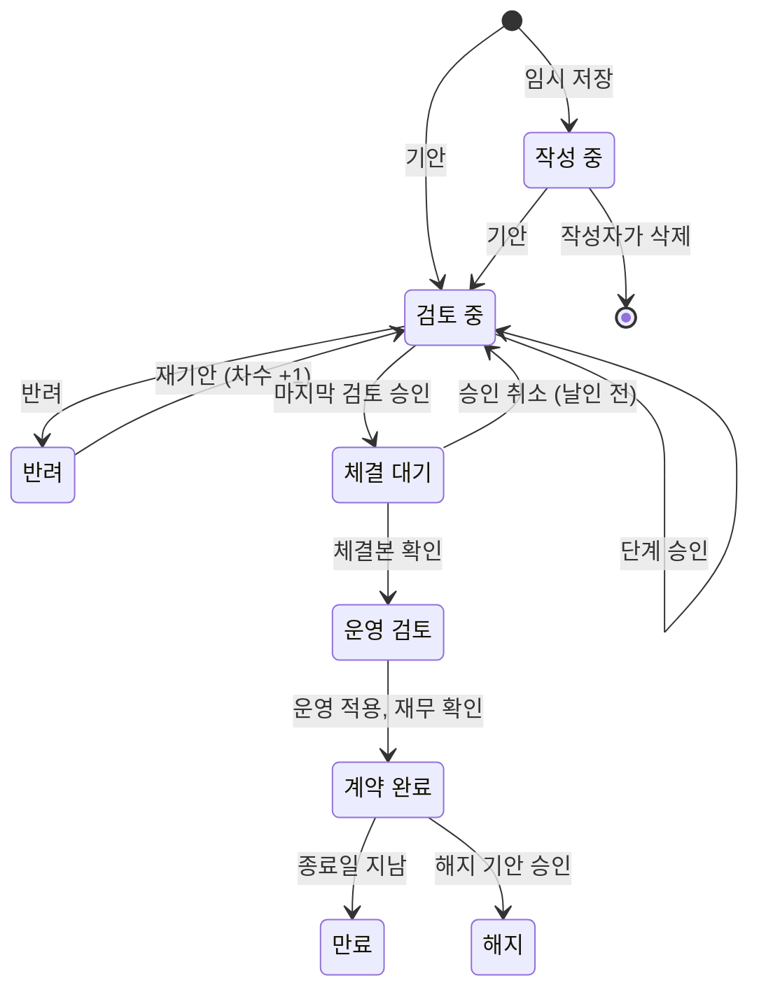

# CLIMB 데이터 정의서

| 항목 | 내용 |
|---|---|
| 문서 버전 | v0.4 (초안) |
| 최종 수정일 | 2026-10-20 |
| 정리 | Claude (프로토타입과 요구사항 정의서 v0.17을 바탕으로 작성) |
| 편집 | 기획자가 Obsidian으로 직접 고치고, 고친 내용을 바탕으로 함께 논의. 화면을 고치면서 데이터도 바뀌어야 하면 Claude가 이 문서를 함께 고치고 변경 이력에 남김(기획자 요청, 2026-10-20) |
| 대상 독자 | 기획자, 사내 개발팀 |
| 관련 문서 | [01_요구사항정의서.md](01_요구사항정의서.md), [02_화면목록.md](02_화면목록.md) |

## 이 문서 읽는 법

화면 목록이 "어떤 화면이 있는지"를 적은 문서라면, 이 문서는 **"어떤 항목에 어떤 값이 들어갈 수 있는지"**를 적은 문서입니다. 개발팀은 이 문서를 보고 데이터베이스(DB) 표를 만들고, 잘못된 값이 들어오지 못하게 막는 검사를 만듭니다.

**값 종류 4가지**

| 값 종류 | 뜻 | 예 |
|---|---|---|
| 자유 입력 | 사람이 직접 쓰는 글자, 숫자, 날짜. 형식 규칙만 정함 | 검토 요청 사항, 금액, 계약일 |
| 코드값 | 정해진 목록(코드표, 9장)에 있는 값만 들어감 | 상태, 서비스, 계약 방식 |
| 목록 참조 | 다른 데이터 묶음(예: 거래처, 사용자)에서 골라 연결함 | 고객사, 영업 대표 |
| 계산값 | 다른 값으로 만들어 보여 줌. 따로 입력하지 않음 | 현재 진행, 할인율, 계약 금액 총액 |

**상태 표시**는 요구사항 정의서와 같습니다. [확정] 기획자가 정함 / [가정] 임시 기본안 / [미정] 결정 필요.

**코드값 원칙**

- 코드는 영문 대문자로 짓고(예: `IN_REVIEW`), 화면에 보이는 이름(예: 검토 중)과 나눕니다. 화면 이름을 바꿔도 DB에 저장된 코드는 그대로입니다. 예: v0.13에서 "체결 완료"를 "계약 완료"로 바꿀 때 코드 `ACTIVE`는 그대로 두었습니다.
- 한 번 쓴 코드는 지우지 않습니다. 더 이상 쓰지 않으면 "사용 안 함"으로 돌립니다. 지우면 지난 기록의 뜻이 사라집니다.
- 누가 목록을 바꾸는지 코드표마다 적습니다. **시스템 고정**(개발팀이 바꿈, 업무 흐름과 묶인 값)과 **관리자 관리**(관리자 화면에서 추가, 사용 중지)로 나눕니다.

**항목 코드**는 개발팀이 DB 칸 이름으로 쓸 영문 이름의 제안입니다. 개발팀 규칙에 맞게 바꿔도 되지만, 바꾸면 이 문서도 함께 고칩니다.

## 변경 이력

| 버전 | 날짜 | 변경 내용 |
|---|---|---|
| v0.1 | 2026-10-20 | 초안: 데이터 묶음 목록, 개요 화면 항목, 계약, 계약 제품, 결재 단계, 거래처, 사용자 계정, 가격 기준, 코드표 12개, 계약 상태 전이표 |
| v0.2 | 2026-10-20 | 요구사항 정의서 v0.17 결정 반영: 거래처 목록 확정(D-01), 부서 목록 확정(D-02, CODE-DEPT), 서비스 3단계 분류(CODE-SERVICE), 임시 저장 삭제(D-05), 해지 기안(D-06, CODE-CONTRACT-KIND에 TERMINATE), 결재 기록과 승인 취소(approval_history, CODE-APPROVAL-ACTION), 사후관리 기록(aftercare_note), 첨부 파일 형식과 50MB(CODE-FILE-KIND), 가격 기준 적용 시작일, 영구 보관 |
| v0.3 | 2026-10-20 | 결재 화면(SCR-20~23)을 만들며 반영: 결재 기록에 기안(SUBMIT)도 한 줄로 남김, 대신 처리한 사람 칸(on_behalf_of, 대리 결재는 미정), 승인 취소 사유는 의견 칸에 함께, 승인 취소 뒤 다시 차례가 된 단계의 도착일시 규칙 |
| v0.4 | 2026-10-20 | 용어 변경: "할인율 캡"을 "할인율 한도"로(요구사항 정의서 REQ-UI-18). 항목 코드(`discount_cap`, `chk_cap`)는 그대로. 할인율의 화면 표시와 금액의 원 표기 추가 |

---

## 1. 데이터 묶음 한눈에 보기

데이터 묶음은 DB의 표(테이블) 하나에 해당합니다. **보존:** 모든 데이터 묶음은 계약이 끝난 뒤에도 지우지 않고 영구 보관합니다(요구사항 정의서 REQ-FLOW-30). 단, 기안 전 임시 저장한 계약만 작성자가 지울 수 있습니다(REQ-FLOW-31).

| 데이터 묶음 | 영문 이름(제안) | 담는 것 | 관련 화면 | 상태 |
|---|---|---|---|---|
| 계약 | `contract` | 계약 한 건의 기본 정보, 상태, 체크리스트 답 | SCR-01, SCR-11, SCR-41 | 가정 |
| 계약 제품 | `contract_product` | 계약에 넣은 제품 줄(제품, 수량, 금액) | SCR-11 | 가정 |
| 연도별 금액 | `contract_yearly_amount` | 1년이 넘는 계약의 해마다 금액 | SCR-11 | 가정 |
| 결재 단계 | `approval_step` | 계약마다 ②~⑪ 단계의 담당자, 지금 처리 상태 | SCR-01, SCR-23 | 가정 |
| 결재 기록 | `approval_history` | 승인, 반려, 승인 취소를 한 일마다 한 줄. 수정, 삭제 불가 | SCR-23, SCR-42 | 확정 |
| 첨부 파일 | `attachment` | 계약서 초안, 최종 견적서, 체결본, 해지 관련 서류 | SCR-11, SCR-32 | 확정 (형식, 크기) |
| 사후관리 기록 | `aftercare_note` | 계약 완료 뒤 담당자 변경과 특이사항. 수정, 삭제 불가 | SCR-42 | 확정 |
| 거래처 | `customer` | 고객사(거래처) 목록. 상호와 사업자등록번호 | SCR-11, 거래처 관리 | 확정 (D-01) |
| 사용자 계정 | `user_account` | CLIMB을 쓰는 사람의 계정 정보 | SCR-51 | 가정 |
| 사용자 역할 | `user_role` | 사람마다 가진 역할(여러 개 가능) | SCR-51 | 가정 |
| 가격 기준 | `price_book` | 제품별 표준 단가와 할인율 한도. 적용 시작일별로 한 줄 | SCR-11, SCR-54 | 확정 (적용 시작일) |
| 접속 기록 | `access_log` | 로그인, 열람, 등록, 수정, 결재, 내려받기, 인쇄 기록 | SCR-51 | 가정 (REQ-AUTH-13) |
| 코드표 | `code` | 9장의 모든 코드값(부서, 서비스 3단계 포함) | 전체, 코드 관리 | 가정 |

## 2. 개요 화면 항목 (SCR-01)

개요 화면의 표에 보이는 항목입니다. 화면 항목은 따로 저장하지 않고, 아래 "가져오는 곳"의 값을 보여 줍니다.

**진행 상세 표**

| 화면 이름 | 값 종류 | 값 규칙 | 가져오는 곳 | 상태 |
|---|---|---|---|---|
| 고객사 | 목록 참조 | 거래처 이름. 열람 제한 계약은 "열람 제한 계약"으로 가림(REQ-AUTH-09) | `contract.customer_id` → `customer.name` | 확정 (D-01) |
| 서비스 | 코드값, 여러 개 | `CODE-SERVICE`. 여러 개면 쉼표로 나열. [미정 D-10] 대분류, 중분류, 소분류 중 어느 단계 이름을 보여 줄지 | `contract.services` | 가정 |
| 상태 | 코드값 | `CODE-CONTRACT-STATUS`. 사람이 고르지 않고 업무 진행에 따라 바뀜(10장) | `contract.status` | 확정 |
| 현재 진행 | 계산값 | 상태 + 지금 결재 단계 + 지난 일수. 예: "법무 검토 중 (4일째)", "체결본 등록 대기 (승인 후 18일)" | `contract.status`, `approval_step` | 확정 |

**만료 임박 표**

| 화면 이름 | 값 종류 | 값 규칙 | 가져오는 곳 | 상태 |
|---|---|---|---|---|
| 남은 일자 | 계산값 | 만료일 − 오늘. 90일 이내만 표시. D-30 이내 Pink, D-60 이내 Purple, 그 외 Blue | `contract.end_date` | 확정 |
| 고객사, 서비스 | (위와 같음) | | | |
| 만료일 | 자유 입력(날짜) | 계약 종료일 | `contract.end_date` | 확정 |
| 담당자 | 목록 참조 | 영업 대표 이름 | `contract.sales_rep_id` → `user_account.name` | 확정 |

**내가 검토할 계약 표** (결재 역할)

| 화면 이름 | 값 종류 | 값 규칙 | 가져오는 곳 | 상태 |
|---|---|---|---|---|
| 요청자 | 목록 참조 | 기안한 영업 대표 이름 | `contract.sales_rep_id` | 가정 |
| 대기 | 계산값 | 지금 단계에 도착한 날부터 오늘까지 일수. 5일 이상이면 강조 | `approval_step.arrived_at` | 가정 |
| 결재 단계 | 계산값 | "3단계 중 2단계" | `approval_step` | 가정 |

## 3. 계약 (`contract`)

새 계약 등록(SCR-11) 입력 항목(요구사항 정의서 3.4)과 업무 진행 중 시스템이 채우는 항목입니다.

**기본 정보**

| 항목 코드 | 항목 이름 | 값 종류 | 필수 | 형식, 규칙 | 누가 정하나 | 관련 요구사항 |
|---|---|---|---|---|---|---|
| `contract_no` | 계약번호 | 계산값 | 기안 때 | 신규 `CT-연도-일련번호 4자리`(예: CT-2026-0412). 변경 `원계약번호-A01`, 갱신 `원계약번호-R01` | 시스템이 기안 때 부여 | REQ-REG-09, REQ-FLOW-18 |
| `draft_key` | 임시 저장 번호 | 계산값 | 임시 저장 때 | `D-일련번호 4자리`(예: D-0001). 기안하면 계약번호로 바뀜 | 시스템 | REQ-FLOW-14 |
| `kind` | 계약 구분 | 코드값 | 필수 | `CODE-CONTRACT-KIND` | 영업 | 3.4 |
| `parent_contract_no` | 원계약 | 목록 참조 | 변경, 갱신일 때 | 계약 완료 상태인 계약에서 고름 | 영업 | REQ-REG-08 |
| `customer_id` | 고객사(거래처) | 목록 참조 | 필수 | 거래처 목록에서 고름. 없으면 상호와 사업자등록번호로 새로 등록(D-01 확정). 지금 시안의 새 계약 등록 화면은 아직 자유 입력이라 바꿀 예정 | 영업 | REQ-REG-18 |
| `sales_rep_id` | 영업 대표 | 목록 참조 | 필수 | 로그인한 사람으로 자동 입력 | 시스템 | 3.4 |
| `opportunity_no` | 영업 기회 번호 | 자유 입력 | 선택 | 기존 CRM의 영업 기회 번호(예: OPP-2026-0311) | 영업 | REQ-SCOPE-03 |
| `contract_type` | 계약 유형 | 코드값 | 필수 | `CODE-CONTRACT-TYPE` | 영업 | 3.4 |
| `method` | 계약 방식 | 코드값 | 필수 | `CODE-METHOD` | 영업 | C-10 |
| `contract_date` | 계약일 | 자유 입력(날짜) | 필수 | YYYY-MM-DD | 영업 | 3.4 |
| `start_date` | 계약 시작일 | 자유 입력(날짜) | 필수 | | 영업 | 3.4 |
| `end_date` | 계약 종료일 | 자유 입력(날짜) | 필수 | 시작일보다 늦어야 함 | 영업 | REQ-REG-12 |
| `service_start_date`, `service_end_date` | 서비스 기간 | 자유 입력(날짜) | 선택 | 계약 기간과 다를 때만 | 영업 | 3.4 |
| `auto_renew` | 자동갱신 | 코드값 | 필수 | `CODE-YES-NO` | 영업 | 3.4 |
| `notice_days` | 해지 통지 기한 | 자유 입력(숫자) | 자동갱신이면 필수 | 만료 며칠 전. 1 이상 정수 | 영업 | 3.4 |
| `personal_data` | 개인정보 처리 | 코드값 | 필수 | `CODE-YES-NO`. 예면 결재선에 ④ 개인정보 검토가 들어감 | 영업 | 3.5 |
| `restricted` | 열람 제한 | 코드값 | 선택 | `CODE-YES-NO`. 기본 아니오 | 영업, 관리자 | REQ-AUTH-07~09 |
| `terminate_date` | 해지일 | 자유 입력(날짜) | 해지 기안이면 필수 | 계약 기간 안의 날짜 | 영업 | REQ-FLOW-29 |
| `terminate_reason` | 해지 사유 | 자유 입력 | 해지 기안이면 필수 | | 영업 | REQ-FLOW-29 |

**금액과 정산**

| 항목 코드 | 항목 이름 | 값 종류 | 필수 | 형식, 규칙 | 누가 정하나 | 관련 요구사항 |
|---|---|---|---|---|---|---|
| `services` | 서비스 | 계산값(코드값 여러 개) | 자동 | 계약 제품의 서비스를 모음. `CODE-SERVICE` | 시스템 | REQ-REG-17 |
| `total_amount` | 계약 금액 총액 | 계산값 | 자동 | 계약 제품 금액의 합. 원, 부가세 별도 | 시스템 | REQ-REG-04 |
| `settlement` | 정산 방식 | 코드값 | 필수 | `CODE-SETTLEMENT` | 영업 | C-10 |
| `ledger_link` | 수불부 연동 | 코드값 | 선택 | `CODE-YES-NO` [미정 형식] | 영업 | 3.4 |
| `tax_invoice` | 세금계산서 | 자유 입력 | 선택 | [미정 형식] | 영업 | 3.4 |
| `purchase` | 매입 | 자유 입력 | 선택 | [미정 형식] | 영업 | 3.4 |

**체크리스트와 메모**

| 항목 코드 | 항목 이름 | 값 종류 | 필수 | 형식, 규칙 | 누가 정하나 | 관련 요구사항 |
|---|---|---|---|---|---|---|
| `chk_standard` | 1. 표준계약서 사용 | 코드값 | 필수 | `CODE-YES-NO` | 영업 | 3.5 |
| `chk_standard_note` | 1번 비고 | 자유 입력 | 아니오면 필수 | | 영업 | REQ-REG-06 |
| `chk_price` | 2. 표준단가표 적용 | 계산값 | 자동 | `CODE-CHECK-ANSWER`. 할인한 제품이 하나라도 있으면 NO | 시스템 | REQ-CHK-04 |
| `chk_price_note` | 2번 비고 | 자유 입력 | 아니오면 필수 | | 영업 | REQ-REG-06 |
| `chk_cap` | 3. 할인율 한도 준수 | 계산값 | 자동 | `CODE-CHECK-ANSWER`. 한도를 넘긴 제품이 하나라도 있으면 NO | 시스템 | REQ-CHK-04 |
| `chk_cap_note` | 3번 비고 | 자유 입력 | 아니오면 필수 | | 영업 | REQ-REG-06 |
| `memo` | 검토 요청 사항 | 자유 입력 | 선택 | 검토자에게 전할 말 | 영업 | 3.4 |

**진행 정보 (시스템이 채움)**

| 항목 코드 | 항목 이름 | 값 종류 | 형식, 규칙 | 관련 요구사항 |
|---|---|---|---|---|
| `status` | 상태 | 코드값 | `CODE-CONTRACT-STATUS`. 10장 전이표대로만 바뀜 | REQ-FLOW-13 |
| `round` | 기안 차수 | 계산값(숫자) | 처음 기안 1, 반려 후 재기안할 때마다 1씩 늘어남 | REQ-FLOW-17 |
| `ops_step` | 운영 검토 차례 | 코드값 | `CODE-OPS-STEP`. 상태가 운영 검토일 때만 | REQ-FLOW-28 |
| `saved_at` | 임시 저장일시 | 계산값(일시) | | REQ-FLOW-14 |
| `requested_at` | 기안일시 | 계산값(일시) | 재기안하면 새 차수의 기안일시 | REQ-FLOW-17 |
| `approved_at` | 승인일시 | 계산값(일시) | 계약 검토 마지막 단계 승인 때 | REQ-FLOW-04 |
| `signed_at` | 체결본 등록일시 | 계산값(일시) | ⑦ 체결본 등록 때 | REQ-FLOW-05 |
| `completed_at` | 계약 완료일시 | 계산값(일시) | ⑨ 운영 적용과 ⑩ 재무 확인이 모두 끝났을 때 | REQ-FLOW-27, 28 |
| `terminated_at` | 해지일시 | 계산값(일시) | 해지 기안이 승인되어 원계약이 해지 상태가 된 때 | REQ-FLOW-29 |

## 4. 계약 제품 (`contract_product`)과 연도별 금액 (`contract_yearly_amount`)

**계약 제품** (계약 1건에 여러 줄)

| 항목 코드 | 항목 이름 | 값 종류 | 필수 | 형식, 규칙 | 관련 요구사항 |
|---|---|---|---|---|---|
| `product_code` | 제품 | 목록 참조 | 필수 (비밀유지계약은 없어도 됨) | 가격 기준(`price_book`)에서 고름 | REQ-REG-03 |
| `qty` | 수량 | 자유 입력(숫자) | 필수 | 1 이상 정수 | REQ-REG-03 |
| `amount` | 계약 금액 | 자유 입력(숫자) | 필수 | 0 이상, 원, 부가세 별도. 화면에는 "28,800,000원"처럼 원을 붙여 보여 줌 | REQ-REG-03, REQ-UI-17 |
| `end_user` | 사용 업체 | 자유 입력 | 선택 | 계약 상대방과 다를 때만 | 3.4 |
| `list_amount` | 표준 금액 | 계산값 | 자동 | 표준 단가 x 수량. 기안 당시 가격 기준으로 저장(나중에 가격 기준이 바뀌어도 그대로) | REQ-CHK-04 |
| `discount_rate` | 할인율 | 계산값 | 자동 | (표준 금액 − 계약 금액) ÷ 표준 금액. 0보다 작으면 0. 화면에는 0이면 "표준 단가", 아니면 "25% 할인"처럼 보여 줌 | REQ-CHK-04, REQ-REV-02 |

**연도별 금액** (계약 기간이 1년을 넘을 때)

| 항목 코드 | 항목 이름 | 값 종류 | 필수 | 형식, 규칙 | 관련 요구사항 |
|---|---|---|---|---|---|
| `year_no` | 연차 | 계산값 | 자동 | 1년차, 2년차. 계약 기간을 시작일부터 1년씩 나눔 | REQ-REG-05 |
| `period_start`, `period_end` | 기간 | 계산값 | 자동 | | REQ-REG-05 |
| `amount` | 금액 | 자유 입력(숫자) | 필수 | 연도별 합계가 계약 금액 총액과 같아야 기안 가능 | REQ-FLOW-21 |

## 4-1. 첨부 파일 (`attachment`)

계약 1건, 기안 차수 1번마다 여러 개. 기안한 뒤에는 그 차수의 첨부를 바꾸거나 지울 수 없습니다(REQ-FLOW-12, 17).

| 항목 코드 | 항목 이름 | 값 종류 | 필수 | 형식, 규칙 | 관련 요구사항 |
|---|---|---|---|---|---|
| `contract_no`, `round` | 계약번호, 기안 차수 | 목록 참조 | 자동 | 어느 계약의 몇 차 기안 때 올렸는지 | REQ-FLOW-17 |
| `file_kind` | 파일 종류 | 코드값 | 필수 | `CODE-FILE-KIND` | REQ-REG-15 |
| `file_name` | 파일 이름 | 자유 입력 | 필수 | 올린 파일 이름 그대로 | REQ-REG-15 |
| `file_size` | 크기 | 계산값 | 자동 | 50MB 이하 | REQ-REG-15 |
| `uploaded_by`, `uploaded_at` | 올린 사람, 일시 | 계산값 | 자동 | | REQ-AUTH-13 |

허용 형식(확정): 계약서 초안과 최종 견적서는 PDF, Word(doc, docx), 한글(hwp, hwpx). 체결본은 PDF와 스캔 이미지(JPG, PNG). 내려받으면 접속 기록에 남깁니다(REQ-AUTH-15).

## 4-2. 사후관리 기록 (`aftercare_note`)

계약 완료 뒤 결재 없이 남기는 기록입니다. 남긴 기록은 수정, 삭제할 수 없습니다(REQ-FLOW-06, 19).

| 항목 코드 | 항목 이름 | 값 종류 | 필수 | 형식, 규칙 | 관련 요구사항 |
|---|---|---|---|---|---|
| `contract_no` | 계약번호 | 목록 참조 | 자동 | | REQ-FLOW-06 |
| `note_type` | 기록 종류 | 코드값 | 필수 | `CODE-AFTERCARE-TYPE` | REQ-FLOW-06 |
| `content` | 내용 | 자유 입력 | 필수 | 담당자 변경이면 바뀐 담당자와 연락처, 특이사항이면 있었던 일 | REQ-FLOW-06 |
| `written_by`, `written_at` | 남긴 사람, 일시 | 계산값 | 자동 | | REQ-FLOW-19 |

## 5. 결재 단계 (`approval_step`)

계약 1건, 기안 차수 1번마다 여러 줄이 생깁니다. 이 묶음은 단계마다 "지금 상태"를 담고, 실제로 한 일(승인, 반려, 승인 취소)은 결재 기록(`approval_history`)에 한 줄씩 쌓습니다. 결재 기록은 **수정, 삭제할 수 없습니다**(REQ-FLOW-12).

순서(확정, REQ-STEP-04): ② 체크리스트 검토 → ③ 법무 검토와 ④ 개인정보 검토 **동시** → ⑤ 영업 검토. 그래서 ③과 ④는 함께 "차례"(PENDING)일 수 있습니다. 결재선은 체크리스트 답과 개인정보 처리 여부로만 정하고 금액 기준은 없습니다(REQ-CHK-05).

| 항목 코드 | 항목 이름 | 값 종류 | 형식, 규칙 | 관련 요구사항 |
|---|---|---|---|---|
| `contract_no`, `round` | 계약번호, 기안 차수 | 목록 참조 | 어느 계약의 몇 차 기안인지 | REQ-FLOW-17 |
| `step` | 세부 단계 | 코드값 | `CODE-STEP` | 3.2 |
| `assignee_role` | 담당 역할 | 코드값 | `CODE-ROLE` | 3.6 |
| `assignee_id` | 담당자 | 목록 참조 | 사용자 계정 | 3.6 |
| `state` | 처리 상태 | 코드값 | `CODE-APPROVAL-STATE` | 3.5 |
| `skip_reason` | 생략 사유 | 계산값 | 체크리스트 답에 따라 생략된 이유(예: 표준계약서를 그대로 씀) | REQ-REG-07 |
| `arrived_at` | 도착일시 | 계산값(일시) | 이 단계 차례가 된 때. 대기 일수 계산에 씀. 앞 단계 승인이 취소되어 다시 대기가 되면 비우고, 다시 차례가 되면 그때로 새로 정함 | REQ-DASH-05 |
| `decided_at` | 처리일시 | 계산값(일시) | 마지막으로 승인 또는 반려한 때. 승인을 취소하면 비움 | REQ-DOC-02 |
| `decided_by` | 처리한 사람 | 목록 참조 | 담당자 본인. 대리 결재는 [미정] | REQ-DOC-02 |

**결재 기록 (`approval_history`)** [확정] 한 일마다 한 줄, 수정, 삭제 불가

| 항목 코드 | 항목 이름 | 값 종류 | 필수 | 형식, 규칙 | 관련 요구사항 |
|---|---|---|---|---|---|
| `contract_no`, `round`, `step` | 계약, 차수, 단계 | 목록 참조 | 자동 | 어느 결재 단계에서 한 일인지. 기안은 단계 `S01` | REQ-FLOW-12 |
| `action` | 한 일 | 코드값 | 필수 | `CODE-APPROVAL-ACTION` | REQ-DOC-06 |
| `actor_id`, `acted_at` | 한 사람, 일시 | 계산값 | 자동 | | REQ-DOC-02 |
| `comment` | 의견, 사유 | 자유 입력 | 승인이면 선택, 반려면 필수(반려 사유), 승인 취소면 필수(취소 사유) [가정] | REQ-DOC-06, 07 |
| `on_behalf_of` | 대신 처리한 담당자 | 목록 참조 | 담당자가 아닌 사람이 처리했을 때 원래 담당자. [미정] 대리 결재를 둘지. 프로토타입은 슈퍼관리자 시연용으로만 씀 | REQ-REV-08 |

승인 취소 규칙(확정): 다음 단계 결재자가 아직 처리하지 않았을 때만 승인한 본인이 취소할 수 있습니다. 취소하면 그 단계는 다시 "차례"가 되고, 처음 승인한 줄과 취소한 줄이 모두 남습니다.

계산 규칙: 결재 단계의 지금 상태(`approval_step`)는 결재 기록을 시간 순서대로 다시 적용하면 언제나 같은 결과가 나옵니다. 프로토타입은 이 방식으로 상태를 만듭니다(`common.js`의 buildReview). 실제 시스템은 상태를 저장해 두되, 기록과 어긋나지 않게 서버에서 같은 규칙으로 검사합니다.

## 6. 거래처 (`customer`) [확정 D-01]

고객사는 거래처 목록에서 고릅니다(기획자 결정, REQ-REG-18). "한빛대"와 "한빛대학교"가 다른 고객사로 쌓여 변경 계약 묶음과 만료 집계가 어긋나는 것을 막기 위해서입니다. 목록에 없으면 영업이 새 거래처를 등록하고, 관리자가 거래처 관리 화면에서 고치거나 합칩니다[가정].

| 항목 코드 | 항목 이름 | 값 종류 | 필수 | 형식, 규칙 |
|---|---|---|---|---|
| `customer_id` | 거래처 번호 | 계산값 | 자동 | 시스템이 부여 |
| `name` | 상호 | 자유 입력 | 필수 | 사업자등록증의 상호 |
| `biz_no` | 사업자등록번호 | 자유 입력 | 필수 | 000-00-00000. **중복 불가**(같은 번호로 두 번 등록 못 함) |
| `customer_type` | 거래처 구분 | 코드값 | 선택 | [미정] 예: 대학, 병원, 공공기관, 기업 |
| `registered_by`, `registered_at` | 등록한 사람, 일시 | 계산값 | 자동 | |
| `use_yn` | 사용 여부 | 코드값 | 자동 | 지우지 않고 사용 안 함으로 |

## 7. 사용자 계정 (`user_account`)과 사용자 역할 (`user_role`)

사용자 권한 관리(SCR-51) 화면의 항목입니다(요구사항 정의서 4.2).

| 항목 코드 | 항목 이름 | 값 종류 | 필수 | 형식, 규칙 | 누가 정하나 | 관련 요구사항 |
|---|---|---|---|---|---|---|
| `email` | 이메일(계정) | 자유 입력 | 필수 | @muhayu.com 주소만. **중복 불가**. 계정의 고유 값 | 관리자 | REQ-ENV-03 |
| `name` | 이름 | 자유 입력 | 필수 | | 관리자 | REQ-ADM-02 |
| `dept` | 부서 | 코드값 | 필수 | `CODE-DEPT`. 부서 목록에서 고름(D-02 확정) | 관리자 | REQ-ADM-09 |
| `roles` | 권한(역할) | 코드값, 여러 개 | 필수 | `CODE-ROLE`. 한 사람이 여러 역할 가능(별도 묶음 `user_role`에 한 줄씩) | 관리자 | REQ-AUTH-05 |
| `status` | 상태 | 코드값 | 자동 | `CODE-ACCOUNT-STATUS` | 시스템, 관리자 | REQ-ADM-06 |
| `registered_at` | 등록일 | 계산값(날짜) | 자동 | 관리자가 계정을 추가한 날 | 시스템 | REQ-ADM-02 |
| `first_login_at` | 최초 접속일시 | 계산값(일시) | 자동 | 접속 기록에서 | 시스템 | REQ-ADM-02 |
| `last_login_at` | 최종 로그인일시 | 계산값(일시) | 자동 | 접속 기록에서 | 시스템 | REQ-ADM-02 |
| `last_logout_at` | 최종 로그아웃일시 | 계산값(일시) | 자동 | 접속 기록에서 [미정 D-08 시간 초과로 끝난 경우] | 시스템 | REQ-ADM-02 |
| `role_changed_at` | 권한 변경일 | 계산값(날짜) | 자동 | 역할을 마지막으로 바꾼 날. 바꾼 사람과 내용은 변경 이력에 | 시스템 | REQ-ADM-08 |

## 8. 가격 기준 (`price_book`)

가격 기준 관리(SCR-54)에서 관리자가 관리합니다. 영업, 세일즈어드민, 관리자만 볼 수 있습니다(REQ-SCOPE-02). 프로토타입의 값은 가상입니다.

| 항목 코드 | 항목 이름 | 값 종류 | 필수 | 형식, 규칙 |
|---|---|---|---|---|
| `product_code` | 제품 코드 | 자유 입력 | 필수 | 영문 대문자와 하이픈(예: CK-ORG). **중복 불가** |
| `service` | 서비스 | 코드값 | 필수 | `CODE-SERVICE` |
| `name` | 제품 이름 | 자유 입력 | 필수 | 예: CK 기관 라이선스 |
| `unit` | 단위 | 자유 입력 | 필수 | 예: 기관, 1년 / 100명, 1년 |
| `list_price` | 표준 단가 | 자유 입력(숫자) | 필수 | 원, 부가세 별도 |
| `discount_cap` | 할인율 한도 | 자유 입력(숫자) | 필수 | 0~100%. 이 비율까지 할인 가능. 검토 화면에는 보여 주지 않음(REQ-REV-02) |
| `valid_from` | 적용 시작일 | 자유 입력(날짜) | 필수 | 이 날 이후 기안하는 계약부터 이 줄의 기준을 씀(확정, REQ-CHK-07). 값을 바꿀 때는 기존 줄을 고치지 않고 새 적용 시작일로 새 줄을 더함 |
| `changed_by`, `changed_at` | 바꾼 사람, 일시 | 계산값 | 자동 | 가격 기준 이력 |
| `use_yn` | 사용 여부 | 코드값 | 자동 | 지우지 않고 사용 안 함으로 |

---

## 9. 코드표

코드표마다 **누가 바꾸는지**를 적었습니다. 시스템 고정은 업무 흐름과 묶여 있어 바꾸려면 개발이 필요합니다.

### CODE-CONTRACT-STATUS 계약 상태 [확정] 시스템 고정

| 코드 | 화면 이름 | 업무 단계 | 배지 색 | 뜻 |
|---|---|---|---|---|
| `DRAFT` | 작성 중 | 1 계약 등록 | Gray | 임시 저장, 기안 전. 작성자만 봄 |
| `IN_REVIEW` | 검토 중 | 2 계약 검토 | Blue | 기안 뒤 결재 진행 중 |
| `REJECTED` | 반려 | 2 계약 검토 | Pink | 반려되어 기안자의 보완을 기다림 |
| `APPROVED` | 체결 대기 | 3 계약 체결 | Purple | 승인 완료. 인장 날인, 상대방 서명, 체결본 등록과 확인 |
| `OPS_REVIEW` | 운영 검토 | 4 운영 검토 | Blue | 운영 적용(CEM), 재무 확인 |
| `ACTIVE` | 계약 완료 | 5 계약 완료 | Green | 모든 절차 끝, 보관함에 보관, 계약 기간 중 |
| `EXPIRED` | 만료 | 5 계약 완료 | Gray | 계약 종료일이 지남 |
| `TERMINATED` | 해지 | 5 계약 완료 | Gray | 계약 기간 중 해지 [미정 D-06 절차] |

### CODE-SERVICE 서비스 [확정: 3단계 구조 / 미정: 목록 값] 관리자 관리

서비스는 **대분류, 중분류, 소분류 3단계**로 나눕니다(요구사항 정의서 REQ-REG-17). 아래 중분류, 소분류는 기획자가 든 예이고, 전체 목록은 기획자가 엑셀로 전달하면 채웁니다(D-09). 코드는 [가정]입니다.

| 코드 | 화면 이름 | 단계 | 상위 코드 |
|---|---|---|---|
| `CK` | CK(카피킬러) | 대분류 | |
| `HR` | HR | 대분류 | |
| `ETC` | 기타 | 대분류 | |
| `CK_CAMPUS` | 카피킬러 캠퍼스 | 중분류 | `CK` |
| `CK_SCHOOL` | 카피킬러 스쿨 | 중분류 | `CK` |
| `CK_CONTEST` | 카피킬러 콘테스트 | 중분류 | `CK` |
| `HR_PRISM` | 프리즘 | 중분류 | `HR` |
| `HR_MONSTER` | 몬스터 | 중분류 | `HR` |
| `HR_PRISM_Q` | 프리즘Q | 소분류 | `HR_PRISM` |

지금 시안은 대분류 `CK`, `HR`만 씁니다. [미정 D-10] 제품(가격 기준)을 어느 단계에 연결할지, 화면에는 어느 단계 이름을 보여 줄지.

### CODE-CONTRACT-KIND 계약 구분 [확정] 시스템 고정

| 코드 | 화면 이름 | 뜻 |
|---|---|---|
| `NEW` | 신규 | 처음 맺는 계약 |
| `AMEND` | 변경 | 원계약의 내용을 바꾸는 계약. 번호 끝에 -A01 |
| `RENEW` | 갱신 | 원계약을 이어 가는 계약. 번호 끝에 -R01 |
| `TERMINATE` | 해지 | 원계약을 기간 중에 끝내는 기안. 번호 끝에 -T01 [가정]. 승인되면 원계약이 해지 상태가 됨(REQ-FLOW-29) |

### CODE-CONTRACT-TYPE 계약 유형 [가정] 관리자 관리

| 코드 | 화면 이름 |
|---|---|
| `SAAS` | SaaS 이용계약 |
| `NDA` | 비밀유지계약(NDA) |
| `RESELLER` | 리셀러 계약 |
| `DPA` | 개인정보 처리위탁 계약 |
| `ETC` | 기타 |

참고: 프로토타입은 아직 코드 대신 화면 이름을 그대로 저장합니다. [미정 D-03] 유형 목록 확정.

### CODE-METHOD 계약 방식 [확정] 관리자 관리

| 코드 | 화면 이름 | 뜻 |
|---|---|---|
| `DIRECT` | 직접 | 고객과 직접 계약 |
| `PROCURE` | 조달 | 조달청 나라장터 등 |
| `RESELLER` | 리셀러 | 총판 경유 |

### CODE-SETTLEMENT 정산 방식 [확정] 관리자 관리

| 코드 | 화면 이름 | 뜻 |
|---|---|---|
| `LUMP` | 일시 | 한 번에 청구 |
| `SPLIT` | 분할 | 나눠서 청구 |
| `POST` | 후불 | 쓴 만큼 나중에 청구 |

### CODE-YES-NO 예, 아니오 [확정] 시스템 고정

| 코드 | 화면 이름 |
|---|---|
| `Y` | 예 (있음) |
| `N` | 아니오 (없음) |

### CODE-CHECK-ANSWER 체크리스트 자동 계산 답 [가정] 시스템 고정

| 코드 | 화면 이름 | 뜻 |
|---|---|---|
| `YES` | 예 | 기준을 지킴 |
| `NO` | 아니오 | 기준을 벗어남. 비고 필수 |
| `NA` | 해당 없음 | 금액이 없는 계약(비밀유지계약 등) |

화면에만 보이는 "계산 대기"(제품을 다 넣기 전)는 저장하지 않습니다.

### CODE-ROLE 역할 [확정] 시스템 고정

| 코드 | 화면 이름 | 하는 일 (요구사항 정의서 4.1) |
|---|---|---|
| `SUPER` | 슈퍼관리자 | 모든 메뉴와 화면, 관리자 일 전부 |
| `ADMIN` | 관리자 | 사용자 권한, 결재선 규칙, 가격 기준, 열람 제한 관리 |
| `SALES` | 영업 | ① 계약 등록과 기안, ⑦ 체결본 등록 |
| `HEAD` | 부서장 | ⑤ 영업 검토 |
| `EXEC` | 영업 담당 임원 | ⑤ 리더 본인 계약의 영업 검토 |
| `SALES_ADMIN` | 세일즈어드민 | ② 체크리스트 검토, ⑧ 체결본 확인 |
| `LEGAL` | 법무 | ③ 법무 검토 |
| `PRIVACY` | 개인정보 담당 | ④ 개인정보 검토 |
| `GA` | 총무 | ⑥ 인장 날인 검토 |
| `CEM` | CEM | ⑨ 운영 적용 |
| `FINANCE` | 재무 | ⑩ 재무 확인 (결재선에는 없음) |

### CODE-ACCOUNT-STATUS 계정 상태 [가정] 시스템 고정

| 코드 | 화면 이름 | 뜻 |
|---|---|---|
| `ACTIVE` | 사용 중 | 로그인한 적이 있음 |
| `INVITED` | 첫 접속 전 | 관리자가 추가했지만 아직 로그인하지 않음 |
| `SUSPENDED` | 사용 중지 | 퇴사, 휴직 등. 지우지 않고 기록 보존 |

### CODE-STEP 세부 단계 [확정] 시스템 고정

| 코드 | 화면 이름 | 업무 단계 | 담당 역할 |
|---|---|---|---|
| `S01` | ① 계약 등록과 기안 | 1 계약 등록 | SALES |
| `S02` | ② 체크리스트 검토 | 2 계약 검토 | SALES_ADMIN |
| `S03` | ③ 법무 검토 | 2 계약 검토 | LEGAL |
| `S04` | ④ 개인정보 검토 | 2 계약 검토 | PRIVACY |
| `S05` | ⑤ 영업 검토 | 2 계약 검토 | HEAD (리더 본인 건은 EXEC) |
| `S06` | ⑥ 인장 날인 검토 | 3 계약 체결 | GA |
| `S07` | ⑦ 상대방 서명, 체결본 등록 | 3 계약 체결 | SALES |
| `S08` | ⑧ 체결본 확인 | 3 계약 체결 | SALES_ADMIN |
| `S09` | ⑨ 운영 적용 | 4 운영 검토 | CEM |
| `S10` | ⑩ 재무 확인 | 4 운영 검토 | FINANCE |
| `S11` | ⑪ 계약 완료 | 5 계약 완료 | 시스템 |

### CODE-APPROVAL-STATE 결재 단계 처리 상태 [가정] 시스템 고정

| 코드 | 화면 이름 | 뜻 |
|---|---|---|
| `WAITING` | 대기 | 앞 단계가 끝나기를 기다림 |
| `PENDING` | 차례 | 지금 이 사람이 처리할 차례 |
| `DONE` | 승인 | 처리 끝 |
| `REJECTED` | 반려 | 반려함. 계약은 반려 상태가 됨 |
| `SKIPPED` | 생략 | 체크리스트 답에 따라 거치지 않음 |

승인을 취소하면 `DONE`이 다시 `PENDING`이 됩니다. 한 일은 `CODE-APPROVAL-ACTION`으로 결재 기록에 남습니다.

### CODE-APPROVAL-ACTION 결재에서 한 일 [확정] 시스템 고정

| 코드 | 화면 이름 | 뜻 |
|---|---|---|
| `SUBMIT` | 기안 | 기안과 재기안. 차수마다 한 줄 [가정] |
| `APPROVE` | 승인 | 의견은 선택 |
| `REJECT` | 반려 | 반려 사유 필수 |
| `CANCEL` | 승인 취소 | 다음 단계가 처리하기 전에만, 승인한 본인이 |

### CODE-FILE-KIND 첨부 파일 종류 [확정] 시스템 고정

| 코드 | 화면 이름 | 허용 형식 |
|---|---|---|
| `DRAFT_DOC` | 계약서 초안 | PDF, doc, docx, hwp, hwpx |
| `QUOTE` | 최종 견적서 | PDF, doc, docx, hwp, hwpx |
| `SIGNED` | 체결본 | PDF, JPG, PNG |
| `TERMINATE_DOC` | 해지 관련 서류 [가정] | PDF, doc, docx, hwp, hwpx, JPG, PNG |

모든 파일은 하나당 50MB까지입니다.

### CODE-AFTERCARE-TYPE 사후관리 기록 종류 [확정] 관리자 관리

| 코드 | 화면 이름 | 뜻 |
|---|---|---|
| `CONTACT_CHANGE` | 담당자 변경 | 영업 담당자나 고객 담당자가 바뀜 |
| `ISSUE` | 특이사항 | 이행 중 생긴 일 |

### CODE-DEPT 부서 [확정: 목록으로 관리 / 가정: 값] 관리자 관리

아래 값은 시연용 가정입니다. 실제 부서 목록은 관리자가 넣습니다(REQ-ADM-09).

| 코드 | 화면 이름 |
|---|---|
| `COMPLIANCE` | 컴플라이언스팀 |
| `EXECUTIVE` | 경영진 |
| `SALES_HQ` | 영업본부 |
| `SALES_1` | 영업1팀 |
| `SALES_2` | 영업2팀 |
| `SALES_3` | 영업3팀 |
| `SALES_ADMIN` | 세일즈어드민팀 |
| `LEGAL` | 법무팀 |
| `INFOSEC` | 정보보호팀 |
| `MGMT_SUPPORT` | 경영지원팀 |
| `CEM` | CEM팀 |
| `FINANCE` | 재무팀 |

### CODE-OPS-STEP 운영 검토 차례 [가정] 시스템 고정

| 코드 | 화면 이름 |
|---|---|
| `CEM` | CEM 운영 적용 중 |
| `FINANCE` | 재무 확인 중 |

---

## 10. 계약 상태 전이표 (`CODE-CONTRACT-STATUS`)

상태는 사람이 직접 고르지 않고, 아래 표의 일이 일어날 때만 바뀝니다. **표에 없는 바뀜은 막습니다**(예: 반려에서 바로 계약 완료로 갈 수 없음).

| 지금 상태 | 다음 상태 | 언제 | 누가 | 관련 요구사항 |
|---|---|---|---|---|
| (없음) | 작성 중 | 임시 저장할 때 | 영업 | REQ-FLOW-14 |
| 작성 중 | (삭제) | 작성자가 지울 때. 기안 전이라 결재 기록이 없음 | 작성자 | REQ-FLOW-31 |
| (없음), 작성 중 | 검토 중 | 기안할 때. 계약번호 부여, 1차 | 영업 | REQ-REG-09 |
| 검토 중 | 검토 중 | 결재 단계 하나를 승인하고 다음 단계가 남았을 때(③과 ④는 동시) | 결재자 | REQ-FLOW-03, REQ-STEP-04 |
| 검토 중 | 검토 중 | 승인한 사람이 다음 단계 처리 전에 승인을 취소할 때 | 승인한 본인 | REQ-DOC-06 |
| 검토 중 | 반려 | 어느 단계에서든 반려할 때 | 결재자 | REQ-DOC-04 |
| 반려 | 검토 중 | 보완 후 재기안할 때. 차수 +1 | 영업 | REQ-FLOW-17 |
| 검토 중 | 체결 대기 | 계약 검토 마지막 단계를 승인할 때 | 결재자 | REQ-FLOW-04 |
| 체결 대기 | 검토 중 | 계약 검토 마지막 단계 승인을 ⑥ 인장 날인 전에 취소할 때 [가정] | 승인한 본인 | REQ-DOC-06 |
| 체결 대기 | 운영 검토 | ⑥ 인장 날인, ⑦ 체결본 등록, ⑧ 체결본 확인이 끝났을 때 | 세일즈어드민 | REQ-FLOW-24, 28 |
| 운영 검토 | 계약 완료 | ⑨ 운영 적용, ⑩ 재무 확인이 끝났을 때 | CEM, 재무 | REQ-FLOW-27, 28 |
| 계약 완료 | 만료 | 계약 종료일이 지났을 때(갱신 없이) | 시스템 | REQ-FLOW-07 |
| 계약 완료 | 해지 | 해지 기안(-T01)을 부서장과 법무가 승인했을 때 | 영업 기안, 부서장과 법무 승인 | REQ-FLOW-29 |

**변경, 갱신 계약**은 원계약의 상태를 바꾸지 않고, 새 계약(번호 -A01, -R01)으로 위 흐름을 처음부터 거칩니다(REQ-FLOW-09).

---

## 11. 확인 필요 사항

| No | 내용 | 관련 | 상태 |
|---|---|---|---|
| D-01 | 고객사를 자유 입력으로 둘지, 거래처 목록(사업자등록번호로 중복 방지)에서 고르게 할지 | 6장, 3장 `customer_id` | 해결 (거래처 목록) |
| D-02 | 부서를 자유 입력으로 둘지, 부서 목록(코드값)으로 둘지 | 7장 `dept` | 해결 (부서 목록, CODE-DEPT) |
| D-03 | 계약 유형 목록 확정 | CODE-CONTRACT-TYPE | 미정 |
| D-04 | 서비스 이름과 목록 | CODE-SERVICE | 해결 (3단계 구조. 값은 D-09) |
| D-05 | 임시 저장한 계약을 작성자가 지울 수 있게 할지 | CODE-CONTRACT-STATUS | 해결 (작성자가 지울 수 있음) |
| D-06 | 해지 절차(누가, 어떤 결재를 거쳐)와 해지 상태로 바뀌는 시점 | 10장 | 해결 (해지 기안, 부서장과 법무 승인) |
| D-07 | 수불부 연동, 세금계산서, 매입의 입력 형식 | 3장 | 미정 |
| D-08 | 로그아웃하지 않고 시간 초과로 끝난 접속을 최종 로그아웃일시에 어떻게 남길지 | 7장 | 미정 |
| D-09 | 서비스 3단계 전체 목록(기획자가 엑셀로 전달 예정) | CODE-SERVICE | 미정 |
| D-10 | 제품(가격 기준)을 서비스 어느 단계에 연결할지, 화면에는 어느 단계 이름을 보여 줄지 | CODE-SERVICE, 8장 | 미정 |
| D-11 | 해지 기안 번호를 -T01로 할지 | CODE-CONTRACT-KIND | 미정 |
