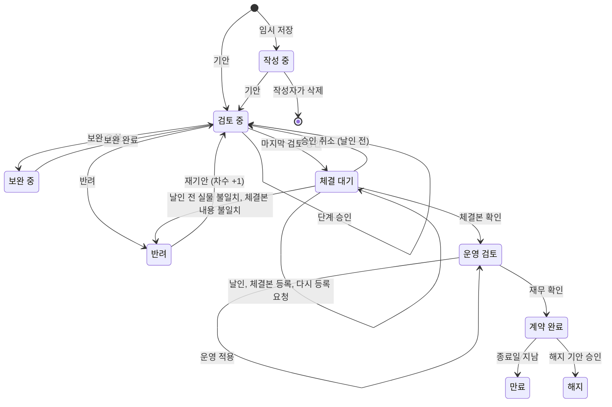

# climb 데이터 정의서

| 항목 | 내용 |
|---|---|
| 문서 버전 | v0.35 (초안) |
| 최종 수정일 | 2026-10-22 |
| 정리 | Claude (프로토타입과 요구사항 정의서 v0.17을 바탕으로 작성) |
| 편집 | 기획자가 Obsidian으로 직접 고치고, 고친 내용을 바탕으로 함께 논의. 화면을 고치면서 데이터도 바뀌어야 하면 Claude가 이 문서를 함께 고치고 변경 이력에 남김(기획자 요청, 2026-10-20) |
| 대상 독자 | 기획자, 사내 개발팀 |
| 관련 문서 | [01_요구사항정의서.md](01_요구사항정의서.md), [02_화면목록.md](02_화면목록.md) |

## 이 문서 읽는 법

화면 목록이 "어떤 화면이 있는지"를 적은 문서라면, 이 문서는 **"어떤 항목에 어떤 값이 들어갈 수 있는지"**를 적은 문서입니다. 개발팀은 이 문서를 보고 데이터베이스(DB) 표를 만들고, 잘못된 값이 들어오지 못하게 막는 검사를 만듭니다.

**값 종류 4가지**

| 값 종류 | 뜻 | 예 |
|---|---|---|
| 자유 입력 | 사람이 직접 쓰는 글자, 숫자, 날짜. 형식 규칙만 정함 | 검토 요청 사항, 금액, 계약 시작일 |
| 코드값 | 정해진 목록(코드표, 9장)에 있는 값만 들어감 | 상태, 서비스, 계약 방식 |
| 목록 참조 | 다른 데이터 묶음(예: 거래처, 사용자)에서 골라 연결함 | 고객사, 영업대표 |
| 계산값 | 다른 값으로 만들어 보여 줌. 따로 입력하지 않음 | 현재 진행, 할인율, 계약 금액 총액 |

**날짜**: 저장과 화면 표시 모두 YYYY-MM-DD(예: 2027-01-01), 일시는 YYYY-MM-DD HH:MM(예: 2026-10-19 14:05)입니다(v0.19, 요구사항 정의서 REQ-UI-25). 날짜 칸은 숫자만 넣고(넣는 대로 '-'가 붙음, v0.23) 달력에서도 고를 수 있습니다(REQ-UI-27).

**상태 표시**는 요구사항 정의서와 같습니다. [확정] 기획자가 정함 / [가정] 임시 기본안 / [미정] 결정 필요.

**코드값 원칙**

- 코드는 영문 대문자로 짓고(예: `IN_REVIEW`), 화면에 보이는 이름(예: 검토 중)과 나눕니다. 화면 이름을 바꿔도 DB에 저장된 코드는 그대로입니다. 예: v0.13에서 "체결 완료"를 "계약 완료"로 바꿀 때 코드 `ACTIVE`는 그대로 두었습니다.
- 한 번 쓴 코드는 지우지 않습니다. 더 이상 쓰지 않으면 "사용 안 함"으로 돌립니다. 지우면 지난 기록의 뜻이 사라집니다.
- 누가 목록을 바꾸는지 코드표마다 적습니다. **시스템 고정**(개발팀이 바꿈, 업무 흐름과 묶인 값)과 **관리자 관리**(관리자 화면에서 추가, 사용 중지)로 나눕니다.

**계약 묶음**은 원계약과 그 뒤의 변경, 연장, 해지, 운영 변경 기안을 함께 부르는 말입니다. 묶음은 원계약의 계약번호로 가리키고, 다른 데이터 묶음에서 계약 묶음을 가리키는 항목 코드는 `bundle_no`로 씁니다(v0.33).

**항목 코드**는 개발팀이 DB 칸 이름으로 쓸 영문 이름의 제안입니다. 개발팀 규칙에 맞게 바꿔도 되지만, 바꾸면 이 문서도 함께 고칩니다.

## 변경 이력

| 버전 | 날짜 | 변경 내용 |
|---|---|---|
| v0.1 | 2026-10-20 | 초안: 데이터 묶음 목록, 개요 화면 항목, 계약, 계약 제품, 결재 단계, 거래처, 사용자 계정, 가격 기준, 코드표 12개, 계약 상태 전이표 |
| v0.2 | 2026-10-20 | 요구사항 정의서 v0.17 결정 반영: 거래처 목록 확정(D-01), 부서 목록 확정(D-02, CODE-DEPT), 서비스 3단계 분류(CODE-SERVICE), 임시 저장 삭제(D-05), 해지 기안(D-06, CODE-CONTRACT-KIND에 TERMINATE), 결재 기록과 승인 취소(approval_history, CODE-APPROVAL-ACTION), 사후관리 기록(aftercare_note), 첨부 파일 형식과 50MB(CODE-FILE-KIND), 가격 기준 적용 시작일, 영구 보관 |
| v0.3 | 2026-10-20 | 결재 화면(SCR-20~23)을 만들며 반영: 결재 기록에 기안(SUBMIT)도 한 줄로 남김, 대신 처리한 사람 칸(on_behalf_of, 대리 결재는 미정), 승인 취소 사유는 의견 칸에 함께, 승인 취소 뒤 다시 차례가 된 단계의 도착일시 규칙 |
| v0.4 | 2026-10-20 | 용어 변경: "할인율 캡"을 "할인율 한도"로(요구사항 정의서 REQ-UI-18). 항목 코드(`discount_cap`, `chk_cap`)는 그대로. 할인율의 화면 표시와 금액의 원 표기 추가 |
| v0.5 | 2026-10-20 | 결재 순서 변경(요구사항 정의서 REQ-STEP-04 v0.20): ② 다음 ③ 영업 검토, 그 다음 ④ 법무와 ⑤ 개인정보 동시. CODE-STEP의 S03, S04, S05 뜻을 바꿈(S03 영업, S04 법무, S05 개인정보. v0.4까지는 S03 법무, S04 개인정보, S05 영업). 역할표와 상태 전이표의 단계 번호 수정 |
| v0.6 | 2026-10-20 | 가격 기준 변경 근거 추가(요구사항 정의서 REQ-CHK-07 v0.21): 사내 품의 문서 링크(`approval_doc_url`, 필수), 품의 번호(`approval_doc_no`), 변경 사유(`change_reason`) |
| v0.7 | 2026-10-20 | 요구사항 정의서 v0.22 반영: 체크리스트 4번(`chk_accounting`, `chk_accounting_note`), 개인정보 분리 예정일(`pi_separate_at`, 계약 종료 10년 뒤), 사후관리 기록에 고객 담당자 이름과 연락처를 적지 않음, 접속 기록 영구 보관 확정, 권한 검토 기록(`access_review`)과 기록 점검 결과(`log_review`) 묶음 추가 |
| v0.8 | 2026-10-20 | 계약 체결과 운영 검토 화면(요구사항 정의서 v0.23, REQ-SIGN)을 만들며 반영: 한 일 코드에 체결본 등록(`REGISTER`)과 다시 등록 요청(`RETURN`) 추가, 결재 기록에 체결본 파일(`attachment_id`), ⑥⑧⑨의 확인 항목은 의견 칸에 함께, ⑨ 다음 ⑩ 순서로 계약 완료일시 규칙 수정, 상태 전이표에 체결 대기 안의 처리와 ⑥⑧ 반려 추가 |
| v0.9 | 2026-10-20 | 보관함 화면(요구사항 정의서 v0.24, REQ-ARC)을 만들며 반영: 갱신 방식(`renew_mode`, `CODE-RENEW-MODE`), 그대로 연장하는 이유(`renew_reason`), 환불과 위약금(`refund_note`), 해지 상태 전이를 ⑩ 재무 확인 뒤로, 그대로 연장 갱신의 상태 전이, 해지 기안 번호 -T01 적용(D-11) |
| v0.10 | 2026-10-20 | 관리자 화면(요구사항 정의서 v0.25, 4.3 REQ-ADM-10~22)을 만들며 반영: 단계 담당자 이력(`step_assignee`, 아직 차례가 오지 않은 단계부터 적용), 대리 지정(`delegation`, CODE-DELEGATION-STATE), 결재 기록에 대리 지정 번호와 근거(`delegation_id`, `basis`), 독촉 기준(`alert_rule`), 관리자 변경 이력(`admin_change_log`, CODE-ADMIN-AREA), 열람 제한 이력(`restrict_history`), 거래처 합치기(`merged_into`), 코드표 항목(`code`), 접속 기록 항목(`access_log`, CODE-LOG-ACTION), 이상 행위 알림(`security_alert`, CODE-ALERT-KIND), 기록 점검과 권한 검토 항목(`log_review`, `access_review`, CODE-REVIEW-RESULT). 그대로 연장의 새 계약 기간은 영업이 입력. D-13 추가 |
| v0.11 | 2026-10-20 | 재무 문서 반영(요구사항 정의서 v0.26): 운영 변경(`CHANGE`, -C01)과 항목(`change_type`, `change_qty`, `change_amount`, `old_end_date`, `activity_url`), CODE-CHANGE-TYPE, 보완 중 상태(`SUPPLEMENT`)와 한 일(`SUPPLEMENT` 보완 요청, `RESUBMIT` 보완 완료, `restart`), ③ 영업 검토 팀별 리더(`team_leader`), 자기 계약 결재 금지, 상태 전이표에 보완과 운영 변경 추가. 그대로 연장의 새 기간 [가정] 1년 표기를 영업 입력으로 바로잡음 |
| v0.12 | 2026-10-20 | C-20 결정(요구사항 정의서 v0.27): 첨부 종류에 조항 대비표(`CLAUSE_DIFF`, 표준계약서를 바꾸면 필수), ④ 법무 승인 의견 필수(표준계약서를 바꾼 계약) |
| v0.13 | 2026-10-20 | 개요 화면 항목에 점검할 일 표(정보보호팀, 요구사항 정의서 REQ-DASH-16) 추가 |
| v0.14 | 2026-10-20 | 역할 2단계와 조직 개편(요구사항 정의서 v0.29): CODE-ROLE에 분야와 등급 칸, 새 역할 6개(`SA_LEAD`, `SEC_LEAD`, `CEM_LEAD`, `FIN_LEAD`, `FIN_EXEC`, `OBSERVER`), 화면 이름 바꿈(슈퍼관리자 → 최고관리자 등). CODE-DEPT를 조직(실, 유닛 2단계, `level`, `parent`)으로 바꾸고 값 교체. 사용자 계정의 `dept`를 조직으로 부름. 팀별 리더를 유닛별 리더로. 단계 담당자와 대신할 사람에 그 분야 리더도 고를 수 있음 [가정] |
| v0.15 | 2026-10-20 | 조직 개편과 어문 규범(요구사항 정의서 v0.31): 결재 기록에 처리한 사람의 그때 조직(`actor_dept`), 조직 코드의 상위 바꾸기(`parent`), 유닛별 리더에 유닛 추가, 사용자 조직 한꺼번에 옮기기(관리자 변경 이력 `USER`), 역할과 조직은 묶지 않음. 날짜와 일시 표시 형식 "2026. 10. 19.", "2026. 10. 19. 14:05" (화면 표시만, 저장 형식은 그대로) |
| v0.16 | 2026-10-20 | 새 계약 등록 반영(요구사항 정의서 v0.32): 거래처 검색과 사업자 정보 DB(`biz_registry`, 상호와 사업자등록번호만, 기준일), 직접 입력한 사업자등록번호의 검증 숫자 확인, 영업 대표 표시 "조직 이름", 영업기회번호(필수) 형식(연도 2자리, 월 2자리, 영문 2자리, 일련번호 3자리)과 판다 링크, 계약번호 규칙 변경 예정(영문 2자리 미정) |
| v0.17 | 2026-10-20 | 사업자 정보 DB 출처 확정(요구사항 정의서 v0.33, C-22): `source` 값 정함(CODE-REGISTRY-SOURCE), 새로 고치는 주기 |
| v0.18 | 2026-10-21 | 새 계약 등록 정리(요구사항 정의서 v0.34): `kind` 이름을 계약종류로, `RENEW` 화면 이름을 연장으로(문서의 "갱신"을 "연장"으로, 자동갱신은 그대로). `contract_type`(계약 유형)을 없애고 `method`에 합침(`RESELLER` → `INDIRECT` 간접), `no_amount`(금액이 없는 계약) 추가. `contract_date`(계약일), 서비스 기간 항목을 뺌. 사업자등록번호는 숫자만 넣고 '-'를 붙여 보임. 사업자 정보 DB 출처를 기획자가 모은 자료로(CODE-REGISTRY-SOURCE `COLLECTED`, `MANUAL`), D-03 해결 |
| v0.19 | 2026-10-21 | 날짜 표시 형식을 YYYY-MM-DD로(요구사항 정의서 v0.35 REQ-UI-25, v0.15의 "2026. 10. 19."를 바꿈. 저장 형식과 같아짐). 날짜 칸 입력 방법(숫자 8자리 또는 달력, REQ-UI-27). 값 종류 예시의 계약일을 계약 시작일로 |
| v0.20 | 2026-10-21 | 항목 이름 바꿈(요구사항 정의서 v0.36): `sales_rep_id` 영업대표(붙여 씀, CRM과 맞춤), `personal_data` 개인정보 처리위탁 계약(있음, 없음) |
| v0.21 | 2026-10-21 | `end_date` 규칙: 시작일보다 앞설 수 없음, 같은 날은 됨(요구사항 정의서 v0.38. 예전 "시작일보다 늦어야 함") |
| v0.22 | 2026-10-21 | 기획자 결정(요구사항 정의서 v0.39): `contract_no` 규칙 확정(기안 연월 + CL + 일련번호 3자리, 후속 -A01, -R01, -T01, -C01), 거래처 기관 `customer_unit`과 계약의 `unit_name`, `restricted` 이어받기(D-13), `biz_no` 고유번호와 국세청 조회, `nts_status` 확정, `customer_type` 두지 않음, `last_logout_at` 시간 초과(D-08), CEM유닛 1단계 조직, D-11 해결. 기다리는 것: D-07(재무), D-09, D-10(서비스 엑셀), D-12(법무) |
| v0.23 | 2026-10-21 | `sla`(서비스 수준 협약) 추가, 날짜 칸 입력 방법(숫자만, 요구사항 정의서 v0.40) |
| v0.24 | 2026-10-21 | 금전 거래가 있는 계약만 등록(요구사항 정의서 v0.41 REQ-SCOPE-05): `no_amount` 뺌, 체크리스트 `NA` 쓰지 않음, 파일 종류에 부속 서류 `ANNEX` |
| v0.25 | 2026-10-22 | 공지사항 `notice`, 받을 이메일 설정 `user_mail_pref`(요구사항 정의서 v0.45 REQ-UI-29, 30), 코드표 CODE-NOTICE-KIND, CODE-MAIL, 관리자 변경 영역 `NOTICE` |
| v0.26 | 2026-10-22 | 기획자 결정(요구사항 정의서 v0.46 REQ-REG-23): `unit_name` 이름을 "기관 또는 부서명"으로, 목록 참조에서 자유 입력으로 바꿈. 거래처 기관 `customer_unit` 없앰(기관 이름은 고유 번호가 없어 맞는지 확인할 수 없으므로 계약마다 직접 적고 거래처에 쌓지 않음) |
| v0.27 | 2026-10-22 | 기획자 요청(요구사항 정의서 v0.47 REQ-ADM-23): 제품과 기능을 나눔(같은 제품이라도 기능마다 플랜이 다를 수 있음). 서비스 → 제품 → 기능 → 플랜. 새 데이터 묶음 제품 `product`, 기능 `feature`(8-5장). 가격 기준 `price_book` 한 줄을 "플랜"으로 부르고 `product_id`, `feature_id`를 더함(8장). 계약 제품에 기안 당시 제품, 기능, 플랜 이름을 함께 남김(4장). `CODE-SERVICE`는 한 단계로, 예전 중분류, 소분류는 제품으로 옮김. 관리자 변경 영역 `PRODUCT`. D-10 해결 |
| v0.28 | 2026-10-22 | 기획자 요청(요구사항 정의서 v0.48 REQ-UI-29): `CODE-NOTICE-KIND`의 `RELEASE` 화면 이름 "릴리즈 노트"를 "릴리즈"로, `CODE-MAIL`의 `NOTICE_ALL` 이름도 "일반 공지와 릴리즈"로. 공지사항 `title`은 20자까지(휴대폰 한 줄에 맞게 10자 안팎(릴리즈는 버전을 빼고. "중요" 표시가 붙는 공지는 12자면 잘림)을 권함) |
| v0.29 | 2026-10-22 | 기획자 결정(요구사항 정의서 v0.49 REQ-REG-17, REQ-ADM-15, 23): 서비스 → 제품 → 기능 → 플랜을 **제품 → 기능** 두 단계로 줄임. 플랜을 없애고 가격 기준 `price_book`은 기능마다 하나(열쇠 `feature_id`, 플랜 코드 `product_code`와 플랜 이름 `name`을 뺌). 계약 제품 `contract_product`는 `feature_id`를 고르고 `plan_name`을 뺌. 서비스는 위계가 아니라 제품에 저절로 붙는 구분(제품 이름에 서비스 이름이 있으면 저절로, 없으면 관리자가 한 번 고름 [가정, 요구사항 정의서 C-27]) |
| v0.30 | 2026-10-22 | 기획자 결정(요구사항 정의서 v0.52 REQ-AUTH-20): 지정 열람자 `contract_viewer` 추가(조직이 기본, 사람은 예외로 조직이 바뀌면 저절로 풀림, 관리자만 지정, 계약 묶음 단위로 이어받음), 코드표 `CODE-VIEWER-KIND`, `CODE-MAIL`에 `VIEWER`, `VIEWER_RELEASED`. `restricted` 설명에 지정 열람자 |
| v0.31 | 2026-10-22 | 기획자 요청(요구사항 정의서 v0.53): 표준계약서 `standard_template`와 표준계약서 판 `standard_template_version`(8-6장), 계약의 기준 표준계약서 `std_template_id`, `std_template_version_no`. 첨부 파일 판 관리(`version_no`, `version_reason`, `file_hash`, `approved_version`, `checked_version`)와 결재 기록의 `viewed_file_version`. 해지 통지 기한 날짜 `notice_deadline`(계산값)과 알림 기준 `notice_soon_days`, `notice_mail_days`, `CODE-MAIL`에 `NOTICE_DEADLINE`과 메일 틀. 화면 밝기 `theme_pref`와 `CODE-THEME`. 관리자 변경 영역 `TEMPLATE`. 통계와 보고서(SCR-46)는 새로 저장하는 값 없이 계산(2-1장). 계약 요약서(SCR-47)도 새 값 없음 |
| v0.32 | 2026-10-22 | 기획자 요청(요구사항 정의서 v0.54): 체결 후 의무 `obligation`과 이행 기록 `obligation_record`(8-7장), 코드표 `CODE-OBLIGATION-KIND`, `CODE-OBLIGATION-WHEN`, 알림 기준 `obligation_soon_days`, `obligation_mail_days`, `CODE-MAIL`에 `OBLIGATION`. 메일 틀의 보낸 사람과 제목 머리를 "계약 관리 플랫폼"으로(본문에는 이름 climb을 쓰지 않음, REQ-NAME-01) |
| v0.33 | 2026-10-22 | 문서 정리(QA, 요구사항 정의서 v0.55): 8장의 묶음을 번호 순서(8-1~8-7)로 다시 늘어놓음(번호는 그대로). 계약 묶음의 뜻과 항목 코드 `bundle_no`를 하나로(체결 후 의무의 `contract_no`를 `bundle_no`로). 기본 정보 표 가운데 끼어 있던 문단을 표 아래로 옮기고 옛 설명(`no_amount`)을 고침. `notice_days` 이름을 "해지 통지 일수"로. 사업자 정보 DB를 한눈에 보기 표와 6장 제목에 넣음. 개요(SCR-01)에 해지 통지 기한과 챙길 의무 표. 관리자 관리 코드표 목록에서 없앤 계약 유형을 뺌. 해결된 D-06 표시. 저절로 풀린 기록의 표시 이름 "플랫폼(자동)". 자주 쓰는 의무 예시 설명. 기존 계약을 옮기지 않으므로(기획자 결정, C-32) 예전 값을 옮기는 규칙 대신 시안 예시 데이터만 읽는다고 고침. 개요 진행 상세의 현재 진행을 두 칸(현재 진행, 대기)으로 나누고 대기의 날수 기준을 하나로(요구사항 정의서 REQ-DASH-06) |
| v0.34 | 2026-10-23 | 기획자 결정(요구사항 정의서 v0.56): 서비스 > 제품 > 기능 = 대분류 > 중분류 > 소분류. `CODE-SERVICE` 화면 이름을 CK, HR, 기타로. 제품의 `service`는 관리자가 고르는 필수 값(제품 이름에서 저절로 정하던 것을 없앰, C-27 해결) |
| v0.35 | 2026-10-23 | 기획자 서비스 정리표 반영(요구사항 정의서 v0.57, D-09): 제품과 기능에 `crm_code`(CRM 코드번호, 옛 체계라 다시 정할 예정), 기능이 따로 없는 제품은 이름이 빈 기능 하나, 가격 단위 예에 건. 계약 제품은 화면에서 서비스 → 제품 → 기능을 고름. 결재 문서의 표준 금액은 기안한 날의 가격 |

---

## 1. 데이터 묶음 한눈에 보기

데이터 묶음은 DB의 표(테이블) 하나에 해당합니다. **보존:** 모든 데이터 묶음은 계약이 끝난 뒤에도 지우지 않고 영구 보관합니다(요구사항 정의서 REQ-FLOW-30). 단, 기안 전 임시 저장한 계약만 작성자가 지울 수 있습니다(REQ-FLOW-31). 계약 안의 개인정보는 계약 종료 10년 뒤 관리자만 여는 별도 보관 영역으로 옮깁니다(REQ-SEC-10, v0.7).

| 데이터 묶음 | 영문 이름(제안) | 담는 것 | 관련 화면 | 상태 |
|---|---|---|---|---|
| 계약 | `contract` | 계약 한 건의 기본 정보, 상태, 체크리스트 답 | SCR-01, SCR-11, SCR-41 | 가정 |
| 계약 제품 | `contract_product` | 계약에 넣은 제품 줄(제품과 기능, 수량, 금액) | SCR-11 | 가정 |
| 연도별 금액 | `contract_yearly_amount` | 1년이 넘는 계약의 해마다 금액 | SCR-11 | 가정 |
| 결재 단계 | `approval_step` | 계약마다 ②~⑪ 단계의 담당자, 지금 처리 상태 | SCR-01, SCR-23 | 가정 |
| 결재 기록 | `approval_history` | 승인, 반려, 승인 취소를 한 일마다 한 줄. 수정, 삭제 불가 | SCR-23, SCR-42 | 확정 |
| 첨부 파일 | `attachment` | 계약서 초안, 최종 견적서, 체결본, 해지 관련 서류 | SCR-11, SCR-32 | 확정 (형식, 크기) |
| 사후관리 기록 | `aftercare_note` | 계약 완료 뒤 담당자 변경과 특이사항. 수정, 삭제 불가 | SCR-42 | 확정 |
| 거래처 | `customer` | 고객사(거래처) 목록. 상호와 사업자등록번호 | SCR-11, SCR-55 | 확정 (D-01) |
| 사업자 정보 DB | `biz_registry` | 거래처 검색에 쓰는 상호와 사업자등록번호(기획자가 모은 자료, 개인정보는 넣지 않음) | SCR-11, SCR-55 | 확정 (출처 v0.18) |
| 사용자 계정 | `user_account` | climb을 쓰는 사람의 계정 정보 | SCR-51 | 가정 |
| 사용자 역할 | `user_role` | 사람마다 가진 역할(여러 개 가능) | SCR-51 | 가정 |
| 가격 기준 | `price_book` | 기능마다 하나인 표준 단가와 할인율 한도(v0.29: 플랜 없음). 적용 시작일별로 한 줄 | SCR-11, SCR-54 | 확정 (적용 시작일) |
| 제품 | `product` | 서비스 아래 제품(예: 프리즘). v0.27 | SCR-58, SCR-11, SCR-54 | 확정 (v0.27) |
| 기능 | `feature` | 제품 아래 기능(예: 결함검사, GPT Killer). 가격은 기능마다 하나(v0.29). v0.27 | SCR-58, SCR-11, SCR-54 | 확정 (v0.27) |
| 표준계약서 | `standard_template` | 법무가 정한 표준계약서(이름, 서비스). v0.31 | SCR-45, SCR-11 | 확정 (v0.31) |
| 표준계약서 판 | `standard_template_version` | 표준계약서의 판마다 적용 시작일, 바뀐 조항, 근거, 파일. 지우거나 덮어쓰지 않음. v0.31 | SCR-45, SCR-11, SCR-23 | 확정 (v0.31) |
| 체결 후 의무 | `obligation` | 계약을 맺은 뒤 지켜야 할 약속(보안 의무, SLA, 청구 일정), 기한, 맡는 분야. 지우지 않고 끝냄만. v0.32 | SCR-48, SCR-42, SCR-47, SCR-01 | 확정 (v0.32) |
| 이행 기록 | `obligation_record` | 의무를 한 때, 한 사람, 한 일과 근거. 수정, 삭제 불가. v0.32 | SCR-48, SCR-42 | 확정 (v0.32) |
| 접속 기록 | `access_log` | 로그인, 열람, 등록, 수정, 결재, 내려받기, 인쇄, 설정 변경 기록. 수정, 삭제 불가, 영구 보관 | SCR-57 | 확정 (REQ-AUTH-13, REQ-SEC-06) |
| 권한 검토 기록 | `access_review` | 분기마다 정보보호 담당자가 모든 계정의 권한을 검토한 사람, 일시, 결과, 조치 | SCR-57 | 확정 (REQ-SEC-05) |
| 기록 점검 결과 | `log_review` | 매월 정보보호 담당자가 접속 기록과 내려받기 기록을 점검한 사람, 일시, 결과, 조치 | SCR-57 | 확정 (REQ-SEC-06) |
| 단계 담당자 | `step_assignee` | 단계마다 담당자와 바꾼 이력(언제부터, 누가, 사유) | SCR-52 | 확정 (v0.10) |
| 대리 지정 | `delegation` | 자리를 비우는 담당자, 대신할 사람, 기간, 근거 | SCR-52, SCR-23 | 확정 (REQ-REV-08) |
| 독촉 기준 | `alert_rule` | 결재 대기 독촉, 체결 지연 독촉 일수 | SCR-52 | 가정 |
| 열람 제한 이력 | `restrict_history` | 열람 제한을 걸고 푼 기록. 수정, 삭제 불가 | SCR-53 | 확정 (REQ-AUTH-10) |
| 지정 열람자 | `contract_viewer` | 열람 제한 계약을 더 볼 조직이나 사람(관리자 지정, 계약 묶음 단위). 사람 지정은 인사이동으로 저절로 풀림 | SCR-53, 23, 42 | 확정 (v0.30, REQ-AUTH-20) |
| 관리자 변경 이력 | `admin_change_log` | 관리자 화면에서 바꾼 모든 것(누가, 언제, 무엇을, 사유). 수정, 삭제 불가, 영구 보관 | SCR-51~58 | 확정 (REQ-ADM-10) |
| 이상 행위 알림 | `security_alert` | 짧은 시간에 많은 열람, 업무 시간 밖 접속, 처음 보는 곳 접속 알림과 확인 결과 | SCR-57 | 가정 |
| 코드표 | `code` | 9장의 모든 코드값(조직 2단계, 서비스 포함. 서비스는 v0.27부터 한 단계) | 전체, 코드 관리(SCR-56) | 가정 |
| 공지사항 | `notice` | 공지와 릴리즈. 내린 글도 지우지 않음 | SCR-91, 92, 01 | 확정 (v0.25) |
| 받을 이메일 설정 | `user_mail_pref` | 사람마다 선택 알림을 받을지 | SCR-93 | 확정 (v0.25, C-26) |

## 2. 개요 화면 항목 (SCR-01)

개요 화면의 표에 보이는 항목입니다. 화면 항목은 따로 저장하지 않고, 아래 "가져오는 곳"의 값을 보여 줍니다.

**진행 상세 표**

| 화면 이름 | 값 종류 | 값 규칙 | 가져오는 곳 | 상태 |
|---|---|---|---|---|
| 고객사 | 목록 참조 | 거래처 이름. 열람 제한 계약은 "열람 제한 계약"으로 가림(REQ-AUTH-09) | `contract.customer_id` → `customer.name` | 확정 (D-01) |
| 서비스 | 코드값, 여러 개 | `CODE-SERVICE`. CK, HR, 기타 가운데 하나 이상. 여러 개면 쉼표로 나열(예: CK, HR). 서비스는 대분류라 그 이름을 그대로 보여 줌(v0.34) | `contract.services` | 확정 |
| 상태 | 코드값 | `CODE-CONTRACT-STATUS`. 사람이 고르지 않고 업무 진행에 따라 바뀜(10장) | `contract.status` | 확정 |
| 현재 진행 | 계산값 | 지금 단계의 번호와 이름만 한 줄(v0.33, 요구사항 정의서 REQ-DASH-06). 예: "④ 법무", "④⑤ 법무, 개인정보", "⑦ 체결본 등록", "④ 법무 반려", "④ 법무 보완 요청". 상태 말(검토 중, 대기)은 상태 칸이 말하므로 쓰지 않음. 끝난 계약은 "만료 2027-04-30"처럼 날짜 | `contract.status`, `approval_step`, `approval_history`(반려, 보완 요청) | 확정 |
| 대기 | 계산값(숫자) | 지금 단계에 온 날(`approval_step.arrived_at`. 반려, 보완 요청이면 그 기록의 일시)부터 오늘까지 날수. 한 가지 기준만 씀. `alert_rule.approval_delay_days`(5일), ⑦ 체결본 등록은 `sign_delay_days`(14일) 이상이면 강조. 끝난 계약은 "-" | `approval_step`, `approval_history`, `alert_rule` | 확정 |

**점검할 일 표** (정보보호(담당자, 리더)와 최고관리자, v0.13)

| 화면 이름 | 값 종류 | 값 규칙 | 가져오는 곳 | 상태 |
|---|---|---|---|---|
| 할 일 | 계산값 | 이상 행위 알림 확인, "YYYY년 M월 기록 점검", "YYYY년 N분기 권한 검토" | `security_alert`, `log_review`, `access_review` | 가정 |
| 상태 | 계산값 | 확인 전 n건, 모두 확인, 점검 전, 검토 전, 이달(분기)이 끝난 뒤 | 같은 곳 | 가정 |
| 기한 | 계산값(날짜) | 매월 점검은 다음 달 말일, 분기 검토는 분기가 끝난 다음 달 말일 [가정]. D-day, 지나면 강조 | 같은 곳 | 가정 |

**만료 임박 표**

| 화면 이름 | 값 종류 | 값 규칙 | 가져오는 곳 | 상태 |
|---|---|---|---|---|
| 남은 일자 | 계산값 | 만료일 − 오늘. 만료일이나 해지 통지 기한이 90일 안에 오는 계약만 표시(v0.31, 요구사항 정의서 REQ-DASH-07). D-30 이내 Pink, D-60 이내 Purple, 그 외 Blue | `contract.end_date`, `notice_deadline` | 확정 |
| 고객사, 서비스 | (위와 같음) | | | |
| 만료일 | 자유 입력(날짜) | 계약 종료일 | `contract.end_date` | 확정 |
| 담당자 | 목록 참조 | 영업대표 이름 | `contract.sales_rep_id` → `user_account.name` | 확정 |
| 해지 통지 기한 | 계산값(날짜) | 자동갱신 계약만. 기한 날짜와 D-n. `alert_rule.notice_soon_days`(30일) 안이거나 지났으면 강조(v0.31) | `contract.notice_deadline` | 확정 |

**챙길 의무 표** (체결 후 의무를 맡는 분야의 담당자와 리더, 최고관리자, v0.32)

| 화면 이름 | 값 종류 | 값 규칙 | 가져오는 곳 | 상태 |
|---|---|---|---|---|
| 기한 | 계산값(날짜) | 다음 기한과 D-n. 기한이 지났거나 `alert_rule.obligation_soon_days`(14일) 안인 의무만, 기한이 이른 순서 | `obligation`, `obligation_record` (8-7장 계산 규칙) | 확정 |
| 의무 | 자유 입력 | 의무 이름과 종류 | `obligation.title`, `kind` | 확정 |
| 고객사 | 목록 참조 | 계약 묶음의 고객사. 볼 수 없는 열람 제한 계약은 "열람 제한 계약"으로 가림 | `obligation.bundle_no` → `contract.customer_id` | 확정 |
| 맡은 분야 | 계산값 | 종류로 정해짐(보안 의무 정보보호, SLA 고객지원, 청구 일정 재무) | `obligation.kind` | 확정 |

**내가 검토할 계약 표** (결재 역할)

| 화면 이름 | 값 종류 | 값 규칙 | 가져오는 곳 | 상태 |
|---|---|---|---|---|
| 요청자 | 목록 참조 | 기안한 영업대표 이름 | `contract.sales_rep_id` | 가정 |
| 대기 | 계산값 | 지금 단계에 도착한 날부터 오늘까지 일수. 5일 이상이면 강조 | `approval_step.arrived_at` | 가정 |
| 결재 단계 | 계산값 | "3단계 중 2단계" | `approval_step` | 가정 |

## 2-1. 통계와 보고서 (SCR-46) 세는 법 (v0.31)

새로 저장하는 값은 없고 아래 데이터로 계산합니다(요구사항 정의서 REQ-DASH-17~21). 열람 제한 계약 중 보는 사람이 볼 수 없는 건은 어디에도 넣지 않습니다.

| 화면 값 | 계산 | 가져오는 곳 |
|---|---|---|
| 체결일 | 체결본 등록(⑦)의 마지막 기록 일시. 조건 그대로 연장(`renew_mode` AUTO, 날인과 체결본 없음)은 ⑩ 재무 확인 일시 | `approval_history` |
| 체결 금액, 체결 건수 | 체결일이 기간 안인 신규, 변경, 연장 계약의 `total_amount` 합과 수. 해지와 운영 변경은 넣지 않음(부가세 별도) | `contract` |
| 진행 중인 금액 | 상태가 검토 중, 보완 중, 체결 대기이고 체결본이 아직 없는 계약의 금액 합(기간과 상관없이 지금) | `contract` |
| 기안부터 체결까지 | `requested_at`부터 체결일까지의 날수(소수 한 자리) 평균과 가장 긴 것 | `contract`, `approval_history` |
| 서비스마다 | `services`가 하나면 그 서비스, 둘 이상이면 "두 서비스 함께"(금액을 나누지 않음) | `contract` |
| 영업 유닛마다 | 기안한 영업(`sales_rep_id`)의 조직. [가정] 시안은 지금 조직으로 셈. 기안 때 조직으로 셀지는 C-28과 함께 확인 | `user_account` |
| 결재 단계마다 걸린 날 | 처리 상태가 승인인 단계의 `arrived_at`부터 `decided_at`까지 날수의 평균(처리일이 기간 안인 것). 기준선은 `alert_rule`의 `approval_delay_days`(⑦은 `sign_delay_days`) | `approval_step` |
| 체크리스트 예외 비율 | 체결한 계약 가운데 `chk_standard`, `chk_price`, `chk_cap`이 아니요, `chk_accounting`이 예인 계약의 비율 | `contract` |

## 3. 계약 (`contract`)

새 계약 등록(SCR-11) 입력 항목(요구사항 정의서 3.4)과 업무 진행 중 시스템이 채우는 항목입니다.

**기본 정보**

| 항목 코드 | 항목 이름 | 값 종류 | 필수 | 형식, 규칙 | 누가 정하나 | 관련 요구사항 |
|---|---|---|---|---|---|---|
| `contract_no` | 계약번호 | 계산값 | 기안 때 | 기안 연월 4자리 + `CL` + 그 달 일련번호 3자리(예: 2610CL001). 변경 `원계약번호-A01`, 연장 `-R01`, 해지 `-T01`, 운영 변경 `-C01`. 일련번호는 달마다 001부터 [가정] (v0.22 확정, 요구사항 정의서 REQ-REG-22, C-23) | 시스템이 기안 때 부여 | REQ-REG-09, REQ-REG-22, REQ-FLOW-18 |
| `draft_key` | 임시 저장 번호 | 계산값 | 임시 저장 때 | `D-일련번호 4자리`(예: D-0001). 기안하면 계약번호로 바뀜 | 시스템 | REQ-FLOW-14 |
| `kind` | 계약종류 | 코드값 | 필수 | `CODE-CONTRACT-KIND`. 계약 등록에서 고르는 값은 신규, 변경, 연장(v0.18: "계약 구분"에서 이름을 바꿈, 내부 CRM과 맞춤) | 영업 | 3.4 |
| `parent_contract_no` | 원계약 | 목록 참조 | 변경, 연장일 때 | 계약 완료 상태인 계약에서 고름 | 영업 | REQ-REG-08 |
| `customer_id` | 고객사(거래처) | 목록 참조 | 필수 | 거래처 검색으로 고름: 거래처 목록과 사업자 정보 DB(`biz_registry`)를 함께 찾고, DB에서 고르거나 검색 결과가 없어 직접 넣으면 기안할 때 거래처로 새로 등록(D-01 확정, v0.16 검색으로 바꿈) | 영업 | REQ-REG-18 |
| `unit_name` | 기관 또는 부서명 | 자유 입력 | 선택 | 거래처 안에서 따로 계약하는 기관이나 부서의 이름을 직접 적음. 최대 40자, 예: 중앙도서관. 이 계약에만 남고 거래처에 쌓지 않음(v0.26 기획자 결정: 기관 이름은 고유 번호가 없어 맞는지 확인할 수 없음. v0.22의 거래처 기관 `customer_unit` 고르기를 바꿈, REQ-REG-23, C-24) | 영업 | REQ-REG-23 |
| `sales_rep_id` | 영업대표 | 목록 참조 | 필수 | 로그인한 사람으로 자동 입력. 화면에는 "조직 이름"(예: 경영지원유닛 원지안, 님 없이, v0.16) | 시스템 | 3.4, REQ-REG-20 |
| `opportunity_no` | 영업기회번호 | 자유 입력 | 필수 | 판다(CRM)의 영업기회번호(v0.16에서 필수로). 형식 연도 2자리, 월 2자리(01~12), 영문 대문자 2자리, 일련번호 3자리(예: 2610SU067, v0.16). 링크 https://panda.muhayu.com/sales/opp/번호 | 영업 | REQ-SCOPE-03, REQ-REG-21 |
| ~~`no_amount`~~ | 금액이 없는 계약 | - | 두지 않음 | (v0.18에 두었다가 v0.24에서 뺌) 금전 거래가 있는 계약만 등록(요구사항 정의서 REQ-SCOPE-05). 비밀유지계약 등은 부속 서류(`ANNEX`)로 첨부 | - | REQ-SCOPE-05 |
| `method` | 계약 방식 | 코드값 | 필수 | `CODE-METHOD`. 직접, 조달, 간접을 버튼으로 고름(v0.18: 계약 유형을 합침) | 영업 | C-10 |
| `start_date` | 계약 시작일 | 자유 입력(날짜) | 필수 | | 영업 | 3.4 |
| `end_date` | 계약 종료일 | 자유 입력(날짜) | 필수 | 시작일보다 앞설 수 없음(같은 날은 됨, v0.21). 화면에서 앞선 날은 고를 수 없고 넣으면 바로 경고 | 영업 | REQ-REG-12, REQ-UI-27 |
| `auto_renew` | 자동갱신 | 코드값 | 필수 | `CODE-YES-NO` | 영업 | 3.4 |
| `notice_days` | 해지 통지 일수 | 자유 입력(숫자) | 자동갱신이면 필수 | 만료 며칠 전. 1 이상 정수 | 영업 | 3.4 |
| `notice_deadline` | 해지 통지 기한 날짜 | 계산값(날짜) | 자동 | 자동갱신 계약의 `end_date`에서 `notice_days`일을 뺀 날. 이날까지 상대방에게 알려야 연장되지 않음. 기한 30일 전과 7일 전 영업대표에게 이메일(`NOTICE_DEADLINE`), 개요, 만료 예정, 계약 상세에 "D-n"(30일 안이거나 지났으면 강조, v0.31) | 시스템 | REQ-FLOW-32 |
| `personal_data` | 개인정보 처리위탁 계약 | 코드값 | 필수 | `CODE-YES-NO`(화면은 있음, 없음). 있음이면 결재선에 ⑤ 개인정보 검토(정보보호 담당자)가 들어감. v0.20에서 항목 이름을 "개인정보 처리"에서 바꿈 | 영업 | 3.5 |
| `sla` | 서비스 수준 협약(SLA) | 코드값 | 필수 | `CODE-YES-NO`(화면은 있음, 없음). 이 계약과 별도로 SLA를 체결하는지(계약서 안의 SLA 조항이 아님, v0.23). 기록만 하고 결재선에는 영향 없음(기획자 결정) | 영업 | 3.4 |
| `restricted` | 열람 제한 | 코드값 | 선택 | `CODE-YES-NO`. 기본 아니요. 원계약이 예이면 변경, 연장, 해지, 운영 변경 기안도 자동으로 예(영업은 바꿀 수 없고 관리자만 풀 수 있음, v0.22 D-13). 더 볼 조직이나 사람은 지정 열람자(`contract_viewer`, v0.30) | 영업, 관리자 | REQ-AUTH-07~09, 20 |
| `terminate_date` | 해지일 | 자유 입력(날짜) | 해지 기안이면 필수 | 계약 기간 안의 날짜 | 영업 | REQ-FLOW-29 |
| `terminate_reason` | 해지 사유 | 자유 입력 | 해지 기안이면 필수 | | 영업 | REQ-FLOW-29 |
| `refund_note` | 환불과 위약금 | 자유 입력 | 선택 | 해지 기안에서. ⑩ 재무 확인에서 재무가 봄 | 영업 | REQ-ARC-06 |
| `renew_mode` | 연장 방식 | 코드값 | 연장이면 필수 | `CODE-RENEW-MODE`. 연장 검토의 "그대로 자동갱신"은 AUTO(짧은 결재), 조건을 바꾼 연장 계약은 FULL | 시스템 | REQ-ARC-07 |
| `renew_reason` | 그대로 연장하는 이유 | 자유 입력 | AUTO이면 필수 | AUTO의 새 계약 기간(`start_date`, `end_date`)은 영업이 직접 입력. 시작일은 원계약의 지금 종료일 다음 날로 미리 채우고 그날 이후만(v0.10, 기획자 결정) | 영업 | REQ-ARC-07 |
| `change_type` | 운영 변경 종류 | 코드값 | 운영 변경이면 필수 | `CODE-CHANGE-TYPE`. 한 번에 한 가지만(재무 문서) | 영업 | REQ-CHG-09 |
| `old_end_date` | 바꾸기 전 종료일 | 계산값(날짜) | 기간 변경이면 자동 | 기안할 때 묶음의 지금 유효한 종료일. 새 종료일은 `end_date` | 시스템 | REQ-CHG-07 |
| `change_qty` | 충전 수량 | 자유 입력(숫자) | 추가 충전이면 필수 | 1건 이상. 무상 충전이 50건을 넘으면 ③ 영업 검토 | 영업 | REQ-CHG-07 |
| `change_amount` | 충전 금액 | 자유 입력(숫자) | 유상 충전이면 필수 | 원, 부가세 별도 | 영업 | REQ-CHG-09 |
| `change_reason` | 변경 사유 | 자유 입력 | 운영 변경이면 필수 | | 영업 | REQ-CHG-09 |
| `activity_url` | CRM 영업활동 링크 | 자유 입력(URL) | 운영 변경이면 필수 | https 주소. 변경 사유를 적은 CRM 영업활동(재무 문서) | 영업 | REQ-CHG-09 |

v0.18에서 뺀 항목: `contract_type`(계약 유형, 계약 방식으로 합치고 금액이 없는 계약은 `no_amount`로 두었다가 v0.24에서 뺌), `contract_date`(계약일, 품의 승인을 거쳐야 정해져 등록할 때 적기 어려움. 계약 시작일과 종료일만 적음), `service_start_date`와 `service_end_date`(서비스 기간은 계약 기간과 같다고 봄). 기존 계약은 옮기지 않으므로(요구사항 정의서 REQ-FLOW-02, C-32 해결) 실제 시스템에는 예전 값이 들어오지 않습니다. 시안의 예시 데이터에 남은 리셀러 계약과 계약 방식 리셀러는 간접으로 읽습니다.

**금액과 정산**

| 항목 코드 | 항목 이름 | 값 종류 | 필수 | 형식, 규칙 | 누가 정하나 | 관련 요구사항 |
|---|---|---|---|---|---|---|
| `services` | 서비스 | 계산값(코드값 여러 개) | 자동 | 계약 제품의 서비스를 모음. `CODE-SERVICE` | 시스템 | REQ-REG-17 |
| `total_amount` | 계약 금액 총액 | 계산값 | 자동 | 계약 제품 금액의 합. 원, 부가세 별도 | 시스템 | REQ-REG-04 |
| `settlement` | 정산 방식 | 코드값 | 필수 | `CODE-SETTLEMENT` | 영업 | C-10 |
| `ledger_link` | 수불부 연동 | 코드값 | 선택 | `CODE-YES-NO` [미정 형식] | 영업 | 3.4 |
| `tax_invoice` | 세금계산서 | 자유 입력 | 선택 | [미정 형식] | 영업 | 3.4 |
| `purchase` | 매입 | 자유 입력 | 선택 | [미정 형식] | 영업 | 3.4 |

**체크리스트와 메모**

| 항목 코드 | 항목 이름 | 값 종류 | 필수 | 형식, 규칙 | 누가 정하나 | 관련 요구사항 |
|---|---|---|---|---|---|---|
| `chk_standard` | 1. 표준계약서 사용 | 코드값 | 필수 | `CODE-YES-NO` | 영업 | 3.5 |
| `chk_standard_note` | 1번 비고 | 자유 입력 | 아니요이면 필수 | | 영업 | REQ-REG-06 |
| `std_template_id` | 기준 표준계약서 | 목록 참조 | 필수 | 표준계약서(`standard_template`) 또는 `OWN`(상대방 양식, 표준계약서 없음). 고를 수 있는 것은 기안하는 날 지금 판이 있는 표준계약서. `OWN`이면 1번(`chk_standard`)은 아니요여야 함(v0.31) | 영업 | REQ-CHK-09 |
| `std_template_version_no` | 기준 표준계약서 판 | 계산값 | 자동 | 기안하는 날의 지금 판 번호를 저장(나중에 새 판이 나와도 그대로). 결재 문서와 계약 요약서에 "카피킬러 SaaS 이용계약서 판 2"처럼 보임(v0.31) | 시스템 | REQ-CHK-09 |
| `chk_price` | 2. 표준단가표 적용 | 계산값 | 자동 | `CODE-CHECK-ANSWER`. 할인한 제품이 하나라도 있으면 NO | 시스템 | REQ-CHK-04 |
| `chk_price_note` | 2번 비고 | 자유 입력 | 아니요이면 필수 | | 영업 | REQ-REG-06 |
| `chk_cap` | 3. 할인율 한도 준수 | 계산값 | 자동 | `CODE-CHECK-ANSWER`. 한도를 넘긴 제품이 하나라도 있으면 NO | 시스템 | REQ-CHK-04 |
| `chk_cap_note` | 3번 비고 | 자유 입력 | 아니요이면 필수 | | 영업 | REQ-REG-06 |
| `chk_accounting` | 4. 회계 영향 특수 조건 | 코드값 | 필수 | `CODE-YES-NO`. 예면 기안할 때 재무에 이메일 알림, 재무 열람 가능. 결재선에는 영향 없음 | 영업 | REQ-CHK-08 |
| `chk_accounting_note` | 4번 비고 | 자유 입력 | 예면 필수 | 어떤 조건인지 (예: 첫 3개월 무상 사용) | 영업 | REQ-CHK-08 |
| `pi_separate_at` | 개인정보 분리 예정일 | 계산값(날짜) | 자동 | 계약 종료일 + 10년. 이날 계약 안의 개인정보를 별도 보관 영역으로 옮기고 화면에서 가림 | 시스템 | REQ-SEC-10 |
| `memo` | 검토 요청 사항 | 자유 입력 | 선택 | 검토자에게 전할 말 | 영업 | 3.4 |

**진행 정보 (시스템이 채움)**

| 항목 코드 | 항목 이름 | 값 종류 | 형식, 규칙 | 관련 요구사항 |
|---|---|---|---|---|
| `status` | 상태 | 코드값 | `CODE-CONTRACT-STATUS`. 10장 전이표대로만 바뀜 | REQ-FLOW-13 |
| `round` | 기안 차수 | 계산값(숫자) | 처음 기안 1, 반려 후 재기안할 때마다 1씩 늘어남 | REQ-FLOW-17 |
| `ops_step` | 운영 검토 차례 | 코드값 | `CODE-OPS-STEP`. 상태가 운영 검토일 때만 | REQ-FLOW-28 |
| `saved_at` | 임시 저장일시 | 계산값(일시) | | REQ-FLOW-14 |
| `requested_at` | 기안일시 | 계산값(일시) | 재기안하면 새 차수의 기안일시 | REQ-FLOW-17 |
| `approved_at` | 승인일시 | 계산값(일시) | 계약 검토 마지막 단계 승인 때 | REQ-FLOW-04 |
| `signed_at` | 체결본 등록일시 | 계산값(일시) | ⑦ 체결본 등록 때 | REQ-FLOW-05 |
| `completed_at` | 계약 완료일시 | 계산값(일시) | ⑩ 재무 확인이 끝났을 때(⑨ 다음 ⑩, v0.8) | REQ-FLOW-27, 28, REQ-SIGN-01 |
| `terminated_at` | 해지일시 | 계산값(일시) | 해지 기안의 ⑩ 재무 확인이 끝나 원계약이 해지 상태가 된 때(v0.9) | REQ-FLOW-29, REQ-ARC-06 |

## 4. 계약 제품 (`contract_product`)과 연도별 금액 (`contract_yearly_amount`)

**계약 제품** (계약 1건에 여러 줄)

| 항목 코드 | 항목 이름 | 값 종류 | 필수 | 형식, 규칙 | 관련 요구사항 |
|---|---|---|---|---|---|
| `feature_id` | 기능 | 목록 참조 | 필수 | 기능(`feature`). 화면에서는 서비스 → 제품 → 기능을 차례로 고름(v0.35. v0.27~v0.34는 제품 → 기능). 표준 금액과 할인율은 기안한 날 적용되던 가격 기준으로 계산(v0.35). 사용 중인 제품과 기능 중 기안하는 날 적용 중인 가격이 있는 것만. 가격 기준(`price_book`)의 열쇠 | REQ-REG-03, REQ-ADM-23 |
| `product_id` | 제품 | 계산값 | 자동 | 고른 기능의 제품(v0.27). 계약의 서비스는 이 제품에 붙은 서비스 | REQ-ADM-23, REQ-REG-17 |
| `product_name`, `feature_name` | 제품, 기능 이름 | 계산값 | 자동 | [가정] 기안 당시 이름을 함께 저장. 나중에 제품과 기능 관리에서 이름을 바꿔도 이미 기안한 계약에는 그때 이름이 남음(v0.27). 화면에는 "프리즘 결함검사" 아래에 단위(v0.29) | REQ-ADM-23, REQ-REV-02 |
| `qty` | 수량 | 자유 입력(숫자) | 필수 | 1 이상 정수 | REQ-REG-03 |
| `amount` | 계약 금액 | 자유 입력(숫자) | 필수 | 0 이상, 원, 부가세 별도. 화면에는 "28,800,000원"처럼 원을 붙여 보여 줌 | REQ-REG-03, REQ-UI-17 |
| `end_user` | 사용 업체 | 자유 입력 | 선택 | 계약 상대방과 다를 때만 | 3.4 |
| `list_amount` | 표준 금액 | 계산값 | 자동 | 표준 단가 x 수량. 기안 당시 가격 기준으로 저장(나중에 가격 기준이 바뀌어도 그대로) | REQ-CHK-04 |
| `discount_rate` | 할인율 | 계산값 | 자동 | (표준 금액 − 계약 금액) ÷ 표준 금액. 0보다 작으면 0. 화면에는 0이면 "표준 단가", 아니면 "25% 할인"처럼 보여 줌 | REQ-CHK-04, REQ-REV-02 |

**연도별 금액** (계약 기간이 1년을 넘을 때)

| 항목 코드 | 항목 이름 | 값 종류 | 필수 | 형식, 규칙 | 관련 요구사항 |
|---|---|---|---|---|---|
| `year_no` | 연차 | 계산값 | 자동 | 1년차, 2년차. 계약 기간을 시작일부터 1년씩 나눔 | REQ-REG-05 |
| `period_start`, `period_end` | 기간 | 계산값 | 자동 | | REQ-REG-05 |
| `amount` | 금액 | 자유 입력(숫자) | 필수 | 연도별 합계가 계약 금액 총액과 같아야 기안 가능 | REQ-FLOW-21 |

## 4-1. 첨부 파일 (`attachment`)

계약 1건, 기안 차수 1번마다 여러 개. 기안한 뒤에는 그 차수의 첨부를 바꾸거나 지울 수 없습니다(REQ-FLOW-12, 17). 새 판을 올려도 앞 판은 지우거나 덮어쓰지 않고 판 번호와 지문으로 구분합니다(v0.31, REQ-REV-13).

| 항목 코드 | 항목 이름 | 값 종류 | 필수 | 형식, 규칙 | 관련 요구사항 |
|---|---|---|---|---|---|
| `contract_no`, `round` | 계약번호, 기안 차수 | 목록 참조 | 자동 | 어느 계약의 몇 차 기안 때 올렸는지 | REQ-FLOW-17 |
| `file_kind` | 파일 종류 | 코드값 | 필수 | `CODE-FILE-KIND` | REQ-REG-15 |
| `file_name` | 파일 이름 | 자유 입력 | 필수 | 올린 파일 이름 그대로 | REQ-REG-15 |
| `file_size` | 크기 | 계산값 | 자동 | 50MB 이하 | REQ-REG-15 |
| `uploaded_by`, `uploaded_at` | 올린 사람, 일시 | 계산값 | 자동 | | REQ-AUTH-13 |
| `version_no` | 판 | 계산값(숫자) | 자동 | 같은 계약, 같은 파일 종류 안에서 1부터. 계약서 초안과 조항 대비표는 차수마다(반려 뒤 재기안, 보완 뒤 다시 올림) 새 판, 체결본은 ⑦에서 올릴 때마다 새 판(v0.31) | REQ-REV-13 |
| `version_reason` | 새 판이 된 이유 | 계산값 | 자동 | 첫 기안, 반려 뒤 재기안, 보완 뒤 다시 올림, 다시 등록 요청 뒤 다시 올림 | REQ-REV-13 |
| `file_hash` | 파일 지문 | 계산값 | 자동 | SHA-256. 화면에는 앞 8자리. 같은 파일인지 맞춰 보는 데 씀 | REQ-REV-13 |
| `approved_version` | 결재한 판 | 계산값 | 자동 | 계약 검토(②~⑤)가 끝났을 때의 계약서 초안 판에 표시 | REQ-REV-13 |
| `checked_version` | 확인한 체결본 | 계산값 | 자동 | ⑧ 체결본 확인을 끝낸 체결본 판에 표시 | REQ-REV-13 |

허용 형식(확정): 계약서 초안과 최종 견적서는 PDF, Word(doc, docx), 한글(hwp, hwpx). 체결본은 PDF와 스캔 이미지(JPG, PNG). 내려받으면 접속 기록에 남깁니다(REQ-AUTH-15).

## 4-2. 사후관리 기록 (`aftercare_note`)

계약 완료 뒤 결재 없이 남기는 기록입니다. 남긴 기록은 수정, 삭제할 수 없습니다(REQ-FLOW-06, 19).

| 항목 코드 | 항목 이름 | 값 종류 | 필수 | 형식, 규칙 | 관련 요구사항 |
|---|---|---|---|---|---|
| `contract_no` | 계약번호 | 목록 참조 | 자동 | | REQ-FLOW-06 |
| `note_type` | 기록 종류 | 코드값 | 필수 | `CODE-AFTERCARE-TYPE` | REQ-FLOW-06 |
| `content` | 내용 | 자유 입력 | 필수 | 담당자 변경이면 누가 바뀌었는지(우리 쪽 담당자 이름, 또는 "고객 담당자 변경"), 특이사항이면 있었던 일. 고객 담당자 이름과 연락처는 적지 않고 CRM에 둠(REQ-SEC-09, v0.7) | REQ-FLOW-06 |
| `written_by`, `written_at` | 남긴 사람, 일시 | 계산값 | 자동 | | REQ-FLOW-19 |

## 5. 결재 단계 (`approval_step`)

계약 1건, 기안 차수 1번마다 여러 줄이 생깁니다. 이 묶음은 단계마다 "지금 상태"를 담고, 실제로 한 일(승인, 반려, 승인 취소)은 결재 기록(`approval_history`)에 한 줄씩 쌓습니다. 결재 기록은 **수정, 삭제할 수 없습니다**(REQ-FLOW-12).

순서(확정, REQ-STEP-04, v0.5에서 바뀜): ② 체크리스트 검토 → ③ 영업 검토 → ④ 법무 검토와 ⑤ 개인정보 검토 **동시**. 그래서 ④와 ⑤는 함께 "차례"(PENDING)일 수 있습니다. 결재선은 체크리스트 답과 개인정보 처리위탁 계약 여부로만 정하고 금액 기준은 없습니다(REQ-CHK-05).

| 항목 코드 | 항목 이름 | 값 종류 | 형식, 규칙 | 관련 요구사항 |
|---|---|---|---|---|
| `contract_no`, `round` | 계약번호, 기안 차수 | 목록 참조 | 어느 계약의 몇 차 기안인지 | REQ-FLOW-17 |
| `step` | 세부 단계 | 코드값 | `CODE-STEP` | 3.2 |
| `assignee_role` | 담당 역할 | 코드값 | `CODE-ROLE` | 3.6 |
| `assignee_id` | 담당자 | 목록 참조 | 사용자 계정. **이 단계가 차례가 된 때의 담당자**(`step_assignee`)를 저장하고, 그 뒤 결재선 규칙에서 담당자를 바꿔도 바뀌지 않음. 아직 차례가 오지 않은 단계는 지금 담당자(v0.10). ⑦은 기안한 영업 | REQ-AUTH-06 |
| `state` | 처리 상태 | 코드값 | `CODE-APPROVAL-STATE` | 3.5 |
| `skip_reason` | 생략 사유 | 계산값 | 체크리스트 답에 따라 생략된 이유(예: 표준계약서를 그대로 씀) | REQ-REG-07 |
| `arrived_at` | 도착일시 | 계산값(일시) | 이 단계 차례가 된 때. 대기 일수 계산에 씀. 앞 단계 승인이 취소되어 다시 대기가 되면 비우고, 다시 차례가 되면 그때로 새로 정함 | REQ-DASH-05 |
| `decided_at` | 처리일시 | 계산값(일시) | 마지막으로 승인 또는 반려한 때. 승인을 취소하면 비움 | REQ-DOC-02 |
| `decided_by` | 처리한 사람 | 목록 참조 | 담당자 본인, 또는 대리 지정 기간 안의 대신할 사람(v0.10) | REQ-DOC-02, REQ-REV-08 |

**결재 기록 (`approval_history`)** [확정] 한 일마다 한 줄, 수정, 삭제 불가

| 항목 코드 | 항목 이름 | 값 종류 | 필수 | 형식, 규칙 | 관련 요구사항 |
|---|---|---|---|---|---|
| `contract_no`, `round`, `step` | 계약, 차수, 단계 | 목록 참조 | 자동 | 어느 결재 단계에서 한 일인지. 기안은 단계 `S01` | REQ-FLOW-12 |
| `action` | 한 일 | 코드값 | 필수 | `CODE-APPROVAL-ACTION` | REQ-DOC-06 |
| `actor_id`, `acted_at` | 한 사람, 일시 | 계산값 | 자동 | | REQ-DOC-02 |
| `actor_dept` | 한 사람의 그때 조직 | 계산값 | 자동 | 처리한 때의 조직 이름(`CODE-DEPT` 코드와 이름). 나중에 조직 이름이 바뀌거나 사람이 다른 조직으로 옮겨도 기록에는 그때 조직이 남음(v0.15) | REQ-AUTH-19 |
| `comment` | 의견, 사유 | 자유 입력 | 승인이면 선택(단, 표준계약서를 바꾼 계약의 ④ 법무 승인은 바꾼 조항과 판단 필수, v0.12), 반려면 필수(반려 사유), 승인 취소면 필수(취소 사유) [가정], 다시 등록 요청이면 필수(요청 사유). ⑥, ⑧, ⑨에서 확인한 항목은 "확인: ..."으로 함께 남김(v0.8) | REQ-DOC-06, 07, REQ-SIGN-03~05 |
| `attachment_id` | 체결본 파일 | 목록 참조 | 체결본 등록이면 필수 | 이때 올린 체결본(`attachment`, 종류 `SIGNED`). 다시 올려도 앞 파일은 남음 | REQ-SIGN-04 |
| `viewed_file_version` | 본 판 | 계산값 | 자동 | ②~⑤ 처리 때는 그때의 계약서 초안 판과 지문, ⑧ 처리 때는 확인한 체결본 판과 지문을 함께 남김. 감사 때 결재한 계약서와 체결한 계약서를 맞춰 봄(v0.31) | REQ-REV-13 |
| `on_behalf_of` | 대신 처리한 담당자 | 목록 참조 | 자동 | 담당자가 아닌 사람이 처리했을 때 원래 담당자. 대리 지정으로 처리하면 채움(v0.10 확정). 프로토타입의 최고관리자 시연 처리도 채우지만 대리 지정 번호는 비움 | REQ-REV-08 |
| `restart` | 처음부터 다시 | 코드값 | 보완 완료면 자동 | `CODE-YES-NO`. 보완하며 금액이나 체크리스트 답이 바뀌었으면 예: 같은 차수 안에서 ②부터 다시 결재(v0.11, REQ-REV-11) | REQ-REV-11 |
| `delegation_id` | 대리 지정 | 목록 참조 | 대리 처리면 자동 | 이 처리의 근거가 된 대리 지정(`delegation`) (v0.10) | REQ-REV-08 |
| `basis` | 대리 근거 | 계산값 | 대리 처리면 자동 | 대리 지정의 근거를 처리할 때 그대로 옮겨 남김. 나중에 대리 지정이 끝나도 기록은 그대로(v0.10) | REQ-REV-08 |

승인 취소 규칙(확정): 다음 단계 결재자가 아직 처리하지 않았을 때만 승인한 본인이 취소할 수 있습니다. 취소하면 그 단계는 다시 "차례"가 되고, 처음 승인한 줄과 취소한 줄이 모두 남습니다.

계산 규칙: 결재 단계의 지금 상태(`approval_step`)는 결재 기록을 시간 순서대로 다시 적용하면 언제나 같은 결과가 나옵니다. 프로토타입은 이 방식으로 상태를 만듭니다(`common.js`의 buildReview). 실제 시스템은 상태를 저장해 두되, 기록과 어긋나지 않게 서버에서 같은 규칙으로 검사합니다.

## 6. 거래처 (`customer`)와 사업자 정보 DB (`biz_registry`) [확정 D-01]

고객사는 거래처 목록에서 고릅니다(기획자 결정, REQ-REG-18). "한빛대"와 "한빛대학교"가 다른 고객사로 쌓여 변경 계약 묶음과 만료 집계가 어긋나는 것을 막기 위해서입니다. 목록에 없으면 영업이 계약 등록 화면에서 "직접 입력하기"로 넣으면 기안할 때 등록되고(v0.16 검색으로 바꿈), 관리자가 거래처 관리 화면(SCR-55)에서 고치거나 합칩니다(v0.10 시안).

| 항목 코드 | 항목 이름 | 값 종류 | 필수 | 형식, 규칙 |
|---|---|---|---|---|
| `customer_id` | 거래처 번호 | 계산값 | 자동 | 시스템이 부여. [가정] C-0001 형식 |
| `name` | 상호 | 자유 입력 | 필수 | 사업자등록증의 상호 |
| `biz_no` | 사업자등록번호 | 자유 입력 | 필수 | 사용자는 '-' 없이 숫자 10자리만 넣고 화면에는 '-'를 붙여 000-00-00000으로 보임(v0.18). [가정] 저장은 숫자 10자리. **중복 불가**(같은 번호로 두 번 등록 못 함). 직접 넣으면 검증 숫자 확인(앞 9자리에 1,3,7,1,3,7,1,3,5를 곱해 더하고 9번째 자리 x 5의 십의 자리를 더한 값으로 끝자리 계산, v0.16). 고유번호(가운데 82, 83)는 맞지 않아도 막지 않고 알림(v0.22). 직접 넣은 번호는 국세청 상태 조회: 폐업은 막고 휴업은 알림(v0.22). 사업자 정보 DB에서 고르면 그 번호 |
| ~~`customer_type`~~ | 거래처 구분 | - | 두지 않음 | (v0.22 기획자 결정) 따로 고르지 않음. 사업자등록번호 가운데 두 자리로 계산하는 사업자 구분(`entity_type`)으로 대신 |
| `registered_by`, `registered_at` | 등록한 사람, 일시 | 계산값 | 자동 | |
| `use_yn` | 사용 여부 | 코드값 | 자동 | 지우지 않고 사용 안 함으로. 사용 안 함이면 계약 등록에서 고를 수 없음 |
| `merged_into` | 합쳐진 거래처 | 목록 참조 | 선택 | 다른 거래처로 합쳤으면 남긴 거래처 번호. 합치면 이 거래처의 계약은 남긴 거래처로 옮기고, 이 거래처는 사용 안 함이 되며 지우지 않음(v0.10, REQ-ADM-16) |

**~~거래처 기관 (`customer_unit`)~~** [없앰 v0.26, 요구사항 정의서 v0.46 REQ-REG-23, C-24] v0.22에서 거래처마다 기관(부서) 목록(기관 번호, 거래처, 기관 이름, 사용 여부)을 두었으나 없앱니다. 기관 이름은 사업자등록번호 같은 고유 번호가 없어 맞는지 확인할 수 없으므로, 계약 등록에서 계약마다 "기관 또는 부서명"(`contract.unit_name`, 자유 입력)을 직접 적습니다. 거래처 검색의 기관 이름 찾기와 거래처를 합칠 때 기관 옮기기도 없앱니다.

[가정] 같은 거래처 의심: 사업자등록번호 앞 6자리(000-00)가 같고 상호 하나가 다른 하나를 품으면 거래처 관리 화면 위에 알립니다(계산값, 저장하지 않음).

### 사업자 정보 DB (`biz_registry`) [가정 v0.16, 출처 v0.18]

거래처 검색에 쓰는 사업자 목록. 기획자가 모은 거래처 자료(추후 전달)에서 상호와 사업자등록번호만 받아 climb 안에 둠(내재화). 공공데이터 API는 쓰지 않음(요구사항 정의서 REQ-REG-19, C-22). 대표자명, 전화, 이메일은 넣지 않음(개인정보가 될 수 있어). 같은 번호를 여러 거래처가 쓰는 경우는 요구사항 정의서 C-24

| 항목 코드 | 항목 이름 | 값 종류 | 필수 | 형식, 규칙 |
|---|---|---|---|---|
| `biz_no` | 사업자등록번호 | 계산값 | 필수 | 화면 표시 000-00-00000, [가정] 저장은 숫자 10자리. 이 목록 안에서 중복 없음 |
| `name` | 상호 | 계산값 | 필수 | 받은 자료의 상호 그대로 |
| `source` | 출처 | 코드값 | 필수 | `CODE-REGISTRY-SOURCE`. 기획자가 모은 자료인지 직접 입력인지(v0.18) |
| `entity_type` | 사업자 구분 | 계산값 | 선택 | 사업자등록번호 가운데 두 자리로 계산. 81, 86, 87, 88 영리법인 본점 / 82 비영리법인 / 83 국가, 지자체 / 84 외국법인 / 85 영리법인 지점 / 그 밖 개인사업자 등 [가정] |
| `nts_status` | 국세청 상태 | 코드값 | 선택 | 계속, 휴업, 폐업 (국세청 사업자등록 상태 조회). 계약 등록에서 직접 넣은 번호만 조회(v0.22 기획자 결정). 폐업은 기안 불가, 휴업은 알림 |
| `status_checked_at` | 상태 확인 일시 | 계산값 | 자동 | 국세청 상태를 마지막으로 확인한 때 |
| `as_of` | 기준일 | 계산값(날짜) | 필수 | 받은 자료의 기준일. 화면에 "기준"으로 보임(예: 모아 둔 사업자 자료(2026-10-19 기준)) |
| `loaded_at` | 가져온 일시 | 계산값 | 자동 | 새로 고칠 때마다 |

거래처 검색은 거래처 목록(`customer`)과 이 목록을 함께 찾고, 같은 사업자등록번호는 거래처 목록 쪽만 보입니다. 사업자 정보 DB에서 고른 곳은 기안할 때 거래처 목록에 새로 등록됩니다(요구사항 정의서 REQ-REG-18).
## 7. 사용자 계정 (`user_account`)과 사용자 역할 (`user_role`)

사용자 권한 관리(SCR-51) 화면의 항목입니다(요구사항 정의서 4.2).

| 항목 코드 | 항목 이름 | 값 종류 | 필수 | 형식, 규칙 | 누가 정하나 | 관련 요구사항 |
|---|---|---|---|---|---|---|
| `email` | 이메일(계정) | 자유 입력 | 필수 | @muhayu.com 주소만. **중복 불가**. 계정의 고유 값 | 관리자 | REQ-ENV-03 |
| `name` | 이름 | 자유 입력 | 필수 | | 관리자 | REQ-ADM-02 |
| `dept` | 조직 | 코드값 | 필수 | `CODE-DEPT`. 조직 목록(실, 유닛 2단계)에서 고름(D-02 확정). 화면 맨 위 이름 앞에 보임(v0.14) | 관리자 | REQ-ADM-09, REQ-AUTH-17, REQ-UI-13 |
| `roles` | 권한(역할) | 코드값, 여러 개 | 필수 | `CODE-ROLE`. 역할은 분야와 등급 2단계(v0.14). 한 사람이 여러 역할 가능(별도 묶음 `user_role`에 한 줄씩) | 관리자 | REQ-AUTH-01, REQ-AUTH-05 |
| `status` | 상태 | 코드값 | 자동 | `CODE-ACCOUNT-STATUS` | 시스템, 관리자 | REQ-ADM-06 |
| `registered_at` | 등록일 | 계산값(날짜) | 자동 | 관리자가 계정을 추가한 날 | 시스템 | REQ-ADM-02 |
| `first_login_at` | 최초 접속일시 | 계산값(일시) | 자동 | 접속 기록에서 | 시스템 | REQ-ADM-02 |
| `last_login_at` | 최종 로그인일시 | 계산값(일시) | 자동 | 접속 기록에서 | 시스템 | REQ-ADM-02 |
| `last_logout_at` | 최종 로그아웃일시 | 계산값(일시) | 자동 | 접속 기록에서. 30분이 지나 자동으로 끝난 접속은 그 자동 로그아웃 시각을 남기고 접속 기록에 "시간 초과"로 표시(v0.22 D-08) | 시스템 | REQ-ADM-02 |
| `role_changed_at` | 권한 변경일 | 계산값(날짜) | 자동 | 역할이나 상태(사용 중지, 다시 사용)를 마지막으로 바꾼 날. 바꾼 사람, 내용, 사유는 관리자 변경 이력(`admin_change_log`, 영역 `USER`)에 | 시스템 | REQ-ADM-08 |
| `theme_pref` | 화면 밝기 | 코드값 | 자동 | `CODE-THEME`. 처음 값 `AUTO`(기기 설정대로). 내 계정에서 본인이 고름(v0.31) | 본인 | REQ-UI-31 |

규칙(v0.10, REQ-ADM-08): 추가하면 상태는 첫 접속 전(`INVITED`). 바꿀 때는 사유가 필수입니다. [가정] 자기 권한은 스스로 바꿀 수 없고, 최고관리자(`SUPER`) 역할은 최고관리자만 주거나 뺍니다. 단계 담당자(`step_assignee`)인 사람의 그 역할을(그 분야 리더 역할이 남으면 괜찮음, v0.14) 빼거나 사용 중지하려면 먼저 담당자를 바꾸고, 지금 차례인 결재가 남은 사람은 대리 지정으로 넘긴 뒤 사용 중지합니다.

## 8. 가격 기준 (`price_book`)

가격 기준 관리(SCR-54)에서 관리자가 관리합니다. 영업, 영업지원, 관리자만 볼 수 있습니다(REQ-SCOPE-02). 프로토타입의 값은 가상입니다.

~~(v0.27) 가격 기준 한 줄은 플랜이고, 같은 기능에 플랜이 여럿일 수 있음.~~ **(v0.29 기획자 결정)** 플랜을 없애고 가격 기준은 **기능마다 하나**입니다. 열쇠는 `feature_id`이고 같은 기능의 기준을 바꿀 때만 새 적용 시작일로 줄을 더합니다. 화면에는 "프리즘 결함검사"처럼 보입니다. 제품과 기능은 8-5장.

| 항목 코드 | 항목 이름 | 값 종류 | 필수 | 형식, 규칙 |
|---|---|---|---|---|
| `feature_id` | 기능 | 목록 참조 | 필수 | 기능(`feature`). 가격 기준의 열쇠(v0.29). 화면에서는 제품 → 기능(사용 중이고 아직 가격이 없는 것만)을 고름 |
| `product_id` | 제품 | 계산값 | 자동 | 그 기능의 제품(`product`) |
| `service` | 서비스 | 계산값 | 자동 | 그 기능이 속한 제품의 서비스(대분류, `CODE-SERVICE`). 가격 기준에서는 직접 고르지 않음 |
| `unit` | 단위 | 자유 입력 | 필수 | 예: 건 / 기관, 1년 / 100명, 1년. 계약 등록의 수량 단위가 이것을 따름(건이면 건, 그 밖에는 개, v0.35) |
| `list_price` | 표준 단가 | 자유 입력(숫자) | 필수 | 원, 부가세 별도 |
| `discount_cap` | 할인율 한도 | 자유 입력(숫자) | 필수 | 0~100%. 이 비율까지 할인 가능. 검토 화면에는 보여 주지 않음(REQ-REV-02) |
| `valid_from` | 적용 시작일 | 자유 입력(날짜) | 필수 | 이 날 이후 기안하는 계약부터 이 줄의 기준을 씀(확정, REQ-CHK-07). 값을 바꿀 때는 기존 줄을 고치지 않고 새 적용 시작일로 새 줄을 더함. [가정] 오늘 이후만, 같은 제품에 같은 적용 시작일은 한 줄만(제품 코드와 적용 시작일이 함께 중복 불가) |
| `approval_doc_url` | 품의 문서 링크 | 자유 입력(URL, https만 [가정]) | 필수 | 이 기준을 승인한 사내 품의 결재 문서 주소. 가격 기준 변경은 climb에서 결재하지 않고 품의로 승인받음(REQ-CHK-07). 없으면 저장할 수 없음 [가정] |
| `approval_doc_no` | 품의 번호 | 자유 입력 | 선택 | 사내 품의 문서 번호 |
| `change_reason` | 변경 사유 | 자유 입력 | 필수 | 품의 내용 요약 |
| `changed_by`, `changed_at` | 바꾼 사람, 일시 | 계산값 | 자동 | 가격 기준 이력 |
| `use_yn` | 사용 여부 | 코드값 | 자동 | 지우지 않고 사용 안 함으로 |

계산값(v0.10, SCR-54): 줄마다 상태를 보여 줍니다. **예정**(적용 시작일이 오늘 뒤), **적용 중**(기능마다 적용 시작일이 오늘 이전인 줄 중 가장 늦은 것), **지난 기준**(그 밖). 계약 등록은 기안하는 날 적용 중인 줄로 계산합니다.

## 8-1. 결재선 규칙: 단계 담당자 (`step_assignee`), 대리 지정 (`delegation`), 독촉 기준 (`alert_rule`) (v0.10)

결재선 규칙(SCR-52)에서 관리자가 정합니다. 어떤 단계를 거치는지는 체크리스트 답과 개인정보 처리위탁 계약 여부로 정해지므로 여기에 두지 않습니다(REQ-CHK-05).

**단계 담당자 (`step_assignee`)** [확정] 바꿀 때마다 한 줄을 더하고 고치지 않음

| 항목 코드 | 항목 이름 | 값 종류 | 필수 | 형식, 규칙 | 관련 요구사항 |
|---|---|---|---|---|---|
| `step` | 단계 | 코드값 | 필수 | `CODE-STEP` 중 S02~S06, S08~S10 (⑦은 기안한 영업이라 두지 않음) | REQ-AUTH-06 |
| `assignee_id` | 담당자 | 목록 참조 | 필수 | 그 단계의 담당 역할(`CODE-ROLE`)이나 그 분야 리더(`SA_LEAD`, `SEC_LEAD`, `CEM_LEAD`, v0.14 가정)가 있고 사용 중지가 아닌 사용자 | REQ-AUTH-06, REQ-AUTH-18 |
| `valid_from` | 적용 일시 | 계산값(일시) | 자동 | 바꾼 때. 이 일시 뒤에 차례가 되는 단계부터 이 담당자에게 감. 그 전에 이미 차례인 단계는 원래 담당자(기획자 결정 v0.10) | REQ-AUTH-06 |
| `changed_by`, `reason` | 바꾼 사람, 사유 | 계산값, 자유 입력 | 자동, 필수 | | REQ-ADM-10 |

**③ 영업 검토(v0.11, 재무 문서 반영):** 기안자 유닛의 리더(`team_leader`)가 검토하고, 리더 본인이 기안한 계약은 영업 임원(`EXEC`, `step_assignee`의 S03)이 검토합니다.

**유닛별 리더 (`team_leader`)** [확정] 바꿀 때마다 한 줄을 더하고 고치지 않음 (v0.14: 팀을 유닛으로 부름. 항목 코드는 그대로). v0.15: 조직 개편으로 새 유닛이 생기면 관리자가 표에 유닛을 더함. `team`은 조직 코드로 저장하므로 조직 이름이 바뀌어도 리더가 이어짐

| 항목 코드 | 항목 이름 | 값 종류 | 필수 | 형식, 규칙 | 관련 요구사항 |
|---|---|---|---|---|---|
| `team` | 유닛 | 코드값 | 필수 | `CODE-DEPT` 중 비즈니스1~3유닛(영업 담당자가 속한 유닛) | REQ-AUTH-06, REQ-AUTH-17 |
| `leader_id` | 리더 | 목록 참조 | 필수 | 영업 리더(`HEAD`) 역할이 있고 사용 중지가 아닌 사용자 | REQ-AUTH-06 |
| `valid_from`, `changed_by`, `reason` | 적용 일시, 바꾼 사람, 사유 | 계산값, 자유 입력 | 자동, 필수 | 담당자와 같이 아직 차례가 오지 않은 단계부터 적용 | REQ-ADM-10 |

**자기 계약 결재 금지(v0.11, REQ-AUTH-16):** 기안자는 자기 계약의 결재 단계를 처리하지 않습니다(⑦ 빼고). 영업지원 담당자가 기안한 계약의 ②, ⑧은 재무 담당자(⑩ 담당자)가 대신 검토합니다. 운영 변경의 HR 추가 충전은 ⑨를 재무 담당자(⑩ 담당자)가 맡습니다.

**대리 지정 (`delegation`)** [확정] (REQ-REV-08)

| 항목 코드 | 항목 이름 | 값 종류 | 필수 | 형식, 규칙 | 관련 요구사항 |
|---|---|---|---|---|---|
| `delegation_id` | 대리 지정 번호 | 계산값 | 자동 | [가정] DL-001 형식 | REQ-REV-08 |
| `absent_id` | 자리를 비우는 담당자 | 목록 참조 | 필수 | 지금 단계 담당자 중 한 사람 | REQ-REV-08 |
| `delegate_id` | 대신할 사람 | 목록 참조 | 필수 | [가정] 자리를 비우는 담당자와 같은 역할(이나 그 분야 리더, v0.14)이 있는 사용자. 영업 리더(`HEAD`)는 영업 임원(`EXEC`)도 됨. 자기 자신은 안 됨 | REQ-REV-08 |
| `start_date`, `end_date` | 기간 | 자유 입력(날짜) | 필수 | 시작일은 오늘 이후, 종료일은 시작일과 같거나 뒤. 처음과 끝 날 모두 포함. 같은 담당자의 끝나지 않은 대리 지정과 기간이 겹치면 안 됨 | REQ-REV-08 |
| `reason` | 근거 | 자유 입력 | 필수 | 휴가, 출장 같은 사유와 대신 결재하는 근거. 처리할 때 결재 기록의 `basis`로 옮김 | REQ-REV-08 |
| `created_by`, `created_at` | 지정한 관리자, 일시 | 계산값 | 자동 | | REQ-ADM-10 |
| `ended_at`, `end_reason` | 끝낸 일시, 사유 | 계산값, 자유 입력 | 끝낼 때 필수 | 기간 전에 끝내거나(진행 중) 취소(예정)할 때 | REQ-ADM-12 |
| `state` | 상태 | 계산값 | 자동 | `CODE-DELEGATION-STATE`. 오늘 날짜와 기간, 끝낸 일시로 계산 | REQ-ADM-12 |

기간 안에는 대신할 사람이 자리를 비우는 담당자의 차례인 단계를 처리할 수 있고(담당자 본인도 처리 가능 [가정]), 처리하면 결재 기록의 `on_behalf_of`, `delegation_id`, `basis`가 채워집니다. 이 판단은 서버가 합니다.

**독촉 기준 (`alert_rule`)** [가정]

| 항목 코드 | 항목 이름 | 값 종류 | 필수 | 형식, 규칙 | 관련 요구사항 |
|---|---|---|---|---|---|
| `approval_delay_days` | 결재 대기 독촉 일수 | 자유 입력(숫자) | 필수 | 1~60. 기본 5. 한 단계에 이 일수 이상 머물면 목록 강조와 담당자 독촉 이메일 | REQ-ENV-10, REQ-DASH-05 |
| `sign_delay_days` | 체결 지연 독촉 일수 | 자유 입력(숫자) | 필수 | 1~60. 기본 14. 계약 검토가 끝나고 이 일수가 지나도 체결본이 없으면 기안자 독촉 이메일 | REQ-ENV-10, REQ-SIGN-07 |
| `notice_soon_days` | 해지 통지 기한 강조 일수 | 자유 입력(숫자) | 필수 | 1~90. 기본 30. 기한이 이 날수 안이면 개요, 만료 예정, 계약 상세에서 강조(v0.31) | REQ-FLOW-32 |
| `notice_mail_days` | 해지 통지 기한 이메일 일수 | 자유 입력(숫자 여러 개) | 필수 | 기본 30과 7. 기한 이 날수 전에 영업대표에게 이메일(v0.31, C-29) | REQ-FLOW-32, REQ-ENV-10 |
| `obligation_soon_days` | 의무 기한 강조 일수 | 자유 입력(숫자) | 필수 | 1~60. 기본 14. 기한이 이 날수 안이면 "D-n"으로 강조하고 개요 "챙길 의무"에 넣음(v0.32) | REQ-FLOW-35, 36 |
| `obligation_mail_days` | 의무 기한 이메일 일수 | 자유 입력(숫자 여러 개) | 필수 | 기본 14와 3. 기한 이 날수 전에 맡은 분야에 이메일, 기한이 지나면 다음 날 그 분야 리더에게도(v0.32, C-31) | REQ-FLOW-36, REQ-ENV-10 |

바꾼 내용은 관리자 변경 이력(`admin_change_log`, 영역 `RULE`)에 남습니다.

## 8-2. 관리자 변경 이력 (`admin_change_log`)과 열람 제한 이력 (`restrict_history`) (v0.10)

**관리자 변경 이력 (`admin_change_log`)** [확정] 수정, 삭제 불가, 영구 보관 (REQ-ADM-10, REQ-SEC-05)

| 항목 코드 | 항목 이름 | 값 종류 | 필수 | 형식, 규칙 |
|---|---|---|---|---|
| `changed_at`, `changed_by` | 일시, 바꾼 사람 | 계산값 | 자동 | |
| `area` | 영역 | 코드값 | 자동 | `CODE-ADMIN-AREA` |
| `target` | 대상 | 계산값 | 자동 | 예: 송민재 (minjae.song@muhayu.com), ③ 영업 검토 대리 지정, 2606CL001 해랑출판 |
| `change` | 바뀐 내용 | 계산값 | 자동 | 바뀌기 전과 뒤. 예: 권한: 법무 → 법무, 관리자 |
| `reason` | 사유 | 자유 입력 | 필수 | 분기 권한 검토에서 사유를 확인함 |

**열람 제한 이력 (`restrict_history`)** [확정] (REQ-AUTH-10)

| 항목 코드 | 항목 이름 | 값 종류 | 필수 | 형식, 규칙 |
|---|---|---|---|---|
| `contract_no` | 계약번호 | 목록 참조 | 자동 | |
| `restricted` | 건 것인지 푼 것인지 | 코드값 | 자동 | `CODE-YES-NO` (예: 걸기, 아니요: 풀기) |
| `changed_by`, `changed_at` | 한 사람, 일시 | 계산값 | 자동 | 영업이 등록할 때 건 것도 한 줄로 남김 |
| `reason` | 사유 | 자유 입력 | 관리자면 필수 | 등록할 때 영업이 건 것은 "계약을 등록하며 영업이 설정" |

**지정 열람자 (`contract_viewer`)** [확정 v0.30, 요구사항 정의서 REQ-AUTH-20] 열람 제한 계약을 기본으로 보는 사람 밖에 더 볼 조직이나 사람. 관리자만 지정하고 뺌. 지우지 않고 뺀 때와 풀린 때를 남김

| 항목 코드 | 항목 이름 | 값 종류 | 필수 | 형식, 규칙 |
|---|---|---|---|---|
| `bundle_no` | 계약 묶음 번호 | 목록 참조 | 필수 | 원계약 번호. 변경, 연장, 해지, 운영 변경 기안은 원계약의 지정을 그대로 씀(이어받음) |
| `viewer_kind` | 지정 종류 | 코드값 | 필수 | `CODE-VIEWER-KIND` (조직이 기본, 사람은 예외) |
| `dept_code` | 조직 | 코드값 | 조직이면 필수 | `CODE-DEPT`. 그 조직에 지금 있는 사람이 봄(인사이동이 저절로 반영). 조직 이름만 바뀌면 그대로 이어감 |
| `user_id` | 사람 | 목록 참조 | 사람이면 필수 | `user_account` |
| `dept_at_grant` | 지정할 때 그 사람의 조직 | 계산값 | 사람이면 자동 | 그 사람의 조직이 이것과 달라지면 지정이 풀림 |
| `granted_by`, `granted_at` | 지정한 관리자, 일시 | 계산값 | 자동 | |
| `grant_reason` | 지정 사유 | 자유 입력 | 필수 | |
| `removed_by`, `removed_at`, `remove_reason` | 뺀 관리자, 일시, 사유 | 계산값, 자유 입력 | 뺐으면 필수 | |
| `released_at`, `released_to` | 저절로 풀린 일시, 옮긴 조직 | 계산값 | 자동 | 사람 지정만. 사용자 권한 관리에서 조직을 바꾸거나 조직 옮기기를 한 순간. 같은 조직으로 돌아와도 되살아나지 않음. 풀리면 관리자에게 이메일(`CODE-MAIL` `VIEWER_RELEASED`) |

지정하고 뺀 것은 관리자 변경 이력(영역 `RESTRICT`)에도 남고, 저절로 풀린 것은 바꾼 사람 없이 "플랫폼(자동)"으로 열람 제한 관리의 변경 이력에 보입니다.

## 8-3. 접속 기록과 점검 (`access_log`, `security_alert`, `log_review`, `access_review`) (v0.10)

접속 기록 점검(SCR-57)은 정보보호(담당자, 리더)와 최고관리자만 봅니다. 관리자는 자기 작업 기록을 스스로 점검하지 않도록 볼 수 없습니다(기획자 결정 v0.10, REQ-ADM-18).

**접속 기록 (`access_log`)** [확정] 업무 데이터와 다른 저장소에 쓰기만 됨. 수정, 삭제 불가, 영구 보관 (REQ-AUTH-13, REQ-SEC-06)

| 항목 코드 | 항목 이름 | 값 종류 | 형식, 규칙 |
|---|---|---|---|
| `logged_at` | 일시 | 계산값 | 초 단위 |
| `user_id` | 사람 | 목록 참조 | |
| `action` | 한 일 | 코드값 | `CODE-LOG-ACTION` |
| `target` | 대상 | 계산값 | 계약번호, 파일, 화면, 설정 영역 등 |
| `place` | 접속 위치 | 코드값 | [가정] 사내망, VPN |
| `ip`, `device` | 주소, 기기 | 계산값 | [가정] 접속 주소와 PC, 휴대폰 구분 |

**이상 행위 알림 (`security_alert`)** [가정] (REQ-SEC-06, REQ-ADM-19)

| 항목 코드 | 항목 이름 | 값 종류 | 필수 | 형식, 규칙 |
|---|---|---|---|---|
| `alert_id`, `detected_at` | 알림 번호, 감지 일시 | 계산값 | 자동 | |
| `user_id` | 사람 | 목록 참조 | 자동 | |
| `kind` | 종류 | 코드값 | 자동 | `CODE-ALERT-KIND` |
| `detail` | 내용 | 계산값 | 자동 | 예: 10분 동안 계약 18건 열람 |
| `status` | 상태 | 코드값 | 자동 | 확인 전(`OPEN`), 확인함(`DONE`) |
| `checked_by`, `checked_at`, `action_note` | 확인한 사람, 일시, 확인 결과와 조치 | 계산값, 자유 입력 | 확인할 때 필수 | |

**기록 점검 결과 (`log_review`)**와 **권한 검토 기록 (`access_review`)** [확정: 둘 것 / 가정: 기한] (REQ-SEC-05, 06, REQ-ADM-20, 21)

| 항목 코드 | 항목 이름 | 값 종류 | 필수 | 형식, 규칙 |
|---|---|---|---|---|
| `period` | 대상 기간 | 계산값 | 자동 | 기록 점검은 달(YYYY-MM), 권한 검토는 분기(YYYY-Q1~Q4) |
| `due_date` | 기한 | 계산값 | 자동 | [가정] 기록 점검은 다음 달 말일, 권한 검토는 분기가 끝난 다음 달 말일 |
| `reviewed_by`, `reviewed_at` | 점검(검토)한 사람, 일시 | 계산값 | 자동 | 정보보호 담당자 |
| `result` | 결과 | 코드값 | 필수 | `CODE-REVIEW-RESULT` |
| `note` | 확인한 내용 | 자유 입력 | 필수 | |
| `action_note` | 조치 | 자유 입력 | 결과가 조치함이면 필수 | 예: 퇴사자 계정 사용 중지 요청 |

권한 검토 창에 보여 주는 자료(계산값, 저장하지 않음): 계정 수(상태별), 관리자 권한을 가진 사람, 지난 검토 뒤 권한을 바꾼 기록 수와 사유 없는 기록 수, 사용 중지 계정, 90일 넘게 로그인하지 않은 계정.

## 8-4. 공지사항 (`notice`)과 받을 이메일 설정 (`user_mail_pref`) (v0.25)

**공지사항 (`notice`)** [확정 v0.25, 요구사항 정의서 REQ-UI-29] 쓰기, 고치기, 내리기는 관리자와 최고관리자. 모두 관리자 변경 이력(`admin_change_log`, 영역 `NOTICE`)에 남음

| 항목 코드 | 항목 이름 | 값 종류 | 필수 | 형식, 규칙 |
|---|---|---|---|---|
| `notice_id` | 글 번호 | 계산값 | 자동 | N-0001 꼴 [가정] |
| `kind` | 구분 | 코드값 | 필수 | `CODE-NOTICE-KIND` |
| `title` | 제목 | 자유 입력 | 필수 | 20자까지(v0.28). 휴대폰 한 줄에 맞게 10자 안팎(릴리즈는 버전을 빼고. "중요" 표시가 붙는 공지는 12자면 잘림)을 권함 |
| `version` | 버전 | 자유 입력 | 릴리즈면 필수 | v1.0.0 꼴(큰 변경, 기능 추가, 작은 고침) |
| `body` | 내용 | 자유 입력 | 공지면 필수 | 문단 여러 개 |
| `items_added`, `items_improved`, `items_changed`, `items_fixed` | 새 기능, 개선, 바뀐 규칙, 고친 문제 | 자유 입력 | 릴리즈면 하나 이상 | 한 줄에 하나 |
| `important` | 중요 공지 | 코드값 | 선택 | `CODE-YES-NO`. 예면 개요의 최근 공지 한 줄에 "중요", 올릴 때 전체 사용자에게 이메일 |
| `posted_by`, `posted_at` | 쓴 사람, 올린 일시 | 계산값 | 자동 | |
| `edited_at` | 고친 일시 | 계산값 | 자동 | 고쳤으면 글 아래에 보임 |
| `hidden`, `hidden_at` | 내림, 내린 일시 | 계산값 | 자동 | 내린 글은 목록과 개요에서 감춤. 지우지 않음 |

**받을 이메일 설정 (`user_mail_pref`)** [확정 v0.25, 요구사항 정의서 REQ-UI-30, C-26 해결] 선택 알림만 사람마다 저장. 꼭 받는 알림은 저장하지 않고 늘 보냄

| 항목 코드 | 항목 이름 | 값 종류 | 필수 | 형식, 규칙 |
|---|---|---|---|---|
| `user_id` | 사용자 | 목록 참조 | 필수 | |
| `mail_code` | 알림 | 코드값 | 필수 | `CODE-MAIL` 중 선택 알림 |
| `receive` | 받기 | 코드값 | 필수 | `CODE-YES-NO`. 처음 값은 아니요 |

## 8-5. 제품 (`product`)과 기능 (`feature`) (v0.27)

제품과 기능 관리(SCR-58)에서 **관리자와 최고관리자**가 넣고 고칩니다(요구사항 정의서 REQ-ADM-23). **서비스 > 제품 > 기능 = 대분류 > 중분류 > 소분류**이고 가격은 기능마다 하나입니다(8장, v0.34 기획자 결정. 이전 변화: v0.27 서비스 → 제품 → 기능 → 플랜, v0.29 플랜을 없애고 서비스는 제품 이름에서 저절로 붙는 구분으로 둠). 제품과 기능을 나눈 것은 기획자 요청입니다( 예: 제품 프리즘, 기능 결함검사, 표절검사, 블라인드 A, 블라인드 B, GPT Killer, BP 평가, RP 매칭, PAC). 지우지 않고 사용 안 함으로 돌립니다. 바꾼 기록은 관리자 변경 이력(`admin_change_log`, 영역 `PRODUCT`)에 남습니다.

**제품** (`product`)

| 항목 코드 | 항목 이름 | 값 종류 | 필수 | 형식, 규칙 |
|---|---|---|---|---|
| `product_id` | 제품 번호 | 계산값 | 자동 | 시스템이 정함. [가정] 예전 서비스 중분류, 소분류 코드를 그대로 이어 씀(`CK_CAMPUS`, `HR_PRISM` 등), 새로 넣으면 `P001` 꼴 |
| `service` | 서비스(대분류) | 코드값 | 필수 | `CODE-SERVICE`(CK, HR, 기타). 제품을 넣을 때 관리자가 고름(v0.34 기획자 결정, 요구사항 정의서 C-27 해결. v0.29~v0.33은 제품 이름에서 저절로 정했음). [가정] 가격이 있는 제품은 바꿀 수 없음(계약의 서비스가 바뀌므로) |
| `name` | 제품 이름 | 자유 입력 | 필수 | 40자까지. [가정] 같은 서비스 안에서 중복 불가(띄어쓰기, 대소문자 무시) |
| `crm_code` | CRM 코드번호 | 자유 입력 | 선택 | 판다(CRM)의 코드번호(예: CAM, PRM). 한 제품에 코드가 여럿이면(예: 몬스터 MCT, MON) 비우고 기능마다 둠. [가정] 옛 체계라 기획자가 다시 정함(요구사항 정의서 C-33) |
| `use_yn` | 사용 여부 | 코드값 | 필수 | 사용 안 함이면 계약 등록과 가격 추가에서 고를 수 없음. 이미 기안한 계약에는 그대로 보임 |

**기능** (`feature`, 제품 1개에 여러 줄)

| 항목 코드 | 항목 이름 | 값 종류 | 필수 | 형식, 규칙 |
|---|---|---|---|---|
| `feature_id` | 기능 번호 | 계산값 | 자동 | 시스템이 정함. 새로 넣으면 `F001` 꼴 |
| `product_id` | 제품 | 목록 참조 | 필수 | 제품(`product`). 기능을 다른 제품으로 옮기지 않음 [가정] |
| `name` | 기능 이름 | 자유 입력 | 필수 | 40자까지. [가정] 같은 제품 안에서 중복 불가(띄어쓰기, 대소문자 무시). 화면에서 한 줄에 하나씩 여러 개를 한 번에 넣을 수 있음. 기능이 따로 없는 제품은 이름이 빈 기능 하나를 둠(화면에는 "기능 구분 없음", 계약 줄과 가격이 늘 기능을 가리키게) [가정] |
| `crm_code` | CRM 코드번호 | 자유 입력 | 선택 | 그 기능의 CRM 코드번호(제품과 같으면 같은 값) [가정, C-33] |
| `use_yn` | 사용 여부 | 코드값 | 필수 | 사용 안 함이면 그 기능을 계약 등록에서 고를 수 없음 |

시안 값(v0.35): 기획자 서비스 정리표(2026-10-23)를 그대로 옮김. CK 아래 제품 18개(카피킬러 캠퍼스는 기능 6개: 표절검사, GPT Killer, 출처 표기법 검사, 가짜 출처 검사, CK Patent, CK 구술평가. 나머지 17개는 기능 구분 없음), HR 아래 프리즘(기능 9개), 몬스터(11개), 교차진단(3개). 가격은 HR은 표의 원/건, CK는 임의 값(기획자가 나중에 줌). 표에 없는 예전 시연 기능(추가 이용자, API 연동, 프리즘 표절검사)과 제품 프리즘Q는 사용 안 함으로 남겨 지난 계약에는 그대로 보입니다.

## 8-6. 표준계약서 (`standard_template`)와 표준계약서 판 (`standard_template_version`) (v0.31)

요구사항 정의서 REQ-CHK-09, 표준계약서 화면(SCR-45). 모두가 지금 판을 보고 내려받고, 법무, 관리자, 최고관리자가 새 판을 올립니다. 지금 판은 적용 시작일이 오늘이거나 그 전인 판 가운데 가장 나중 것입니다. 바꾼 내용은 관리자 변경 이력(`admin_change_log`, 영역 `TEMPLATE`)에도 남습니다.

**표준계약서 (`standard_template`)** [확정] 지우지 않음

| 항목 코드 | 항목 이름 | 값 종류 | 필수 | 형식, 규칙 | 관련 요구사항 |
|---|---|---|---|---|---|
| `template_id` | 표준계약서 번호 | 계산값 | 자동 | [가정] `TPL-영문` 형식(예: TPL-CK) | REQ-CHK-09 |
| `name` | 이름 | 자유 입력 | 필수 | 중복 불가. 예: 카피킬러 SaaS 이용계약서 | REQ-CHK-09 |
| `service` | 서비스 | 코드값 | 선택 | `CODE-SERVICE`. 비우면 모든 서비스(예: 개인정보 처리위탁 계약서) | REQ-CHK-09 |

**표준계약서 판 (`standard_template_version`)** [확정] 판마다 한 줄, 수정, 삭제 불가

| 항목 코드 | 항목 이름 | 값 종류 | 필수 | 형식, 규칙 | 관련 요구사항 |
|---|---|---|---|---|---|
| `template_id`, `version_no` | 표준계약서, 판 | 목록 참조, 계산값 | 자동 | 판은 1부터 차례로 | REQ-CHK-09 |
| `valid_from` | 적용 시작일 | 자유 입력(날짜) | 필수 | 오늘 이후. 같은 표준계약서에 같은 날 시작하는 판은 둘 수 없음. 이날부터 계약 등록에서 이 판을 씀. 오지 않은 판은 "예정" | REQ-CHK-09 |
| `summary` | 바뀐 조항 | 자유 입력 | 필수 | 예: 제12조 손해배상 한도를 연간 이용료 총액으로 분명히 함 | REQ-CHK-09 |
| `basis` | 근거 | 자유 입력 | 필수 | 새 판을 정한 법무 검토 기록이나 품의 | REQ-CHK-09 |
| `file` | 표준계약서 파일 | 파일 | 필수 [가정] | 워드나 한글. 내려받으면 접속 기록에 남김 | REQ-AUTH-15 |
| `uploaded_by`, `uploaded_at` | 올린 사람, 일시 | 계산값 | 자동 | 법무, 관리자, 최고관리자 | REQ-ADM-10 |

## 8-7. 체결 후 의무 (`obligation`)와 이행 기록 (`obligation_record`) (v0.32)

요구사항 정의서 REQ-FLOW-33~36, 의무 관리 화면(SCR-48)과 계약 상세(SCR-42). 계약을 맺은 뒤 지켜야 할 약속(보안 의무, SLA, 청구 일정)을 계약 묶음마다 둡니다. 의무와 이행 기록은 고치거나 지우지 않고, 그만 챙길 때는 끝냄을 남깁니다.

**체결 후 의무 (`obligation`)** [확정 v0.32]

| 항목 코드 | 항목 이름 | 값 종류 | 필수 | 형식, 규칙 | 관련 요구사항 |
|---|---|---|---|---|---|
| `obligation_id` | 의무 번호 | 계산값 | 자동 | [가정] `OB-일련번호 4자리`(예: OB-0001) | REQ-FLOW-33 |
| `bundle_no` | 계약 묶음 번호 | 목록 참조 | 필수 | 원계약 번호. 체결본이 등록된 계약부터 | REQ-FLOW-33 |
| `kind` | 종류 | 코드값 | 필수 | `CODE-OBLIGATION-KIND`. 종류마다 맡는 분야가 정해짐 | REQ-FLOW-33, 34 |
| `title` | 의무 | 자유 입력 | 필수 | 예: 달마다 SLA 보고서(가용률 99.5%) 보내기. 자주 쓰는 의무를 고르면 채워짐 | REQ-FLOW-33 |
| `clause` | 근거 조항 | 자유 입력 | 선택 | 예: SLA 제4조 | REQ-FLOW-33 |
| `when` | 언제 | 코드값 | 필수 | `CODE-OBLIGATION-WHEN` | REQ-FLOW-33 |
| `due_date` | 기한 | 자유 입력(날짜) | 한 번이면 필수 | 이날까지 함 | REQ-FLOW-33 |
| `first_due`, `every_months` | 첫 기한, 되풀이 간격 | 자유 입력(날짜), 코드값 | 되풀이면 필수 | 간격은 1, 3, 6, 12달. 첫 기한부터 계약 묶음이 끝나는 날까지의 기한이 계산됨 | REQ-FLOW-33 |
| `within` | 얼마 안에 | 자유 입력 | 일이 생기면 필수 | 예: 알게 된 때부터 4시간 안. 기한 알림 없음 | REQ-FLOW-33 |
| `amount` | 청구 금액 | 자유 입력(숫자) | 선택 | 청구 일정만. 원, 부가세 별도. 이메일에는 넣지 않음 | REQ-FLOW-33, REQ-ENV-14 |
| `created_by`, `created_at` | 더한 사람, 일시 | 계산값 | 자동 | 영업대표(본인 계약), 법무, 관리자, 최고관리자, 그 종류를 맡는 분야 [가정] | REQ-FLOW-34 |
| `ended_at`, `ended_by`, `end_reason` | 끝낸 일시, 사람, 사유 | 계산값, 자유 입력 | 끝낼 때 필수 | 맡은 분야, 법무, 관리자, 최고관리자 [가정]. 끝내면 기한 알림을 멈춤 | REQ-FLOW-34, 36 |

**이행 기록 (`obligation_record`)** [확정 v0.32] 한 번 한 일마다 한 줄, 수정, 삭제 불가

| 항목 코드 | 항목 이름 | 값 종류 | 필수 | 형식, 규칙 | 관련 요구사항 |
|---|---|---|---|---|---|
| `obligation_id` | 의무 | 목록 참조 | 자동 | | REQ-FLOW-33 |
| `for_due` | 어느 기한의 것 | 목록 참조(날짜) | 한 번, 되풀이면 필수 | 아직 하지 않은 기한 중에서 고름. 일이 생기면 비움 | REQ-FLOW-33 |
| `note` | 한 일과 근거 | 자유 입력 | 필수 | 예: 세금계산서 발행(2026-10-30), 파기 확인서 받음(문서 번호) | REQ-FLOW-33 |
| `recorded_by`, `recorded_at` | 남긴 사람, 일시 | 계산값 | 자동 | 맡은 분야, 관리자, 최고관리자 | REQ-FLOW-34 |

계산 규칙: 지금 상태는 저장하지 않고 계산합니다. 끝냄이 있으면 끝냄, 일이 생기면 하는 의무는 "일이 생기면", 그 밖에는 이행 기록이 없는 가장 이른 기한(다음 기한)으로 기한 지남(오늘보다 앞), D-n(`alert_rule`의 `obligation_soon_days` 안), 예정, 남은 기한이 없으면 모두 함. 맡는 분야는 `kind`로 정해지고 사람을 저장하지 않으므로 인사이동이 저절로 반영됩니다(REQ-FLOW-34).

자주 쓰는 의무(의무를 더할 때 고르면 이름, 언제, 간격이 채워지는 예시 목록. 프로토타입의 `OBLIGATION_PRESETS`)는 따로 저장하지 않고 고른 값이 `obligation`에 그대로 들어갑니다. [가정] 목록은 개발팀이 관리하고, 법무가 화면에서 바꾸게 할지는 운영해 보고 정합니다.

---

## 9. 코드표

코드표마다 **누가 바꾸는지**를 적었습니다. 시스템 고정은 업무 흐름과 묶여 있어 바꾸려면 개발이 필요합니다. 관리자 관리 코드표(조직, 서비스, 계약 방식, 정산 방식, 사후관리 기록 종류)는 코드 관리 화면(SCR-56)에서 바꿉니다(v0.10).

**코드 한 줄 (`code`)** [가정]: 코드표(`code_group`), 코드(`code`, 영문 대문자로 시작하는 영문 대문자, 숫자, 밑줄. 그 코드표 안에서 중복 불가, 한 번 정하면 바꾸지 않음), 화면 이름(`label`, 그 코드표 안에서 중복 불가, 바꿀 수 있음), 단계와 상위 코드(`level`, `parent_code`, 조직과 서비스. v0.15부터 2단계 이하의 상위는 바꿀 수 있음), 사용 여부(`use_yn`), 순서(`sort_order`). 사람이나 사용 중인 하위가 남은 조직은 사용 안 함으로 돌릴 수 없습니다(요구사항 정의서 REQ-AUTH-19). 사용 안 함인 코드는 새로 고르는 목록에서만 빠지고 저장된 기록에는 그대로 보입니다. 바꾼 내용은 관리자 변경 이력(영역 `CODE`)에 남습니다.

### CODE-CONTRACT-STATUS 계약 상태 [확정] 시스템 고정

| 코드 | 화면 이름 | 업무 단계 | 배지 색 | 뜻 |
|---|---|---|---|---|
| `DRAFT` | 작성 중 | 1 계약 등록 | Gray | 임시 저장, 기안 전. 작성자만 봄 |
| `IN_REVIEW` | 검토 중 | 2 계약 검토 | Blue | 기안 뒤 결재 진행 중 |
| `SUPPLEMENT` | 보완 중 | 2 계약 검토 | Purple | 결재자가 보완을 요청해 기안자가 고치는 중. 다른 차례도 멈춤. 보완 완료하면 요청한 단계부터 이어 감(v0.11, REQ-REV-11) |
| `REJECTED` | 반려 | 2 계약 검토 | Pink | 반려되어 기안자의 보완을 기다림 |
| `APPROVED` | 체결 대기 | 3 계약 체결 | Purple | 승인 완료. 인장 날인, 상대방 서명, 체결본 등록과 확인 |
| `OPS_REVIEW` | 운영 검토 | 4 운영 검토 | Blue | 운영 적용(고객지원), 재무 확인 |
| `ACTIVE` | 계약 완료 | 5 계약 완료 | Green | 모든 절차 끝, 보관함에 보관, 계약 기간 중 |
| `EXPIRED` | 만료 | 5 계약 완료 | Gray | 계약 종료일이 지남 |
| `TERMINATED` | 해지 | 5 계약 완료 | Gray | 계약 기간 중 해지(해지 기안을 거쳐, D-06 해결) |

### CODE-SERVICE 서비스 [확정: 대분류 CK, HR, 기타 세 가지(v0.34)] 관리자 관리

**(v0.34 기획자 결정)** 서비스 > 제품 > 기능 = 대분류 > 중분류 > 소분류입니다. 서비스(대분류)는 아래 세 가지뿐이고, 그 아래 제품(`product`, 중분류)과 기능(`feature`, 소분류)을 둡니다(8장, 8-5장, 요구사항 정의서 REQ-REG-17, REQ-ADM-23). (이전 변화: v0.27 서비스는 한 단계 + 제품 → 기능 → 플랜, v0.29 플랜을 없애고 서비스는 제품 이름에서 저절로 붙는 구분) v0.26까지의 중분류, 소분류(`CK_CAMPUS` 카피킬러 캠퍼스, `CK_SCHOOL` 카피킬러 스쿨, `CK_CONTEST` 카피킬러 콘테스트, `HR_PRISM` 프리즘, `HR_MONSTER` 몬스터, `HR_PRISM_Q` 프리즘Q)는 같은 번호로 제품(`product`)에 옮겼습니다. 전체 목록은 기획자가 엑셀로 전달하면 채웁니다(D-09). 코드는 [가정]입니다.

| 코드 | 화면 이름 |
|---|---|
| `CK` | CK |
| `HR` | HR |
| `ETC` | 기타 |

화면 이름은 CK, HR, 기타입니다(v0.34. v0.33까지는 카피킬러, HR 서비스, 기타). 계약의 서비스는 계약에 넣은 제품의 서비스를 모은 것입니다(D-10 해결, v0.27).

### CODE-CONTRACT-KIND 계약종류 [확정] 시스템 고정 (v0.18 이름 바꿈)

| 코드 | 화면 이름 | 뜻 |
|---|---|---|
| `NEW` | 신규 | 처음 맺는 계약 |
| `AMEND` | 변경 | 원계약의 내용을 바꾸는 계약. 번호 끝에 -A01 |
| `RENEW` | 연장 | 원계약을 이어 가는 계약. 번호 끝에 -R01. v0.18에서 화면 이름을 "갱신"에서 "연장"으로(내부 CRM과 맞춤), 코드는 그대로 |
| `CHANGE` | 운영 변경 | 계약서는 그대로 두고 계약 기간을 바꾸거나 수량을 추가 충전하는 기안. 번호 끝에 -C01(v0.11). [③ 영업 검토] → ⑨ 운영 변경(REQ-CHG-06~11) |
| `TERMINATE` | 해지 | 원계약을 기간 중에 끝내는 기안. 번호 끝에 -T01 [가정]. ③ 영업 리더, ④ 법무 승인 뒤 ⑨ 운영 종료, ⑩ 재무 확인이 끝나면 원계약이 해지 상태가 됨(REQ-FLOW-29, REQ-ARC-06) |

### CODE-RENEW-MODE 연장 방식 [확정] 시스템 고정 (v0.9)

| 코드 | 화면 이름 | 뜻 |
|---|---|---|
| `AUTO` | 연장(조건 그대로) | 자동갱신 계약의 연장 검토에서 "그대로 자동갱신"을 고른 것. 짧은 결재(③ 팀 리더 → ④ 법무 → ⑨ 기간 연장 → ⑩ 재무 확인), 새 계약 기간은 영업이 입력(v0.10) (REQ-ARC-07) |
| `FULL` | 연장 | 조건을 바꾼 연장 계약. 계약 등록 화면에서 기안하고 체크리스트에 따라 결재 |

### CODE-CONTRACT-TYPE 계약 유형 [없앰 v0.18]

계약 유형은 v0.18에서 없애고 계약 방식(CODE-METHOD)으로 합쳤습니다. 코드 관리 화면에도 보이지 않습니다. 예전 값(SaaS 이용계약, 비밀유지계약(NDA), 리셀러 계약, 개인정보 처리위탁 계약, 기타)은 시안의 예시 데이터를 읽을 때만 씁니다(기존 계약은 옮기지 않으므로 실제 시스템에는 두지 않아도 됨, REQ-FLOW-02). 리셀러 계약은 계약 방식 간접으로 읽습니다. 비밀유지계약 같은 금전 거래가 없는 서류는 v0.24부터 등록하지 않고 계약의 부속 서류(`ANNEX`)로 첨부합니다.

### CODE-METHOD 계약 방식 [확정] 관리자 관리

| 코드 | 화면 이름 | 뜻 |
|---|---|---|
| `DIRECT` | 직접 | 고객과 직접 계약 |
| `PROCURE` | 조달 | 조달청 나라장터 등 |
| `INDIRECT` | 간접 | 총판, 리셀러 등을 거치는 계약(v0.18: `RESELLER` 리셀러에서 바꿈) |

### CODE-SETTLEMENT 정산 방식 [확정] 관리자 관리

| 코드 | 화면 이름 | 뜻 |
|---|---|---|
| `LUMP` | 일시 | 한 번에 청구 |
| `SPLIT` | 분할 | 나눠서 청구 |
| `POST` | 후불 | 쓴 만큼 나중에 청구 |

### CODE-YES-NO 예, 아니요 [확정] 시스템 고정

| 코드 | 화면 이름 |
|---|---|
| `Y` | 예 (있음) |
| `N` | 아니요 (없음) |

### CODE-CHECK-ANSWER 체크리스트 자동 계산 답 [가정] 시스템 고정

| 코드 | 화면 이름 | 뜻 |
|---|---|---|
| `YES` | 예 | 기준을 지킴 |
| `NO` | 아니요 | 기준을 벗어남. 비고 필수 |
| `NA` | 해당 없음 | (v0.24부터 쓰지 않음) 금액이 없는 계약을 등록하지 않아 2, 3번은 늘 예 또는 아니요. 코드는 지우지 않음 |

화면에만 보이는 "계산 대기"(제품을 다 넣기 전)는 저장하지 않습니다.

### CODE-ROLE 역할 [확정] 시스템 고정

역할은 **분야(1단계)와 등급(2단계: 담당자, 리더, 임원)** 으로 나눕니다(v0.14, 요구사항 정의서 REQ-AUTH-01). 코드는 예전 그대로 두고 화면 이름만 바꿨습니다(예전 이름은 괄호). 화면에는 "분야 등급"으로 쓰고, 결재란처럼 좁은 곳에는 담당자는 분야 이름만, 리더와 임원은 "분야 등급"으로 씁니다. 개발할 때는 분야와 등급을 따로 담는 칸(`role_area`, `role_level`)을 두어도 됩니다.

| 코드 | 분야 | 등급 | 화면 이름 | 하는 일 (요구사항 정의서 4.1) |
|---|---|---|---|---|
| `SALES` | 영업 | 담당자 | 영업 담당자 (영업) | ① 계약 등록과 기안, ⑦ 체결본 등록 |
| `HEAD` | 영업 | 리더 | 영업 리더 (부서장) | ③ 영업 검토 |
| `EXEC` | 영업 | 임원 | 영업 임원 (영업 담당 임원, COO) | ③ 리더 본인 계약의 영업 검토 |
| `SALES_ADMIN` | 영업지원 | 담당자 | 영업지원 담당자 (세일즈어드민) | ② 체크리스트 검토, ⑧ 체결본 확인 |
| `SA_LEAD` | 영업지원 | 리더 | 영업지원 리더 (v0.14 새로) | 영업지원 담당자의 화면과 차례를 봄. 담당자로 정해지면 ②, ⑧ [가정] |
| `LEGAL` | 법무 | 담당자 | 법무 담당자 (법무) | ④ 법무 검토 |
| `PRIVACY` | 정보보호 | 담당자 | 정보보호 담당자 (개인정보 담당) | ⑤ 개인정보 검토, 접속 기록 점검 |
| `SEC_LEAD` | 정보보호 | 리더 | 정보보호 리더 (v0.14 새로, CISO와 CPO [가정]) | 정보보호 담당자의 화면과 차례를 봄, 접속 기록 점검 |
| `GA` | 총무 | 담당자 | 총무 담당자 (총무) [가정] | ⑥ 인장 날인 검토 |
| `CEM` | 고객지원 | 담당자 | 고객지원 담당자 (CEM) | ⑨ 운영 적용 |
| `CEM_LEAD` | 고객지원 | 리더 | 고객지원 리더 (v0.14 새로) | 고객지원 담당자의 화면과 차례를 봄. 담당자로 정해지면 ⑨ [가정] |
| `FINANCE` | 재무 | 담당자 | 재무 담당자 (재무) | ⑩ 재무 확인 (결재선에는 없음) |
| `FIN_LEAD` | 재무 | 리더 | 재무 리더 (v0.14 새로) | 열람 역할: 재무 담당자의 차례와 회계 영향 계약을 봄 |
| `FIN_EXEC` | 재무 | 임원 | 재무 임원 (v0.14 새로, CFO) | 열람 역할: 재무 리더와 같음 |
| `OBSERVER` | - | - | 관찰자 (v0.14 새로) | 열람 역할: 계약을 읽기만 함. 열람 제한 계약은 못 봄 |
| `ADMIN` | - | - | 관리자 | 사용자 권한, 결재선 규칙, 가격 기준, 열람 제한 관리 |
| `SUPER` | - | - | 최고관리자 (슈퍼관리자) | 모든 메뉴와 화면, 관리자 일 전부 |

### CODE-ACCOUNT-STATUS 계정 상태 [가정] 시스템 고정

| 코드 | 화면 이름 | 뜻 |
|---|---|---|
| `ACTIVE` | 사용 중 | 로그인한 적이 있음 |
| `INVITED` | 첫 접속 전 | 관리자가 추가했지만 아직 로그인하지 않음 |
| `SUSPENDED` | 사용 중지 | 퇴사, 휴직 등. 지우지 않고 기록 보존 |

### CODE-STEP 세부 단계 [확정] 시스템 고정

| 코드 | 화면 이름 | 업무 단계 | 담당 역할 |
|---|---|---|---|
| `S01` | ① 계약 등록과 기안 | 1 계약 등록 | SALES |
| `S02` | ② 체크리스트 검토 | 2 계약 검토 | SALES_ADMIN |
| `S03` | ③ 영업 검토 | 2 계약 검토 | HEAD (리더 본인 건은 EXEC) |
| `S04` | ④ 법무 검토 | 2 계약 검토 | LEGAL |
| `S05` | ⑤ 개인정보 검토 | 2 계약 검토 | PRIVACY |
| `S06` | ⑥ 인장 날인 검토 | 3 계약 체결 | GA |
| `S07` | ⑦ 상대방 서명, 체결본 등록 | 3 계약 체결 | SALES |
| `S08` | ⑧ 체결본 확인 | 3 계약 체결 | SALES_ADMIN |
| `S09` | ⑨ 운영 적용 | 4 운영 검토 | 고객지원 |
| `S10` | ⑩ 재무 확인 | 4 운영 검토 | FINANCE |
| `S11` | ⑪ 계약 완료 | 5 계약 완료 | 시스템 |

### CODE-APPROVAL-STATE 결재 단계 처리 상태 [가정] 시스템 고정

| 코드 | 화면 이름 | 뜻 |
|---|---|---|
| `WAITING` | 대기 | 앞 단계가 끝나기를 기다림 |
| `PENDING` | 차례 | 지금 이 사람이 처리할 차례 |
| `DONE` | 승인 | 처리 끝 |
| `REJECTED` | 반려 | 반려함. 계약은 반려 상태가 됨 |
| `SKIPPED` | 생략 | 체크리스트 답에 따라 거치지 않음 |

승인을 취소하면 `DONE`이 다시 `PENDING`이 됩니다. ⑧에서 다시 등록을 요청하면 ⑦이 다시 `PENDING`, ⑧은 `WAITING`이 됩니다(v0.8). 한 일은 `CODE-APPROVAL-ACTION`으로 결재 기록에 남습니다.

### CODE-CHANGE-TYPE 운영 변경 종류 [확정] 시스템 고정 (v0.11, 재무 문서)

| 코드 | 화면 이름 | ③ 영업 검토 | ⑨ 반영 |
|---|---|---|---|
| `PERIOD` | 계약 기간 변경 | 2개월 넘게 바뀌면(연장, 단축) | 고객지원 |
| `CK_FREE` | CK 무상 추가 충전 | 50건을 넘으면 | 고객지원 |
| `CK_PAID` | CK 유상 추가 충전 | 없음 | 고객지원 |
| `HR_FREE` | HR 무상 추가 충전 | 50건을 넘으면 | 재무(수불부) |
| `HR_PAID` | HR 유상 추가 충전 | 없음 | 재무(수불부) |

### CODE-APPROVAL-ACTION 결재에서 한 일 [확정] 시스템 고정

| 코드 | 화면 이름 | 뜻 |
|---|---|---|
| `SUBMIT` | 기안 | 기안과 재기안. 차수마다 한 줄 [가정] |
| `APPROVE` | 승인 | 의견은 선택. ⑥, ⑧, ⑨, ⑩에서는 화면에 날인 완료, 확인 완료, 운영 적용 완료, 재무 확인 완료로 보여 줌 |
| `REJECT` | 반려 | 반려 사유 필수 |
| `CANCEL` | 승인 취소 | 다음 단계가 처리하기 전에만, 승인한 본인이. ②~⑤에만 있음(v0.8) |
| `REGISTER` | 체결본 등록 | ⑦ 영업이 체결본을 올림. 파일 필수 (v0.8) |
| `RETURN` | 다시 등록 요청 | ⑧ 오탈자나 스캔 문제로 ⑦에 되돌림. 사유 필수 (v0.8) |
| `SUPPLEMENT` | 보완 요청 | ②~⑤ 결재자가 기안자에게 보완을 요청. 사유 필수 (v0.11) |
| `RESUBMIT` | 보완 완료 | 기안자가 고쳐서 다시 올림(단계 `S01`). 고친 내용 필수. `restart`가 예면 ②부터 다시 (v0.11) |

### CODE-FILE-KIND 첨부 파일 종류 [확정] 시스템 고정

| 코드 | 화면 이름 | 허용 형식 |
|---|---|---|
| `DRAFT_DOC` | 계약서 초안 | PDF, doc, docx, hwp, hwpx |
| `CLAUSE_DIFF` | 조항 대비표 | PDF, doc, docx, hwp, hwpx. 체크리스트 1번(`chk_standard`)이 NO면 필수, 한 개 (v0.12, REQ-REG-15) |
| `ANNEX` | 부속 서류 | PDF, doc, docx, hwp, hwpx. 비밀유지계약서처럼 계약에 딸린 서류, 여러 개(v0.24, 요구사항 정의서 REQ-SCOPE-05) |
| `QUOTE` | 최종 견적서 | PDF, doc, docx, hwp, hwpx |
| `SIGNED` | 체결본 | PDF, JPG, PNG |
| `TERMINATE_DOC` | 해지 관련 서류 [가정] | PDF, doc, docx, hwp, hwpx, JPG, PNG |

모든 파일은 하나당 50MB까지입니다.

### CODE-AFTERCARE-TYPE 사후관리 기록 종류 [확정] 관리자 관리

| 코드 | 화면 이름 | 뜻 |
|---|---|---|
| `CONTACT_CHANGE` | 담당자 변경 | 영업 담당자나 고객 담당자가 바뀜 |
| `ISSUE` | 특이사항 | 이행 중 생긴 일 |

### CODE-DEPT 조직 [확정: 목록으로 관리 / 값은 기획자 지정 v0.14] 관리자 관리

조직은 실과 그 아래 유닛 2단계입니다(v0.14, 요구사항 정의서 REQ-AUTH-17). `level`은 단계(1, 2), `parent`는 상위 조직 코드입니다. 조직 목록은 관리자가 코드 관리(SCR-56)에서 고치고, 더 늘 수 있습니다. 괄호의 임원과 맡는 일은 설명이며 값이 아닙니다.

| 코드 | 화면 이름 | 단계 | 상위 | 설명 |
|---|---|---|---|---|
| `MGMT` | 경영지원실 | 1 | - | CFO(재무 임원) |
| `MGMT_SUPPORT` | 경영지원유닛 | 2 | `MGMT` | 법무, 인사. [가정] 총무, 최고관리자 |
| `FIN_PLAN` | 재무기획유닛 | 2 | `MGMT` | 재무 |
| `BIZ` | 비즈니스유닛 | 1 | - | COO(영업 임원) |
| `BIZ_1` | 비즈니스1유닛 | 2 | `BIZ` | 영업(CK) |
| `BIZ_2` | 비즈니스2유닛 | 2 | `BIZ` | 영업(HR) |
| `BIZ_3` | 비즈니스3유닛 | 2 | `BIZ` | 영업(HR) |
| `SALES_ADMIN` | 세일즈어드민유닛 | 2 | `BIZ` | 영업지원 |
| `CEM` | CEM유닛 | 1 | - | 고객지원. 어느 실에도 속하지 않는 1단계 조직(v0.22 기획자 결정, 요구사항 정의서 C-21) |
| `INFOSEC` | 정보보호유닛 | 1 | - | 개인정보 보호 |

v0.13까지의 부서 값(컴플라이언스팀, 경영진, 영업본부, 영업1~3팀, 세일즈어드민팀, 법무팀, 정보보호팀, 경영지원팀, CEM팀, 재무팀)은 위 조직으로 옮겼습니다(요구사항 정의서 REQ-AUTH-17).

### CODE-REGISTRY-SOURCE 사업자 정보 DB 출처 [확정 v0.18] 시스템 고정

v0.18에서 출처를 바꿨습니다(요구사항 정의서 REQ-REG-19, C-22). 넣는 칸은 상호와 사업자등록번호뿐이고 대표자명, 전화, 이메일은 넣지 않습니다. v0.17의 공공데이터 출처(우리 전자세금계산서, 계약관리대장, 금융위원회, OpenDART, 공정거래위원회, 조달청)는 쓰지 않습니다.

| 코드 | 화면 이름 | 새로 고침 [가정] | 비고 |
|---|---|---|---|
| `COLLECTED` | 모아 둔 사업자 자료 | 기획자가 새 자료를 줄 때 | 기획자가 직접 모은 거래처 자료(추후 전달) |
| `MANUAL` | 직접 입력 | - | 계약 등록에서 검색되지 않아 직접 넣은 곳. 10자리와 검증 숫자 확인 |

### CODE-OPS-STEP 운영 검토 차례 [가정] 시스템 고정

| 코드 | 화면 이름 |
|---|---|
| `CEM` | 운영 적용 중 (v0.14: 누가 하는지는 결재란에 있으므로 하는 일만) |
| `FINANCE` | 재무 확인 중 |

### CODE-DELEGATION-STATE 대리 지정 상태 [가정] 시스템 고정 (계산값, v0.10)

| 코드 | 화면 이름 | 뜻 |
|---|---|---|
| `PLANNED` | 예정 | 시작일 전 |
| `ACTIVE` | 대리 중 | 기간 안, 끝내지 않음 |
| `ENDED` | 끝남 | 종료일이 지났거나 끝냈거나 취소함 |

### CODE-ADMIN-AREA 관리자 변경 영역 [가정] 시스템 고정 (v0.10)

| 코드 | 화면 이름 | 화면 |
|---|---|---|
| `USER` | 사용자 권한 | SCR-51 |
| `RULE` | 결재선 규칙 | SCR-52 |
| `RESTRICT` | 열람 제한 | SCR-53 |
| `PRICE` | 가격 기준 | SCR-54 |
| `PRODUCT` | 제품과 기능 | SCR-58 (v0.27) |
| `CUSTOMER` | 거래처 | SCR-55 |
| `CODE` | 코드 | SCR-56 |
| `AUDIT` | 점검 기록 | SCR-57 |
| `NOTICE` | 공지사항 | SCR-91, 92 (v0.25) |
| `TEMPLATE` | 표준계약서 | SCR-45 (v0.31) |

### CODE-VIEWER-KIND 지정 열람자 종류 [확정] 시스템 고정 (v0.30, 요구사항 정의서 REQ-AUTH-20)

| 코드 | 화면 이름 | 뜻 |
|---|---|---|
| `DEPT` | 조직 | 기본. 그 조직에 지금 있는 사람이 봄. 인사이동이 저절로 반영됨 |
| `USER` | 사람 | 예외. 그 사람의 조직이 바뀌면 지정이 저절로 풀리고 관리자에게 이메일 |

### CODE-NOTICE-KIND 공지사항 구분 [확정] 시스템 고정 (v0.25)

| 코드 | 화면 이름 | 뜻 |
|---|---|---|
| `NOTICE` | 공지 | 운영 안내. 내용은 문단 |
| `RELEASE` | 릴리즈 | 고친 내용. 버전과 새 기능, 개선, 바뀐 규칙, 고친 문제 (v0.28: "릴리즈 노트"에서 줄임) |

### CODE-THEME 화면 밝기 [확정] 시스템 고정 (v0.31, 요구사항 정의서 REQ-UI-31)

| 코드 | 화면 이름 | 뜻 |
|---|---|---|
| `AUTO` | 기기 설정대로 | PC나 휴대폰의 다크모드 설정을 따름(처음 값) |
| `LIGHT` | 밝게 | 늘 밝은 화면 |
| `DARK` | 어둡게 | 늘 어두운 화면. 인쇄는 어느 값이든 밝게 |

### CODE-OBLIGATION-KIND 체결 후 의무 종류 [확정] 시스템 고정 (v0.32, 요구사항 정의서 REQ-FLOW-33, 34)

| 코드 | 화면 이름 | 맡는 분야 |
|---|---|---|
| `SECURITY` | 보안 의무 | 정보보호(`PRIVACY` 담당자와 리더) |
| `SLA` | SLA | 고객지원(`CEM` 담당자와 리더) |
| `BILLING` | 청구 일정 | 재무(`FINANCE` 담당자, 리더, 임원) |

### CODE-OBLIGATION-WHEN 의무를 하는 때 [확정] 시스템 고정 (v0.32)

| 코드 | 화면 이름 | 뜻 |
|---|---|---|
| `ONCE` | 한 번 | 기한(`due_date`)까지 한 번 |
| `REPEAT` | 되풀이 | 첫 기한부터 1, 3, 6, 12달마다 계약 묶음이 끝나는 날까지 |
| `EVENT` | 일이 생기면 | 기한 없이 일이 생길 때마다(예: 장애, 사고, 감사 요청) |

### CODE-MAIL 이메일 알림 [확정] 시스템 고정 (v0.25, 요구사항 정의서 REQ-ENV-10, C-26 해결)

| 코드 | 화면 이름 | 보내는 때 | 받는 사람 | 꼭 받음 |
|---|---|---|---|---|
| `TURN` | 결재 차례 | 내가 처리할 결재 단계(②~⑩)가 됐을 때 | 그 단계 담당자 | 예 |
| `REJECT` | 반려와 보완 요청 | 내가 기안한 계약이 반려되거나 보완 요청을 받았을 때 | 기안자 | 예 |
| `SIGN_READY` | 체결 대기 | 내가 기안한 계약의 계약 검토가 끝났을 때 | 기안자 | 예 |
| `REMIND` | 독촉 | 한 단계에 5일 넘게 머물거나 승인 뒤 14일 동안 체결본이 없을 때 | 담당자, 기안자 | 예 |
| `EXPIRY` | 만료 임박 | 계약이 끝나기 60일 전과 30일 전 | 영업대표 | 예 |
| `NOTICE_DEADLINE` | 해지 통지 기한 | 자동갱신 계약의 해지 통지 기한 30일 전과 7일 전 (v0.31) | 영업대표 | 예 |
| `OBLIGATION` | 챙길 의무 | 맡은 분야의 체결 후 의무 기한 14일 전과 3일 전, 기한이 지나면 다음 날 (v0.32) | 맡은 분야(정보보호, 고객지원, 재무). 지나면 그 분야 리더에게도 | 예 |
| `ACCOUNTING` | 회계 영향 조건 | 체크리스트 4번이 "예"인 계약이 기안됐을 때 | 재무 | 예 |
| `SECURITY` | 이상 행위 | 접속 기록에서 이상 행위가 감지됐을 때 | 정보보호 | 예 |
| `NOTICE_IMPORTANT` | 중요 공지 | 중요 공지가 올라왔을 때 | 전체 사용자 | 예 |
| `VIEWER` | 열람자 지정 | 내가, 또는 내 조직이 열람 제한 계약의 열람자로 지정됐을 때 (v0.30) | 지정된 사람, 조직이면 그 조직 사람 모두 | 예 |
| `VIEWER_RELEASED` | 열람자 지정 풀림 | 사람으로 지정한 열람자가 다른 조직으로 옮겨 지정이 저절로 풀렸을 때 (v0.30) | 관리자 | 예 |
| `PROGRESS` | 내 기안 진행 소식 | 내가 기안한 계약이 다음 결재 단계로 넘어갈 때마다 | 기안자 | 아니요(처음에는 꺼짐) |
| `NOTICE_ALL` | 일반 공지와 릴리즈 | 중요 공지가 아닌 글이 올라왔을 때 | 전체 사용자 | 아니요(처음에는 꺼짐) |

메일 틀(v0.31, 요구사항 정의서 REQ-ENV-14): 모든 알림이 같은 틀입니다. 보낸 사람 "계약 관리 플랫폼(보내기 전용)", 제목 "[계약 관리 플랫폼] 무슨 일: 고객사 계약 단계"(v0.32: 본문에는 이름 climb을 쓰지 않음), 인사(조직 이름님), 한두 문장, 사실 표(계약번호, 고객사, 서비스, 단계, 일시 등), 플랫폼 화면으로 가는 버튼 하나, 바닥글(끌 수 있는 알림인지, 답장을 받지 않음). [가정, C-30] 계약 금액, 첨부 파일, 고객 담당자 개인정보는 넣지 않고, 열람 제한 계약은 고객사 대신 계약번호만 적습니다. 알림마다 예시 메일은 프로토타입 `mock-data.js`의 `MAIL_SAMPLES`에 있고 내 계정(SCR-93)의 "미리 보기"로 봅니다. 메일 문구는 저장하지 않고 코드마다 정해 둔 틀을 씁니다.

### CODE-LOG-ACTION 접속 기록의 한 일 [가정] 시스템 고정 (v0.10)

| 코드 | 화면 이름 |
|---|---|
| `LOGIN` | 로그인 |
| `LOGOUT` | 로그아웃 |
| `VIEW` | 열람 |
| `SUBMIT` | 기안 |
| `APPROVE` | 결재 |
| `DOWNLOAD` | 내려받기 |
| `PRINT` | 인쇄 |
| `NOTE` | 사후관리 기록 |
| `ADMIN` | 설정 변경 |
| `AUDIT` | 점검 기록 |

### CODE-ALERT-KIND 이상 행위 종류 [가정] 시스템 고정 (v0.10)

| 코드 | 화면 이름 |
|---|---|
| `BULK` | 짧은 시간에 많은 열람(내려받기) |
| `NIGHT` | 업무 시간 밖 접속 |
| `NEW_PLACE` | 처음 보는 곳에서 접속 |

### CODE-REVIEW-RESULT 점검, 검토 결과 [가정] 시스템 고정 (v0.10)

| 코드 | 화면 이름 |
|---|---|
| `OK` | 이상 없음 |
| `ACTION` | 조치함 |

---

## 10. 계약 상태 전이표 (`CODE-CONTRACT-STATUS`)

상태는 사람이 직접 고르지 않고, 아래 표의 일이 일어날 때만 바뀝니다. **표에 없는 바뀜은 막습니다**(예: 반려에서 바로 계약 완료로 갈 수 없음).

| 지금 상태 | 다음 상태 | 언제 | 누가 | 관련 요구사항 |
|---|---|---|---|---|
| (없음) | 작성 중 | 임시 저장할 때 | 영업 | REQ-FLOW-14 |
| 작성 중 | (삭제) | 작성자가 지울 때. 기안 전이라 결재 기록이 없음 | 작성자 | REQ-FLOW-31 |
| (없음), 작성 중 | 검토 중 | 기안할 때. 계약번호 부여, 1차 | 영업 | REQ-REG-09 |
| 검토 중 | 검토 중 | 결재 단계 하나를 승인하고 다음 단계가 남았을 때(④와 ⑤는 동시) | 결재자 | REQ-FLOW-03, REQ-STEP-04 |
| 검토 중 | 검토 중 | 승인한 사람이 다음 단계 처리 전에 승인을 취소할 때 | 승인한 본인 | REQ-DOC-06 |
| 검토 중 | 반려 | 어느 단계에서든 반려할 때 | 결재자 | REQ-DOC-04 |
| 반려 | 검토 중 | 보완 후 재기안할 때. 차수 +1 | 영업 | REQ-FLOW-17 |
| 검토 중 | 보완 중 | ②~⑤ 결재자가 보완을 요청할 때(v0.11) | 결재자 | REQ-REV-11 |
| 보완 중 | 검토 중 | 기안자가 보완 완료할 때. 요청한 단계부터 이어 가고, 금액이나 체크리스트 답이 바뀌었으면 ②부터 다시(차수는 그대로) | 영업 | REQ-REV-11 |
| 검토 중 | 체결 대기 | 계약 검토 마지막 단계를 승인할 때 | 결재자 | REQ-FLOW-04 |
| 체결 대기 | 검토 중 | 계약 검토 마지막 단계 승인을 ⑥ 인장 날인 전에 취소할 때 [가정] | 승인한 본인 | REQ-DOC-06 |
| 체결 대기 | 체결 대기 | ⑥ 날인 완료, ⑦ 체결본 등록, ⑧ 다시 등록 요청(⑦이 다시 차례) | 총무, 영업, 영업지원 | REQ-SIGN-03, 04 |
| 체결 대기 | 반려 | ⑥ 실물이 다르거나 ⑧ 계약 내용이 승인본과 다를 때 반려 | 총무, 영업지원 | REQ-SIGN-03, 04 |
| 체결 대기 | 운영 검토 | ⑧ 체결본 확인을 완료할 때 | 영업지원 | REQ-FLOW-24, 28, REQ-SIGN-04 |
| 운영 검토 | 운영 검토 | ⑨ 운영 적용을 완료할 때(다음은 ⑩) | 고객지원 | REQ-SIGN-05 |
| 운영 검토 | 계약 완료 | ⑩ 재무 확인을 완료할 때 | 재무 | REQ-FLOW-27, 28, REQ-SIGN-05 |
| 계약 완료 | 만료 | 계약 종료일이 지났을 때(연장 없이) | 시스템 | REQ-FLOW-07 |
| 계약 완료 | 해지 | 해지 기안(-T01)이 ③ 영업 리더, ④ 법무 승인과 ⑨ 운영 종료를 거쳐 ⑩ 재무 확인까지 끝났을 때(v0.9) | 영업 기안, 영업 리더와 법무 승인, 고객지원, 재무 | REQ-FLOW-29, REQ-ARC-06 |
| (없음) | 검토 중, 운영 검토 | 운영 변경(-C) 기안. ③ 영업 검토를 거치면 검토 중, 아니면 바로 운영 검토(⑨ 차례)(v0.11) | 영업 | REQ-CHG-07 |
| 운영 검토 | 계약 완료 | 운영 변경의 ⑨ 운영 변경 완료(⑩ 없음). 기간 변경이면 묶음의 지금 유효한 종료일이 바뀜 | 고객지원, 재무 | REQ-CHG-08, 10 |
| 계약 완료 | 계약 완료 | 조건 그대로 연장(-R, AUTO)이 ⑩까지 끝나 지금 유효한 계약이 그 연장으로 바뀔 때. 이전 차수의 상태는 바꾸지 않음 [가정] | 영업 기안, 영업 리더, 법무, 고객지원, 재무 | REQ-ARC-07, 08 |

**변경, 연장 계약**은 원계약의 상태를 바꾸지 않고, 새 계약(번호 -A01, -R01)으로 위 흐름을 처음부터 거칩니다(REQ-FLOW-09). **운영 변경(-C01)**은 체결 단계 없이 검토 중(③이 있을 때)에서 운영 검토(⑨)를 거쳐 계약 완료가 되고, 원계약의 상태는 바꾸지 않습니다(기간 변경은 묶음의 종료일만 바뀜).

---

## 11. 확인 필요 사항

| No | 내용 | 관련 | 상태 |
|---|---|---|---|
| D-01 | 고객사를 자유 입력으로 둘지, 거래처 목록(사업자등록번호로 중복 방지)에서 고르게 할지 | 6장, 3장 `customer_id` | 해결 (거래처 목록) |
| D-02 | 부서를 자유 입력으로 둘지, 부서 목록(코드값)으로 둘지 | 7장 `dept` | 해결 (부서 목록, CODE-DEPT) |
| D-03 | 계약 유형 목록 확정 | CODE-CONTRACT-TYPE | 해결 (v0.18 계약 유형을 없애고 계약 방식으로 합침) |
| D-04 | 서비스 이름과 목록 | CODE-SERVICE | 해결 (3단계 구조. 값은 D-09. v0.27에 서비스는 한 단계 + 제품, 기능으로 바뀜) |
| D-05 | 임시 저장한 계약을 작성자가 지울 수 있게 할지 | CODE-CONTRACT-STATUS | 해결 (작성자가 지울 수 있음) |
| D-06 | 해지 절차(누가, 어떤 결재를 거쳐)와 해지 상태로 바뀌는 시점 | 10장 | 해결 (해지 기안, 부서장과 법무 승인) |
| D-07 | 수불부 연동, 세금계산서, 매입의 입력 형식 | 3장 | 재무 확인 대기 (v0.22 기획자 결정: 재무와 상의 후 정함. 그때까지 선택 칸) |
| D-08 | 로그아웃하지 않고 시간 초과로 끝난 접속을 최종 로그아웃일시에 어떻게 남길지 | 7장 | 해결 (자동 로그아웃 시각 + "시간 초과" 표시) |
| D-09 | 서비스(CK, HR, 기타) > 제품 > 기능과 기능마다 가격 전체 목록(기획자가 엑셀로 전달 예정. v0.27에 제품과 기능을 나눔, v0.29에 플랜을 없앰, v0.34에 서비스를 대분류로). 제품마다 어느 서비스 아래인지 함께 | CODE-SERVICE, 8장, 8-5장 | 받음 (2026-10-23 서비스 정리표 v2, 개략). 제품과 기능, HR 가격을 넣음. 남은 것: 카피킬러 가격, CRM 코드 다시 정하기, 할인율 한도(요구사항 정의서 C-33) |
| D-10 | 제품(가격 기준)을 서비스 어느 단계에 연결할지, 화면에는 어느 단계 이름을 보여 줄지 | CODE-SERVICE, 8장 | 해결 (v0.27 기획자 요청: 서비스는 한 단계, 그 아래 제품 → 기능 → 플랜. 플랜은 기능마다. 화면의 서비스 칸은 서비스 이름, 제품 칸은 "프리즘 결함검사(기본 플랜)" 꼴. v0.29: 플랜을 없애 제품 칸은 "프리즘 결함검사" 꼴) |
| D-11 | 해지 기안 번호를 -T01로 할지 | CODE-CONTRACT-KIND | 해결 (v0.22 계약번호 규칙 확정과 함께 -T01, 요구사항 정의서 C-23) |
| D-12 | 계약 종료 10년 뒤에도 분리 보관하는 개인정보의 보관 근거와 그 뒤 처리(계속 보관 또는 파기) | 3장 `pi_separate_at` | 법무 확인 대기 (REQ-SEC-10) |
| D-13 | 열람 제한 계약의 변경, 연장, 해지 기안이 원계약의 열람 제한을 이어받을지 | 3장 `restricted`, 8-2 | 해결 (이어받음. 영업은 바꿀 수 없고 관리자만 풀 수 있음) |
