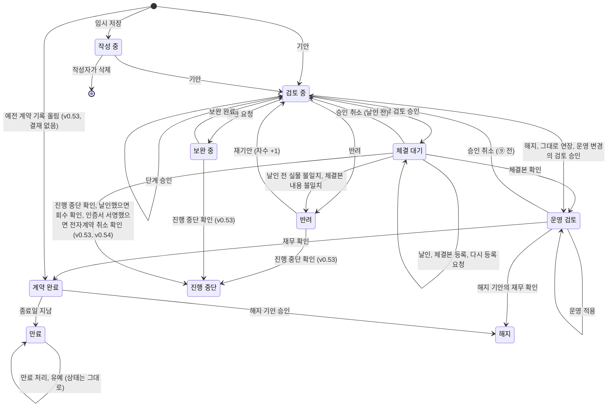

# climb 데이터 정의서

| 항목     | 내용                                                                                                                  |
| ------ | ------------------------------------------------------------------------------------------------------------------- |
| 문서 버전  | v0.57 (초안)                                                                                                          |
| 최종 수정일 | 2026-11-16                                                                                                          |
| 정리     | Claude (프로토타입과 요구사항 정의서 v0.17을 바탕으로 작성)                                                                             |
| 편집     | 기획자가 Obsidian으로 직접 고치고, 고친 내용을 바탕으로 함께 논의. 화면을 고치면서 데이터도 바뀌어야 하면 Claude가 이 문서를 함께 고치고 변경 이력에 남김(기획자 요청, 2026-10-20) |
| 대상 독자  | 기획자, 사내 개발팀                                                                                                         |
| 관련 문서  | [01_요구사항정의서.md](01_요구사항정의서.md), [02_화면목록.md](02_화면목록.md)                                                            |

## 이 문서 읽는 법

화면 목록이 "어떤 화면이 있는지"를 적은 문서라면, 이 문서는 **"어떤 항목에 어떤 값이 들어갈 수 있는지"**를 적은 문서입니다. 개발팀은 이 문서를 보고 데이터베이스(DB) 표를 만들고, 잘못된 값이 들어오지 못하게 막는 검사를 만듭니다.

**값 종류 4가지**

| 값 종류 | 뜻 | 예 |
|---|---|---|
| 자유 입력 | 사람이 직접 쓰는 글자, 숫자, 날짜. 형식 규칙만 정함 | 검토 요청 사항, 금액, 계약 시작일 |
| 코드값 | 정해진 목록(코드표, 9장)에 있는 값만 들어감 | 상태, 서비스, 계약 방식 |
| 목록 참조 | 다른 데이터 묶음(예: 거래처, 사용자)에서 골라 연결함 | 고객사, 영업대표 |
| 계산값 | 다른 값으로 만들어 보여 줌. 따로 입력하지 않음 | 현재 진행, 할인율, 계약 금액 총액 |

**날짜**: 저장과 화면 표시 모두 YYYY-MM-DD(예: 2027-01-01), 일시는 YYYY-MM-DD HH:MM(예: 2026-10-19 14:05)입니다(v0.19, 요구사항 정의서 REQ-UI-25). 날짜 칸은 숫자만 넣고(넣는 대로 '-'가 붙음, v0.23) 달력에서도 고를 수 있습니다(REQ-UI-27).

**상태 표시**는 요구사항 정의서와 같습니다. [확정] 기획자가 정함 / [가정] 임시 기본안 / [미정] 결정 필요.

**코드값 원칙**

- 코드는 영문 대문자로 짓고(예: `IN_REVIEW`), 화면에 보이는 이름(예: 검토 중)과 나눕니다. 화면 이름을 바꿔도 DB에 저장된 코드는 그대로입니다. 예: v0.13에서 "체결 완료"를 "계약 완료"로 바꿀 때 코드 `ACTIVE`는 그대로 두었습니다.
- 한 번 쓴 코드는 지우지 않습니다. 더 이상 쓰지 않으면 "사용 안 함"으로 돌립니다. 지우면 지난 기록의 뜻이 사라집니다.
- 누가 목록을 바꾸는지 코드표마다 적습니다. **시스템 고정**(개발팀이 바꿈, 업무 흐름과 묶인 값)과 **관리자 관리**(관리자 화면에서 추가, 사용 중지)로 나눕니다.

**계약 묶음**은 원계약과 그 뒤의 변경, 연장, 해지, 운영 변경 기안을 함께 부르는 말입니다. 묶음은 원계약의 계약번호로 가리키고, 다른 데이터 묶음에서 계약 묶음을 가리키는 항목 코드는 `bundle_no`로 씁니다(v0.33).

**항목 코드**는 개발팀이 DB 칸 이름으로 쓸 영문 이름의 제안입니다. 개발팀 규칙에 맞게 바꿔도 되지만, 바꾸면 이 문서도 함께 고칩니다.

## 변경 이력

| 버전 | 날짜 | 변경 내용 |
|---|---|---|
| v0.1 | 2026-10-20 | 초안: 데이터 묶음 목록, 개요 화면 항목, 계약, 계약 제품, 결재 단계, 거래처, 사용자 계정, 가격 기준, 코드표 12개, 계약 상태 전이표 |
| v0.2 | 2026-10-20 | 요구사항 정의서 v0.17 결정 반영: 거래처 목록 확정(D-01), 부서 목록 확정(D-02, CODE-DEPT), 서비스 3단계 분류(CODE-SERVICE), 임시 저장 삭제(D-05), 해지 기안(D-06, CODE-CONTRACT-KIND에 TERMINATE), 결재 기록과 승인 취소(approval_history, CODE-APPROVAL-ACTION), 사후관리 기록(aftercare_note), 첨부 파일 형식과 50MB(CODE-FILE-KIND), 가격 기준 적용 시작일, 영구 보관 |
| v0.3 | 2026-10-20 | 결재 화면(SCR-20~23)을 만들며 반영: 결재 기록에 기안(SUBMIT)도 한 줄로 남김, 대신 처리한 사람 칸(on_behalf_of, 대리 결재는 미정), 승인 취소 사유는 의견 칸에 함께, 승인 취소 뒤 다시 차례가 된 단계의 도착일시 규칙 |
| v0.4 | 2026-10-20 | 용어 변경: "할인율 캡"을 "할인율 한도"로(요구사항 정의서 REQ-UI-18). 항목 코드(`discount_cap`, `chk_cap`)는 그대로. 할인율의 화면 표시와 금액의 원 표기 추가 |
| v0.5 | 2026-10-20 | 결재 순서 변경(요구사항 정의서 REQ-STEP-04 v0.20): ② 다음 ③ 영업 검토, 그 다음 ④ 법무와 ⑤ 개인정보 동시. CODE-STEP의 S03, S04, S05 뜻을 바꿈(S03 영업, S04 법무, S05 개인정보. v0.4까지는 S03 법무, S04 개인정보, S05 영업). 역할표와 상태 전이표의 단계 번호 수정 |
| v0.6 | 2026-10-20 | 가격 기준 변경 근거 추가(요구사항 정의서 REQ-CHK-07 v0.21): 사내 품의 문서 링크(`approval_doc_url`, 필수), 품의 번호(`approval_doc_no`), 변경 사유(`change_reason`) |
| v0.7 | 2026-10-20 | 요구사항 정의서 v0.22 반영: 체크리스트 4번(`chk_accounting`, `chk_accounting_note`), 개인정보 분리 예정일(`pi_separate_at`, 계약 종료 10년 뒤), 사후관리 기록에 고객 담당자 이름과 연락처를 적지 않음, 접속 기록 영구 보관 확정, 권한 검토 기록(`access_review`)과 기록 점검 결과(`log_review`) 묶음 추가 |
| v0.8 | 2026-10-20 | 계약 체결과 운영 검토 화면(요구사항 정의서 v0.23, REQ-SIGN)을 만들며 반영: 한 일 코드에 체결본 등록(`REGISTER`)과 다시 등록 요청(`RETURN`) 추가, 결재 기록에 체결본 파일(`attachment_id`), ⑥⑧⑨의 확인 항목은 의견 칸에 함께, ⑨ 다음 ⑩ 순서로 계약 완료일시 규칙 수정, 상태 전이표에 체결 대기 안의 처리와 ⑥⑧ 반려 추가 |
| v0.9 | 2026-10-20 | 보관함 화면(요구사항 정의서 v0.24, REQ-ARC)을 만들며 반영: 갱신 방식(`renew_mode`, `CODE-RENEW-MODE`), 그대로 연장하는 이유(`renew_reason`), 환불과 위약금(`refund_note`), 해지 상태 전이를 ⑩ 재무 확인 뒤로, 그대로 연장 갱신의 상태 전이, 해지 기안 번호 -T01 적용(D-11) |
| v0.10 | 2026-10-20 | 관리자 화면(요구사항 정의서 v0.25, 4.3 REQ-ADM-10~22)을 만들며 반영: 단계 담당자 이력(`step_assignee`, 아직 차례가 오지 않은 단계부터 적용), 대리 지정(`delegation`, CODE-DELEGATION-STATE), 결재 기록에 대리 지정 번호와 근거(`delegation_id`, `basis`), 독촉 기준(`alert_rule`), 관리자 변경 이력(`admin_change_log`, CODE-ADMIN-AREA), 열람 제한 이력(`restrict_history`), 거래처 합치기(`merged_into`), 코드표 항목(`code`), 접속 기록 항목(`access_log`, CODE-LOG-ACTION), 이상 행위 알림(`security_alert`, CODE-ALERT-KIND), 기록 점검과 권한 검토 항목(`log_review`, `access_review`, CODE-REVIEW-RESULT). 그대로 연장의 새 계약 기간은 영업이 입력. D-13 추가 |
| v0.11 | 2026-10-20 | 재무 문서 반영(요구사항 정의서 v0.26): 운영 변경(`CHANGE`, -C01)과 항목(`change_type`, `change_qty`, `change_amount`, `old_end_date`, `activity_url`), CODE-CHANGE-TYPE, 보완 중 상태(`SUPPLEMENT`)와 한 일(`SUPPLEMENT` 보완 요청, `RESUBMIT` 보완 완료, `restart`), ③ 영업 검토 팀별 리더(`team_leader`), 자기 계약 결재 금지, 상태 전이표에 보완과 운영 변경 추가. 그대로 연장의 새 기간 [가정] 1년 표기를 영업 입력으로 바로잡음 |
| v0.12 | 2026-10-20 | C-20 결정(요구사항 정의서 v0.27): 첨부 종류에 조항 대비표(`CLAUSE_DIFF`, 표준계약서를 바꾸면 필수), ④ 법무 승인 의견 필수(표준계약서를 바꾼 계약) |
| v0.13 | 2026-10-20 | 개요 화면 항목에 점검할 일 표(정보보호팀, 요구사항 정의서 REQ-DASH-16) 추가 |
| v0.14 | 2026-10-20 | 역할 2단계와 조직 개편(요구사항 정의서 v0.29): CODE-ROLE에 분야와 등급 칸, 새 역할 6개(`SA_LEAD`, `SEC_LEAD`, `CEM_LEAD`, `FIN_LEAD`, `FIN_EXEC`, `OBSERVER`), 화면 이름 바꿈(슈퍼관리자 → 최고관리자 등). CODE-DEPT를 조직(실, 유닛 2단계, `level`, `parent`)으로 바꾸고 값 교체. 사용자 계정의 `dept`를 조직으로 부름. 팀별 리더를 유닛별 리더로. 단계 담당자와 대신할 사람에 그 분야 리더도 고를 수 있음 [가정] |
| v0.15 | 2026-10-20 | 조직 개편과 어문 규범(요구사항 정의서 v0.31): 결재 기록에 처리한 사람의 그때 조직(`actor_dept`), 조직 코드의 상위 바꾸기(`parent`), 유닛별 리더에 유닛 추가, 사용자 조직 한꺼번에 옮기기(관리자 변경 이력 `USER`), 역할과 조직은 묶지 않음. 날짜와 일시 표시 형식 "2026. 10. 19.", "2026. 10. 19. 14:05" (화면 표시만, 저장 형식은 그대로) |
| v0.16 | 2026-10-20 | 새 계약 등록 반영(요구사항 정의서 v0.32): 거래처 검색과 사업자 정보 DB(`biz_registry`, 상호와 사업자등록번호만, 기준일), 직접 입력한 사업자등록번호의 검증 숫자 확인, 영업 대표 표시 "조직 이름", 영업기회번호(필수) 형식(연도 2자리, 월 2자리, 영문 2자리, 일련번호 3자리)과 판다 링크, 계약번호 규칙 변경 예정(영문 2자리 미정) |
| v0.17 | 2026-10-20 | 사업자 정보 DB 출처 확정(요구사항 정의서 v0.33, C-22): `source` 값 정함(CODE-REGISTRY-SOURCE), 새로 고치는 주기 |
| v0.18 | 2026-10-21 | 새 계약 등록 정리(요구사항 정의서 v0.34): `kind` 이름을 계약종류로, `RENEW` 화면 이름을 연장으로(문서의 "갱신"을 "연장"으로, 자동갱신은 그대로). `contract_type`(계약 유형)을 없애고 `method`에 합침(`RESELLER` → `INDIRECT` 간접), `no_amount`(금액이 없는 계약) 추가. `contract_date`(계약일), 서비스 기간 항목을 뺌. 사업자등록번호는 숫자만 넣고 '-'를 붙여 보임. 사업자 정보 DB 출처를 기획자가 모은 자료로(CODE-REGISTRY-SOURCE `COLLECTED`, `MANUAL`), D-03 해결 |
| v0.19 | 2026-10-21 | 날짜 표시 형식을 YYYY-MM-DD로(요구사항 정의서 v0.35 REQ-UI-25, v0.15의 "2026. 10. 19."를 바꿈. 저장 형식과 같아짐). 날짜 칸 입력 방법(숫자 8자리 또는 달력, REQ-UI-27). 값 종류 예시의 계약일을 계약 시작일로 |
| v0.20 | 2026-10-21 | 항목 이름 바꿈(요구사항 정의서 v0.36): `sales_rep_id` 영업대표(붙여 씀, CRM과 맞춤), `personal_data` 개인정보 처리위탁 계약(있음, 없음) |
| v0.21 | 2026-10-21 | `end_date` 규칙: 시작일보다 앞설 수 없음, 같은 날은 됨(요구사항 정의서 v0.38. 예전 "시작일보다 늦어야 함") |
| v0.22 | 2026-10-21 | 기획자 결정(요구사항 정의서 v0.39): `contract_no` 규칙 확정(기안 연월 + CL + 일련번호 3자리, 후속 -A01, -R01, -T01, -C01), 거래처 기관 `customer_unit`과 계약의 `unit_name`, `restricted` 이어받기(D-13), `biz_no` 고유번호와 국세청 조회, `nts_status` 확정, `customer_type` 두지 않음, `last_logout_at` 시간 초과(D-08), CEM유닛 1단계 조직, D-11 해결. 기다리는 것: D-07(재무), D-09, D-10(서비스 엑셀), D-12(법무) |
| v0.23 | 2026-10-21 | `sla`(서비스 수준 협약) 추가, 날짜 칸 입력 방법(숫자만, 요구사항 정의서 v0.40) |
| v0.24 | 2026-10-21 | 금전 거래가 있는 계약만 등록(요구사항 정의서 v0.41 REQ-SCOPE-05): `no_amount` 뺌, 체크리스트 `NA` 쓰지 않음, 파일 종류에 부속 서류 `ANNEX` |
| v0.25 | 2026-10-22 | 공지사항 `notice`, 받을 이메일 설정 `user_mail_pref`(요구사항 정의서 v0.45 REQ-UI-29, 30), 코드표 CODE-NOTICE-KIND, CODE-MAIL, 관리자 변경 영역 `NOTICE` |
| v0.26 | 2026-10-22 | 기획자 결정(요구사항 정의서 v0.46 REQ-REG-23): `unit_name` 이름을 "기관 또는 부서명"으로, 목록 참조에서 자유 입력으로 바꿈. 거래처 기관 `customer_unit` 없앰(기관 이름은 고유 번호가 없어 맞는지 확인할 수 없으므로 계약마다 직접 적고 거래처에 쌓지 않음) |
| v0.27 | 2026-10-22 | 기획자 요청(요구사항 정의서 v0.47 REQ-ADM-23): 제품과 기능을 나눔(같은 제품이라도 기능마다 플랜이 다를 수 있음). 서비스 → 제품 → 기능 → 플랜. 새 데이터 묶음 제품 `product`, 기능 `feature`(8-5장). 가격 기준 `price_book` 한 줄을 "플랜"으로 부르고 `product_id`, `feature_id`를 더함(8장). 계약 제품에 기안 당시 제품, 기능, 플랜 이름을 함께 남김(4장). `CODE-SERVICE`는 한 단계로, 예전 중분류, 소분류는 제품으로 옮김. 관리자 변경 영역 `PRODUCT`. D-10 해결 |
| v0.28 | 2026-10-22 | 기획자 요청(요구사항 정의서 v0.48 REQ-UI-29): `CODE-NOTICE-KIND`의 `RELEASE` 화면 이름 "릴리즈 노트"를 "릴리즈"로, `CODE-MAIL`의 `NOTICE_ALL` 이름도 "일반 공지와 릴리즈"로. 공지사항 `title`은 20자까지(휴대폰 한 줄에 맞게 10자 안팎(릴리즈는 버전을 빼고. "중요" 표시가 붙는 공지는 12자면 잘림)을 권함) |
| v0.29 | 2026-10-22 | 기획자 결정(요구사항 정의서 v0.49 REQ-REG-17, REQ-ADM-15, 23): 서비스 → 제품 → 기능 → 플랜을 **제품 → 기능** 두 단계로 줄임. 플랜을 없애고 가격 기준 `price_book`은 기능마다 하나(열쇠 `feature_id`, 플랜 코드 `product_code`와 플랜 이름 `name`을 뺌). 계약 제품 `contract_product`는 `feature_id`를 고르고 `plan_name`을 뺌. 서비스는 위계가 아니라 제품에 저절로 붙는 구분(제품 이름에 서비스 이름이 있으면 저절로, 없으면 관리자가 한 번 고름 [가정, 요구사항 정의서 C-27]) |
| v0.30 | 2026-10-22 | 기획자 결정(요구사항 정의서 v0.52 REQ-AUTH-20): 지정 열람자 `contract_viewer` 추가(조직이 기본, 사람은 예외로 조직이 바뀌면 저절로 풀림, 관리자만 지정, 계약 묶음 단위로 이어받음), 코드표 `CODE-VIEWER-KIND`, `CODE-MAIL`에 `VIEWER`, `VIEWER_RELEASED`. `restricted` 설명에 지정 열람자 |
| v0.31 | 2026-10-22 | 기획자 요청(요구사항 정의서 v0.53): 표준계약서 `standard_template`와 표준계약서 판 `standard_template_version`(8-6장), 계약의 기준 표준계약서 `std_template_id`, `std_template_version_no`. 첨부 파일 판 관리(`version_no`, `version_reason`, `file_hash`, `approved_version`, `checked_version`)와 결재 기록의 `viewed_file_version`. 해지 통지 기한 날짜 `notice_deadline`(계산값)과 알림 기준 `notice_soon_days`, `notice_mail_days`, `CODE-MAIL`에 `NOTICE_DEADLINE`과 메일 틀. 화면 밝기 `theme_pref`와 `CODE-THEME`. 관리자 변경 영역 `TEMPLATE`. 통계와 보고서(SCR-46)는 새로 저장하는 값 없이 계산(2-1장). 계약 요약서(SCR-47)도 새 값 없음 |
| v0.32 | 2026-10-22 | 기획자 요청(요구사항 정의서 v0.54): 체결 후 의무 `obligation`과 이행 기록 `obligation_record`(8-7장), 코드표 `CODE-OBLIGATION-KIND`, `CODE-OBLIGATION-WHEN`, 알림 기준 `obligation_soon_days`, `obligation_mail_days`, `CODE-MAIL`에 `OBLIGATION`. 메일 틀의 보낸 사람과 제목 머리를 "계약 관리 플랫폼"으로(본문에는 이름 climb을 쓰지 않음, REQ-NAME-01) |
| v0.33 | 2026-10-22 | 문서 정리(QA, 요구사항 정의서 v0.55): 8장의 묶음을 번호 순서(8-1~8-7)로 다시 늘어놓음(번호는 그대로). 계약 묶음의 뜻과 항목 코드 `bundle_no`를 하나로(체결 후 의무의 `contract_no`를 `bundle_no`로). 기본 정보 표 가운데 끼어 있던 문단을 표 아래로 옮기고 옛 설명(`no_amount`)을 고침. `notice_days` 이름을 "해지 통지 일수"로. 사업자 정보 DB를 한눈에 보기 표와 6장 제목에 넣음. 개요(SCR-01)에 해지 통지 기한과 챙길 의무 표. 관리자 관리 코드표 목록에서 없앤 계약 유형을 뺌. 해결된 D-06 표시. 저절로 풀린 기록의 표시 이름 "플랫폼(자동)". 자주 쓰는 의무 예시 설명. 기존 계약을 옮기지 않으므로(기획자 결정, C-32) 예전 값을 옮기는 규칙 대신 시안 예시 데이터만 읽는다고 고침. 개요 진행 상세의 현재 진행을 두 칸(현재 진행, 대기)으로 나누고 대기의 날수 기준을 하나로(요구사항 정의서 REQ-DASH-06) |
| v0.34 | 2026-10-23 | 기획자 결정(요구사항 정의서 v0.56): 서비스 > 제품 > 기능 = 대분류 > 중분류 > 소분류. `CODE-SERVICE` 화면 이름을 CK, HR, 기타로. 제품의 `service`는 관리자가 고르는 필수 값(제품 이름에서 저절로 정하던 것을 없앰, C-27 해결) |
| v0.35 | 2026-10-23 | 기획자 서비스 정리표 반영(요구사항 정의서 v0.57, D-09): 제품과 기능에 `crm_code`(CRM 코드번호, 옛 체계라 다시 정할 예정), 기능이 따로 없는 제품은 이름이 빈 기능 하나, 가격 단위 예에 건. 계약 제품은 화면에서 서비스 → 제품 → 기능을 고름. 결재 문서의 표준 금액은 기안한 날의 가격 |
| v0.36 | 2026-10-23 | QA 점검(요구사항 정의서 v0.58): `restricted`는 묶음 전체에 걸고 풂(원계약에 걸면 후속 기안도). 체결 후 의무의 지금 상태에 "기한 없음"(되풀이 기한이 하나도 없을 때)과 해지된 묶음은 해지일까지. 재기안하면 앞 차수의 기안(`SUBMIT`)을 결재 기록에 한 줄 남김. 해지, 그대로 연장, 운영 변경도 반려되면 같은 번호의 다음 차수(`round`)로(기획자 결정). 체크리스트 비고(`chk_*_note`)는 비고가 필요한 답일 때만 화면에 나타나고 그때만 저장. 사용자 계정 번호는 겹치지 않게. 쓰지 않던 계약 유형 코드 줄을 시안에서도 뺌 |
| v0.37 | 2026-10-31 | 견적서(요구사항 정의서 v0.61 3.9 REQ-QUO, 기획자 결정): `quote`(견적번호와 판, 받는 곳, 견적일, 유효기간, 조건), `quote_line`(기능, 수량, 견적 단가, 그때의 표준 단가와 한도), `quote_issue`(출력 기록, 수정과 삭제 불가)를 8-8에 더함. 견적은 계약과 이어지지 않아 `contract`는 그대로 |
| v0.38 | 2026-10-31 | 통제와 표준 대응표(05) 반영: `chk_price` 설명을 C-34에 맞춤(표준 단가와 다르면 NO, G-03), 계약 제품에 쓴 가격 기준 행과 그때의 한도 [제안](G-03), 결재 기록에 ⑦ 계약서 밖 약속 없음 확인과 ⑧ 항목별 확인, ⑧ 반려의 `mismatch_codes`와 `CODE-SIGNED-MISMATCH`(G-06). 검토로 더함: `CODE-SIGNED-MISMATCH`에서 서명 빠짐을 뺌(다시 등록 요청의 일), 이름에 쉼표를 쓰지 않음, 8-9 회사 설정(`company_setting`) [가정]. 두 번째 검토: `comment` 행의 필수 칸, `CODE-ADMIN-AREA`에 `COMPANY`, `RETURN`에 서명 빠짐 |
| v0.39 | 2026-10-31 | 통제와 표준 대응표(05) G-19와 G-01 남은 것(요구사항 정의서 v0.62): 계약 제품의 `end_user`는 계약 방식이 간접이면 필수, 새 항목 `end_user_pending`(새 코드표 CODE-END-USER-PENDING)과 `end_user_pending_note`. 통계 세는 법에 계약 방식과 거래처마다 가격 예외, 한도를 넘는 줄이 있는 견적. 견적의 한도 판단은 줄에 저장한 값으로 |
| v0.40 | 2026-11-01 | 통제와 표준 대응표(05) G-05 ①③과 G-25 ①(요구사항 정의서 v0.63): 결재 기록 `comment`에 ② 확인 항목, 새 항목 `supplement_codes`(새 코드표 CODE-SUPPLEMENT-ITEM), 통계 세는 법에 보완 요청 항목. 거래처에 등록 경로 `registered_via`와 등록한 계약 `registered_contract_no`(직접 입력한 새 거래처를 결재 문서에 표시). G-24 ①③: 결재 기록, 관리자 변경 이력, 접속 기록의 `prev_hash`, `row_hash`, `CODE-ALERT-KIND` `LOG_CHAIN`, `CODE-ADMIN-AREA` `DATA_FIX`. G-23 ②③: 권한 검토 자료에 그 분기의 대리 지정, 점검과 검토 기록에 `seen_snapshot` |
| v0.41 | 2026-11-01 | 데이터 정의서와 시안 맞추기 점검(세 영역, 반박 확인)으로 바로잡음: 1장의 결재 기록과 첨부 파일 요약, 개요 만료 임박의 해지 통지 기한 줄(v0.59에 없앰)과 "내가 검토할 계약" 표의 칸, `total_amount`는 0원보다 커야 기안, `discount_rate`는 부호 그대로(표준보다 높으면 음수, "N% 높음")와 총액 줄의 전체 할인율, 사후관리 기록은 계약 묶음(`bundle_no`), 가격 기준 적용 시작일 중복은 기능마다, `notice_soon_days`의 개요 쓰임, 공지의 중요와 내림 설명, ⑨의 화면 이름(운영 종료 완료, 기간 연장 완료, 운영 변경 완료와 "중" 표기), 10장 상태 전이에 해지, 그대로 연장, 운영 변경의 검토 중 → 운영 검토, 승인 취소, 해지 기안의 운영 검토 → 해지 |
| v0.42 | 2026-11-02 | 기획자 결정 2026-11-02(요구사항 정의서 v0.64, C-40~C-43과 C-37 ①) 가운데 데이터에 닿는 것만: 공지사항에 새 항목 `pin_until`(맨 위 고정이 끝나는 날, 중요 공지면 필수, 고정 여부는 계산)과 `important` 설명(C-43 ①). `CODE-STEP`에 짧은 이름 칸(맡는 사람 이름, 계산값, C-40 ③). 2장 진행 상세 표의 현재 진행 예("④⑤ 법무, 정보보호")와 맡는 사람 이름, 새 화면 항목 "내 차례"(계산값), 표 위 안내는 고정 문장(C-40 ①②). 만료 임박 표의 "남은 일자"를 "만료까지"로(값 규칙 그대로, C-41 ⑧), 만료일 순서(C-37 ①). `user_mail_pref`는 켜고 끄면 바로 저장(값 모양 그대로, C-43 ④). 다른 결정(검토 완료 확인 문장 줄이기, 체결 대기 ⑧ 기준, 전체 계약 변경과 연장 칸 등)은 보여 주는 방식만 바뀌어 데이터는 그대로. 같은 날 이어서 문서만 바꾸는 결정: 2-1 통계 "서비스마다"의 이름을 "여러 서비스 함께"로(C-38 ①), `CODE-FILE-KIND`에 개수 칸(계약서 초안과 부속 서류 여러 개, 조항 대비표, 최종 견적서, 해지 관련 서류 한 개, 체결본은 ⑦에서 한 번에 한 개, C-38 ⑤), 메일 틀의 넣지 않는 것(C-30)과 의무를 더하고 끝내는 사람(C-31)의 [가정]을 확정으로. 값 모양은 그대로 |
| v0.43 | 2026-11-02 | 기획자 결정 2026-11-02(요구사항 정의서 v0.65) 가운데 시안에 반영한 것: 결재 기록에 새 항목 `sign_date`, `open_date`(B-8), `no_interest`(C-14), `anti_bribe`, `anti_bribe_note`(C-15, 새 코드표 CODE-ANTI-BRIBE), `recent_same_count`(E-2, 5장 "같은 거래처 최근 계약"과 "날짜 순서 표시"), `grace_until`(A-11). 결재 단계에 S03C ③ 영업 임원 승인(E-3, 추천과 다르게 A안), SXP ⑨ 만료 처리(A-10), SGR ③ 만료 유예 확인(A-11)과 한 일 GRACE, GRACE_OK, GRACE_NO, 새 계산값 코드표 CODE-EXPIRY-STATE, 10장 끝 "만료 처리와 유예". 운영 변경 모두에 ⑩(B-3, 추천과 다르게 정함. HR 충전은 재무 리더 `step_assignee` S10_HR, ⑨와 ⑩은 다른 사람), CODE-CHANGE-TYPE에 ⑩ 칸, 10장 운영 변경 줄. 계약에 `free_used_before`(B-4 계약 연도 누적), `change_feature`, `change_list_price`, `change_price_unit`, `change_price_from`(B-3 덧붙임), `quote_instead`(B-5, 새 코드표 CODE-QUOTE-INSTEAD-CHECK [가정], CODE-FILE-KIND 설명), `chk_accounting_kinds`(B-6, 새 코드표 CODE-ACCT-KIND). 새 데이터 묶음 재무 의견 `finance_opinion`(4-3장, B-6), 기간 마감 점검 확인 `period_close_check`(8-10장, B-9), 결재 규칙 값 `approval_rule`(`coo_over_pp` [가정] 10, 기안 때 값을 씀)과 위임전결 근거 `rule_basis`(E-3), 고정 값 `quote_instead_under`, `grace_max_days`(30일), `grace_ask_days` [가정]. 표준계약서 판에 `anti_bribery_clause`(C-15). `alert_rule` 네 값을 결재선 규칙에서 바꿈(A-5, 추천과 다르게 지금 바로 둠)과 `notice_mail_days`의 리더 받는 날(E-12, CODE-MAIL NOTICE_DEADLINE). 통계 2-1: 체결일은 서명본 체결일(B-8), ⑧ 반려 차수 뺌(A-2), 단계마다 걸린 날에 S03C와 SXP, 기간 마감 점검(B-9), 통제 지표 둘(C-1, 리더와 임원만). 관찰자는 지정 열람자여도 못 봄(A-9, `contract_viewer`, CODE-ROLE, CODE-MAIL VIEWER), 공지의 변경 이력 사유는 시스템이 적음(A-6), 유닛별 리더 표에 더할 유닛(A-7), 원계약에 만료 뒤 늦은 연장(A-11), 개요 "점검할 일"에 재무 기간 마감(C-10). 11장 D-07에 B-10, B-7 보류 |
| v0.44 | 2026-11-03 | 요구사항 정의서 v0.67과 함께. 기획자 결정 2026-11-02(셋째 묶음: 컴플라이언스 역할, C-1, C-2, C-3, C-5, C-6, C-7, C-8, C-9, C-10, C-13, C-16, E-1, E-4, E-7, E-9, E-15)과 2026-11-03 기획자 답을 시안대로 반영. 새 역할 `COMPLIANCE`(컴플라이언스 담당자, 결재 단계 없음)와 `AUDIT`(감사 열람, 읽기만, 끝나는 날)과 7장 읽기만 하는 역할, 끝나는 날, 요청한 사람, 겹치면 안 되는 역할(새 코드표 CODE-ROLE-CONFLICT, CODE-GRANT-STATE). 새 데이터 묶음: 권한 기간 기록 `role_grant`(7장), 영업대표 바꾼 기록 `contract_owner_change`(3-1장, C-44), 거래처 확인 `customer_check`(6장), 보류 `trade_hold`와 개선 과제 `remediation`(8-11장), 할인 예외 점검 기록, 설정 변경 확인, 영업기회 대사, 인장 기록 대사(8-12장), 최고관리자 작업 점검과 유닛 리더에게 보낸 계정 목록(8-3장), 내보내기 실행 기록 `export_log`(8-13장). 새 칸: 계약의 `opp_dup_contract_ids`, `opp_dup_reason`(E-1 ①), `customer_check_warn`(C-13), 계약 제품의 `list_price`와 `cap_rate` 확정(E-4), 거래처의 계산값 `check_state`, `check_due`, `hold_state`, 관리자 변경 이력의 `requested_by`(C-7), `conflict_user_id`, `conflict_list`, `conflict_reason`(C-5), 공지의 `change_screens`, `change_days`(E-15), 견적 출력 기록의 `seal_stamped`, `seal_version`(E-7, 추천과 다르게 정함: 고객용 견적서에 인장을 늘 찍음), 회사 설정의 인장 그림(총무)과 [가정] 풂(E-9, 회사 정보는 최고관리자). 새 코드표: CODE-CHECK-REASON, CODE-CHECK-RESULT, CODE-CHECK-ITEM-RESULT, CODE-RISK-GRADE, CODE-HOLD-KIND, CODE-REMEDIATION-STATE, CODE-REMEDIATION-SOURCE, CODE-CONFIG-CHECK-RESULT, CODE-SEAL-RECON-RESULT, CODE-EXPORT-KIND. CODE-ADMIN-AREA에 `COMPLIANCE`, CODE-MAIL에 `HOLD_SET`, `HOLD_RELEASE`(2026-11-03: 막히는 사람 모두), `OWNER_SET`(C-44). 2장 점검할 일을 점검을 맡은 모든 사람으로(C-10, 매출 대사는 B-7 보류라 뺌), 2-1 통제 지표에 평균 할인, 대리 결재, 위험 신호와 보는 사람(C-1, C-28 해결). 2026-11-03 기획자 결정: HR 충전 ⑩은 재무 담당자(⑨를 한 사람이면 다른 재무 담당자)라 `step_assignee` S10_HR과 재무 리더 [가정]을 없앰(C-18 ⑤, 재무 리더는 v0.29 규칙대로 결재 단계 없음). 영업대표가 바뀌면 영업 리더가 계약마다 새 영업대표를 정하고 그동안 맡음(C-44, `sales_rep_id`는 기안 기록으로 그대로). 10장 끝에 보류 중과 영업대표가 바뀔 때. 11장 D-09에 E-4, E-5. 운영에서 최고관리자는 결재 단계를 처리하지 않음(C-5). 같은 날 마지막 고침: 계약과 영업대표 바꾼 기록에 계약의 유닛 `sales_team`([가정], C-44), 영업 역할이 없어진 영업대표도 리더가 맡음, 직무 분리, 보류 메일과 이력의 열람 제한 가림, [가정] 둘(처음 기안자를 분기 권한 검토 자료에, ③이 자기 차례인 리더는 자기를 영업대표로 못 정함, 기획자 확인 필요). 같은 날 검토 고침: ③이 자기 차례로 남은 사람은 누가 고르든 영업대표가 못 됨(대리 지정 차례 포함), 분기 검토는 "앞 기안자(그 묶음 계약을 기안한 사람)"로 묶음의 모든 계약을 봄(기안자로 남은 동안만 봄), 대신 낸 유예 요청도 영업 임원이 확인 |
| v0.45 | 2026-11-06 | 요구사항 정의서 v0.69와 함께(기획자 요청): 견적 받는 곳의 `biz_no`는 입력하지 않음. 목록에서 고른 거래처일 때만 그 번호를 기록에 남기고(화면에 보이지 않음) 견적서에 싣지 않음, 직접 적은 곳은 비움(REQ-QUO-03). 그 밖의 데이터는 바뀌지 않음 |
| v0.46 | 2026-11-06 | 점검(2026-11-06): v0.44 표의 관련 요구사항 번호를 바로잡음. 거래처 확인(`customer_check`)은 REQ-REG-18(거래처 검색)이 아니라 REQ-CMP-01~03, 영업대표 바꾼 기록(`contract_owner_change`)은 REQ-ARC-02(계약 상세)가 아니라 REQ-ARC-12. 데이터는 그대로 |
| v0.47 | 2026-11-06 | 점검 4회차: 기록 대상(`target`)은 열람 제한 계약이면 계약번호만. 화면 밝기는 휴대폰 메뉴판 밝기 단추로도 바꿈. 체결 지연 독촉과 반려, 체결 대기 이메일은 지금 영업대표(C-44), 영업 리더도 받음. 독촉은 "5일 이상". ⑦ 짧은 이름은 기안자(영업대표가 바뀐 계약은 영업대표)로 시안에 맞춤 |
| v0.48 | 2026-11-09 | 기획자 결정(요구사항 정의서 v0.77): 상호 60자, 수량 999,999까지, 사업자등록번호는 모든 화면에서 숫자 10자리에 하이픈 자동 |
| v0.49 | 2026-11-09 | 5회차 점검: 설정 변경 확인(`config_check`)과 매월 "설정 변경" 묶음에 거래처(`CUSTOMER`)를 더함. 추가, 고치기, 합치기는 묶음에 보이고, 완료 계약이 있는 거래처의 사업자등록번호 고치기만 재무 리더가 "맞음", "다름"으로 확인(05 G-25 ②, 06 CTL-83, 합치기와 완료 계약의 뜻은 [가정]). CODE-MAIL의 `PROGRESS`와 `EXPIRY` 받는 사람을 `REJECT`, `SIGN_READY`와 같게(지금 영업대표, 대신 맡는 영업 리더, C-44) |
| v0.50 | 2026-11-09 | 기획자 결정 2026-11-09 5회차(요구사항 정의서 v0.79): 새 묶음 `unit_list_ack`(유닛 리더의 계정 확인, 5번), `mail_send_log`(보낸 이메일 기록, 본문 없음, 9번), `check_issue`(점검에서 넘어온 일, 13번). `access_review`에 인사 명단 대조 칸(`hr_*`, 15번)과 자기 권한 변경이 든 분기는 다른 정보보호 담당자가 남김(2번). `seal_recon_check`에 계약서 ⑥ 날인 수와 열쇠(3번). `discount_review_record`, `opp_recon_confirm`, `seal_recon_check`, `remediation`에 넘어온 일 번호(13번). CODE-APPROVAL-ACTION `CONFLICT`(이해관계 있음, 14번). CODE-MAIL에 `GRACE_RESULT`(7번), `UNIT_LIST`(5번), `INTEREST_OUT`(14번), `CHECK_ISSUE`(13번)를 더하고 `TURN`, `REMIND`의 받는 사람과 보내는 횟수(6번, 8번), `ACCOUNTING`의 받는 사람(10번)을 고침. 관리자 변경 이력의 한 일 `UNIT_LIST_ACK`, `ISSUE_RAISE`. 결재선 규칙에서 저장하는 관리자 본인은 고를 수 없음(1번). 개요 인사말의 검토 건수(4번) |
| v0.51 | 2026-11-10 | 기획자 답 2026-11-10(5회차 결정을 반영하며 생긴 확인 거리 16~23번, 요구사항 정의서 v0.80): `unit_list_ack`에 `on_behalf_of`, `delegation_id`(대리 지정 기간에 대신할 사람도 확인, 19번)와 `marks`(계정마다 퇴사, 휴직, 이동 표시, 새 코드 CODE-ACCOUNT-MARK, 21번). `access_review`의 인사 명단 대조 칸(`hr_*`)은 사용 안 함으로 두고 조치할 계정 수(`marks_total`, `marks_open`)를 더함(21번, 5회차 15번을 바꿈). `mail_send_log`를 보는 곳과 사람(접속 기록 점검의 보낸 메일 묶음, 정보보호와 감사 열람, 20번). CODE-APPROVAL-ACTION `ASSIGN`(결재자 지정)과 결재 기록의 `assignee`, `hold_id`, `CONFLICT`의 단계에 S03C(18번). `trade_hold`에 `conflict_*` 칸과 고정 사유(18번). `check_issue`에 최고관리자 작업 점검(17번). `config_check`의 거래처 합치기(22번)와 완료 계약의 뜻 확정(23번). 컴플라이언스의 점검 화면 보기(16번). CODE-MAIL `INTEREST_OUT`, `UNIT_LIST`, `CHECK_ISSUE`의 보내는 때와 받는 사람 |
| v0.52 | 2026-11-11 | 설계 검토 2026-11-11(작업기록/2026-11-11/설계검토.md, 요구사항 정의서 v0.81) 1, 8, 10번과 3장의 작은 일. **1번 "가볍게 잇기":** 계약(3장)에 `quote_no`(연결한 견적번호, 선택. 견적서로 대신하면 필수, 영업대표가 출력한 판만)와 `quote_ver`(판)를 더함. `quote_instead` 규칙에 연결한 견적 필수, 1장 견적 줄과 8-8장 머리글의 "계약과 이어지지 않음"을 지우고 계약에서 견적을 찾는 길과 견적에서 계약을 거꾸로 찾는 길(그 판을 이은 계약, 같은 영업기회번호의 견적)을 적음. 견적 묶음에는 새 칸 없음. CODE-QUOTE-INSTEAD-CHECK `QUOTE_NO`의 화면 이름 뒤에 연결한 견적번호와 판. **8번과 4-1 8-1:** `old_end_date`에 운영 변경 기간 한도(지금 종료일과 계약서의 종료일에서 앞뒤 2개월, 계약서의 종료일은 저장하지 않는 계산값 [가정]), CODE-CHANGE-TYPE `PERIOD`의 ③을 "없음"으로(예전 "2개월 넘게 바뀌면"은 지움). **10번:** 2장에 영업 리더의 보는 범위와 유닛 거르기(거르는 유닛은 지금 영업대표의 지금 조직, 내 유닛, 개요 보는 범위 `UNIT`/`ALL`은 브라우저에만 [가정]). 저장하는 칸은 없음. **3장 [가정]:** 결재 기록 `comment`의 ⑥ 확인 항목 다섯(결재한 판과 같은 문서(판 번호))과 ⑧ 여덟(조항이 결재한 판과 같음), CODE-SIGNED-MISMATCH에 `CLAUSE` 조항. 계약에 `std_amount`(그대로 연장의 그날 표준 금액, 계산값), `discount_review_record.seen_counts`에 참고 건수 둘, 8-12장에 참고 줄 규칙(한도를 넘은 유상 충전, 표준 금액과 다른 그대로 연장). 코드 값은 지운 것이 없음 |
| v0.53 | 2026-11-11 | 설계 검토 2026-11-11(작업기록/2026-11-11/설계검토.md, 요구사항 정의서 v0.82) 3, 4, 5, 6, 7, 9번과 3장의 남은 작은 일. **3, 4번과 4-1 3-1(가격 틀):** 가격 기준(8장)에 `unit_kind`(새 코드표 CODE-PRICE-UNIT: PERIOD 기간제 12개월 값, PER_UNIT 건당, ONCE 1회. 예전 줄은 단위 글자로 정함 [가정])와 `tier_prices`(고객사 티어마다 단가, 선택. [제안] 따로 표 `price_book_tier`). 거래처(6장)에 `tier`(새 코드표 CODE-CUSTOMER-TIER, 예시 T1~T3 [가정]). 계약 제품(4장)에 `unit_kind`, `months`, `tier_code`, `list_amount` 셈을 표준 단가 × 수량 × 달 수 ÷ 12(기간제)로 바꿈(`list_price`는 쓴 표준 단가, 할인율 계산식 그대로). 견적(8-8장)에 `months`(이용 기간, 기본 12), 견적 줄에 `unit_kind`, `months`, `list_amount`, `tier_code`와 기간제 줄 금액 셈. 운영 변경에 `change_price_tier`, `change_price_unit`은 단위 종류로 견줌. 그대로 연장의 `std_amount`도 같은 셈. **5번(예전 계약 기록):** 계약(3장)에 예전 계약 기록 칸(`is_legacy`, `legacy_need`(새 코드표 CODE-LEGACY-NEED), `legacy_note`, `legacy_doc_no`, `legacy_doc_url`, `legacy_signed_file`, `legacy_no_file_reason`, `legacy_registered_by`, `legacy_registered_at`, `legacy_registered_dept`, `legacy_replaces`, `legacy_fix_reason`), 번호 `LG-0001` [가정], CODE-ADMIN-AREA `LEGACY`, 상태 전이표에 올림 줄. **6번(변경 계약):** 계약에 `amend_kind`(새 코드표 CODE-AMEND-KIND: ADD, REDUCE, TERMS), `total_amount`와 제품 줄 `qty`, `amount`의 음수(줄임), 조항만은 0원, `end_date`는 지금 종료일 이하, CODE-CHECK-ANSWER `NA`를 다시 씀(줄임과 조항만의 2, 3번). **7번(진행 중단):** CODE-CONTRACT-STATUS `STOPPED`, CODE-STEP `SST`, `SSB`, CODE-APPROVAL-ACTION `STOP_REQ`, `STOP_OK`, `STOP_RETURN`, `SEAL_BACK`, CODE-MAIL `STOP_RESULT`, CODE-ROLE-CONFLICT의 ③ 묶음에 SST, 계약에 `stopped_at`(계산값), 상태 전이표와 "진행 중단" 규칙, `MAIL_LOG` 예시 32줄. **9번(체결 방식):** 계약에 `sign_method`(새 코드표 CODE-SIGN-METHOD: PAPER, ESIGN_G2B, ESIGN_CUSTOMER), 결재 기록에 `cert_signer`, `cert_signed_at`, `sign_method`, 전자계약의 ⑥ ⑧ 확인 항목과 단계 이름(CODE-STEP 아래 문단), CODE-FILE-KIND `SIGNED`의 화면 이름, CODE-MAIL `SIGN_READY` 문장. **3장:** 2-1장에 "계약 뒤쪽" 세는 법 넷과 변경 금액 부호, 예전 기록과 진행 중단 빼기. 8-7장에 분할 정산의 청구 일정 알림(계산값, 재무 답 전 [가정]). 11장에 D-14(고객사 티어 자료), D-15(전자계약 철회와 인증서 보관). 코드 값은 지운 것이 없음(NA는 "사용 안 함"에서 다시 씀) |
| v0.54 | 2026-11-11 | 기획자 답(2026-11-11 오후, 팝업 다섯, 모두 추천대로)과 설계 검토 2026-11-11 "시안에 남은 것" ②~⑩(작업기록/2026-11-11/설계검토.md 4-2, 요구사항 정의서 v0.83). **답 ④(전자계약의 진행 중단):** CODE-STEP `SSE` ⑥ 전자계약 취소 확인(서명한 영업지원, 사용 중지이거나 기안자, 지금 영업대표면 영업지원 리더 [가정]), CODE-APPROVAL-ACTION `ESIGN_BACK`, 새 코드표 CODE-ESIGN-END(CANCELLED 전자계약을 취소함, UNSIGNED 상대가 서명하지 않음), 결재 기록 `esign_end`(ESIGN_BACK이면 필수), `comment`의 "확인: … 메모", `stopped_at`은 리더 확인, 회수 확인, 취소 확인 가운데 마지막, 5장 "진행 중단의 차례 셋"(SSB와 SSE가 함께면 동시 [가정]), 10장 상태 전이와 "진행 중단", CODE-MAIL `TURN`, `STOP_RESULT`. 인장 기록 대조 `seal_recon_check`에 `seen_back_count`, `seen_back_keys`(진행 중단으로 돌려받은 날인본도 확인한 달에 대조 [가정]). **답 ①(고객사 티어):** 설정 변경 확인 `config_check`의 `change_area` `CUSTOMER`에 티어 변경(완료 계약과 상관없이), 새 칸 `check_name_key`(TIER, 시안 `op.rk`), CODE-CONFIG-CHECK-RESULT 화면 이름, 6장 `tier`와 8장 `tier_prices`, 8-2장 `CUSTOMER` 줄. **답 ②(예전 계약 기록 매월 확인):** 새 묶음 `legacy_month_check`(8-12장), 새 코드표 CODE-LEGACY-CHECK-RESULT(MATCH, DIFF, NONE), 8-2장 한 일 `AUDIT` `LEGACY_CHECK`, CODE-REMEDIATION-SOURCE `LEGACY`와 `check_issue.source`, 예전 기록의 열람(영업지원 리더, 체결본 없는 기록은 컴플라이언스), 개요 점검할 일, CODE-ROLE 설명. **답 ③:** 회사 인증서는 영업지원 리더가 보관(새 칸 없음, CODE-SIGN-METHOD 아래 문단). **답 ⑤(적용일):** 결재 기록과 결재 단계의 `open_date` 화면 이름이 줄임과 조항만 변경이면 "적용일"(칸과 값은 같음), `sign_date` 화면 이름(전자계약 체결일, 고객 날인일), 날짜 순서 표시의 글. **시안에 남은 것:** ② 그대로 연장의 `total_amount`(지금 유효한 조건, 유상 충전 뺌 [가정])와 `std_amount`의 제품 줄(변경 반영) ③ 체결 방식 줄, 예전 기록의 판과 체결 방식 "기록 없음" ④ 단계 이름과 거르기 이름(5장), 통계의 전자계약 ⑥⑦⑧ 따로 셈(2-1장) ⑤ CODE-ADMIN-AREA `LEGACY`의 [남은 일]을 지움, 8-13장 증빙의 티어 줄과 결재 기록 묶음의 가격 시트 칸 ⑥ 결재 문서의 분할 정산 알림(8-7장, `settlement`) ⑧ 유상 충전의 건당 판단 순서(8장 `unit_kind`, [제안] `change_price_unit_kind`) ⑩ CODE-MAIL `SIGN_READY` 예시 두 통, `mail_send_log` 예시 33줄, 예시 거래처 티어 3 스물한 곳. 11장 D-14 일부와 D-15 해결. 코드 값은 지운 것이 없음. (같은 날 저녁 정리) `total_amount`의 예시 2512CL001-R01 금액을 새 셈으로 맞춤(72,000,000원에서 81,600,000원, 원계약과 계약 완료된 변경 A01) [가정]. |
| v0.55 | 2026-11-12 | 기획자 답(2026-11-12, 설계 검토 뒤 남은 [제안] 둘, 팝업, 모두 추천대로, 요구사항 정의서 v0.84). **① 티어가 다른 거래처 합치기:** 설정 변경 확인 `config_check`의 `change_area` `CUSTOMER`에 남길 거래처와 고객사 티어가 다른 곳이 있는 합치기 줄(완료 계약과 상관없이, 티어는 합친 때의 값), `check_name_key` `TIER`도 그 줄에. 관리자 변경 이력 합치기의 `change` 끝에 "고객사 티어: 앞 → 뒤"(티어가 다를 때만, 시안은 합친 때의 티어를 `op.tiers`에도 남김), 6장 `merged_into` 설명. 새 칸 없음. **② 상대가 이미 서명함:** CODE-ESIGN-END에 `SIGNED`(상대가 이미 서명함), CODE-APPROVAL-ACTION에 `ESIGN_SIGNED`(상대 서명 확인(중단 풀림)), 결재 기록 `esign_end`는 한 일 `ESIGN_BACK`이나 `ESIGN_SIGNED`이면 필수, 5장 "진행 중단의 차례 셋"과 10장 "진행 중단"에 요청이 풀리는 길(상태는 그대로라 상태 전이표는 바뀌지 않음), CODE-MAIL `STOP_RESULT`(풀렸을 때도, 확인한 영업 리더(또는 영업 임원)도 받음 [가정]). 11장 D-15의 남은 것 해결. 같은 날 독립 검토로 1장 표, 8-3장 묶음, 8-12장 문단의 재무 확인 범위와 인장 기록 대조(풀린 요청은 뺌), 8-13장 증빙(티어가 다른 합치기 줄), CODE-MAIL `STOP_RESULT`의 받는 사람 칸도 맞춤. 코드 값은 지운 것이 없음. |
| v0.56 | 2026-11-14 | 주말 점검(2026-11-13~14, 기획자 요청 "일요일 자정까지 계속, 결정할 것은 문서로", 작업기록/2026-11-13/주말작업.md). 기획자 결정이 아니라 점검으로 고친 것이고, 고를 것은 작업기록/2026-11-13/결정할것.md에 추천과 함께 모아 그동안 추천안을 [가정]으로 둠. 고친 곳마다 "(2026-11-13 주말 점검)", "(2026-11-14 주말 점검)" 표시가 있음. 새로 넣거나 설명을 더한 칸(각 줄의 표시): 예전 문서 결재일 `legacy_doc_date`, 회사 설정의 전환 날 `conversion_date`, 날인본 회수 결과 `seal_end`(CODE-SEAL-END), 전자계약 취소 확인 증빙 `evidence_file`, `evidence_why`. 바뀐 설명: `amend_kind`(줄임 금액 상한), `auto_renew`와 `notice_days`(묶음 값은 가장 늦게 계약 완료된 기록), `assignee_id`(전자계약 ⑧ 대체), `opportunity_no`(진행 중단 계약), `settlement`(분할 정산 알림을 기록마다), `customer_check_warn`(그대로 연장과 운영 변경도), `legacy_signed_file`, `seen_back_count`, `check_issue_id`, `source`, `year_no`, `arrived_at`, `comment`, `memo`. CODE-YES-NO 아래에 시안 값(YES/NO 글자, 참/거짓) 안내, 관리자 변경 이력의 점검 기록 셋(LOG_REVIEW, ACCESS_REVIEW, ALERT_DONE)을 8-2장 표에, 1장 목록에 유닛별 리더(`team_leader`). 보낸 메일 예시 35줄. 코드 값은 지운 것이 없음. 코드 다시 보기 고침(같은 날, 표시 "(2026-11-14 주말 점검, 코드 다시 보기 번호)", 새 칸과 코드 값 없이 설명만): `old_end_date`(변경 계약도 기안 때 지금 종료일을 남기고 계약 완료되면 그보다 앞일 때만 묶음 기간을 줄임, 운영 변경의 계약서의 종료일에 뒤 변경 계약의 종료일), `end_date`(변경 종료일 견줌과 겹침 막기), `auto_renew`와 `notice_days`(값을 바꾼 기록 가운데 가장 늦게 계약 완료된 것), `amend_kind`와 `feature_id`(진행 중인 줄임을 먼저 빼는 상한과 사용 안 함 기능의 줄임 [가정]), `check_issue.note`(날인본을 돌려받지 못함은 고정 문장, 티어 넘김 글은 열람 제한 번호를 건수로), 8-12장 참고 줄(열람 제한 계약은 금액과 계약 기간도 가림, 줄임 참고 금액의 남은 달 수와 기능마다 셈 [가정], 티어 줄의 번호 가림), CODE-STEP `SSE`(넘겨받을 사람 [가정]). 코드 다시 보기 2차(같은 날, 검토자 둘이 남긴 것): `contract`에 `renew_base_auto_renew`, `renew_base_notice_days`(변경 계약이 기안 때 남기는 묶음의 자동갱신과 통지 일수, common-03 2차 [가정])를 더하고 `auto_renew`의 옛 한계 문장을 취소선으로, `old_end_date`의 필수 칸 옛 글을 취소선으로, `approval_history.assignee_id`의 SSE 담당(리더가 없으면 다른 영업지원 담당자, admin-01 [가정])을 CODE-STEP `SSE`와 맞춤 |
| v0.57 | 2026-11-16 | 기획자 답 2026-11-16(작업기록/2026-11-13/결정할것.md의 결정, 확인, 묶음 확인, 5장 모두. 반영 목록은 작업기록/2026-11-16/반영목록.md, 요구사항 정의서 v0.86과 함께). 고친 곳마다 "(2026-11-16 기획자 결정, 결정할것 …)"이나 "(2026-11-16 기획자 확인, …)" 표시가 있고, 바뀐 예전 문장은 취소선으로 남김. **새 칸:** 계약(3장)에 환불 금액 `refund_amount`, 위약금 `penalty_amount`, 환불받는 곳 `refund_to`(결정 5. `refund_note`는 메모로 뜻을 바꾸고 받는 곳이 계약 고객이 아니면 필수), 줄임의 변경 뒤 할인율 셈 `reduce_over`(W7-3, 한도를 넘으면 ③), 사후 등록 `late_entry`와 임시 결재 번호 `late_temp_no`(W7-7). 결재 기록(5장)에 바로잡은 것 있음 `corrected`(결정 4). 유닛 리더에게 보낸 계정 목록(8-3장)에 함께 받은 대신할 사람 `also_user_ids`(묶음 확인 5, 시안 `units[].also`). 새 표 `legacy_own_check`(1장, 8-12장, 영업지원 리더가 올린 예전 기록의 컴플라이언스 확인, 확인 2, 시안 한 일 `LEGACY_OWN_CHECK`). **코드:** CODE-CUSTOMER-TIER를 관리자 관리 코드표(코드 관리 SCR-56)로(결정 3, 바꾼 줄은 재무 리더의 설정 변경 확인 대상, 9장 머리와 CODE-ADMIN-AREA `CODE`, 8-12장, 11장 D-14), CODE-MAIL에 `REMEDIATION_OWNER`(W3-4, 꼭 받음)와 `SECURITY` 받는 사람의 예외(5-3), CODE-RISK-GRADE `LOW` 사용 안 함(확인 4), CODE-EXPORT-KIND에 `POP_CONFIG`(W7-6, 8-13장 모집단 내려받기). **바뀐 설명:** `coo_over_pp` 10에서 5(결정 2), 유닛별 리더에 세일즈어드민유닛 리더 없음(결정 11), ② 확인 항목에 조항만 변경 한 줄(W7-5)과 할인 예외 점검 참고 표 다섯째, 여섯째(W7-5), ⑨ ⑩ 의견과 해지 ⑩ 확인 항목(`comment`), 예전 기록의 결재일이 전환 날과 같거나 뒤이면 막음(`legacy_doc_date`, `conversion_date`, W7-1, 결정 12와 13), 리더의 매월 확인에서 리더가 올린 기록을 뺌(`legacy_month_check`, `seen_own_count`, 확인 2), 진행 중단(체결본이 살아 있는 계약은 요청 못 함, 확인 1. 뜻을 넓힘, 5-3), SSE 담당(W3-5), 줄임의 `amend_kind`(W7-3), 간접 계약의 티어는 줄의 사용 업체(`tier_code`, W7-4), 유상 충전은 그 계약 기간(`amend_kind`, `total_amount`, 묶음 확인 6, 7), 개요 점검할 일(확인 2, W3-4), 거래처 `tier`와 `risk_grade`. **[가정] 확정:** 결정할것 R-1~R-5, 확인 1, 2, 묶음 확인 1~10, 12, 13, 16~18에 든 [가정] 가운데 이 문서에 표시가 남아 있던 곳의 [가정]을 떼고 확인 표시를 붙임(남은 [가정]은 이 답에 들지 않은 것). 코드 값은 지운 것이 없음. 밤 코드 다시 보기 고침 반영(같은 날 밤, 표시 "(2026-11-16 밤 코드 다시 보기 번호)", 새 칸과 코드 값 없이 설명만: dec-01 관리자 변경 이력 `change`의 앞뒤 티어 코드와 8-12장 티어 변경 읽기, dec-02 자기 계약 결재 금지의 ②, ⑧ 담당과 `assignee_id` [가정, 결정할것 9장 새 결정 N-2], dec-03 `refund_to`, w3-02 CODE-MAIL `SECURITY` 받는 사람, w7-01 `reduce_over` 셈, w7-06 할인 예외 점검 `seen_counts`). 다른 눈 고침(2026-11-17) 반영. |

---

## 1. 데이터 묶음 한눈에 보기

데이터 묶음은 DB의 표(테이블) 하나에 해당합니다. **보존:** 모든 데이터 묶음은 계약이 끝난 뒤에도 지우지 않고 영구 보관합니다(요구사항 정의서 REQ-FLOW-30). 단, 기안 전 임시 저장한 계약만 작성자가 지울 수 있습니다(REQ-FLOW-31). 계약 안의 개인정보는 계약 종료 10년 뒤 관리자만 여는 별도 보관 영역으로 옮깁니다(REQ-SEC-10, v0.7).

| 데이터 묶음 | 영문 이름(제안) | 담는 것 | 관련 화면 | 상태 |
|---|---|---|---|---|
| 계약 | `contract` | 계약 한 건의 기본 정보, 상태, 체크리스트 답. (v0.53, 설계 검토 2026-11-11) 변경 종류(`amend_kind`), 체결 방식(`sign_method`), 진행 중단 일시, 예전 계약 기록의 칸(`is_legacy`, `legacy_…`) | SCR-01, SCR-11, SCR-41, SCR-95 | 가정 |
| 계약 제품 | `contract_product` | 계약에 넣은 제품 줄(제품과 기능, 수량, 금액). (v0.53) 쓴 표준 단가, 단위 종류, 달 수, 표준 금액, 고객사 티어. 줄임 변경은 수량과 금액이 음수 | SCR-11 | 가정 |
| 연도별 금액 | `contract_yearly_amount` | 1년이 넘는 계약의 해마다 금액 | SCR-11 | 가정 |
| 결재 단계 | `approval_step` | 계약마다 ②~⑪ 단계의 담당자, 지금 처리 상태. (v0.43) 계약 완료 뒤의 ⑨ 만료 처리와 ③ 만료 유예 확인도 지금 유효한 계약에 붙음. (v0.53) ③ 진행 중단 확인과 ⑥ 날인본 회수 확인. (v0.54) ⑥ 전자계약 취소 확인 | SCR-01, SCR-23, SCR-42 | 가정 |
| 결재 기록 | `approval_history` | 기안, 승인, 반려, 승인 취소, 체결본 등록, 다시 등록 요청, 보완 요청, 보완 완료, (v0.43) 유예 요청, 유예 확인, 유예 반려, (v0.50) 이해관계 있음, (v0.53) 진행 중단 요청, 진행 중단 확인, 중단 요청 돌려보냄, 날인본 회수 확인, (v0.54) 전자계약 취소 확인, (v0.55) 상대 서명 확인(중단 풀림), (2026-11-14 주말 점검 W7) 고객 날인 확인(중단 풀림)을 한 일마다 한 줄(CODE-APPROVAL-ACTION). (v0.53) 전자계약의 ⑥ 인증서 서명한 사람과 일시. (v0.54) 전자계약 취소 확인에서 확인한 것(`esign_end`). (2026-11-14 주말 점검 W7) 날인본 회수 확인에서 확인한 것(`seal_end`), 전자계약 취소 확인의 증빙(`evidence_file`, `evidence_why`), 넘긴 점검할 일(`check_issue_id`). 수정, 삭제 불가 | SCR-23, SCR-42 | 확정 |
| 첨부 파일 | `attachment` | 계약서 초안, 조항 대비표, 부속 서류, 최종 견적서, 체결본, 해지 관련 서류(CODE-FILE-KIND) | SCR-11, SCR-32 | 확정 (형식, 크기) |
| 사후관리 기록 | `aftercare_note` | 계약 완료 뒤 담당자 변경과 특이사항. 수정, 삭제 불가 | SCR-42 | 확정 |
| 재무 의견 | `finance_opinion` | 결재선 밖에서 재무가 체결 전에 남기는 의견. 덧붙이기만, 수정, 삭제 불가(v0.43, 4-3장) | SCR-23 | 확정 (B-6) |
| 거래처 | `customer` | 고객사(거래처) 목록. 상호와 사업자등록번호. (v0.53) 고객사 티어 | SCR-11, SCR-55, SCR-15 | 확정 (D-01) |
| 사업자 정보 DB | `biz_registry` | 거래처 검색에 쓰는 상호와 사업자등록번호(기획자가 모은 자료, 개인정보는 넣지 않음) | SCR-11, SCR-55 | 확정 (출처 v0.18) |
| 사용자 계정 | `user_account` | climb을 쓰는 사람의 계정 정보 | SCR-51 | 가정 |
| 사용자 역할 | `user_role` | 사람마다 가진 역할(여러 개 가능). (v0.44) 감사 열람은 끝나는 날이 있음(`role_grant`) | SCR-51 | 가정 |
| 가격 기준 | `price_book` | 기능마다 하나인 표준 단가와 할인율 한도(v0.29: 플랜 없음). 적용 시작일별로 한 줄. (v0.53, 설계 검토 2026-11-11 3번, 4-1 3-1) 단위 종류와 고객사 티어 단가(선택, [제안] 따로 표 `price_book_tier`) | SCR-11, SCR-54, SCR-15 | 확정 (적용 시작일) |
| 제품 | `product` | 서비스 아래 제품(예: 프리즘). v0.27 | SCR-58, SCR-11, SCR-54 | 확정 (v0.27) |
| 기능 | `feature` | 제품 아래 기능(예: 결함검사, GPT Killer). 가격은 기능마다 하나(v0.29). v0.27 | SCR-58, SCR-11, SCR-54 | 확정 (v0.27) |
| 표준계약서 | `standard_template` | 법무가 정한 표준계약서(이름, 서비스). v0.31 | SCR-45, SCR-11 | 확정 (v0.31) |
| 표준계약서 판 | `standard_template_version` | 표준계약서의 판마다 적용 시작일, 바뀐 조항, 근거, 파일, (v0.43) 반부패 조항 표시. 지우거나 덮어쓰지 않음. v0.31 | SCR-45, SCR-11, SCR-23 | 확정 (v0.31) |
| 체결 후 의무 | `obligation` | 계약을 맺은 뒤 지켜야 할 약속(보안 의무, SLA, 청구 일정), 기한, 맡는 분야. 지우지 않고 끝냄만. v0.32 | SCR-48, SCR-42, SCR-47, SCR-01 | 확정 (v0.32) |
| 이행 기록 | `obligation_record` | 의무를 한 때, 한 사람, 한 일과 근거. 수정, 삭제 불가. v0.32 | SCR-48, SCR-42 | 확정 (v0.32) |
| 접속 기록 | `access_log` | 로그인, 열람, 등록, 수정, 결재, 내려받기, 인쇄, 설정 변경 기록. 수정, 삭제 불가, 영구 보관. (v0.44) 점검 화면의 기록과 증빙 내보내기도 | SCR-57 | 확정 (REQ-AUTH-13, REQ-SEC-06) |
| 권한 검토 기록 | `access_review` | 분기마다 정보보호 담당자가 모든 계정의 권한을 검토한 사람, 일시, 결과, 조치. (v0.50, 5회차 15번) 인사 퇴사, 휴직, 이동 명단 대조 결과 | SCR-57 | 확정 (REQ-SEC-05) |
| 기록 점검 결과 | `log_review` | 매월 정보보호 담당자가 접속 기록과 내려받기 기록을 점검한 사람, 일시, 결과, 조치 | SCR-57 | 확정 (REQ-SEC-06) |
| 단계 담당자 | `step_assignee` | 단계마다 담당자와 바꾼 이력(언제부터, 누가, 사유) | SCR-52 | 확정 (v0.10) |
| 유닛별 리더 | `team_leader` | 영업 유닛마다 ③ 영업 검토 리더와 바꾼 이력(언제부터, 누가, 사유). 8-1장. (2026-11-14 주말 점검, 데이터 대조 data-05) 이 목록에 빠져 있던 것을 더함 | SCR-52 | 확정 (v0.11, v0.14) |
| 대리 지정 | `delegation` | 자리를 비우는 담당자, 대신할 사람, 기간, 근거 | SCR-52, SCR-23 | 확정 (REQ-REV-08) |
| 독촉 기준 | `alert_rule` | 결재 대기 독촉, 체결 지연 독촉 일수. (v0.43) 해지 통지 기한과 의무 기한의 강조, 이메일 일수도 결재선 규칙에서 바꿈 | SCR-52 | 가정 |
| 결재 규칙 값 | `approval_rule` | ③ 영업 임원 승인 기준(`coo_over_pp`)과 바꾼 이력(v0.43, 8-1장) | SCR-52 | 확정 (E-3, 값은 ~~가정~~ 2026-11-16 기획자 결정, 결정할것 결정 2) |
| 위임전결 근거 | `rule_basis` | 결재선 규칙이 근거로 삼는 위임전결규정의 이름과 판(v0.43, 8-1장) | SCR-52 | 확정 (E-3) |
| 열람 제한 이력 | `restrict_history` | 열람 제한을 걸고 푼 기록. 수정, 삭제 불가 | SCR-53 | 확정 (REQ-AUTH-10) |
| 지정 열람자 | `contract_viewer` | 열람 제한 계약을 더 볼 조직이나 사람(관리자 지정, 계약 묶음 단위). 사람 지정은 인사이동으로 저절로 풀림 | SCR-53, 23, 42 | 확정 (v0.30, REQ-AUTH-20) |
| 관리자 변경 이력 | `admin_change_log` | 관리자 화면에서 바꾼 모든 것(누가, 언제, 무엇을, 사유). 수정, 삭제 불가, 영구 보관 | SCR-51~58 | 확정 (REQ-ADM-10) |
| 이상 행위 알림 | `security_alert` | 짧은 시간에 많은 열람, 업무 시간 밖 접속, 처음 보는 곳 접속 알림과 확인 결과 | SCR-57 | 가정 |
| 코드표 | `code` | 9장의 모든 코드값(조직 2단계, 서비스 포함. 서비스는 v0.27부터 한 단계) | 전체, 코드 관리(SCR-56) | 가정 |
| 공지사항 | `notice` | 공지와 릴리즈. 내린 글도 지우지 않음 | SCR-91, 92, 90 | 확정 (v0.25) |
| 받을 이메일 설정 | `user_mail_pref` | 사람마다 선택 알림을 받을지 | SCR-93 | 확정 (v0.25, C-26) |
| 견적 | `quote` | 견적서 한 판(받는 곳, 견적일, 유효기간, 조건). ~~계약과 이어지지 않음.~~ v0.37. (v0.52, 설계 검토 2026-11-11 1번) 계약에 연결한 견적번호와 판(`contract.quote_no`, `quote_ver`)으로 가볍게 이음 | SCR-15~17, SCR-11, SCR-23 | 확정 (v0.37) |
| 견적 줄 | `quote_line` | 견적의 제품 줄(기능, 수량, 단가, 그때의 표준 단가와 한도). v0.37. (v0.53) 단위 종류, 달 수, 표준 금액, 고객사 티어. 견적에는 이용 기간(`quote.months`) | SCR-15, 17 | 확정 (v0.37) |
| 견적 출력 기록 | `quote_issue` | 견적서를 출력한 일시, 사람, 합계. 수정, 삭제 불가. v0.37. (v0.44) 인장을 찍었는지와 인장 그림 판 | SCR-17, SCR-63 | 확정 (v0.37) |
| 회사 설정 | `company_setting` | 견적서 공급자 칸의 회사 정보, 윤리 규정과 신고 창구 링크. v0.38. (v0.44) 견적서에 찍는 회사 인장 그림 | SCR-59, SCR-17, SCR-90 | 확정 (E-9, E-7) |
| 기간 마감 점검 확인 | `period_close_check` | 재무가 기간 말마다 기간 마감 점검을 보고 남긴 확인과 그때 본 숫자. 덧붙이기만(v0.43, 8-10장) | SCR-46, SCR-01 | 확정 (B-9) |
| 영업대표 바꾼 기록 | `contract_owner_change` | 계약 묶음의 영업대표를 영업 리더가 바꾼 기록(누가, 언제, 누구에서 누구로, 사유). 덧붙이기만(v0.44, 3-1장) | SCR-42, SCR-12, SCR-51 | 확정 (C-44) |
| 거래처 확인 | `customer_check` | 컴플라이언스 담당자가 손으로 한 제재와 반부패 확인의 결과, 위험 등급, 다음 확인일, 증빙. 이름은 남기지 않음. 덧붙이기만(v0.44, 6장) | SCR-55, SCR-11, SCR-23 | 확정 (C-13) |
| 권한 기간 기록 | `role_grant` | 끝나는 날이 있는 역할(감사 열람)을 준 기록, 끝나는 날, 일찍 뺀 기록. 덧붙이기만(v0.44, 7장) | SCR-51, SCR-57 | 확정 (C-2) |
| 보류 | `trade_hold` | 거래처나 계약 묶음에 건 보류와 푼 기록. 지우지 않음(v0.44, 8-11장) | SCR-64, SCR-55, SCR-11, SCR-23, SCR-42 | 확정 (C-16) |
| 개선 과제 | `remediation`, `remediation_history` | 통제 실패의 원인, 조치, 책임자, 기한, 효과 확인, 끝낸 증거와 바뀐 기록(v0.44, 8-11장) (v0.50) 점검에서 넘어온 일로 기록하면 그 번호(5회차 13번) | SCR-64, SCR-01 | 확정 (C-16) |
| 할인 예외 점검 기록 | `discount_review_record` | 재무 임원이 매월 ③ 가격 예외와 늦은 ⑩을 다시 본 한계값, 줄 확인, 점검 마침(v0.44, 8-12장) | SCR-61, SCR-01 | 확정 (C-9) |
| 설정 변경 확인 | `config_check` | 가격, 제품과 기능, 표준계약서 변경과 (v0.49) 완료 계약이 있는 거래처의 사업자등록번호 변경, (v0.51) 완료 계약이 있는 거래처를 합친 것, (v0.54) 거래처의 고객사 티어 변경(완료 계약과 상관없이), (v0.55) 고객사 티어가 다른 거래처를 합친 것(완료 계약과 상관없이)을 바꾼 사람이 아닌 사람이 확인한 기록(v0.44, 8-12장) | SCR-65, SCR-57 | 확정 (C-8, 기획자 답 2026-11-11 오후 ①) |
| 영업기회 대사 기록 | `opp_recon_upload`, `opp_recon_row`, `opp_recon_note`, `opp_recon_confirm` | 영업지원이 매월 올린 판다 수주 목록, 짝 없는 줄의 의견, 그달 확인(v0.44, 8-12장) | SCR-62, SCR-01 | 확정 (E-1 ②) |
| 인장 기록 대조 | `seal_recon_check` | 총무가 매월 견적서 인장 출력과 (v0.50) 계약서 ⑥ 날인, (v0.54) 진행 중단으로 돌려받은 날인본(회수 확인)을 인장 대장과 맞춘 결과(v0.44, 8-12장) | SCR-63, SCR-01 | 확정 (E-7 ③) |
| 예전 계약 기록 매월 확인 | `legacy_month_check` | 영업지원 리더가 매월 그달 올린 예전 계약 기록을 체결본(없으면 예전 문서)과 맞춰 본 결과, 그때 본 건수와 열쇠. 덧붙이기만(v0.54, 8-12장) | SCR-95, SCR-01 | 확정 (기획자 답 2026-11-11 오후 ②) |
| 영업지원 리더가 올린 예전 계약 기록 확인 | `legacy_own_check` | 올린 사람이 영업지원 리더인 예전 계약 기록을 컴플라이언스가 한 건씩 체결본과 맞춰 본 결과와 메모. 덧붙이기만(2026-11-16, 8-12장) | SCR-95, SCR-01 | 확정 (2026-11-16 기획자 결정, 결정할것 확인 2) |
| 최고관리자 작업 점검 | `super_work_review` | 정보보호가 매월 최고관리자 계정의 작업을 본 결과(v0.44, 8-3장) | SCR-57, SCR-01 | 확정 (C-6) |
| 유닛 리더에게 보낸 계정 목록 | `unit_list_send`, `unit_list_send_unit` | 분기 권한 검토 때 유닛마다 계정 목록 확인을 리더에게 요청한 기록((v0.50) 메일에는 계정 수만)(v0.44, 8-3장) | SCR-57 | 확정 (C-7) |
| 유닛 리더 계정 확인 | `unit_list_ack` | 확인 요청을 받은 유닛 리더가 유닛 계정 확인 화면에서 자기 유닛 계정을 보고 남긴 "확인함"과 이상한 계정 메모. 덧붙이기만(v0.50, 8-3장). (v0.51) 대리 지정 기간에는 대신할 사람도 남김(누구 대신), 계정마다 퇴사, 휴직, 이동 표시 | SCR-94, SCR-57 | 확정 (5회차 5번, 2026-11-10 19번, 21번) |
| 점검에서 넘어온 일 | `check_issue` | 매월 점검의 문제 결과가 컴플라이언스로 넘어온 일. 덧붙이기만, 개선 과제로 기록하면 닫힘(v0.50, 8-11장) | SCR-64, SCR-01, SCR-57, SCR-61, SCR-62, SCR-63, SCR-65 | 확정 (5회차 13번) |
| 보낸 이메일 기록 | `mail_send_log` | 시스템이 보낸 이메일마다 알림 종류, 받은 사람, 계약번호, 보낸 일시, 실패 여부. 본문은 남기지 않음. 덧붙이기만(v0.50, 8-4장) | SCR-57 ~~[가정]~~(v0.51 보낸 메일 묶음) | 확정 (5회차 9번, 2026-11-10 20번) |
| 내보내기 실행 기록 | `export_log` | 통제 증빙 내보내기와 결재 기록 묶음, (2026-11-16 W7-6) 설정 변경 모집단을 꺼낸 사람, 일시, 조건, 건수, 지문(v0.44, 8-13장) | SCR-46, SCR-42, SCR-65 | 확정 (C-3) |

## 2. 개요 화면 항목 (SCR-01)

개요 화면의 표에 보이는 항목입니다. 화면 항목은 따로 저장하지 않고, 아래 "가져오는 곳"의 값을 보여 줍니다.

**진행 상세 표**

| 화면 이름 | 값 종류 | 값 규칙 | 가져오는 곳 | 상태 |
|---|---|---|---|---|
| 고객사 | 목록 참조 | 거래처 이름. 열람 제한 계약은 "열람 제한 계약"으로 가림(REQ-AUTH-09) | `contract.customer_id` → `customer.name` | 확정 (D-01) |
| 서비스 | 코드값, 여러 개 | `CODE-SERVICE`. CK, HR, 기타 가운데 하나 이상. 여러 개면 쉼표로 나열(예: CK, HR). 서비스는 대분류라 그 이름을 그대로 보여 줌(v0.34) | `contract.services` | 확정 |
| 상태 | 코드값 | `CODE-CONTRACT-STATUS`. 사람이 고르지 않고 업무 진행에 따라 바뀜(10장) | `contract.status` | 확정 |
| 현재 진행 | 계산값 | 지금 단계의 번호와 이름만 한 줄(v0.33, 요구사항 정의서 REQ-DASH-06). 예: "④ 법무", "④⑤ 법무, 정보보호", "⑦ 체결본 등록", "④ 법무 반려", "④ 법무 보완 요청". ②~⑤와 반려, 보완 요청은 맡는 사람 이름(`CODE-STEP`의 짧은 이름, 예: "③ 영업 리더", "② 영업지원 반려"), ⑥~⑩이 차례면 하는 일 이름(v0.42, 기획자 결정 2026-11-02, 요구사항 정의서 C-40 ③). 상태 말(검토 중, 대기)은 상태 칸이 말하므로 쓰지 않음. 끝난 계약은 "만료 2027-04-30"처럼 날짜 | `contract.status`, `approval_step`, `approval_history`(반려, 보완 요청) | 확정 |
| 대기 | 계산값(숫자) | 지금 단계에 온 날(`approval_step.arrived_at`. 반려, 보완 요청이면 그 기록의 일시)부터 오늘까지 날수. 한 가지 기준만 씀. `alert_rule.approval_delay_days`(5일), ⑦ 체결본 등록은 `sign_delay_days`(14일) 이상이면 강조. 끝난 계약은 "-" | `approval_step`, `approval_history`, `alert_rule` | 확정 |
| 내 차례 | 계산값 | 영업만. 인사말 "처리가 필요한 내 계약 n건"과 같은 계약(내가 기안한 반려, 보완 요청, ⑦ 체결본 등록 차례)에 "내 차례" 배지. 저장하지 않음(v0.42, 기획자 결정 2026-11-02, 요구사항 정의서 C-40 ①, REQ-DASH-10) | `contract.status`, `approval_step` | 확정 |

표 위 회색 안내 한 줄("현재 진행의 ①은 1단계 계약 등록, ②~⑤는 2단계 계약 검토, ⑥~⑧은 3단계 계약 체결, ⑨와 ⑩은 4단계 운영 검토입니다.")은 고정 문장이라 저장하지 않습니다(v0.42, 기획자 결정 2026-11-02, 요구사항 정의서 C-40 ②).

(v0.50, 기획자 결정 2026-11-09 5회차 4번) 결재를 맡지 않는 사람의 인사말 "계약 검토 단계에 있는 계약 n건"은 단계 표시기의 계약 검토와 같은 상태(검토 중, 보완 중, 반려)를 셉니다. 계산값이라 저장하지 않습니다.

(v0.52, 설계 검토 2026-11-11 10번, 요구사항 정의서 REQ-DASH-14, REQ-ARC-13) **영업 리더의 보는 범위와 유닛 거르기.** 새로 저장하는 칸은 없습니다. ① **거르는 유닛**(계산값, 저장하지 않음) [가정]: 지금 영업대표(3-1장 마지막 줄, 없으면 `contract.sales_rep_id`) 계정의 지금 조직(`user_account.dept`, `CODE-DEPT`). 영업대표가 맡을 수 없어(사용 중지, 영업 역할 없음) 영업 리더가 대신 맡는 중이면 `contract.sales_team`. 계약의 유닛(`sales_team`)과 다르고, 사용자의 조직을 바꾸면 그 사람이 영업대표인 계약의 거르기 결과도 바로 바뀝니다. 개요의 "내 유닛"과 전체 진행 현황(SCR-20), 전체 계약(SCR-41), 만료 예정(SCR-43)의 유닛 칸(`?unit=`)이 이 값으로 거릅니다. 고를 수 있는 값은 영업 유닛(8-1장 유닛별 리더 표와 결재선 규칙에서 더한 유닛)과 그 목록에만 있는 유닛입니다. ② **내 유닛**(계산값) [가정]: 그 사람이 ③ 리더로 정해진 첫 유닛, 없으면 그 사람의 조직. 대리 지정으로 잠시 맡는 유닛은 넣지 않습니다. ③ **개요 보는 범위**(영업 리더만, `UNIT` 기본, `ALL`): 사람마다의 화면 편의 설정이라 시안은 이 기기의 브라우저(`climb.dashScope.사용자 번호`)에만 두고 시연 기록이 아닙니다 [가정]. 서버에는 두지 않으며, 둔다면 화면 밝기(`theme_pref`)처럼 사용자 계정(7장 `user_account`)의 `dash_scope` 칸으로 둡니다. 값이 둘뿐이라 코드표를 따로 두지 않습니다.

**점검할 일 표** (v0.13에 정보보호(담당자, 리더)와 최고관리자로 시작. (v0.44) 기획자 결정 2026-11-02 C-10: 점검을 맡은 모든 사람(정보보호, 재무 임원, 재무 리더, 법무, 재무, 영업지원, 총무, 컴플라이언스)이 받고 사람마다 자기 점검만 보임. 감사 열람과 관찰자처럼 읽기만 하는 역할은 없음. 최고관리자는 시연용으로 모두 보고 줄마다 맡은 사람을 보이며, 인사말의 점검 건수에는 넣지 않음. 매출 대사는 B-7 보류라 넣지 않음)

| 화면 이름 | 값 종류 | 값 규칙 | 가져오는 곳 | 상태 |
|---|---|---|---|---|
| 할 일 | 계산값 | 정보보호: 이상 행위 알림 확인, "YYYY년 M월 기록 점검", (v0.44) "최고관리자 작업 점검"(C-6), "YYYY년 N분기 권한 검토". 재무: "지난달 기간 마감 점검"(v0.43). (v0.44) 재무 임원: 끝난 달마다 "할인 예외 점검"(C-9). 재무 리더와 법무: "설정 변경 확인 n건"(그 사람이 확인할 수 있는 변경, C-8). 영업지원: 끝난 달마다 "영업기회 대사"(E-1 ②). 총무: 끝난 달마다 "인장 기록 대조"(E-7 ③). 컴플라이언스: "거래처 확인"(확인 전이나 다시 확인할 때 지남 n곳, C-13), "개선 과제"(끝나지 않음 n건, 기한 지남 n건, C-16), (v0.50, 5회차 13번) 맨 위에 "넘어온 일: ..."(개선 과제 기록 전, 기한 "바로", `check_issue`). (v0.54, 기획자 답 2026-11-11 오후 ①, ②) 재무 리더의 "설정 변경 확인 n건"에 고객사 티어 변경도 셈. 영업지원 리더: 확인을 마치지 않은 달마다 "예전 계약 기록 확인"(기한 다음 달 말일, `legacy_month_check`). 컴플라이언스: "체결본 없음 예전 계약 기록" 한 줄(최근 30일 안에 `legacy_no_file_reason`이 있게 올린 기록 수, 바로잡힌 것은 뺌, 있으면 할 일이고 기한 "-", 없으면 "최근 30일 없음" [가정]). (2026-11-16 기획자 결정, 결정할것 확인 2) 컴플라이언스: "영업지원 리더가 올린 예전 계약 기록 확인 n건"(올린 사람이 지금 영업지원 리더인 기록 가운데 컴플라이언스 확인 전인 것, 바로잡힌 것은 뺌, 8-12장 `legacy_own_check`). 영업지원 리더의 "예전 계약 기록 확인"은 리더가 직접 올린 기록을 빼고 셈. (2026-11-16 기획자 결정, 결정할것 W3-4) 개선 과제 책임자(컴플라이언스 담당자가 아닌 사람): "내가 책임자인 개선 과제: 번호 제목"(기한, 상태. 누르면 개선 과제 화면의 책임자 보기로 가고 내 과제만 보기만 함, `remediation.owner_id`). 누르면 그 점검 화면으로 감 | `security_alert`, `log_review`, `access_review`, `period_close_check`, (v0.44) `super_work_review`, `discount_review_record`, `config_check`, `opp_recon_confirm`, `seal_recon_check`, `customer_check`, `remediation`, (v0.50) `check_issue`, (v0.54) `legacy_month_check`, `contract`(예전 기록), (2026-11-16) `legacy_own_check` | 확정 (C-10) |
| 상태 | 계산값 | 확인 전 n건, 모두 확인, 점검 전, 검토 전, 이달(분기)이 끝난 뒤. (v0.43) 기간 마감 점검은 지난달 말일을 기간 말로 한 확인이 없으면 할 일, 있으면 확인함. (v0.44) 할인 예외 점검은 기록이 있고 점검 마침이 없으면 점검 중, 없으면 점검 전. 매월 대사는 그달 확인이 없으면 할 일. (2026-11-13 주말 점검) 설정 변경 확인은 "내가 확인할 것 n건"(그 사람이 확인할 수 있는 변경. 설정 변경 확인 화면 건수 줄의 "내가 확인할 것"과 같은 셈. 그 화면의 "확인 전"은 본인이 올린 판처럼 남이 확인할 줄까지 셈) | 같은 곳 | 가정 |
| 기한 | 계산값(날짜) | 매월 점검(기록 점검, 최고관리자 작업 점검, 할인 예외 점검, 영업기회 대사, 인장 기록 대조)은 다음 달 말일(2026-11-16 기획자 확인, 묶음 확인 16), 분기 검토는 분기가 끝난 다음 달 말일 [가정]. D-day, 지나면 강조. 기간 마감 점검은 기한을 비워 둠(2026-11-16 기획자 확인, 묶음 확인 16). (v0.44) 설정 변경 확인과 거래처 확인은 하나의 기한이 없어 "-"(2026-11-16 기획자 확인, 묶음 확인 16. 바뀔 때마다 확인, 거래처마다 다음 확인일). 개선 과제는 끝나지 않은 과제 가운데 가장 이른 기한 | 같은 곳 | 가정 |

**만료 임박 표**

| 화면 이름 | 값 종류 | 값 규칙 | 가져오는 곳 | 상태 |
|---|---|---|---|---|
| 만료까지 | 계산값 | 만료일 − 오늘. 만료일이나 해지 통지 기한이 90일 안에 오는 계약만 표시(v0.31, 요구사항 정의서 REQ-DASH-07). D-30 이내 Pink, D-60 이내 Purple, 그 외 Blue. (v0.42: 화면 이름 "남은 일자"를 "만료까지"로, 값 규칙은 그대로. 기획자 결정 2026-11-02, 요구사항 정의서 C-41 ⑧) | `contract.end_date`, `notice_deadline` | 확정 |
| 고객사, 서비스 | (위와 같음) | | | |
| 만료일 | 자유 입력(날짜) | 계약 종료일 | `contract.end_date` | 확정 |
| 담당자 | 목록 참조 | 영업대표 이름. (v0.44, 기획자 결정 2026-11-03 C-44) 지금 영업대표(영업대표를 바꿨으면 바꾼 사람). "영업대표 지정" 줄에서는 영업대표의 계정이 사용 중지되었거나 영업 역할이 없어져 맡을 수 없는 그 사람 이름 아래에 까닭("사용 중지", "영업 역할 없음") | `contract.sales_rep_id`, `contract_owner_change` → `user_account.name` | 확정 |
| ~~해지 통지 기한~~ | 계산값(날짜) | (v0.41: 요구사항 정의서 v0.59 기획자 요청으로 표에서 뺌) 표에는 두지 않고, 표 위 설명에 "해지 통지 기한이 30일(`alert_rule.notice_soon_days`) 안에 오는 자동갱신 계약이 n건"을 적고 누르면 만료 예정의 통지 기한 보기로 감 | `contract.notice_deadline` | 확정 |

만료 임박 표는 만료일이 가까운 순서이고, 만료일이 같으면 계약번호 순서입니다. 다음에 오는 날(지나지 않은 해지 통지 기한, 아니면 만료일) 순서는 만료 예정(SCR-43)에서만 씁니다(v0.42, 기획자 결정 2026-11-02, 요구사항 정의서 C-37 ①, REQ-FLOW-32 ②).

**챙길 의무 표** (체결 후 의무를 맡는 분야의 담당자와 리더, 최고관리자, v0.32)

| 화면 이름 | 값 종류 | 값 규칙 | 가져오는 곳 | 상태 |
|---|---|---|---|---|
| 기한 | 계산값(날짜) | 다음 기한과 D-n. 기한이 지났거나 `alert_rule.obligation_soon_days`(14일) 안인 의무만, 기한이 이른 순서. (2026-11-14 주말 점검 W7, isms-08 [가정]) 정보보호에게는 맨 위에 처리위탁 예전 계약 기록인데 보안 의무가 없는 묶음 줄(기한 "바로", "의무 없음", 8-7장)이 재무의 분할 정산 줄처럼 붙음 | `obligation`, `obligation_record` (8-7장 계산 규칙) | 확정 |
| 의무 | 자유 입력 | 의무 이름과 종류 | `obligation.title`, `kind` | 확정 |
| 고객사 | 목록 참조 | 계약 묶음의 고객사. 볼 수 없는 열람 제한 계약은 "열람 제한 계약"으로 가림 | `obligation.bundle_no` → `contract.customer_id` | 확정 |
| 맡은 분야 | 계산값 | 종류로 정해짐(보안 의무 정보보호, SLA 고객지원, 청구 일정 재무) | `obligation.kind` | 확정 |

**내가 검토할 계약 표** (결재 역할. 총무, 고객지원, 재무에게는 "내가 처리할 계약", 요구사항 정의서 REQ-DASH-05 v0.63)

| 화면 이름 | 값 종류 | 값 규칙 | 가져오는 곳 | 상태 |
|---|---|---|---|---|
| 요청자 | 목록 참조 | 기안한 영업대표 이름 | `contract.sales_rep_id` | 가정 |
| 대기 | 계산값 | 지금 단계에 도착한 날부터 오늘까지 일수. `alert_rule.approval_delay_days`(5일) 이상이면 강조 | `approval_step.arrived_at` | 가정 |
| 내 단계 | 계산값 | 내 차례인 단계의 번호와 이름(예: "④ 법무 검토"). 계약 검토(②~⑤) 단계면 앞에 거치는 단계 점(승인, 차례, 대기, 반려). (v0.41: 예전 "3단계 중 2단계"를 시안에 맞춤) (v0.43) ③ 영업 임원 승인, ⑨ 만료 처리, ③ 만료 유예 확인 차례도 들어가고, 만료 처리와 유예 확인 줄은 계약 상세(SCR-42)로 감. (v0.44, 기획자 결정 2026-11-03 C-44) 영업대표의 계정이 사용 중지되었거나 영업 역할이 없어져 새 영업대표를 정해야 하는 묶음은 그 계약 유닛(`contract.sales_team`, 바꾼 적이 있으면 마지막 바꾼 기록의 `sales_team`)의 영업 리더(리더 본인 계약은 영업 임원)에게 "영업대표 지정" 줄로 보이고 계약 상세로 감. 대기는 그 계정의 권한 변경일부터 셈. (v0.53, v0.54) ③ 진행 중단 확인, ⑥ 날인본 회수 확인, ⑥ 전자계약 취소 확인(기획자 답 2026-11-11 오후 ④) 차례도 들어감. 단계 이름은 그 계약의 이름(전자계약은 ⑥ 인증서 서명 등, 5장) | `approval_step`, `contract_owner_change`, `user_account` | 가정 |

## 2-1. 통계와 보고서 (SCR-46) 세는 법 (v0.31)

새로 저장하는 값은 없고 아래 데이터로 계산합니다(요구사항 정의서 REQ-DASH-17~21). 열람 제한 계약 중 보는 사람이 볼 수 없는 건은 어디에도 넣지 않습니다. (v0.43) 기간 마감 점검의 확인만 따로 저장합니다(8-10장 `period_close_check`). (v0.44) 통제 증빙 내보내기를 꺼낸 기록도 따로 저장합니다(8-13장 `export_log`).

(v0.44, 기획자 결정 2026-11-02 C-1) 지금 통계는 모두에게 그대로 보이고(요구사항 정의서 C-28 해결), "통제 지표" 묶음만 리더(영업, 영업지원, 정보보호, 고객지원, 재무), 임원(영업, 재무), 감사 열람이 봅니다(시안은 최고관리자도). 감사 열람은 열람 제한 계약까지 모두 셉니다(C-2).

| 화면 값 | 계산 | 가져오는 곳 |
|---|---|---|
| 체결일 | (v0.43, 기획자 결정 2026-11-02 B-8) 지금 차수의 마지막 체결본 등록(⑦) 기록의 서명본 체결일(`sign_date`). 없으면 그 기록의 일시. 올린 일시(`contract.signed_at`)도 함께 보임. 조건 그대로 연장(`renew_mode` AUTO, 날인과 체결본 없음)은 ⑩ 재무 확인 일시 | `approval_history` |
| 체결 금액, 체결 건수 | 체결일이 기간 안인 신규, 변경, 연장 계약의 `total_amount` 합과 수. 해지와 운영 변경은 넣지 않음(부가세 별도). (v0.43, 기획자 결정 2026-11-02 A-2) 지금 차수가 반려(⑦을 마친 뒤 반려는 ⑧뿐)된 계약은 넣지 않음. 같은 번호로 다시 기안해 체결되면 그 차수의 체결일로 셈. ⑧ 확인을 기다리는 계약은 셈. 칸 아래에 체결한 달 뒤에 올린 건수를 보임(B-8). (v0.53, 설계 검토 2026-11-11 6번 [가정]) 변경 계약의 `total_amount`는 부호 그대로 더함(늘어난 계약 금액의 순합계, 줄임은 빼짐). 줄임과 조항만 변경도 건수에 넣고 칸 아래 "변경 n건(줄임 n건, 조항만 n건)". 합계가 0 아래인 달은 막대를 그리지 않음. (5번) 예전 계약 기록(`is_legacy` 예) 자체는 넣지 않고 그 후속 계약은 셈. (7번) 진행 중단(STOPPED)은 ⑦을 올렸어도 넣지 않음 | `contract`, `approval_history` |
| 진행 중인 금액 | 상태가 검토 중, 보완 중, 체결 대기이고 체결본이 아직 없는 계약의 금액 합(기간과 상관없이 지금). (v0.53) 변경 금액은 부호 그대로. 진행 중단을 요청 중인 계약은 그대로 셈 [가정] | `contract` |
| 기안부터 체결까지 | `requested_at`부터 체결일까지의 날수(소수 한 자리) 평균과 가장 긴 것. (v0.43) 체결일은 서명본 체결일이고, 서명이 기안보다 앞서면 0일 | `contract`, `approval_history` |
| 서비스마다 | `services`가 하나면 그 서비스, 둘 이상이면 "여러 서비스 함께"(금액을 나누지 않음. 서비스가 CK, HR, 기타 셋이라 시안 이름으로 맞춤, 2026-11-02 기획자 결정 C-38 ①) | `contract` |
| 영업 유닛마다 | 기안한 영업(`sales_rep_id`)의 조직. [가정] 시안은 지금 조직으로 셈. 기안 때 조직으로 셀지는 확인 필요(C-28은 C-1로 해결했지만 이 셈은 정하지 않음). (v0.44, C-44) 영업대표를 바꿔도 통계는 처음 기안한 영업으로 셈 [가정] | `user_account` |
| 결재 단계마다 걸린 날 | 처리 상태가 승인인 단계의 `arrived_at`부터 `decided_at`까지 날수의 평균(처리일이 기간 안인 것). 기준선은 `alert_rule`의 `approval_delay_days`(⑦은 `sign_delay_days`). (v0.43) ③ 영업 임원 승인(S03C)과 ⑨ 만료 처리(SXP)도 따로 셈. (v0.54, 설계 검토 2026-11-11 시안에 남은 것 ④ [가정]) 전자계약(`sign_method`가 ESIGN_…)의 S06, S07, S08은 "⑥ 인증서 서명", "⑦ 출력본 등록", "⑧ 출력본 확인"으로 따로 셈(⑦ 출력본 등록도 `sign_delay_days`). 화면의 셈 열쇠일 뿐 새 코드가 아님 | `approval_step`, `contract.sign_method` |
| 체크리스트 예외 비율 | 체결한 계약 가운데 `chk_standard`, `chk_price`, `chk_cap`이 아니요, `chk_accounting`이 예인 계약의 비율 | `contract` |
| 계약 방식과 거래처마다 가격 예외 | (v0.39, 표준 대응표 G-19) 체결한 계약을 `method`마다, 거래처와 `method`마다 묶어 `chk_price`, `chk_cap`이 아니요인 건수. 거래처는 예외가 있는 줄만 `chk_cap` 아니요가 많은 순(같으면 `chk_price`, 체결 건수 순) 10줄(더 있으면 그렇게 적음). 보고서 인쇄에도 찍음 | `contract` |
| 한도를 넘는 줄이 있는 견적 | (v0.39, 표준 대응표 G-01 남은 것) 처음 출력(`quote_issue`의 첫 기록)이 기간 안인 견적 가운데, 견적 단가가 표준 단가 × (1 − 할인율 한도)보다 낮은 줄이 하나라도 있는 견적의 수와 비율. 줄에 저장한 `list_price`, `discount_cap`으로 봄. 견적을 볼 수 있는 역할만 보이고, 그 사람이 볼 수 있는 견적만 셈(REQ-QUO-07) | `quote`, `quote_line`, `quote_issue` |
| 체결본 확인 반려 항목 | (v0.38, 표준 대응표 G-06) 기간 안의 ⑧ 반려(`approval_history` 단계 S08, 한 일 REJECT) 건수와, 그 가운데 `mismatch_codes`의 항목마다 고른 건수(한 번에 여러 항목). 코드가 없는 예전 기록은 "고르지 않음" | `approval_history` |
| 보완 요청 항목 | (v0.40, 표준 대응표 G-05) 기간 안의 보완 요청(`approval_history` 한 일 SUPPLEMENT, 단계 ②~⑤) 건수와, 그 가운데 `supplement_codes`의 항목마다 고른 건수(한 번에 여러 항목). 코드가 없는 예전 기록은 "고르지 않음" | `approval_history` |
| 통제 지표: 4번 조건의 종류 | (v0.43, 기획자 결정 2026-11-02 C-1, B-6) 기간 안에 체결한 계약 가운데 `chk_accounting`이 예인 계약을 `chk_accounting_kinds`의 종류마다 셈(한 계약이 여러 종류에 들 수 있음). 종류가 없는 예전 기록은 "고르지 않음". 통제 지표를 보는 사람만 봄(v0.44에 감사 열람을 더함) | `contract` |
| 통제 지표: 반부패 조항 판단 | (v0.43, C-1, C-15) `chk_standard`가 아니요이고 지금 차수의 ④ 승인(`approval_history` 단계 S04, 한 일 APPROVE)이 기간 안인 계약을 `method`마다 `anti_bribe`(있고 약해지지 않음, 없음, 고르지 않음)로 셈. "없음" 건수는 전체 계약(SCR-41)의 거르기로 이어짐. 통제 지표를 보는 사람만 봄 | `contract`, `approval_history` |
| 통제 지표: 평균 할인 | (v0.44, 기획자 결정 2026-11-02 C-1) 기간 안에 체결한 계약을 영업(처음 기안한 사람), 영업 유닛, 기관 종류, 계약 방식마다 묶어 건수, 평균 할인율, 가장 큰 할인율을 보임. 계약마다 할인율은 (표준 금액 합 − 계약 금액 합) ÷ 표준 금액 합이고, 평균은 계약마다 할인율의 단순 평균(2026-11-16 기획자 확인, 묶음 확인 16). 표준 금액은 줄에 저장한 표준 단가(없으면 기안한 날의 가격 행, 그날 행이 없으면 그 기능의 첫 행)로 셈 [가정]. (v0.53, 설계 검토 2026-11-11 3번, 4번, 6번) 표준 금액은 줄에 저장한 `list_amount`(달 수와 고객사 티어 반영, 4장)를 먼저 쓰고, 줄임과 조항만 변경은 넣지 않고 그 건수를 알림. 기관 종류는 사업자등록번호 가운데 두 자리: 83 국가와 지자체, 82 비영리법인, 81과 85~88 영리법인, 그 밖은 개인사업자와 단체(2026-11-16 기획자 확인, 묶음 확인 16). 셀 수 없어 뺀 계약 수를 함께 알림 | `contract`, `contract_product`, `customer` |
| 통제 지표: 대리 결재 | (v0.44, C-1) 기간 안의 결재 기록 가운데 담당자가 아닌 사람이 처리한 것(`on_behalf_of`가 있음)을 대리 지정이 있는 것(`delegation_id` 있음)과 없는 것으로 나눠 세고 목록을 보임. 대리 지정 없는 처리는 운영에서 없어야 함(최고관리자는 결재 단계를 처리하지 않음, C-5) | `approval_history` |
| 통제 지표: 위험 신호 | (v0.44, C-1) ① 같은 사업자등록번호의 계약이 기안일로 30일 안에 이어진 묶음(해지, 그대로 연장, 운영 변경은 뺌. 30일 안에 이어지면 한 묶음으로 계속 이음) ② 가격 예외 승인일(③ 승인일, ③이 없으면 기안일)이 분기 말 앞 5일 안인 계약. 30일과 5일은 2026-11-16 기획자 확인, 묶음 확인 16(운영 첫해 말에 실제 자료로 다시 봄). ②의 가격 예외에는 체크리스트 2번이나 3번이 아니요인 계약과 함께 ③을 거친 줄임(3장 `reduce_over`가 남은 줄임 변경)도 듦 (2026-11-17 다른 눈 oversight-01) | `contract`, `approval_history` |
| 감사 열람의 견적 비율 | (v0.44, C-2) 감사 열람에게는 "한도를 넘는 줄이 있는 견적"을 모든 견적으로 셈. 견적 화면은 열지 못함 | `quote`, `quote_line`, `quote_issue` |
| 기간 마감 점검 | (v0.43, 기획자 결정 2026-11-02 B-9) 기간 말(기본 지난달 말일, 오늘까지)과 앞뒤 날 수(기본 5일(2026-11-16 기획자 확인, 묶음 확인 17), 0~31일)로 세 목록을 만듦. 위 조건(기간, 서비스, 영업 유닛)은 따르지 않고 볼 수 있는 모든 계약의 지금 차수만 봄(반려된 차수는 뺌 [가정]). (가) 체결일이 기간 말 앞뒤 n일 안인 계약과, 기간 말까지 체결했지만 기간 말 뒤에 올린 계약("마감 뒤에 올림") (나) 기간 말까지 승인됐지만 그때 체결 전이던 계약과 그때 단계 (다) 기간 말에 ⑨나 ⑩을 기다리던 계약, 차례 온 날과 처리한 날. 금액은 신규, 변경, 연장만 더하고 해지와 운영 변경은 줄만 보임. 볼 수 없는 열람 제한 계약은 빼고 건수만 알림. 날짜 순서가 이상한 계약(5장 날짜 순서 표시)도 함께 보임. (v0.53, 설계 검토 2026-11-11 5번, 7번 [가정]) 예전 계약 기록 자체와 진행 중단(STOPPED)은 뺌 | `contract`, `approval_history`, `approval_step`, `period_close_check` |
| 계약 뒤쪽: 운영 변경 | (v0.53, 설계 검토 2026-11-11 3장, 2026-11-16 기획자 확인, 묶음 확인 18, 요구사항 정의서 REQ-DASH-26. 아래 넷 모두 같은 조건(기간, 서비스, 영업 유닛)을 따르고 모두 봄. 볼 수 없는 열람 제한 계약, 예전 계약 기록 자체(그 계약 기간의 만료 결과도), 진행 중단, 반려되어 다시 기안을 기다리는 기안은 넣지 않고, 예전 기록에 이어 기안한 연장, 운영 변경, 해지와 그 묶음의 의무는 셈) 기안일(`requested_at`)이 기간 안인 운영 변경을 `change_type`마다: 기안 건수, 계약 완료 건수, 충전 수량(`change_qty`, 신청한 수량. CK와 HR은 단위가 달라 합계를 내지 않음), 유상 금액(`change_amount`)과 합계 줄. 무상 충전은 `free_used_before` + 이번이 50건을 넘어 ③을 거친 건수. 기간 변경 길이: `old_end_date`와 `end_date` 사이 날 수를 늘림과 줄임마다 건수, 평균, 가장 긴 날, 1개월 안, 2개월 안, 2개월 넘음(달은 REQ-CHG-07의 세는 법) | `contract` |
| 계약 뒤쪽: 만료 처리 결과 | (v0.53, 3장. 2026-11-16 기획자 확인, 묶음 확인 18) 종료일(해지했으면 `terminate_date`)이 기간 안이고 오늘 전인 계약 기간(원계약과 계약 완료된 연장을 하나씩)을 연장(뒤에 계약 완료되거나 진행 중인 연장이나 새 계약), 유예 중, 만료(서비스 닫음, 닫기 전, `CODE-EXPIRY-STATE`), 해지로 나눈 건수. 유예를 확인받았던(결재 기록 `GRACE_OK`) 계약 기간 수 한 줄 | `contract`, `approval_history` |
| 계약 뒤쪽: 해지 | (v0.53, 3장. 2026-11-16 기획자 확인, 묶음 확인 18) 기안일이 기간 안인 해지의 건수(계약 완료, 진행 중)와 목록(고객사, 기안일, `terminate_date`와 원래 종료일보다 몇 달 먼저인지, 지금 상태, `terminate_reason`). 달 수는 해지 다음 날부터 원래 종료일까지이고 남는 날은 한 달로 셈(4장 `months`와 같은 셈) | `contract` |
| 계약 뒤쪽: 의무를 기한 안에 한 비율 | (v0.53, 3장. 2026-11-16 기획자 확인, 묶음 확인 18) 한 번과 되풀이 의무(`obligation`)의 기한 가운데 기간 안이고 오늘 전인 것(미리 한 것 포함)을 모든 의무와 `kind`마다 셈. 그 기한의 첫 이행 기록(`obligation_record.recorded_at`, `for_due`)이 기한 날까지면 "기한 안", 늦으면 "늦게 함", 없으면 "아직 하지 않음". 끝낸 의무는 끝낸 날 뒤의 기한을 넣지 않음. 일이 생기면 하는 의무는 비율에 넣지 않고 기록 건수만. 원계약으로 거름(볼 수 있는지, 서비스, 영업 유닛) | `obligation`, `obligation_record`, `contract` |

## 3. 계약 (`contract`)

새 계약 등록(SCR-11) 입력 항목(요구사항 정의서 3.4)과 업무 진행 중 시스템이 채우는 항목입니다.

**기본 정보**

| 항목 코드 | 항목 이름 | 값 종류 | 필수 | 형식, 규칙 | 누가 정하나 | 관련 요구사항 |
|---|---|---|---|---|---|---|
| `contract_no` | 계약번호 | 계산값 | 기안 때 | 기안 연월 4자리 + `CL` + 그 달 일련번호 3자리(예: 2610CL001). 변경 `원계약번호-A01`, 연장 `-R01`, 해지 `-T01`, 운영 변경 `-C01`. 일련번호는 달마다 001부터 [가정] (v0.22 확정, 요구사항 정의서 REQ-REG-22, C-23). (v0.53, 설계 검토 2026-11-11 5번 [가정]) 예전 계약 기록(`is_legacy` 예)은 계약번호와 따로 `LG-` + 4자리 일련번호(예: LG-0001)를 올릴 때 부여하고, 지우지 않아 빠짐없이 이어짐. 그 기록의 후속 기안은 다른 계약처럼 `LG-0001-R01`, `-A01`, `-C01`, `-T01` | 시스템이 기안 때 부여(예전 계약 기록은 올릴 때) | REQ-REG-09, REQ-REG-22, REQ-FLOW-18, REQ-REG-29 |
| `draft_key` | 임시 저장 번호 | 계산값 | 임시 저장 때 | `D-일련번호 4자리`(예: D-0001). 기안하면 계약번호로 바뀜 | 시스템 | REQ-FLOW-14 |
| `kind` | 계약종류 | 코드값 | 필수 | `CODE-CONTRACT-KIND`. 계약 등록에서 고르는 값은 신규, 변경, 연장(v0.18: "계약 구분"에서 이름을 바꿈, 내부 CRM과 맞춤). (v0.53) 변경이면 `amend_kind`도 필수이고 화면 이름은 "변경(추가)", "변경(줄임)", "변경(조항만)"(고르기 전 임시 저장은 "변경"). 예전 계약 기록은 NEW 그대로이고 화면 이름만 "예전 계약 기록" [가정] | 영업 | 3.4 |
| `parent_contract_no` | 원계약 | 목록 참조 | 변경, 연장일 때 | 계약 완료 상태이고 기안하는 사람이 그 계약의 영업대표(`sales_rep_id`)인 계약에서 고름(2026-11-02 기획자 결정 A-3, 요구사항 정의서 C-37 ③. 최고관리자는 시연용으로 모든 계약). (v0.43, 기획자 결정 2026-11-02 A-11) 연장은 만료됐어도 서비스를 닫기 전(만료 처리 차례, 유예 중)인 내 계약도 고름. 서비스를 닫은 계약은 신규로 기안. 변경은 계약 완료 계약만. (v0.53, 설계 검토 2026-11-11 5번) 예전 계약 기록(상태는 계약 완료)도 고르고 목록 글 끝에 ", 예전 계약 기록". 바로잡힌 기록(다른 예전 기록의 `legacy_replaces`가 가리키는 것)은 고르지 못함 | 영업 | REQ-REG-08, REQ-REG-29 |
| `amend_kind` | 변경 종류 | 코드값 | 계약종류가 변경이면 필수 | (v0.53, 설계 검토 2026-11-11 6번) `CODE-AMEND-KIND`(추가, 줄임, 조항만). 줄임은 제품 줄의 수량과 금액이 음수이고 줄어드는 금액이 꼭 있어야 하며 기능마다 지금 유효한 조건의 수량을 넘지 못함. 줄어드는 금액도 기능마다 지금 금액을, 합계는 지금 계약 금액(~~그 계약 연도 유상 충전 뺌 [가정]~~ 그 계약 기간(원계약이나 연장)의 유상 충전 뺌. 여러 해 계약도 계약 연도로 자르지 않음, 2026-11-16 기획자 확인, 묶음 확인 6)을 넘지 못함(원계약에 제품 줄이 없으면 합계만 봄) (2026-11-14 주말 점검 W7). 조항만은 제품 줄 없이 0원, 서비스는 원계약 것. 줄임과 조항만은 `chk_price`, `chk_cap`이 NA이고 ~~③을 거치지 않으며~~ `quote_instead`를 고르지 못함(2026-11-16 기획자 확인, 묶음 확인 6). (2026-11-16 기획자 결정, 결정할것 W7-3 (가)) 조항만은 ③을 거치지 않음. 줄임도 ③을 거치지 않지만, 줄인 수량 몫(참고 금액, 8-12장 참고 표 셋째와 같은 셈)보다 더 깎은 기능의 변경 뒤 할인율이 그 기능의 한도를 넘으면 ③ 영업 검토를 거침(아래 `reduce_over`. ③ 영업 임원 승인은 넣지 않음 [가정]). 기안 뒤에는 고치지 않고 보완 후 재기안에서 다시 고름. 이 칸을 두기 전에 기안한 변경은 ADD로 봄(2026-11-16 기획자 확인, 묶음 확인 6). 주소 `?amend=`로 미리 고름. 시안 이름 `amendKind`(임시 저장은 `form.amendKind`). (2026-11-14 주말 점검, 코드 다시 보기 amend-03. 2026-11-16 기획자 확인, 결정할것 R-1) 줄임의 수량, 기능 금액, 계약 전체(변경 뒤 0원 이상) 상한은 같은 묶음에서 진행 중인 줄임 변경(REDUCE, 결재 중이나 보완 중)의 줄과 금액을 먼저 빼고 셈(다시 기안하는 그 기안은 넣지 않음, 시안 `C.pendingReduces`). 추가 변경을 함께 진행하는 것은 막지 않음. (amend-05. 2026-11-16 기획자 확인, 결정할것 R-2) 줄임은 지금 유효한 조건에 수량이 남은 기능이면 사용 안 함 기능도 받음(4장 `feature_id`). 저장하는 칸은 그대로 | 영업 | REQ-REG-30 |
| `reduce_over` | 줄임의 변경 뒤 할인율 셈 | 계산값(JSON) | 줄임 변경이 한도를 넘으면 자동 | (2026-11-16 기획자 결정, 결정할것 W7-3 (가)) 줄임 변경(`amend_kind` REDUCE)을 기안할 때(보완 후 재기안 포함) 서버가 셈해 남기고, 그 뒤에는 다시 셈하지 않음. 줄인 수량 몫(참고 금액 = 계약 단가 x 줄이는 수량 x 남은 달 수 / 그 기간 달 수, 8-12장 참고 표 셋째와 같은 셈, 기능마다 더함)보다 더 깎은 기능만 변경 뒤 조건(~~변경 전 조건의 그 기능 줄에서 줄인 수량과 금액을 뺀 남는 수량과 금액,~~ 변경 전 조건의 그 기능 줄에서 진행 중인 다른 줄임과 이 줄임의 수량과 금액을 뺀 남는 수량과 금액(2026-11-16 밤 코드 다시 보기 w7-01), 기안한 날 가격 기준과 티어 단가, 지금 계약 기간 달 수)으로 표준 금액(4장 셈)과 할인율을 다시 셈해 그날 그 기능의 할인율 한도와 견줌. 한 기능이라도 한도를 넘으면 값을 남기고 그 줄임은 ③ 영업 검토를 거침(`chk_price`, `chk_cap`은 NA 그대로, 결재란 근거 "줄인 수량 몫보다 더 깎아 변경 뒤 할인율이 한도를 넘김"). 넘지 않으면 비움. 그 기능을 모두 줄이면(남는 수량 0) 셈하지 않음 [가정]. 진행 중인 다른 줄임은 이 줄임보다 먼저 기안해 결재 중이나 보완 중인 같은 묶음의 줄임 변경이고, 위 `amend_kind`의 줄임 상한과 같은 규칙(결정할것 R-1, 다시 기안하는 그 기안은 넣지 않음, 시안 `C.pendingReduces`)으로 먼저 뺌. 한 번에 줄이면 ③에 가는 줄임을 두 건으로 나눠 함께 기안해 ③을 건너뛰지 못하게 하려는 것 (2026-11-16 밤 코드 다시 보기 w7-01). 간접 계약의 티어는 줄의 사용 업체로 봄(4장 `tier_code`). 값: 넘은 기능마다 기능, 변경 뒤 수량, 변경 뒤 금액, 표준 금액, 할인율, 한도, 넘음과 전체 넘음. 결재선 미리 보기(계약 등록)도 같은 셈을 보임. 통계의 분기 말 위험 신호(2-1장)와 통제 증빙 내보내기의 ③ 가격 예외(8-13장)에도 이 값이 남은 줄임을 넣고, 넘은 폭은 이 값의 할인율에서 한도를 뺀 값으로 셈 (2026-11-17 다른 눈 oversight-01). 시안 이름 `reduceOver`, 셈은 `C.reduceAfter`(참고 금액은 `C.shrinkRef`) | 시스템 | REQ-REG-30, REQ-DASH-24 |
| `customer_id` | 고객사(거래처) | 목록 참조 | 필수 | 거래처 검색으로 고름: 거래처 목록과 사업자 정보 DB(`biz_registry`)를 함께 찾고, DB에서 고르거나 검색 결과가 없어 직접 넣으면 기안할 때 거래처로 새로 등록(D-01 확정, v0.16 검색으로 바꿈). 직접 넣어 등록한 거래처면 결재 문서에 "새 거래처" 표시(6장 `registered_via`, v0.40) | 영업 | REQ-REG-18 |
| `unit_name` | 기관 또는 부서명 | 자유 입력 | 선택 | 거래처 안에서 따로 계약하는 기관이나 부서의 이름을 직접 적음. 최대 40자, 예: 중앙도서관. 이 계약에만 남고 거래처에 쌓지 않음(v0.26 기획자 결정: 기관 이름은 고유 번호가 없어 맞는지 확인할 수 없음. v0.22의 거래처 기관 `customer_unit` 고르기를 바꿈, REQ-REG-23, C-24) | 영업 | REQ-REG-23 |
| `sales_rep_id` | 영업대표 | 목록 참조 | 필수 | 신규는 로그인한 사람으로 자동 입력. 변경과 연장은 원계약의 영업대표(최고관리자가 시연으로 대신 기안해도, 해지, 연장 검토, 운영 변경과 같게. 2026-11-02 A-3). 화면에는 "조직 이름"(예: 경영지원유닛 원지안, 님 없이, v0.16). (v0.44, 기획자 결정 2026-11-03 C-44) 이 값은 처음 기안한 사람으로 남는 기안 기록이라 바꾸지 않음. 지금 영업대표는 영업대표 바꾼 기록(3-1장)의 마지막 줄, 없으면 이 값. 지금 영업대표의 계정이 사용 중지되었거나 영업 역할이 없어졌고 새 줄이 없으면 그 계약 유닛(`sales_team`)의 영업 리더가 기안자 쪽 일을 맡음. 지금 영업대표가 다시 기안한 차수는 그 사람이 기안자로 남음 | 시스템 | 3.4, REQ-REG-20 |
| `sales_team` | 계약의 유닛 | 계산값(조직) | 원계약만 자동 | (v0.44 [가정], 기획자 결정 2026-11-03 C-44) 원계약을 처음 기안할 때 기안자의 조직(`CODE-DEPT`). 보완 후 재기안해도 그대로. 변경, 연장, 해지, 운영 변경은 원계약의 값을 씀. 영업대표를 바꾸면 그 뒤로는 바꾼 기록(3-1장)의 `sales_team`을 씀(마지막 것). 영업대표를 다시 정할 영업 리더(그 유닛의 리더, 리더 본인 계약은 영업 임원)를 찾을 때 씀. 시안 이름 `salesTeam` | 시스템 | REQ-ARC-12 |
| `opportunity_no` | 영업기회번호 | 자유 입력 | 필수 | 판다(CRM)의 영업기회번호(v0.16에서 필수로). 형식 연도 2자리, 월 2자리(01~12), 영문 대문자 2자리, 일련번호 3자리(예: 2610SU067, v0.16). 링크 https://panda.muhayu.com/sales/opp/번호. (v0.44, 기획자 결정 2026-11-02 E-1 ①) 번호 하나는 계약 하나에만 씀. 반려 뒤 다시 기안한 차수는 같은 계약이고, 변경과 연장은 각자 번호를 넣음. 기안한 계약만 셈(임시 저장은 빼고). 다른 거래처의 계약이 같은 번호를 쓰면 기안을 막고 그 까닭을 보임. 같은 거래처의 다른 계약이 쓰면 경고하고 사유(`opp_dup_reason`)를 받음. 같은 거래처는 사업자등록번호로, 둘 다 번호가 없으면 상호로 봄. 볼 수 없는 열람 제한 계약은 건수만 보임. (2026-11-14 주말 점검 W7) 진행 중단(STOPPED)한 계약은 같은 거래처의 새 기안에는 세지 않고(새로 기안할 수 있음 [가정]), 다른 거래처이거나 거래처를 아직 모르면 세어 막음. 같은 거래처면 결재 문서의 영업기회번호 줄에 "같은 번호로 앞서 기안했다가 진행 중단한 같은 고객의 계약"(번호와 반려 뒤 중단인지)을 보이기만 함(저장하지 않는 계산값, 시안 `oppStoppedOf`) | 영업 | REQ-SCOPE-03, REQ-REG-21 |
| `opp_dup_contract_ids` | 같은 번호를 쓰는 계약 | 계산값(목록) | 같은 거래처의 다른 계약이 쓰면 자동 | (v0.44, E-1 ①) 기안할 때 같은 영업기회번호를 쓰던 같은 거래처의 계약번호들. 결재 문서 영업기회번호 줄에 보이고, 볼 수 없는 열람 제한 계약은 "열람 제한 계약"으로 가림. 시안 이름 `oppDup.ids` | 시스템 | REQ-REG-21 |
| `opp_dup_reason` | 같은 번호를 쓰는 까닭 | 자유 입력 | 같은 거래처의 다른 계약이 쓰면 필수 | (v0.44, E-1 ①) 기안 확인 창과 결재 문서(주로 ②가 봄)에 보임. 시안 이름 `oppDup.reason`, `form.oppReason` | 영업 | REQ-REG-21 |
| `customer_check_warn` | 기안 때 거래처 확인 경고 | 계산값 | 자동 | (v0.44, 기획자 결정 2026-11-02 C-13) 기안할 때 보인 거래처 확인 경고 문장(확인 대상인데 확인 안 함, 다시 확인할 때 지남, 문제 있음). 없으면 비움. 경고만 하고 기안은 막지 않음. 결재 문서 고객사 줄에 "기안 때 거래처 확인 경고"로 보임. (2026-11-14 주말 점검 W7) 계약 등록(SCR-11), 조건 그대로 연장(SCR-44), 운영 변경 가운데 유상 충전과 기간 늘림(SCR-14)에서 남김. [가정] 무상 충전과 기간 줄임은 비움(화면에는 경고가 보임). 보완 후 재기안은 그때 값으로 바꿔 씀. 예전 계약 기록은 남기지 않음. 시안 이름 `customerCheckWarn` | 시스템 | REQ-CMP-03, REQ-ARC-07 |
| `quote_no` | 연결한 견적번호 | 목록 참조(견적) | 선택. 견적서로 대신하면(`quote_instead` 예) 필수 | (v0.52, 설계 검토 2026-11-11 1번 "가볍게 잇기") 견적(`quote.quote_no`, 8-8장). 고를 수 있는 것은 영업대표(변경과 연장은 원계약의 지금 영업대표)가 한 번이라도 출력한(`quote_issue`가 있는) 판(2026-11-16 기획자 확인, 묶음 확인 9). 시안에서는 최고관리자가 모든 견적을 고름(시연). 견적서 보기의 "이 견적으로 계약 등록"으로 들어오면 미리 채워짐. 연결하지 않으면 비움(견적 없이 등록). 기안 뒤에는 고치지 않고, 보완 후 재기안에서는 바꿀 수 있음. 임시 저장에도 남음. 견적 판은 지우지 않으므로 늘 찾을 수 있음. ⑧ 견적서 확인 항목 `QUOTE_NO`와 결재 문서의 견적 상자가 이 값을 씀. 시안 이름 `quoteNo`(임시 저장은 `form.quoteNo`) | 영업 | REQ-REG-28, REQ-QUO-11, REQ-REG-25 |
| `quote_ver` | 연결한 견적의 판 | 목록 참조(견적 판) | `quote_no`가 있으면 필수 | (v0.52, 설계 검토 2026-11-11 1번) `quote.version`. `quote_no`와 함께 정하고 함께 비움. 고치는 규칙은 `quote_no`와 같음. 시안 이름 `quoteVer` | 영업 | REQ-REG-28 |
| ~~`no_amount`~~ | 금액이 없는 계약 | - | 두지 않음 | (v0.18에 두었다가 v0.24에서 뺌) 금전 거래가 있는 계약만 등록(요구사항 정의서 REQ-SCOPE-05). 비밀유지계약 등은 부속 서류(`ANNEX`)로 첨부 | - | REQ-SCOPE-05 |
| `method` | 계약 방식 | 코드값 | 필수 | `CODE-METHOD`. 직접, 조달, 간접을 버튼으로 고름(v0.18: 계약 유형을 합침) | 영업 | C-10 |
| `sign_method` | 체결 방식 | 코드값 | 필수 | (v0.53, 설계 검토 2026-11-11 9번, 4-1 9-1) `CODE-SIGN-METHOD`, 처음 값 PAPER(종이 날인). 버튼으로 고름. ESIGN_G2B(나라장터 전자계약)는 `method`가 조달일 때만, `quote_instead`가 예이면 PAPER만(기안할 때 막음, 2026-11-16 기획자 확인, 묶음 확인 10). 전자계약이면 ⑥ ⑦ ⑧의 이름과 맡는 사람이 바뀜(5장). ⑥~⑧을 거치는 계약(신규, 변경, 바꿔서 연장)에만 뜻이 있음. 값이 없는 예전 계약과 임시 저장은 PAPER로 봄(2026-11-16 기획자 확인, 묶음 확인 10). 시안 이름 `signMethod`(임시 저장은 `form.signMethod`) | 영업 | REQ-SIGN-09 |
| `start_date` | 계약 시작일 | 자유 입력(날짜) | 필수 | | 영업 | 3.4 |
| `end_date` | 계약 종료일 | 자유 입력(날짜) | 필수 | 시작일보다 앞설 수 없음(같은 날은 됨, v0.21). 화면에서 앞선 날은 고를 수 없고 넣으면 바로 경고. (v0.53, 설계 검토 2026-11-11 6번 [가정]) 변경 계약은 "변경 뒤 계약 전체의 종료일"이고 지금 종료일 이하(늘리려면 연장). 원계약을 고르면 기본값과 상한이 지금 종료일. ~~계약 완료된 변경의 종료일이 그때 종료일보다 앞이면 묶음 종료일도 줄어듦(묶음 계산 `termsEnd`).~~ (2026-11-14 주말 점검, 코드 다시 보기 amend-01, amend-02 [가정]) 계약 완료된 변경의 종료일이 기안 때 남긴 지금 종료일(`old_end_date`)보다 앞이면 묶음 종료일도 그 날로 줄어듦(그때 종료일보다 늦어지게 하지는 않음. 같으면 기간을 바꾸지 않은 변경이라 건너뜀. `old_end_date`가 없는 예전 기록은 그때 종료일과 견줌, 묶음 계산 `termsEnd`). 같은 묶음에 진행 중인 연장, 기간 변경, 기간을 줄이는 다른 변경이 있으면 변경 종료일은 지금 종료일과 같아야 함. 예전 계약 기록은 오늘 이후만 [가정]. (v0.53, 3번, 4번) 기간제 줄의 표준 금액은 `start_date`~`end_date`의 달 수로 셈(4장) | 영업 | REQ-REG-12, REQ-UI-27, REQ-REG-30, REQ-ARC-08 |
| `auto_renew` | 자동갱신 | 코드값 | 필수 | `CODE-YES-NO`. (2026-11-14 주말 점검 W7) 변경 계약의 값은 종료일처럼 "변경 뒤 계약 전체의 값". ~~묶음 값은 계약 완료된 원계약, 변경, 조건을 바꾼 연장 가운데 가장 늦게 계약 완료된(`completed_at`, 없으면 `requested_at`) 기록의 값(조건 그대로 연장은 빼고, 그 기록에 값이 없으면 앞 기록) [가정].~~ (2026-11-14 주말 점검, 코드 다시 보기 common-03. 2026-11-16 기획자 확인, 결정할것 R-5) 묶음 값은 계약 완료된 원계약, 변경, 조건을 바꾼 연장 가운데 값을 바꾼 기록만 보고, 그 가운데 가장 늦게 계약 완료된(`completed_at`, 없으면 `requested_at`) 기록의 값(조건 그대로 연장은 빼고, 그 기록에 값이 없으면 앞 기록). 변경(추가, 줄임, 조항만)은 기안하기 전의 묶음 값(그 변경의 기안 일시 전에 기안한 기록만 넣고 그 변경을 뺀 같은 셈, 결재 문서 "변경 전"과 같음)과 자동갱신, 통지 일수가 모두 같으면(기안 화면이 채운 값을 그대로 둠) 값을 바꾸지 않은 기록으로 보고 뺌. 기안 일시가 없는 기록은 바꾼 것으로 봄. ~~먼저 기안했지만 이 변경을 기안할 때 아직 끝나지 않았던 다른 변경이 값을 바꿨으면 이 변경이 채운 옛 값은 바꾼 값으로 셈됨(결재 문서에 "바뀜"이 보임). 저장하는 칸은 그대로.~~ (2026-11-14 주말 점검, 코드 다시 보기 common-03 2차. 2026-11-16 기획자 확인, 결정할것 R-5) 기안 때 남긴 묶음 값(`renew_base_auto_renew`, `renew_base_notice_days`)이 있는 변경은 위 셈 대신 그 값과 견줌(결재 문서 "변경 전"도 같음). 그래서 먼저 기안했지만 이 변경을 기안할 때 아직 끝나지 않았던 다른 변경이 값을 바꾼 경우도 이 변경이 채운 옛 값으로 되돌리지 않음. 위 셈은 그 칸이 없는 예전 기록만. 지금 유효한 조건(계산값)에도 들고, 만료 예정과 해지 통지 기한 알림, 연장 검토, 만료 처리가 이 묶음 값을 씀. 변경 결재 문서는 변경 전 값과 다르면 "바뀜"을 보임. 시안 `renewTermsOf` | 영업 | 3.4, REQ-ARC-14 |
| `notice_days` | 해지 통지 일수 | 자유 입력(숫자) | 자동갱신이면 필수 | 만료 며칠 전. 1 이상 정수. (2026-11-14 주말 점검 W7) 묶음 값은 `auto_renew`와 같은 기록에서 가져옴. 자동갱신이 아니요이면 비움 [가정]. (2026-11-14 주말 점검, 코드 다시 보기 common-03) 값을 바꾼 기록만 보는 규칙도 `auto_renew`와 같음(두 값을 함께 견줌) | 영업 | 3.4, REQ-ARC-14 |
| `renew_base_auto_renew` | 기안 때 묶음의 자동갱신 | 계산값(코드값) | 변경 계약이면 자동 | (2026-11-14 주말 점검, 코드 다시 보기 common-03 2차. 2026-11-16 기획자 확인, 결정할것 R-5) `CODE-YES-NO`. 변경 계약(AMEND)을 기안할 때(임시 저장, 보완 후 재기안 포함) 원계약 묶음의 지금 자동갱신 값(계약 등록이 `auto_renew`에 채우는 값과 같음). 보완 후 재기안은 그때 값으로 덮어씀. 계약 완료된 변경의 `auto_renew`와 `notice_days`가 이 칸과 아래 칸에 모두 같으면 값을 바꾸지 않은 기록으로 보고 묶음 값을 정할 때 뺌(`auto_renew`의 "기안하기 전의 묶음 값" 대신 이 값과 견줌). 결재 문서 "바뀜"의 "변경 전"도 이 값. 그래서 조항만 변경이 진행 중일 때 기안한 추가나 줄임 변경이 그보다 늦게 끝나도 채워 둔 옛 값으로 되돌리지 않음. 이 칸이 없는 변경은 예전 기록(예시 데이터, 이 규칙 전의 기록)이라 `auto_renew`의 셈을 씀. 서버가 기안을 받을 때 정함(요청에 담긴 값을 쓰지 않음). 다른 계약종류는 비움. 시안 이름 `renewBase.autoRenew`(`new-contract.js`의 `formRecord`, `common.js` `renewTermsOf`의 `kept`, `review.js`의 `renewChangedHtml`) | 시스템 | 3.4, REQ-ARC-14, REQ-REG-30 |
| `renew_base_notice_days` | 기안 때 묶음의 해지 통지 일수 | 계산값(숫자) | 위 칸이 예이면 자동 | (2026-11-14 주말 점검, 코드 다시 보기 common-03 2차. 2026-11-16 기획자 확인, 결정할것 R-5) 같은 때 원계약 묶음의 지금 해지 통지 일수. 위 칸이 아니요이면 비움. 시안 이름 `renewBase.noticeDays` | 시스템 | 3.4, REQ-ARC-14, REQ-REG-30 |
| `notice_deadline` | 해지 통지 기한 날짜 | 계산값(날짜) | 자동 | 자동갱신 계약의 `end_date`에서 `notice_days`일을 뺀 날. 이날까지 상대방에게 알려야 연장되지 않음. 기한 `alert_rule.notice_mail_days`(기본 30일, 7일) 전에 영업대표에게, 가장 작은 날(기본 7일 전)에는 기안자 유닛의 영업 리더에게도 이메일(`NOTICE_DEADLINE`, v0.43 E-12), 만료 예정, 계약 상세에 "D-n"(30일 안이거나 지났으면 강조, v0.31. 개요는 30일 안에 오는 건수만, v0.41) | 시스템 | REQ-FLOW-32 |
| `personal_data` | 개인정보 처리위탁 계약 | 코드값 | 필수 | `CODE-YES-NO`(화면은 있음, 없음). 있음이면 결재선에 ⑤ 개인정보 검토(정보보호 담당자)가 들어감. v0.20에서 항목 이름을 "개인정보 처리"에서 바꿈 | 영업 | 3.5 |
| `sla` | 서비스 수준 협약(SLA) | 코드값 | 필수 | `CODE-YES-NO`(화면은 있음, 없음). 이 계약과 별도로 SLA를 체결하는지(계약서 안의 SLA 조항이 아님, v0.23). 기록만 하고 결재선에는 영향 없음(기획자 결정) | 영업 | 3.4 |
| `restricted` | 열람 제한 | 코드값 | 선택 | `CODE-YES-NO`. 기본 아니요. 원계약이 예이면 변경, 연장, 해지, 운영 변경 기안도 자동으로 예(영업은 바꿀 수 없고 관리자만 풀 수 있음, v0.22 D-13). 더 볼 조직이나 사람은 지정 열람자(`contract_viewer`, v0.30) | 영업, 관리자 | REQ-AUTH-07~09, 20 (v0.36) 관리자가 원계약에 걸거나 풀면 묶음 전체(변경, 연장, 해지, 운영 변경)에 함께 적용. |
| `terminate_date` | 해지일 | 자유 입력(날짜) | 해지 기안이면 필수 | 계약 기간 안의 날짜 | 영업 | REQ-FLOW-29 |
| `terminate_reason` | 해지 사유 | 자유 입력 | 해지 기안이면 필수 | | 영업 | REQ-FLOW-29 |
| `refund_amount` | 환불 금액 | 자유 입력(숫자) | 해지 기안이면 필수 | (2026-11-16 기획자 결정, 결정할것 결정 5) 원, 0 이상 정수, 처음 값 0(환불이 없으면 0). 화면은 쉼표를 붙여 보임. ⑩ 재무 확인에서 해지 서류와 맞춰 봄(확인 항목 "환불 금액과 위약금이 해지 서류와 같음"). 이 칸을 두기 전에 기안한 해지는 비어 있고 `refund_note`만 보임. 시안 이름 `refundAmount` | 영업 | REQ-ARC-06, REQ-FLOW-29 |
| `penalty_amount` | 위약금 | 자유 입력(숫자) | 해지 기안이면 필수 | (2026-11-16 기획자 결정, 결정할것 결정 5) 원, 0 이상 정수, 처음 값 0. 해지 서류에 적힌 위약금. ⑩에서 환불 금액과 함께 해지 서류와 맞춰 봄. 시안 이름 `penaltyAmount` | 영업 | REQ-ARC-06, REQ-FLOW-29 |
| `refund_to` | 환불받는 곳 | 자유 입력 | `refund_amount`가 0보다 크면 필수 | (2026-11-16 기획자 결정, 결정할것 결정 5) 처음 값은 계약 고객(원계약 고객사) 이름. 환불이 0이면 비워 저장함. 계약 고객 이름과 다르면(제3자 환불, 반부패 위험 ISO 37001 8.3) `refund_note`에 까닭이 필수이고 결재 문서에 "계약 고객 아님"이 붙음. 같은지는 앞뒤 빈칸을 뺀 이름 글자로 봄 [가정]. ⑩ 확인 항목은 계약 고객이면 "환불받는 곳이 계약 고객(이름)임", 아니면 "환불받는 곳(이름)이 계약 고객(이름)이 아닌 까닭을 기안 메모와 서류로 확인함", 환불이 0이면 "환불 없음(받는 곳 확인 필요 없음)"(결재 기록 `comment`에 "확인: …"으로 남음). 시안 이름 `refundTo`, 판단은 `C.refundToOther`. 관리자가 거래처 관리에서 상호를 바꾸거나 거래처를 합쳐 계약 고객(`customer_id`)의 이름이 바뀌면, 이 칸이 예전 상호와 같은 계약은 이 칸도 새 이름으로 함께 바꿈(계약 고객에게 돌려주는 환불이 "계약 고객 아님"으로 보이지 않게. 다른 이름을 적은 칸은 그대로. 시안은 계약의 고객사 이름과 함께 `common.js` `rename`에서 바꿈) (2026-11-16 밤 코드 다시 보기 dec-03) | 영업 | REQ-ARC-06, REQ-FLOW-29 |
| `refund_note` | ~~환불과 위약금~~ 환불과 위약금 메모 | 자유 입력 | 선택. `refund_to`가 계약 고객이 아니면 필수 | ~~해지 기안에서. ⑩ 재무 확인에서 재무가 봄~~ (2026-11-16 기획자 결정, 결정할것 결정 5) 금액과 받는 곳은 위 세 칸으로 나눠 받고 이 칸은 메모로 뜻을 바꿈(예: 남은 기간 이용료는 해지 합의서 3조대로 일할 계산). 받는 곳이 계약 고객이 아니면 그 까닭을 적음. ⑩ 재무 확인에서 재무가 봄. 이 칸만 있는 예전 해지 기록은 이 글만 보임. 화면의 한 줄은 "환불 1,200,000원(받는 곳 …), 위약금 0원. 메모"(시안 `C.refundText`). 시안 이름 `refundNote` | 영업 | REQ-ARC-06 |
| `renew_mode` | 연장 방식 | 코드값 | 연장이면 필수 | `CODE-RENEW-MODE`. 연장 검토의 "그대로 자동갱신"은 AUTO(짧은 결재), 조건을 바꾼 연장 계약은 FULL | 시스템 | REQ-ARC-07 |
| `renew_reason` | 그대로 연장하는 이유 | 자유 입력 | AUTO이면 필수 | AUTO의 새 계약 기간(`start_date`, `end_date`)은 영업이 직접 입력. 시작일은 원계약의 지금 종료일 다음 날로 미리 채우고 그날 이후만(v0.10, 기획자 결정) | 영업 | REQ-ARC-07 |
| `std_amount` | 그날 표준 금액 | 계산값(원) | AUTO이면 자동 | (v0.52, 설계 검토 2026-11-11 3장. 2026-11-16 기획자 확인, 묶음 확인 7) 그대로 연장을 기안한 날의 가격 기준으로 셈한 새 계약 기간(`start_date`~`end_date`)의 표준 금액. 제품 줄은 묶음에서 계약 완료나 만료인 원계약과 조건을 바꾼 연장(FULL) 가운데 마지막 것의 줄(변경 계약의 줄은 더하지 않고, 그 계약에 줄이 없으면 앞 계약으로 거슬러 가지 않음). 줄마다 그날 가격 줄의 표준 단가 x 수량이고, ~~단위에 "1년"이 든 기간제는 달 수에 비례(남는 날은 30일을 한 달로), 건과 1회 단위는 수량대로~~ (v0.53, 설계 검토 2026-11-11 3번, 4번) 4장의 표준 금액 셈과 같음: 단위 종류가 PERIOD면 온전한 달 수에 비례(남는 날은 한 달로), PER_UNIT과 ONCE는 수량대로, 표준 단가는 원계약 거래처의 지금 고객사 티어 단가가 있으면 그 값(2026-11-16 기획자 확인, 묶음 확인 2). ~~[남은 일] 변경 계약의 줄은 아직 더하지 않음(지금 유효한 조건으로 함께 바꿀 것).~~ (v0.54, 설계 검토 2026-11-11 시안에 남은 것 ②) 제품 줄은 지금 유효한 조건의 줄(바탕 + 계약 완료된 변경 줄, 줄임은 빼기, 요구사항 정의서 REQ-ARC-14)이고, 위 "마지막 것의 줄" 규칙을 바꿈. 바탕에 줄이 없거나 제품 줄이 없는 변경이 있으면 견주지 못해 비움. 모두 줄인 기능(0개)은 건너뜀. 판 날의 단위는 줄을 넣은 계약(바탕, 변경)마다 봄. 티어는 바탕 계약 거래처의 지금 티어(2026-11-16 기획자 확인, 묶음 확인 2. (2026-11-16 기획자 결정, 결정할것 W7-4) 간접 계약은 줄마다 사용 업체의 티어, 4장 `tier_code`). 줄을 판 날과 그날의 가격 단위가 다르거나, 제품 줄이나 가격 기준이 없으면 견주지 못해 비움. 보완 후 재기안하면 다시 셈. 연장 검토(SCR-44)의 회색 줄과 할인 예외 점검(SCR-61)의 참고 표 "표준 금액과 다른 그대로 연장"에 씀(계약 금액과 다르면 그 줄에 넣음). 시안 이름 `stdAmount`, 계산은 시안 `renewStd`. ~~가격 틀(설계 검토 2~4번)을 넣을 때 같은 계산 함수를 씀~~ (v0.53) `renewStd`가 공통 셈(`C.stdLine`)을 씀 | 시스템 | REQ-ARC-07, REQ-DASH-24 |
| `change_type` | 운영 변경 종류 | 코드값 | 운영 변경이면 필수 | `CODE-CHANGE-TYPE`. 한 번에 한 가지만(재무 문서) | 영업 | REQ-CHG-09 |
| `old_end_date` | 바꾸기 전 종료일 | 계산값(날짜) | ~~기간 변경이면 자동~~ (2026-11-14 주말 점검, 코드 다시 보기 amend-01) 기간 변경과 변경 계약이면 자동 | 기안할 때 묶음의 지금 유효한 종료일. 새 종료일은 `end_date`. (v0.52, 설계 검토 2026-11-11 8번, 8-1) 새 종료일은 이 값에서 앞뒤 2개월(`CHANGE_RULES.periodMonths`, 말일로 끝나면 말일 기준) 안이어야 하고, 계약서의 종료일에서도 앞뒤 2개월 안이어야 함(2026-11-16 기획자 확인, 묶음 확인 8). 계약서의 종료일은 저장하지 않는 계산값: 원계약이나 마지막 연장의 종료일(이 계약 기간에 앞서 끝난 기간 변경이 있으면 그 첫 건의 `old_end_date`). 넘으면 기안을 막고 늘림은 연장, 줄임은 변경 계약으로 보냄. 기간 변경에는 ③ 영업 검토가 없음. (2026-11-14 주말 점검, 코드 다시 보기 amend-01, amend-02 [가정]) 변경 계약(AMEND)도 기안할 때(임시 저장, 보완 후 재기안 포함) 원계약 묶음의 지금 종료일(지금 유효한 조건의 종료일)을 남김. 화면에서 남기는 곳은 계약 등록의 `formRecord`(보완 후 재기안은 새 값으로 덮어씀). 계약 완료된 변경은 `end_date` < `old_end_date`일 때만 묶음 종료일을 줄이고, 같으면 기간을 바꾸지 않은 변경. 이 값이 없는 변경은 예전 기록(예시 데이터 포함)이라 그때 종료일과 견줌. 기간을 줄이는 변경(`end_date` < `old_end_date`, 조항만 포함)은 기간 변경 겹침 막기에 들어, 진행 중이면 연장과 운영 변경의 기간 변경을 받지 않음(시안 `C.amendShortens`). (amend-04 [가정]) 계약서의 종료일에는 그 뒤 계약 완료된 변경 계약이 바꾼 종료일도 듦: 이 계약 기간에 종료일을 바꾼 마지막 변경 계약 뒤에 기간 변경이 있으면 그 첫 건의 `old_end_date`, 없으면 그 변경 계약의 `end_date`(시안 `ops-change.js`의 `PERIOD_BASE`, `C.termsEnd`) | 시스템 | REQ-CHG-07, REQ-CHG-11, REQ-REG-30, REQ-ARC-08 |
| `change_qty` | 충전 수량 | 자유 입력(숫자) | 추가 충전이면 필수 | 1건 이상. 같은 계약 연도의 무상 충전 누적(`free_used_before` + 이번)이 50건을 넘으면 ③ 영업 검토(v0.43, 기획자 결정 2026-11-02 B-4) | 영업 | REQ-CHG-07 |
| `free_used_before` | 이미 받은 무상 충전 | 계산값(숫자) | 무상 충전이면 자동 | (v0.43, B-4) 기안할 때 같은 묶음, 같은 계약 연도, 같은 종류(`CK_FREE`와 `HR_FREE`는 단위가 달라 따로 [가정])의 앞선 무상 충전 기안 수량의 합. 임시 저장과 반려는 빼고, 이번보다 먼저 기안한 것만 셈. 계약 연도 n은 그날이 든 계약 기간(원계약이나 계약 완료된 연장 중 시작일이 그날보다 늦지 않은 마지막 것)의 시작일 + (n-1)년부터 + n년 전까지(원계약 시작일 앞 날짜는 원계약 1년 차). 충전마다 기안한 날로 계약 기간과 n을 정해 같은 것만 더함 [가정]: 연장이 시작되면 앞 계약 기간의 충전은 세지 않고, 일찍 승인된 연장이 시작되기 전의 충전은 앞 계약의 것(시안 `contractYearWindow`). 기안 때 정해 저장하고 다시 기안하면 다시 셈. 뒤에 다른 충전이 반려되어도 이 기안의 결재선은 그대로. 운영 변경 기안 화면에 계약 연도, 이미 받은 수량, 이번까지 누적, ③을 거치는지를 보임. 시안 이름 `freeUsed` | 시스템 | REQ-CHG-03, REQ-CHG-07 |
| `change_amount` | 충전 금액 | 자유 입력(숫자) | 유상 충전이면 필수 | 원, 부가세 별도 | 영업 | REQ-CHG-09 |
| `change_feature` | 충전할 기능 | 목록 참조 | 유상 충전이면 필수 | (v0.43, 기획자 결정 2026-11-02 B-3 덧붙임) 기능(`feature`). 계약의 서비스에서 사용 중이고 기안한 날 가격 기준이 있는 기능, 제품마다 묶어 보임. 고르면 표준 금액과 할인율을 보여 주기만 하고 막지 않음 | 영업 | REQ-CHG-09 |
| `change_list_price` | 그때 표준 단가 | 계산값(원) | 유상 충전이면 자동 | (v0.43) 기안한 날 가격 기준(`price_book`)의 표준 단가. 뒤에 가격이 바뀌어도 이 값으로 견줌. 표준 금액 = 이 값 x `change_qty`. 할인율 = (표준 금액 − `change_amount`) ÷ 표준 금액. (v0.53, 설계 검토 2026-11-11 3번, 4-1 3-1) 쓴 단가: 원계약 거래처의 고객사 티어 단가가 있으면 그 값 | 시스템 | REQ-CHG-09 |
| `change_price_tier` | 그때 쓴 고객사 티어 | 계산값(코드값) | 티어 단가를 썼을 때만 자동 | (v0.53, 설계 검토 2026-11-11 3번, 4-1 3-1) `CODE-CUSTOMER-TIER`. `change_list_price`가 티어 단가일 때 그 티어. 기본 단가를 썼으면 비움. 시안 이름 `changePriceTier` | 시스템 | REQ-CHG-09, REQ-CHK-11 |
| `change_price_unit` | 표준 단가 단위 | 계산값 | 유상 충전이면 자동 | (v0.43) 예: 건. 건 단위일 때만 표준 금액과 할인율을 견주어 보임. 지금 CK 단가는 "기관, 1년" 단위의 시연 값이라 단가만 보임(요구사항 정의서 C-33 뒤). (v0.53, 설계 검토 2026-11-11 3번) 견주는 기준을 단위 글자에서 가격 줄의 단위 종류(`price_book.unit_kind`)로 바꿈: PER_UNIT일 때만 견줌. (v0.54) 결재 문서와 할인 예외 점검의 판단 순서는 8장 `unit_kind`. [제안] 기안 때 그 줄의 단위 종류도 `change_price_unit_kind`로 남기면 가격 줄을 다시 찾지 않아도 됨(시안은 아직 남기지 않음) | 시스템 | REQ-CHG-09 |
| `change_price_from` | 가격 기준 적용 시작일 | 계산값(날짜) | 유상 충전이면 자동 | (v0.43) 쓴 가격 기준 줄의 `valid_from` | 시스템 | REQ-CHG-09 |
| `change_reason` | 변경 사유 | 자유 입력 | 운영 변경이면 필수 | | 영업 | REQ-CHG-09 |
| `activity_url` | CRM 영업활동 링크 | 자유 입력(URL) | 운영 변경이면 필수 | https 주소. 변경 사유를 적은 CRM 영업활동(재무 문서) | 영업 | REQ-CHG-09 |

v0.18에서 뺀 항목: `contract_type`(계약 유형, 계약 방식으로 합치고 금액이 없는 계약은 `no_amount`로 두었다가 v0.24에서 뺌), `contract_date`(계약일, 품의 승인을 거쳐야 정해져 등록할 때 적기 어려움. 계약 시작일과 종료일만 적음), `service_start_date`와 `service_end_date`(서비스 기간은 계약 기간과 같다고 봄). 기존 계약은 옮기지 않으므로(요구사항 정의서 REQ-FLOW-02, C-32 해결) 실제 시스템에는 예전 값이 들어오지 않습니다. 시안의 예시 데이터에 남은 리셀러 계약과 계약 방식 리셀러는 간접으로 읽습니다. (v0.53, 설계 검토 2026-11-11 5번) 다만 일이 생긴 예전 계약은 아래 "예전 계약 기록" 칸으로 올립니다(요구사항 정의서 REQ-REG-29).

**예전 계약 기록 (v0.53, 설계 검토 2026-11-11 5번 "일이 생긴 건만 올림", 4-1 5-3)**

시스템 전에 맺은 계약에 연장, 변경, 운영 변경 충전, 해지 같은 일이 생기면 영업지원(담당자, 리더)이 결재 없이 예전 계약 기록 화면(SCR-95)으로 올립니다. 같은 `contract` 묶음에 한 줄로 두고, 위 칸 가운데 계약 방식, 거래처, 계약 기간, 자동갱신과 해지 통지 일수, 개인정보 처리위탁, SLA, 정산 방식, 열람 제한, 제품 줄(4장, 가격 값은 남기지 않음)을 같은 규칙으로 받습니다. 다른 칸은 이렇게 다릅니다: `contract_no` `LG-0001`부터(2026-11-16 기획자 확인, 묶음 확인 12), `kind` NEW, `status` ACTIVE 고정, `requested_at`과 결재 기록 없음(결재란 없음. 접속 기록의 "기안"과 같은 거래처 최근 계약에 들지 않음), `sales_rep_id`는 올릴 때 고른 영업대표(사용 중이고 영업 담당자나 영업 리더 역할, 유닛 제한 없음(2026-11-16 기획자 확인, 묶음 확인 12)), `sales_team`은 그 사람의 조직, `total_amount`는 줄 합계. 올린 뒤 고치지 않습니다(바로잡기는 새 기록). 시안은 계약 기록의 `legacy` 묶음(`docNo`, `docDate`(2026-11-14 주말 점검 W7), `docUrl`, `file`, `noFile`, `need`, `note`, `by`, `dept`, `at`, `replaces`, `fixReason`)에 둡니다.

| 항목 코드 | 항목 이름 | 값 종류 | 필수 | 형식, 규칙 | 누가 정하나 | 관련 요구사항 |
|---|---|---|---|---|---|---|
| `is_legacy` | 예전 계약 기록 | 코드값 | 자동 | `CODE-YES-NO`. 예전 계약 기록 화면으로 올린 줄만 예. 예면 모든 화면에 "예전 계약 기록" 표시, 통계와 통제 지표, 기간 마감 점검, 증빙 내보내기에서 뺌(후속 계약은 셈), 만료 예정, 해지 통지 기한, 만료 처리, 체결 후 의무에는 넣음(2026-11-16 기획자 확인, 묶음 확인 12). 결재 문서 주소로 오면 SCR-95로 보냄. (v0.54, 기획자 답 2026-11-11 오후 ②) **열람:** 예전 기록은 매월 확인을 남기는 영업지원 리더(`SA_LEAD`)도 `restricted`와 상관없이 봄(2026-11-16 기획자 확인, 묶음 확인 12). (2026-11-16 기획자 결정, 결정할것 확인 2) 다만 올린 사람이 지금 영업지원 리더인 기록은 리더의 매월 확인에서 빠지고 컴플라이언스가 한 건씩 확인하므로, 컴플라이언스도 `restricted`와 상관없이 봄(보기와 확인만, 8-12장 `legacy_own_check`). `legacy_no_file_reason`이 있는(체결본 없는) 기록은 컴플라이언스(`COMPLIANCE`)도 봄(보기만). 계약 상세는 원계약으로 열람을 정하므로 그 묶음의 후속 기안도 함께 보임(2026-11-16 기획자 확인, 묶음 확인 12). 기준 표준계약서 판(`std_template_version_no`)은 없음(판의 쓴 계약 수에서 빼고 계약 요약서는 "판 기록 없음"), 체결 방식(`sign_method`)도 받지 않음("기록 없음"). 매월 확인은 8-12장 `legacy_month_check` | 시스템 | REQ-REG-29, REQ-FLOW-02, REQ-AUTH-09 |
| `legacy_need` | 생긴 일 | 코드값 | 예전 기록이면 필수 | `CODE-LEGACY-NEED`(연장, 변경, 운영 변경 충전, 해지 가운데 하나)(2026-11-16 기획자 확인, 묶음 확인 12). 일이 생긴 계약만 올린다는 결정을 화면에서 지키려고 받음 | 영업지원 | REQ-REG-29 |
| `legacy_note` | 생긴 일 설명 | 자유 입력 | 선택 | 200자(2026-11-16 기획자 확인, 묶음 확인 12) | 영업지원 | REQ-REG-29 |
| `legacy_doc_no` | 예전 문서 번호 | 자유 입력 | 예전 기록이면 필수 | 예전 전자결재의 문서 번호(예: 영업-2025-1204). 40자(2026-11-16 기획자 확인, 묶음 확인 12). 바로잡히지 않은 다른 예전 기록과 같은 번호는 막음(2026-11-16 기획자 확인, 묶음 확인 12) | 영업지원 | REQ-REG-29 |
| `legacy_doc_date` | 예전 문서 결재일 | 자유 입력(날짜) | 예전 기록이면 필수 | (2026-11-14 주말 점검 W7) 예전 전자결재에서 이 문서의 결재가 끝난 날. 오늘 뒤는 받지 않음(2026-11-16 기획자 확인, 묶음 확인 12). 회사 설정의 전환 날(8-9장 `conversion_date`)과 같거나 뒤이면 기록 보기, SCR-95 목록, 매월 확인 표에 "전환 날 뒤" 표시가 붙음. ~~올리기는 막지 않음 [가정, 막을지는 결정할것 W7-1].~~ (2026-11-16 기획자 결정, 결정할것 W7-1 (가)) 결재일이 전환 날과 같거나 뒤이면 올리지 못함("전환 날부터 맺는 계약은 시스템에서 기안", 서버도 막음). 그래서 "전환 날 뒤" 표시는 전환 날을 나중에 바꿔 걸리게 된 지난 기록에만 남음. 매월 확인의 볼 것에 "결재일이 전환 날 전임"을 더함. 전환 날이 비어 있으면 견주지 않음. ~~(2026-11-14 주말 점검 W7) [가정] 결정 13의 진행 중이던 건은 결재일이 전환 날 뒤라 표시가 붙는 것이 맞으므로, 매월 확인에서 전환 날의 진행 중 목록(04 6.4)과 맞춰 봅니다.~~ (2026-11-16 기획자 결정, 결정할것 결정 13) 전환 날 1주 전부터 예전 전자결재의 새 계약 기안을 멈추고 그동안 진행 중인 건을 끝까지 처리하며, 전환 날까지 끝나지 않은 건은 예전 전자결재에서 회수하고 시스템에서 새로 기안함. 그래서 전환 날 뒤에 끝난 예전 결재는 없음. 같은 표시가 계약 상세, 전체 계약, 만료 예정, 연장 검토, 해지, 계약 요약서의 예전 계약 기록 표시에도 붙음(시안 `common.js`의 `legacyBadges`). 이 칸을 두기 전에 올린 시연 기록은 비어 있고 "-"로 보임. 시안 이름 `legacy.docDate` | 영업지원 | REQ-REG-29 |
| `legacy_doc_url` | 예전 문서 주소 | 자유 입력(URL) | 선택 | https 주소만(2026-11-16 기획자 확인, 묶음 확인 12) | 영업지원 | REQ-REG-29 |
| `legacy_signed_file` | 예전 체결본 | 목록 참조(첨부) | `legacy_no_file_reason`과 둘 중 하나 필수 | (2026-11-14 주말 점검 W7, 예전의 "종류는 `SIGNED`로 두기를 [제안]"을 바꿈) (2026-11-16 기획자 확인, 묶음 확인 12) 첨부 표(`attachment`), 종류 `SIGNED`, 파일 지문 `file_hash`(전체 저장). 시안은 파일 이름만 `legacy.file`. PDF, JPG, PNG, 50MB 이하(2026-11-16 기획자 확인, 묶음 확인 12). 계약 상세 체결본 목록 맨 위에 보임. (2026-11-14 주말 점검 W7) 서버는 LEGACY_ADD 바뀐 내용(8-2장)에 체결본 지문 앞 8자리를 넣음. 시안은 파일 이름만이라 지문이 없음 | 영업지원 | REQ-REG-29 |
| `legacy_no_file_reason` | 체결본을 찾지 못한 까닭 | 자유 입력 | 체결본이 없으면 필수 | (4-1 5-3) 200자(2026-11-16 기획자 확인, 묶음 확인 12). 값이 있으면 "체결본 없음" 표시가 계약 상세와 목록에 남음. (v0.54, 기획자 답 2026-11-11 오후 ②) 값이 있으면 컴플라이언스도 열람 제한과 상관없이 보고, SCR-95 목록의 "체결본" 거르기와 컴플라이언스 개요의 "체결본 없음 예전 계약 기록"(최근 30일 안에 올린 것, 바로잡힌 것은 뺌(2026-11-16 기획자 확인, 묶음 확인 12))에 셈 | 영업지원 | REQ-REG-29, REQ-DASH-16 |
| `legacy_registered_by` | 올린 사람 | 목록 참조(사용자) | 자동 | 올린 영업지원(최고관리자 시연이면 그 사람). 올린 영업지원은 열람 제한이어도 계속 봄(2026-11-16 기획자 확인, 묶음 확인 12). (2026-11-16 기획자 결정, 결정할것 확인 2) 올린 사람이 지금 영업지원 리더 역할을 지니면(지금 역할로 봄 [가정, 결정할것 9장 새 결정 N-4] (2026-11-17 다른 눈 sales-04)) 그 기록은 컴플라이언스가 확인하고, 올린 기록 목록의 올린 사람 칸에 "컴플라이언스 확인 전" 또는 "컴플라이언스 확인함"이 보임. 관리자 변경 이력(영역 `LEGACY`)에도 같은 값 | 시스템 | REQ-REG-29 |
| `legacy_registered_at` | 올린 일시 | 계산값(일시) | 자동 | 전체 계약의 줄 세움과 계약 이력의 "올린 날"에 씀 | 시스템 | REQ-REG-29 |
| `legacy_registered_dept` | 올린 사람의 그때 조직 | 계산값(조직) | 자동 | `CODE-DEPT`. "조직 이름" 표시에 씀 | 시스템 | REQ-REG-29 |
| `legacy_replaces` | 바로잡는 앞 기록 | 목록 참조(계약) | 바로잡을 때 필수 | 앞 예전 기록의 계약번호. 가리켜진 앞 기록은 "바로잡힘"이 되어 묶음 목록, 만료 예정, 원계약 고르기, 후속 기안에서 빠지고 기록으로만 남음. 후속 기안이 이어진 기록은 바로잡지 못함(2026-11-16 기획자 확인, 묶음 확인 12) | 영업지원 | REQ-REG-29 |
| `legacy_fix_reason` | 바로잡는 까닭 | 자유 입력 | 바로잡을 때 필수 | 200자(2026-11-16 기획자 확인, 묶음 확인 12) | 영업지원 | REQ-REG-29 |

**금액과 정산**

| 항목 코드 | 항목 이름 | 값 종류 | 필수 | 형식, 규칙 | 누가 정하나 | 관련 요구사항 |
|---|---|---|---|---|---|---|
| `services` | 서비스 | 계산값(코드값 여러 개) | 자동 | 계약 제품의 서비스를 모음. `CODE-SERVICE` | 시스템 | REQ-REG-17 |
| `total_amount` | 계약 금액 총액 | 계산값 | 자동 | 계약 제품 금액의 합. 원, 부가세 별도. 0원보다 커야 기안할 수 있음(줄마다 0원은 되지만 모두 0원이면 막음, 요구사항 정의서 REQ-CHK-04, REQ-SCOPE-05, v0.41에 적음). (v0.53, 설계 검토 2026-11-11 6번) 변경 계약은 "늘거나 준 만큼"이라 **부호가 있음**: 줄임(`amend_kind` REDUCE)은 0보다 작아야 하고, 조항만(TERMS)은 제품 줄 없이 0원(0원 막음을 이것에만 풂). DB 칸은 음수를 받아야 함. 통계에는 부호 그대로 더함(2-1장). (v0.54, 설계 검토 2026-11-11 시안에 남은 것 ②) 그대로 연장(`kind` RENEW, `renew_mode` AUTO)은 제품 줄 없이 기안할 때의 지금 유효한 조건 금액: 바탕 + 계약 완료된 변경 계약의 늘거나 준 만큼이고, ~~그 계약 연도의 유상 충전은 넣지 않음 [가정].~~ 그 계약 기간(원계약이나 연장)의 유상 충전은 넣지 않음(2026-11-16 기획자 확인, 묶음 확인 6, 7). 원계약이 계약 완료 전이면 지금 유효한 계약의 금액. 보완 후 재기안하면 다시 셈. 사람이 적지 않음. 시안의 예시 2512CL001-R01은 이 규칙대로 81,600,000원(2026-11-11 저녁 정리). 시안 이름 `amount` | 시스템 | REQ-REG-04, REQ-REG-30, REQ-ARC-07 |
| `settlement` | 정산 방식 | 코드값 | 필수 | `CODE-SETTLEMENT`. (v0.53, 설계 검토 2026-11-11 3장 [가정, 재무 답 전]) 묶음의 정산 방식(체결본을 올렸거나 계약 완료된 원계약, 변경, 연장(예전 계약 기록 포함) 가운데 가장 늦게 기안한 것의 값)이 SPLIT이고, 체결본이 등록되었고, 해지, 만료, 진행 중단이 아니며, 묶음에 `obligation.kind` BILLING이 하나도 없으면(끝낸 것도 있음으로 봄) 계약 상세와 재무 개요에 알림(저장하지 않는 계산값, 8-7장). (v0.54) 결재 문서의 ⑧ ⑨ ⑩ 차례에도 알림. (2026-11-14 주말 점검 W7) 알림을 묶음 하나가 아니라 기록마다 봄 [가정]: 기록(원계약, 연장, 추가 변경)마다 그 기록의 정산 방식이 SPLIT이고, 그 기록 기간 안에 기한이 있는 청구 일정 의무가 없으면 알림(끝낸 의무도 그 기간의 기한이면 있음으로 봄, 끝낸 되풀이 의무는 끝낸 날까지만). 조건 그대로 연장은 앞 기록의 정산 방식을 이어받고 ⑨ ⑩ 차례부터 봄. 줄임과 조항만 변경은 보지 않음. 안내에는 빠진 기록 번호와 기간이 보임. 묶음의 정산 방식(위 "가장 늦게 기안한 것의 값")은 다른 화면이 보이는 값으로 그대로 둠. 시안 이름 `form.settlement`, 셈은 `billingGapList` | 영업 | C-10, REQ-FLOW-33 |
| `ledger_link` | 수불부 연동 | 코드값 | 선택 | `CODE-YES-NO` [미정 형식] | 영업 | 3.4 |
| `tax_invoice` | 세금계산서 | 자유 입력 | 선택 | [미정 형식] | 영업 | 3.4 |
| `purchase` | 매입 | 자유 입력 | 선택 | [미정 형식] | 영업 | 3.4 |
| `quote_instead` | 견적서로 계약서를 대신함 | 코드값 | 선택 | (v0.43, 기획자 결정 2026-11-02 B-5) `CODE-YES-NO`, 기본 아니요. 신규, 변경, 바꿔서 연장에서만. 공급가액 합계(`total_amount`, 부가세 별도)가 `quote_instead_under`(5,000,000원) 미만이고 최종 견적서(`QUOTE`)를 첨부했을 때만 예. 고른 뒤 합계가 기준 이상이 되거나 견적서를 지우면 저절로 풀림. 예이면 계약서 초안(`DRAFT_DOC`) 없이 기안할 수 있고, ⑦은 고객이 날인하거나 서명한 최종 견적서를 올리고, ⑧은 견적서 확인 항목(`CODE-QUOTE-INSTEAD-CHECK`)으로 확인. 보완하며 합계가 기준 이상이 되면 보통의 체결본 흐름으로 돌아감. (v0.52, 설계 검토 2026-11-11 1번) 예이면 연결한 견적(`quote_no`, `quote_ver`)이 필수이고, ⑧의 `QUOTE_NO` 항목이 그 번호와 판으로 확인함. (v0.53, 설계 검토 2026-11-11 9번, 6번 [가정]) 예이면 `sign_method`는 PAPER만이고, 줄임과 조항만 변경은 예를 고르지 못함(이미 골랐으면 풀고 알림). 시안 이름 `quoteInstead` | 영업 | REQ-REG-25, REQ-SCOPE-04, REQ-FLOW-24, REQ-REG-28 |

**체크리스트와 메모**

| 항목 코드 | 항목 이름 | 값 종류 | 필수 | 형식, 규칙 | 누가 정하나 | 관련 요구사항 |
|---|---|---|---|---|---|---|
| `chk_standard` | 1. 표준계약서 사용 | 코드값 | 필수 | `CODE-YES-NO` | 영업 | 3.5 |
| `chk_standard_note` | 1번 비고 | 자유 입력 | 아니요이면 필수 | | 영업 | REQ-REG-06 |
| `std_template_id` | 기준 표준계약서 | 목록 참조 | 필수 | 표준계약서(`standard_template`) 또는 `OWN`(상대방 양식, 표준계약서 없음). 고를 수 있는 것은 기안하는 날 지금 판이 있는 표준계약서. `OWN`이면 1번(`chk_standard`)은 아니요여야 함(v0.31) | 영업 | REQ-CHK-09 |
| `std_template_version_no` | 기준 표준계약서 판 | 계산값 | 자동 | 기안하는 날의 지금 판 번호를 저장(나중에 새 판이 나와도 그대로). 결재 문서와 계약 요약서에 "카피킬러 SaaS 이용계약서 판 2"처럼 보임(v0.31) | 시스템 | REQ-CHK-09 |
| `chk_price` | 2. 표준단가표 적용 | 계산값 | 자동 | `CODE-CHECK-ANSWER`. 표준 단가와 다르게 받은 제품(할인했거나 더 높게 받은 것)이 하나라도 있으면 NO(C-34 ②, v0.38에 설명을 맞춤). (v0.53, 설계 검토 2026-11-11 3번, 4번) 줄마다 계약 금액을 표준 금액(4장, 달 수와 고객사 티어 반영)과 견줌. 기간제 줄이 있는데 계약 기간이 없으면 화면은 계산 대기(저장하지 않음). (6번) 줄임과 조항만 변경은 NA | 시스템 | REQ-CHK-04, REQ-REG-30 |
| `chk_price_note` | 2번 비고 | 자유 입력 | 아니요이면 필수 | | 영업 | REQ-REG-06 |
| `chk_cap` | 3. 할인율 한도 준수 | 계산값 | 자동 | `CODE-CHECK-ANSWER`. 한도를 넘긴 제품이 하나라도 있으면 NO. (v0.53) 할인율은 4장 계산식(달 수 비례 표준 금액), 줄임과 조항만 변경은 NA | 시스템 | REQ-CHK-04, REQ-REG-30 |
| `chk_cap_note` | 3번 비고 | 자유 입력 | 아니요이면 필수 | | 영업 | REQ-REG-06 |
| `chk_accounting` | 4. 회계 영향 특수 조건 | 코드값 | 필수 | `CODE-YES-NO`. 예면 기안할 때 재무에 이메일 알림, 재무 열람 가능. 결재선에는 영향 없음 | 영업 | REQ-CHK-08 |
| `chk_accounting_note` | 4번 비고 | 자유 입력 | 예면 필수 | 어떤 조건인지 (예: 첫 3개월 무상 사용) | 영업 | REQ-CHK-08 |
| `chk_accounting_kinds` | 4번 조건의 종류 | 코드값(여러 개) | 예면 필수(하나 이상) | (v0.43, 기획자 결정 2026-11-02 B-6) `CODE-ACCT-KIND`. 비고(`chk_accounting_note`)도 함께 필수. 아니요면 비움. 결재 문서, 기안 확인 창, ⑩ 창에 비고와 함께 보이고 통계의 통제 지표에서 종류마다 셈. 시안 이름 `checklist.acctKinds` | 영업 | REQ-CHK-08 |
| `pi_separate_at` | 개인정보 분리 예정일 | 계산값(날짜) | 자동 | 계약 종료일 + 10년. 이날 계약 안의 개인정보를 별도 보관 영역으로 옮기고 화면에서 가림 | 시스템 | REQ-SEC-10 |
| `memo` | 검토 요청 사항 | 자유 입력 | 선택 | 검토자에게 전할 말 | 영업 | 3.4 |
| `late_entry` | 사후 등록 | 코드값 | 선택 | (2026-11-16 기획자 결정, 결정할것 W7-7 (가), 결정 14) `CODE-YES-NO`, 기본 아니요. 시스템이 반나절 넘게 멈춘 동안 영업지원 리더가 연 임시 결재로 진행한 계약을, 복구 뒤 계약 등록(신규, 변경, 바꿔서 연장)으로 올릴 때 예("시스템이 멈춘 동안 임시 결재로 진행한 계약을 사후 등록합니다"). 결재는 다시 거침. 예이면 결재 문서 머리, 전체 진행 현황, 전체 계약, 할인 예외 점검 줄에 "사후 등록" 배지(묶음은 원계약 값을 봄, 시안 `C.lateBadge`). 임시 결재 문서(예전 전자결재나 종이)는 첨부로 올림. 예전 계약 기록으로는 올리지 못함(전환 날 막음, `legacy_doc_date`). 복구 뒤 컴플라이언스가 임시 결재 목록과 사후 등록을 하나씩 맞춰 결과를 남김(1차는 문서와 스프레드시트, 개발팀 전달 6.4). 보완 후 재기안은 앞 차수 값을 채움. 시안은 칸 하나 `lateEntry`(`{ tempNo }`, 아니면 비움) | 영업 | REQ-SEC-15 |
| `late_temp_no` | 임시 결재 번호 | 자유 입력 | `late_entry`가 예이면 필수 | (2026-11-16 기획자 결정, 결정할것 W7-7) 임시 결재 때 매긴 번호(예: 임시-2027-0003). 사후 등록을 고르지 않으면 칸을 쓸 수 없고 비움. 시안 이름 `lateEntry.tempNo` | 영업 | REQ-SEC-15 |

**진행 정보 (시스템이 채움)**

| 항목 코드 | 항목 이름 | 값 종류 | 형식, 규칙 | 관련 요구사항 |
|---|---|---|---|---|
| `status` | 상태 | 코드값 | `CODE-CONTRACT-STATUS`. 10장 전이표대로만 바뀜. (v0.53) 진행 중단을 요청 중인 동안에도 상태는 그대로(반려, 보완 중, 체결 대기)이고, 요청 중인지는 결재 기록의 마지막 진행 중단 기록으로 셈(5장). 예전 계약 기록은 ACTIVE 고정 | REQ-FLOW-13, REQ-FLOW-37 |
| `stopped_at` | 진행 중단 일시 | 계산값(일시) | (v0.53, 설계 검토 2026-11-11 7번) 진행 중단으로 끝난 때: 영업 리더 확인(`STOP_OK`) 일시, 날인본 회수 확인이 필요했으면 그 확인(`SEAL_BACK`) 일시. (v0.54, 기획자 답 2026-11-11 오후 ④) 리더 확인, 날인본 회수 확인(`SEAL_BACK`), 전자계약 취소 확인(`ESIGN_BACK`) 가운데 마지막 일시(둘 다 필요하면 둘 다 끝난 때). 시안은 결재 기록에서 셈(`stoppedAt`) [제안: 서버는 저장] | REQ-FLOW-37 |
| `round` | 기안 차수 | 계산값(숫자) | 처음 기안 1, 반려 후 재기안할 때마다 1씩 늘어남. (v0.36 기획자 결정) 해지, 그대로 연장, 운영 변경도 반려되면 같은 번호의 다음 차수로 | REQ-FLOW-17 |
| `ops_step` | 운영 검토 차례 | 코드값 | `CODE-OPS-STEP`. 상태가 운영 검토일 때만 | REQ-FLOW-28 |
| `saved_at` | 임시 저장일시 | 계산값(일시) | | REQ-FLOW-14 |
| `requested_at` | 기안일시 | 계산값(일시) | 재기안하면 새 차수의 기안일시 | REQ-FLOW-17 |
| `approved_at` | 승인일시 | 계산값(일시) | 계약 검토 마지막 단계 승인 때 | REQ-FLOW-04 |
| `signed_at` | 체결본 등록일시 | 계산값(일시) | ⑦ 체결본 등록 때. (v0.43) 서명본에 적힌 날짜는 결재 기록의 `sign_date`이고, 통계의 체결일은 그 날짜. 이 값은 올린 일시로 함께 보임(B-8) | REQ-FLOW-05 |
| `completed_at` | 계약 완료일시 | 계산값(일시) | ⑩ 재무 확인이 끝났을 때(⑨ 다음 ⑩, v0.8) | REQ-FLOW-27, 28, REQ-SIGN-01 |
| `terminated_at` | 해지일시 | 계산값(일시) | 해지 기안의 ⑩ 재무 확인이 끝나 원계약이 해지 상태가 된 때(v0.9) | REQ-FLOW-29, REQ-ARC-06 |

## 3-1. 영업대표 바꾼 기록 (`contract_owner_change`) (v0.44)

기획자 결정 2026-11-03(요구사항 정의서 C-44, REQ-ARC-12): 영업대표가 퇴사, 휴직, 이동하면 그 유닛의 영업 리더가 계약 묶음마다 새 영업대표를 정하고 기록이 남습니다. 정하기 전까지는 영업 리더가 맡습니다. 계약 상세(SCR-42)의 "영업대표 바꾸기"에서 남기고, 덧붙이기만 하며 고치거나 지우지 않습니다. 앞 차수의 기안 기록(`sales_rep_id`, 결재 기록의 기안 줄)은 그대로 둡니다.

| 항목 코드 | 항목 이름 | 값 종류 | 필수 | 형식, 규칙 | 관련 요구사항 |
|---|---|---|---|---|---|
| `owner_change_id` | 바꾼 기록 번호 | 계산값 | 자동 | OC-0001 꼴 [가정] | REQ-ARC-12 |
| `bundle_no` | 계약 묶음 번호 | 목록 참조 | 필수 | 원계약 번호. 해지된 묶음과 임시 저장은 고르지 않음. 진행 중이거나 보관함에 있는 묶음 모두 [가정]. 보류 중이어도 바꿀 수 있음 [가정] | REQ-ARC-12 |
| `from_user_id` | 바꾸기 전 | 목록 참조 | 자동 | 그때 지금 영업대표 | REQ-ARC-12 |
| `to_user_id` | 바꾼 뒤 | 목록 참조 | 필수 | 사용 중(`ACTIVE`)이고 영업 담당자나 영업 리더 역할이 있는 사람. 영업 리더는 계약 유닛(자기 자신 포함), 영업 임원과 최고관리자는 모든 유닛에서 고름 [가정]. 지금 영업대표는 고르지 않음. (2026-11-16 기획자 확인, 묶음 확인 4) 그 묶음의 ③(`S03`, `S03C`, `SGR`)이 자기 차례(대리 지정으로 대신 맡은 차례 포함)로 남은 사람(영업 리더, 리더 본인 계약이면 영업 임원)은 누가 고르든 고르지 못함(정하는 사람 자신도, 최고관리자나 새 유닛 리더가 고를 때도. 이미 온 ③은 영업대표를 바꿔도 그 사람에게 남아 처리할 사람이 없어지므로). 고를 사람에서 빼고 저장 때도 막고 까닭 한 줄: 자기면 "이 계약의 ③ 승인이 내 차례라 나를 영업대표로 정할 수 없습니다(승인과 기안이 같은 사람이 되지 않게).", 다른 사람이면 "고른 사람은 이 계약의 ③ 승인 차례라 영업대표로 정할 수 없습니다(승인과 기안이 같은 사람이 되지 않게)." | REQ-ARC-12, REQ-AUTH-16 |
| `changed_by`, `changed_at` | 정한 사람, 일시 | 계산값 | 자동 | 계약 유닛(`contract.sales_team`, 바꾼 적이 있으면 마지막 줄의 `sales_team`)의 영업 리더(리더 본인 계약이나 유닛별 리더 표에 없는 유닛은 영업 임원). 시안은 최고관리자도. 읽기만 하는 역할은 못 함 | REQ-ARC-12 |
| `changed_by_dept` | 정한 사람의 그때 조직 | 계산값 | 자동 | 결재 기록의 `actor_dept`와 같은 방식 | REQ-AUTH-19 |
| `sales_team` | 바꾼 뒤 계약의 유닛 | 계산값(조직) | 자동 | (v0.44 [가정], C-44) 바꿀 때 새 영업대표의 조직(`CODE-DEPT`). 이 뒤로 계약의 유닛은 마지막 줄의 이 값. 시안 이름 `salesTeam` | REQ-ARC-12 |
| `reason` | 사유 | 자유 입력 | 필수 | | REQ-ADM-10 |

규칙 [가정, 시안이 정함]:
- 계약의 "유닛"은 원계약을 처음 기안할 때 기안자의 조직(`contract.sales_team`, 보완 후 재기안은 그대로)이고, 영업대표를 바꾸면 그때 새 영업대표의 조직(이 표의 `sales_team`)입니다. 마지막 것을 씁니다. 영업 역할을 지닌 채 다른 영업 유닛으로 옮긴 영업대표는 그대로 맡고, 계약 유닛의 리더가 필요하면 바꿉니다(2026-11-16 기획자 확인, 묶음 확인 4).
- 지금 영업대표의 계정이 사용 중지(`SUSPENDED`)되었거나 영업 역할(영업 담당자, 영업 리더)이 모두 없어졌고(영업 밖으로 이동) 새 줄이 없으면 그 계약 유닛의 영업 리더(리더 본인 계약은 영업 임원)가 기안자 쪽 일을 맡습니다: ⑦ 체결본 등록, 보완 후 재기안, 변경, 운영 변경, 연장, 해지 기안, 유예 요청, 사후관리 기록, 원본 내려받기, 알림. 화면에는 "담당 지정 필요 (영업 리더가 맡음)"으로 보입니다. 시연의 최고관리자 계정은 맡을 수 없는 영업대표로 보지 않습니다.
- 이미 기안한 차수의 ③은 처음 기안한 사람 유닛의 리더가 그대로 맡습니다. 바꾼 뒤 다시 기안한 차수는 지금 영업대표(맡는 리더 포함)가 기안자로 남고, 맡는 리더가 다시 기안하면 리더 본인 계약이라 ③은 영업 임원이 맡습니다. 맡는 리더가 낸 유예 요청(시연의 최고관리자가 그 리더 대신 낸 요청 포함)은 영업 임원이 확인하고, 그 리더는 확인하지 못합니다.
- 새 영업대표도 처음 기안한 사람처럼 그 계약의 결재 단계를 처리하거나 승인을 취소하지 못합니다(⑦ 빼고).
- 직무 분리: 대신 맡는 리더가 그 차수를 보완 완료했거나 자기를 새 영업대표로 정했으면 그 차수의 ③은 영업 임원이 하고, 그 리더는 그 차수의 결재 단계를 처리하거나 취소하지 않습니다. 그 차수의 결재 기록(보완 완료한 사람)과 그때까지의 바꾼 기록으로 판단하므로, 사용 중지 전에 온 ③은 그대로 유닛 리더가 하고 기록을 다시 읽어도 판단이 바뀌지 않습니다.
- (2026-11-16 기획자 확인, 묶음 확인 4) 그 묶음의 ③(`S03`, `S03C`, `SGR`)이 자기 차례(대리 지정으로 대신 맡은 차례 포함)로 남은 사람(영업 리더, 리더 본인 계약이면 영업 임원)은 누가 고르든 새 영업대표가 되지 못합니다(`to_user_id`). 이미 온 ③은 영업대표를 바꿔도 그 사람에게 남으므로, 정하면 그 ③을 처리할 사람이 없어지기 때문입니다.
- (2026-11-16 기획자 확인, 묶음 확인 4) 열람 제한 묶음의 영업대표가 바뀌어도 그 묶음 계약을 기안한 사람(앞 기안자: 원계약, 변경, 연장, 해지, 운영 변경의 `sales_rep_id`)은 앞 결재자처럼 그 계약을 계속 봅니다(요구사항 정의서 REQ-AUTH-09 "요청자 본인"). 그 계약이나 차수의 기안자로 남아 있는 동안만입니다. 반려 뒤 새 영업대표가 다시 기안하면 그 차수의 `sales_rep_id`가 새 영업대표로 바뀌어 앞 기안자는 더 보지 않습니다(앞 차수의 기안 기록은 결재 기록에 남음). 그래서 분기 권한 검토 자료(8-3장)에 "영업대표가 바뀐 열람 제한 계약의 앞 기안자(그 묶음 계약을 기안한 사람)"로 묶음 번호만 보입니다(고객사 없음. 지금 영업대표와 대신 맡는 리더는 뺌).
- 원본 내려받기는 지금 영업대표만 합니다(처음 기안한 사람은 바뀐 뒤 받지 않음). 임시 저장은 바꾸지 않고 쓴 사람만 이어서 씁니다.
- 바꾸기 전 영업대표가 사용 중이면 내 등록 목록에 "영업대표 바뀜"으로 남고 할 일은 없습니다. 통계(영업마다, 유닛마다)는 처음 기안한 사람으로 셉니다.
- 새 영업대표에게 "영업대표 지정" 이메일(`CODE-MAIL` `OWNER_SET`)이 갑니다. 계약 상세의 "영업대표 바뀐 기록" 표와 결재 기록 묶음(8-13장)에도 같은 줄이 들어갑니다.

## 4. 계약 제품 (`contract_product`)과 연도별 금액 (`contract_yearly_amount`)

**계약 제품** (계약 1건에 여러 줄)

| 항목 코드 | 항목 이름 | 값 종류 | 필수 | 형식, 규칙 | 관련 요구사항 |
|---|---|---|---|---|---|
| `feature_id` | 기능 | 목록 참조 | 필수 | 기능(`feature`). 화면에서는 서비스 → 제품 → 기능을 차례로 고름(v0.35. v0.27~v0.34는 제품 → 기능). 표준 금액과 할인율은 기안한 날 적용되던 가격 기준으로 계산(v0.35). 사용 중인 제품과 기능 중 기안하는 날 적용 중인 가격이 있는 것만. 가격 기준(`price_book`)의 열쇠. (2026-11-14 주말 점검, 코드 다시 보기 amend-05. 2026-11-16 기획자 확인, 결정할것 R-2) 줄임 변경(`amend_kind` REDUCE)은 예외: 원계약 묶음의 지금 유효한 조건에 수량이 남은 기능이면 사용 안 함이어도 받고, 가격 줄이 없어도 제품과 서비스는 기능에서 정함(줄임은 표준 금액과 할인율을 셈하지 않음). 지금 조건에 없는 사용 안 함 기능, 추가와 신규는 그대로 | REQ-REG-03, REQ-ADM-23 |
| `product_id` | 제품 | 계산값 | 자동 | 고른 기능의 제품(v0.27). 계약의 서비스는 이 제품에 붙은 서비스 | REQ-ADM-23, REQ-REG-17 |
| `product_name`, `feature_name` | 제품, 기능 이름 | 계산값 | 자동 | [가정] 기안 당시 이름을 함께 저장. 나중에 제품과 기능 관리에서 이름을 바꿔도 이미 기안한 계약에는 그때 이름이 남음(v0.27). 화면에는 "프리즘 결함검사" 아래에 단위(v0.29) | REQ-ADM-23, REQ-REV-02 |
| `qty` | 수량 | 자유 입력(숫자) | 필수 | 1 이상 정수, 999,999까지(견적, 운영 변경과 같은 한도, 2026-11-09 기획자 결정). (v0.53, 설계 검토 2026-11-11 4번) 기간제 기능도 기관 수 같은 수량만 적고 기간에 맞춰 바꿔 적지 않음(달 수는 `months`). (6번. 2026-11-16 기획자 확인, 묶음 확인 6) 줄임 변경(`amend_kind` REDUCE)의 줄은 음수: 화면에서 "줄이는 수량"을 숫자로 넣으면 시스템이 빼기로 남김(휴대폰 숫자 자판에 빼기가 없어서). 기능마다 줄이는 수량의 합은 지금 유효한 조건의 수량 이하(원계약에 제품 줄이 없으면 검사하지 않음). 조항만 변경은 줄이 없음 | REQ-REG-03, REQ-REG-30 |
| `amount` | 계약 금액 | 자유 입력(숫자) | 필수 | 0 이상, 원, 부가세 별도. 화면에는 "28,800,000원"처럼 원을 붙여 보여 줌. (v0.53, 설계 검토 2026-11-11 6번) 줄임 변경의 줄은 음수("줄어드는 금액"을 숫자로 넣으면 빼기로 남김) | REQ-REG-03, REQ-UI-17, REQ-REG-30 |
| `end_user` | 사용 업체 | 자유 입력 | 선택 (간접은 필수) | 계약 상대방과 다를 때만. (v0.39, 표준 대응표 G-19) 계약 방식이 `INDIRECT`면 `end_user`와 `end_user_pending` 가운데 하나가 필수. 관리자가 거래처 관리에서 상호를 바꾸거나 거래처를 합쳐 거래처 이름이 바뀌면, 이 칸이 예전 이름과 같은 제품 줄도 새 이름(합치면 남긴 거래처 이름)으로 함께 바꿈(아래 `tier_code`의 사용 업체 티어를 계속 찾게. 다른 이름을 적은 칸은 그대로. 시안은 `common.js` `rename`에서 계약의 고객사 이름과 함께 바꿈). 실제 시스템은 이름이 아니라 거래처 번호로 이음 (2026-11-17 다른 눈 sales-01) | 3.4, REQ-REG-24 |
| `end_user_pending` | 사용 업체가 정해지지 않은 까닭 | 코드값 | 간접이고 `end_user`가 비었으면 필수 | (v0.39) `CODE-END-USER-PENDING`. 간접일 때만 저장하고 직접, 조달은 비움. 임시 저장에서는 까닭을 고르기 전(정해지지 않음만 체크한 상태)도 남김(기안은 막음) | REQ-REG-24 |
| `end_user_pending_note` | 그 밖의 까닭 | 자유 입력 | 까닭이 `OTHER`면 필수 | (v0.39) 60자까지 | REQ-REG-24 |
| `list_amount` | 표준 금액 | 계산값 | 자동 | ~~표준 단가 x 수량.~~ (v0.53, 설계 검토 2026-11-11 3번, 4번 "달 수에 비례") `unit_kind`가 PERIOD(기간제)면 **표준 단가(`list_price`) × 수량 × 달 수(`months`) ÷ 12**, PER_UNIT(건당)과 ONCE(1회)는 표준 단가 × 수량. 원 단위에서 반올림(2026-11-16 기획자 확인, 묶음 확인 1). 기안 당시 가격 기준으로 저장(나중에 가격 기준이 바뀌어도 그대로). 저장한 뒤에는 다시 계산하지 않음. 이 셈을 두기 전에 기안한 줄(표준 단가만 있고 표준 금액이 없음)과 계약 기간이 없는 예시 계약은 12개월로 봄(2026-11-16 기획자 확인, 묶음 확인 1). 줄임과 조항만 변경은 셈하지 않고 비움. 체크리스트 2, 3번, ③ 영업 검토, ③ 영업 임원 승인, 결재 문서, 할인 예외 점검, 통계, 연장 검토가 이 값 하나를 씀. 시안 이름 `stdAmount`, 계산은 시안 `C.stdLine`, `C.contractStd` | REQ-CHK-04 |
| `unit_kind` | 그때 단위 종류 | 계산값(코드값) | 자동 | (v0.53, 설계 검토 2026-11-11 3번) `CODE-PRICE-UNIT`. 쓴 가격 기준 줄의 `unit_kind`를 저장. 계약 등록의 수량 단위는 PER_UNIT이면 "건". 줄임과 조항만 변경은 비움. 시안 이름 `unitKind` | REQ-CHK-04 |
| `months` | 달 수 | 계산값(숫자) | 기간제 줄이면 자동 | (v0.53, 설계 검토 2026-11-11 4번) 계약 기간의 달 수. 시작일부터 종료일 다음 날까지의 온전한 달 수이고, 말일로 끝나면 말일 기준(REQ-CHG-07과 같은 세는 법, 시안 `monthsLater`), 남는 날이 있으면 한 달로 올림(표준 금액을 낮게 잡지 않게, 2026-11-16 기획자 확인, 묶음 확인 1). 시험 예: 2026-03-01~2028-02-29는 24, 2026-01-31~2026-02-27은 1, 2026-11-01~2027-06-30은 8, 2026-11-15~2027-11-30은 13. 기간제 줄이 있는데 계약 기간이 없으면 2, 3번은 계산 대기. PER_UNIT, ONCE는 비움. 시안 이름 `months`, 계산 `C.periodMonths` | REQ-CHK-04 |
| `tier_code` | 그때 쓴 고객사 티어 | 계산값(코드값) | 티어 단가를 썼을 때만 자동 | (v0.53, 설계 검토 2026-11-11 3번, 4-1 3-1) `CODE-CUSTOMER-TIER`. 계약 거래처의 티어 단가(`price_book.tier_prices`)를 `list_price`로 썼을 때 그 티어. 기본 단가를 썼으면 비움. 결재 문서 제품 아래 "표준 단가 …(단위, 티어), n개월"에 씀. (2026-11-16 기획자 결정, 결정할것 W7-4 (가)) 간접 계약(`method` INDIRECT)은 리셀러인 계약 거래처의 티어를 쓰지 않고, 줄마다 사용 업체(`end_user`)가 거래처 목록에 있으면(이름이 같으면 [가정]) 그 거래처의 티어 단가, 없으면 티어 없이 기본 단가. 사용 업체 이름이 합쳐진 거래처의 이름이면 남긴 거래처의 티어 단가(REQ-CHK-11 ①, 6장 `tier`의 "합쳐진 거래처는 남긴 거래처의 티어"와 같음. 시안 `C.customerByName`) (2026-11-17 다른 눈 sales-01). 계약 등록, 그대로 연장의 표준 금액, 유상 충전, 줄임의 변경 뒤 셈(3장 `reduce_over`) 모두 같음(시안 `C.tierCustomerFor`). 계약 등록의 사용 업체 칸이 거래처 이름을 제안함. 시안 이름 `tier` | REQ-CHK-11, REQ-REG-24 |
| `discount_rate` | 할인율 | 계산값 | 자동 | (표준 금액 − 계약 금액) ÷ 표준 금액. (v0.53) 표준 금액은 위 `list_amount`(달 수와 티어 반영)이고, 같은 달 수로 견주므로 기간이 달라도 할인율이 수량을 적는 방식에 따라 바뀌지 않음. 부호 그대로 저장: 표준 금액보다 높게 받으면 음수(v0.58 C-34, 예전 "0보다 작으면 0"을 v0.41에 바로잡음). 화면에는 0이면 "표준 단가", 양수면 "N% 할인", 음수면 "N% 높음"(계약 등록은 "표준 단가보다 N% 높음"). 3번 한도 판단은 할인(양수)만 봄. 결재 문서 제품과 금액 표의 총액 줄에는 계약 전체 할인율((표준 금액 합 − 계약 금액 합) ÷ 표준 금액 합)을 같은 말로 보임(계산값, 저장하지 않음, 요구사항 정의서 v0.63 G-16) | REQ-CHK-04, REQ-REV-02 |
| `price_row_id`, `cap_rate` | 쓴 가격 기준 행, 그때의 할인율 한도 | 계산값 | 자동 | [제안 v0.38, 표준 대응표 G-03] 기안할 때 쓴 가격 기준 행과 그 행의 한도를 함께 저장(같은 날 가격이 바뀌어도 어느 행인지 가림). 한도 값은 결재 문서에 보이지 않음. 계약 제품과 체크리스트 답은 차수와 보완 순번마다 남김. (v0.44, 기획자 결정 2026-11-02 E-4) `cap_rate`는 확정: 저장과 기안 때 줄마다 그때 한도를 저장하고, ③ 영업 임원 승인과 할인 예외 점검이 이 값을 먼저 씀(시안 이름 `cap`). `price_row_id`는 [제안] 그대로 | REQ-CHK-04, REQ-REV-02 |
| `list_price` | 그때 표준 단가 | 계산값(원) | 자동 | (v0.44, E-4) 저장과 기안 때 줄마다 그날 가격 기준의 표준 단가를 저장(시안 이름 `listPrice`). 결재 문서의 제품과 금액 표, ③ 영업 임원 승인, 할인 예외 점검은 이 값을 먼저 쓰고, 없으면(예전 기록) 기안한 날 적용되던 가격 행, 그날 행이 없으면 그 기능의 첫 행으로 계산. 오늘 가격으로 계산하지 않음. (v0.53, 설계 검토 2026-11-11 3번, 4-1 3-1) 뜻을 "쓴 표준 단가"로 넓힘: 계약 거래처의 고객사 티어 단가가 있으면 그 값(`tier_code`에 티어), 없으면 기본 표준 단가. 기간제는 12개월 값. 줄임과 조항만 변경은 남기지 않음 | REQ-CHK-04, REQ-CHK-07, REQ-CHK-11 |

**연도별 금액** (계약 기간이 1년을 넘을 때)

| 항목 코드 | 항목 이름 | 값 종류 | 필수 | 형식, 규칙 | 관련 요구사항 |
|---|---|---|---|---|---|
| `year_no` | 연차 | 계산값 | 자동 | 1년차, 2년차. 계약 기간을 시작일부터 1년씩 나눔. (2026-11-13 주말 점검, 06 AC-02) [가정] n번째 해는 시작일 + 12(n-1)개월부터 시작일 + 12n개월의 전날까지이고, 말일에 시작하면 말일 기준(`months`, 계약 연도와 같은 셈, 시안 `C.monthsLater`). 예: 2028-02-29 시작이면 1년 차는 2029-02-27까지, 2027-02-28 시작이면 2028-02-28까지 | REQ-REG-05 |
| `period_start`, `period_end` | 기간 | 계산값 | 자동 | | REQ-REG-05 |
| `amount` | 금액 | 자유 입력(숫자) | 필수 | 연도별 합계가 계약 금액 총액과 같아야 기안 가능 | REQ-FLOW-21 |

## 4-1. 첨부 파일 (`attachment`)

계약 1건, 기안 차수 1번마다 여러 개. 기안한 뒤에는 그 차수의 첨부를 바꾸거나 지울 수 없습니다(REQ-FLOW-12, 17). 새 판을 올려도 앞 판은 지우거나 덮어쓰지 않고 판 번호와 지문으로 구분합니다(v0.31, REQ-REV-13).

| 항목 코드 | 항목 이름 | 값 종류 | 필수 | 형식, 규칙 | 관련 요구사항 |
|---|---|---|---|---|---|
| `contract_no`, `round` | 계약번호, 기안 차수 | 목록 참조 | 자동 | 어느 계약의 몇 차 기안 때 올렸는지 | REQ-FLOW-17 |
| `file_kind` | 파일 종류 | 코드값 | 필수 | `CODE-FILE-KIND` | REQ-REG-15 |
| `file_name` | 파일 이름 | 자유 입력 | 필수 | 올린 파일 이름 그대로 | REQ-REG-15 |
| `file_size` | 크기 | 계산값 | 자동 | 50MB 이하 | REQ-REG-15 |
| `uploaded_by`, `uploaded_at` | 올린 사람, 일시 | 계산값 | 자동 | | REQ-AUTH-13 |
| `version_no` | 판 | 계산값(숫자) | 자동 | 같은 계약, 같은 파일 종류 안에서 1부터. 계약서 초안과 조항 대비표는 차수마다(반려 뒤 재기안, 보완 뒤 다시 올림) 새 판, 체결본은 ⑦에서 올릴 때마다 새 판(v0.31) | REQ-REV-13 |
| `version_reason` | 새 판이 된 이유 | 계산값 | 자동 | 첫 기안, 반려 뒤 재기안, 보완 뒤 다시 올림, 다시 등록 요청 뒤 다시 올림 | REQ-REV-13 |
| `file_hash` | 파일 지문 | 계산값 | 자동 | SHA-256. 화면에는 앞 8자리. 같은 파일인지 맞춰 보는 데 씀 | REQ-REV-13 |
| `approved_version` | 결재한 판 | 계산값 | 자동 | 계약 검토(②~⑤)가 끝났을 때의 계약서 초안 판에 표시 | REQ-REV-13 |
| `checked_version` | 확인한 체결본 | 계산값 | 자동 | ⑧ 체결본 확인을 끝낸 체결본 판에 표시 | REQ-REV-13 |

허용 형식(확정): 계약서 초안과 최종 견적서는 PDF, Word(doc, docx), 한글(hwp, hwpx). 체결본은 PDF와 스캔 이미지(JPG, PNG). 내려받으면 접속 기록에 남깁니다(REQ-AUTH-15).

(v0.43, 기획자 결정 2026-11-02 B-5) 견적서로 계약서를 대신한 계약(`contract.quote_instead` 예)은 ⑦에서 고객이 날인하거나 서명한 최종 견적서를 체결본(`SIGNED`) 자리에 올립니다. 판, 지문, "확인한 체결본" 표시는 체결본과 같고, 화면에는 "최종 견적서(계약서 대신)", "확인한 최종 견적서"로 보입니다.

## 4-2. 사후관리 기록 (`aftercare_note`)

계약 완료 뒤 결재 없이 남기는 기록입니다. 남긴 기록은 수정, 삭제할 수 없습니다(REQ-FLOW-06, 19).

| 항목 코드 | 항목 이름 | 값 종류 | 필수 | 형식, 규칙 | 관련 요구사항 |
|---|---|---|---|---|---|
| `bundle_no` | 계약 묶음 | 목록 참조 | 자동 | 원계약의 계약번호(계약 묶음, 머리말 v0.33). 계약 상세(SCR-42)와 계약 요약서(SCR-47)에 묶음 전체의 기록으로 보임. 남길 수 있는 때는 원계약이 계약 완료, 만료, 해지일 때 [가정] (v0.41: `contract_no`에서 바로잡음, 시안과 같게) | REQ-FLOW-06, REQ-ARC-02 |
| `note_type` | 기록 종류 | 코드값 | 필수 | `CODE-AFTERCARE-TYPE` | REQ-FLOW-06 |
| `content` | 내용 | 자유 입력 | 필수 | 담당자 변경이면 누가 바뀌었는지(우리 쪽 담당자 이름, 또는 "고객 담당자 변경"), 특이사항이면 있었던 일. 고객 담당자 이름과 연락처는 적지 않고 CRM에 둠(REQ-SEC-09, v0.7) | REQ-FLOW-06 |
| `written_by`, `written_at` | 남긴 사람, 일시 | 계산값 | 자동 | | REQ-FLOW-19 |

## 4-3. 재무 의견 (`finance_opinion`) (v0.43)

기획자 결정 2026-11-02 B-6(표준 대응표 G-07). 재무가 체결 전에 계약에 남기는 의견입니다. 결재 단계가 아니라서 결재 차례와 상태를 바꾸지 않습니다(요구사항 정의서 C-15). 덧붙이기만 하고 고치거나 지우지 않습니다.

| 항목 코드 | 항목 이름 | 값 종류 | 필수 | 형식, 규칙 | 관련 요구사항 |
|---|---|---|---|---|---|
| `contract_no` | 계약번호 | 목록 참조 | 자동 | 의견을 남긴 계약 | REQ-CHK-08 |
| `round` | 기안 차수 | 계산값 | 자동 | 남길 때의 차수. 다음 차수에서도 보이고 차수를 함께 적음 | REQ-FLOW-17 |
| `written_by`, `written_at` | 남긴 사람, 일시 | 계산값 | 자동 | 재무 담당자, 리더, 임원(`FINANCE`, `FIN_LEAD`, `FIN_EXEC`)만 | REQ-AUTH-18 |
| `writer_dept` | 남긴 사람의 그때 조직 | 계산값 | 자동 | 결재 기록의 `actor_dept`와 같은 방식 | REQ-AUTH-19 |
| `content` | 의견 | 자유 입력 | 필수 | 문단 | REQ-CHK-08 |
| `prev_hash`, `row_hash` | 앞 기록 지문, 이 기록 지문 | 계산값 | 자동 | [제안] 결재 기록(5장)과 같은 지문 잇기 | REQ-FLOW-12 |

남길 수 있는 때: 재무가 볼 수 있는 계약이고, 상태가 검토 중, 보완 중이거나, 체결 대기에서 ⑥ 인장 날인이 끝나기 전(⑥을 거치지 않으면 생략 전)입니다. ⑥ 날인과 체결이 있는 계약(신규, 변경, 바꿔서 연장)에만 남기고, 해지, 그대로 연장, 운영 변경에는 칸이 없습니다 [가정, B-6]. 결재 문서(SCR-23)의 체크리스트 묶음 아래 "재무 의견" 칸에서 쓰고 보며, 결재 문서를 볼 수 있는 사람은 모두 봅니다. ⑩ 재무 확인 창에는 4번 조건의 종류와 함께 다시 보입니다. 재무 이메일(`ACCOUNTING`)의 단추는 이 칸으로 갑니다. 최고관리자는 쓰지 않습니다(결재 단계가 아니고 재무만 쓰는 칸, 시연은 재무 역할로). 시안 이름 `finOpinions`.

## 5. 결재 단계 (`approval_step`)

계약 1건, 기안 차수 1번마다 여러 줄이 생깁니다. 이 묶음은 단계마다 "지금 상태"를 담고, 실제로 한 일(CODE-APPROVAL-ACTION: 승인, 반려, 승인 취소, 보완 요청 등)은 결재 기록(`approval_history`)에 한 줄씩 쌓습니다. 결재 기록은 **수정, 삭제할 수 없습니다**(REQ-FLOW-12).

순서(확정, REQ-STEP-04, v0.5에서 바뀜): ② 체크리스트 검토 → ③ 영업 검토 → ④ 법무 검토와 ⑤ 개인정보 검토 **동시**. 그래서 ④와 ⑤는 함께 "차례"(PENDING)일 수 있습니다. 결재선은 체크리스트 답과 개인정보 처리위탁 계약 여부로만 정하고 금액 기준은 없습니다(REQ-CHK-05).

(v0.43, 기획자 결정 2026-11-02 E-3) ③을 거치는 계약 가운데 할인율 한도를 `approval_rule.coo_over_pp`%p(~~지금 10 [가정]~~ 지금 5, 2026-11-16 기획자 결정, 결정할것 결정 2. 그 전에 기안한 계약은 기안 때 값) 넘게 넘긴 제품 줄이 하나라도 있으면 ③ 다음에 ③ 영업 임원 승인(S03C)을 거치고, 그 뒤 ④와 ⑤로 갑니다. 금액은 보지 않습니다. 넘긴 폭은 기안한 날의 가격 행으로 0.01%p까지 계산하고, 기준과 같으면 거치지 않습니다. 기준은 기안한 때 적용되던 값을 씁니다(나중에 관리자가 바꿔도 진행 중인 계약은 그대로). 리더 본인 계약은 ③이 이미 영업 임원이라 거치지 않고, ③을 영업 임원이 승인했으면(대리 지정 등) "한 번만 받음"으로 생략합니다. ③ 승인을 취소하거나 ②부터 다시 결재하면 다시 정합니다. 해지, 그대로 연장, 운영 변경은 거치지 않습니다.

(v0.43, 기획자 결정 2026-11-02 A-10, A-11) 계약이 끝난 뒤의 차례 둘은 묶음의 지금 유효한 계약에 결재 단계로 붙습니다: ⑨ 만료 처리(SXP, 고객지원)와 ③ 만료 유예 확인(SGR, 영업 리더). 결재 문서가 아니라 계약 상세(SCR-42)와 만료 예정(SCR-43)에서 처리하고, 결재 기록에 같은 방식으로 남습니다. 규칙은 10장 끝 "만료 처리와 유예"에 있습니다.

(v0.53, 설계 검토 2026-11-11 7번, 4-1 5-4. v0.54 기획자 답 2026-11-11 오후 ④로 차례 둘을 셋으로) **진행 중단의 차례 셋:** 반려, 보완 중, 체결 대기인 계약에서 지금 영업대표가 진행 중단을 요청(단계 `S01`, 한 일 `STOP_REQ`)하면 ③ 진행 중단 확인(SST, 영업 리더)이 차례가 되고, 확인(`STOP_OK`)하거나 돌려보냄(`STOP_RETURN`). 요청 전에 어느 차수든 ⑥ 날인 완료(인증서 서명은 빼고) 기록이 있으면 확인 뒤 ⑥ 날인본 회수 확인(SSB, 총무)이 차례가 되고, 회수 확인(`SEAL_BACK`)해야 끝남 (리더 다음 총무, 2026-11-16 기획자 확인, 결정할것 확인 1). (v0.54) 요청 전에 어느 차수든 ⑥ 인증서 서명(S06 승인 기록에 `cert_signer`가 있음) 기록이 있으면 확인 뒤 ⑥ 전자계약 취소 확인(SSE, 서명한 영업지원)이 차례가 되고, 확인(`ESIGN_BACK`, `esign_end`와 메모 필수, 돌려보내기 없음)해야 끝남. 두 기록이 함께 있으면 리더 확인 뒤 SSB와 SSE가 **동시에** 차례가 되고 둘 다 끝나야 STOPPED(2026-11-16 기획자 확인, 묶음 확인 3). (v0.55, 기획자 답 2026-11-12 [제안] ②) SSE에서 상대가 이미 서명했다고 확인하면(`ESIGN_SIGNED`) 진행 중단으로 끝나지 않고 요청이 풀려 멈춘 차례가 다시 이어지고, 남은 SSB도 없어짐(2026-11-16 기획자 확인, 묶음 확인 3). (2026-11-14 주말 점검 W7, 점검 번호 ai-ops-06. 2026-11-16 기획자 확인, 결정할것 확인 1) SSB의 결과도 셋(`seal_end`): 날인본을 돌려받음(BACK, `SEAL_BACK`)과 돌려받지 못함(LOST, `SEAL_BACK`)은 진행 중단으로 끝나고, LOST는 같은 저장에서 컴플라이언스 담당자의 점검할 일(넘어온 일, 찾은 곳 `SEAL`)로 넘김. 고객이 이미 날인함(SIGNED, `SEAL_SIGNED`)은 `ESIGN_SIGNED`처럼 요청이 풀려 멈춘 차례가 다시 이어지고 남은 SSE도 없어짐. 풀린 뒤에는 다시 진행 중단을 요청하지 못함(끝내려면 계약 완료 뒤 해지). 상태 전이(10장)는 바뀌지 않음. 요청 중에는 남은 차례(⑥ ⑦ ⑧), 보완 완료, 보완 후 재기안이 멈추고, 돌려보내면 다시 이어지며 대기 일수는 그때부터 셈(2026-11-16 기획자 확인, 결정할것 확인 1). 끝나면 상태가 STOPPED, 남은 단계는 `SKIPPED`(생략 사유 "진행 중단"). 이 차례들은 결재 문서 결재란 표에 그리지 않고 맨 위 안내에 보이며(요청 중에는 "계약 검토가 끝나 체결 중" 안내를 그리지 않음, 2026-11-16 기획자 확인, 결정할것 확인 1) 결재 기록과 계약 요약서에는 남음. 규칙은 10장 끝 "진행 중단"에 있습니다. (2026-11-16 기획자 결정, 결정할것 확인 1) 고객이 서명한 체결본이 살아 있는 계약(마지막 ⑦ 체결본 등록 뒤 ⑧ 다시 등록 요청이나 반려가 없음)은 진행 중단을 요청하지 못하고 계약 완료 뒤 해지로 끝냅니다.

(v0.53, 설계 검토 2026-11-11 9번, 4-1 9-1) **전자계약:** `contract.sign_method`가 전자계약이면 단계 코드는 그대로(S06, S07, S08)이고 이름과 맡는 사람이 바뀝니다: ⑥ 인증서 서명(영업지원), ⑦ 전자계약서 출력본 등록(영업), ⑧ 출력본 확인(⑥을 하지 않은 다른 영업지원). 맡는 규칙은 아래 `assignee_id`, 기록은 `cert_signer`, `cert_signed_at`. (v0.54, 설계 검토 2026-11-11 시안에 남은 것 ④ [가정]) 목록의 줄과 통계, 결재선 규칙도 그 계약의 이름을 쓰고, 여러 계약을 함께 거르는 단계 거르기의 S06 이름은 "⑥ 날인 또는 인증서 서명"입니다(화면 이름일 뿐 코드는 그대로. 시안 `C.stepLabel(code, c)`, `C.stepAnyLabel`, `C.stepDone(code, c)`).

| 항목 코드 | 항목 이름 | 값 종류 | 형식, 규칙 | 관련 요구사항 |
|---|---|---|---|---|
| `contract_no`, `round` | 계약번호, 기안 차수 | 목록 참조 | 어느 계약의 몇 차 기안인지 | REQ-FLOW-17 |
| `step` | 세부 단계 | 코드값 | `CODE-STEP` | 3.2 |
| `assignee_role` | 담당 역할 | 코드값 | `CODE-ROLE` | 3.6 |
| `assignee_id` | 담당자 | 목록 참조 | 사용자 계정. **이 단계가 차례가 된 때의 담당자**(`step_assignee`)를 저장하고, 그 뒤 결재선 규칙에서 담당자를 바꿔도 바뀌지 않음. 아직 차례가 오지 않은 단계는 지금 담당자(v0.10). ⑦은 기안한 영업. (v0.44, C-44) ⑦은 지금 영업대표(3-1장), 그 계정이 사용 중지되었거나 영업 역할이 없어졌고 새 영업대표가 없으면 그 계약 유닛의 영업 리더. 대신 맡는 리더가 그 차수를 보완 완료했거나 자기를 새 영업대표로 정했으면 그 차수의 ③은 영업 임원(직무 분리, 3-1장). (v0.43) ③ 영업 임원 승인(S03C)은 `step_assignee` S03의 영업 임원, ⑨ 만료 처리(SXP)는 S09 담당(HR도 고객지원), ③ 만료 유예 확인(SGR)은 기안자 유닛의 리더(리더 본인 계약은 영업 임원). (v0.44, 기획자 결정 2026-11-03) 운영 변경 HR 충전의 ⑩은 S10 담당이고, 그 사람이 ⑨를 했으면 ⑨를 하지 않은 다른 재무 담당자(8-1장). (v0.53, 설계 검토 2026-11-11 7번. 2026-11-16 기획자 확인, 결정할것 확인 1) ③ 진행 중단 확인(SST)은 만료 유예 확인(SGR)과 같은 규칙: 기안자 유닛의 리더, 리더 본인 계약이나 리더가 요청했거나 리더가 기안자 쪽에 선 경우는 영업 임원. ⑥ 날인본 회수 확인(SSB)은 그때의 S06 담당(총무, 날인한 사람이 아님). (9번, 4-1 9-1. 2026-11-16 기획자 확인, 묶음 확인 10) 전자계약의 ⑥ 인증서 서명은 S08 담당 영업지원(그 사람이 기안자면 다른 영업지원 담당자, 없으면 영업지원 리더). ⑧ 출력본 확인은 ⑥을 실제로 한 사람과 기안자가 아닌 영업지원 담당자(사용 중이고 역할이 끝나지 않은 사람 가운데 S08 담당자와 같은 조직 먼저, 그다음 계정 순서), 없으면 영업지원 리더, ~~그래도 없으면 S08 담당자~~ (2026-11-14 주말 점검 W7) 그래도 없으면(⑥을 한 사람과 기안자를 뺀 영업지원 담당자와 리더가 아무도 없으면) ⑩ 담당 재무(S10, ~~종이 계약의 "기안자가 ⑧ 담당이면 재무"와 같은 대체~~ 종이 계약의 "영업지원 역할을 지닌 사람이 기안하면 ②, ⑧은 재무"(8-1장 자기 계약 결재 금지)와 같은 쪽의 대체. 전자계약도 ②는 그 규칙을 따름 [가정, 결정할것 9장 새 결정 N-2] (2026-11-16 밤 코드 다시 보기 dec-02)). 예: 사용 중인 영업지원 담당자가 한 명뿐이고 그 사람이 기안하면 ⑥은 리더, ⑧은 재무. ⑥이 끝나기 전에는 ⑥을 맡을 사람을 빼고 미리 정하고, ⑧이 차례가 될 때 다시 정함. 시안 `common.js`의 `esignSignerAt`, `esignCheckerAt`, `otherSalesAdmin`. (v0.54, 기획자 답 2026-11-11 오후 ④. 2026-11-16 기획자 확인, 묶음 확인 3) ⑥ 전자계약 취소 확인(SSE)은 요청 전 마지막 인증서 서명의 `cert_signer`. 그 사람이 사용 중지이거나 기안자, 지금 영업대표이거나, (2026-11-16 기획자 결정, 결정할것 W3-5) 사용 중이어도 영업지원 역할(담당자나 리더)이 남아 있지 않으면(다른 부서로 옮김) 영업지원 리더(사용 중이고 SA_LEAD 역할이 끝나지 않은 계정 가운데 계정 목록 첫째), ~~리더도 없으면 서명한 사람 그대로.~~ (2026-11-14 주말 점검, 코드 다시 보기 admin-01. 2026-11-16 기획자 확인, 결정할것 R-3) 리더도 없으면 사용 중인 다른 영업지원 담당자(기안자, 지금 영업대표, 서명한 사람이 아님. ⑧ 담당자와 같은 조직 먼저), 그도 없으면 서명한 사람 그대로(시안 `esignBackerAt`, `otherSalesAdmin`). 계정 상태는 지금 값으로 봄(차례가 된 때로 고정하지 않음). 결재선 규칙(`step_assignee`)의 S06, S08 담당자를 바꿔도 옮겨 가지 않음. 시안 `esignBackerAt` | REQ-AUTH-06, REQ-FLOW-37, REQ-SIGN-09 |
| `state` | 처리 상태 | 코드값 | `CODE-APPROVAL-STATE` | 3.5 |
| `skip_reason` | 생략 사유 | 계산값 | 체크리스트 답에 따라 생략된 이유(예: 표준계약서를 그대로 씀) | REQ-REG-07 |
| `arrived_at` | 도착일시 | 계산값(일시) | 이 단계 차례가 된 때. 대기 일수 계산에 씀. 앞 단계 승인이 취소되어 다시 대기가 되면 비우고, 다시 차례가 되면 그때로 새로 정함. (2026-11-13 주말 점검, 06 AC-15) 보완 완료로 ②부터 다시 할 때 대기로 돌린 단계도 비우고 담당자를 지금 규칙으로 다시 정함 | REQ-DASH-05 |
| `decided_at` | 처리일시 | 계산값(일시) | 마지막으로 승인 또는 반려한 때. 승인을 취소하면 비움 | REQ-DOC-02 |
| `decided_by` | 처리한 사람 | 목록 참조 | 담당자 본인, 또는 대리 지정 기간 안의 대신할 사람(v0.10). (v0.43) 한 계약에서 ⑨를 처리한 사람은 ⑩을, ③을 승인한 사람은 ③ 영업 임원 승인을 처리하지 못함(최고관리자 시연 제외, B-3, E-3). (v0.44) 운영에서 최고관리자는 결재 단계를 처리하지 않음(기획자 결정 2026-11-02 C-5. 시안은 시연용으로 처리함). 감사 열람과 관찰자는 처리하지 못함. 보류 중이면 막는 일이 있음(8-11장). (v0.53, 설계 검토 2026-11-11 9번) 전자계약에서 그 차수의 ⑥을 한 사람은 대리 지정으로 맡아도 ⑧을 처리하지 못함(최고관리자 시연만 예외). (7번) 진행 중단을 요청한 사람, 기안자, 영업대표는 ③ 진행 중단 확인을 처리하지 못함. (v0.54, 답 ④) 기안자와 지금 영업대표는 ⑥ 전자계약 취소 확인(SSE)을 처리하지 못함. 대리 지정은 다른 차례와 같음 | REQ-DOC-02, REQ-REV-08, REQ-AUTH-14, REQ-AUTH-16 |
| `sign_date`, `open_date` | 서명본 체결일, 실제 개통일 | 계산값(날짜) | (v0.43, B-8) ⑦과 ⑨의 지금 값. 결재 기록의 마지막 ⑦ 등록과 ⑨ 승인에서 옮김. ⑧에서 다시 등록을 요청하면 `sign_date`를 비움. (v0.54) 화면 이름은 결재 기록의 같은 칸과 같음(`sign_date`는 계약에 따라 서명본 체결일, 전자계약 체결일, 고객 날인일. `open_date`는 줄임과 조항만 변경이면 "적용일", 기획자 답 2026-11-11 오후 ⑤) | REQ-SIGN-04, REQ-SIGN-05 |

**결재 기록 (`approval_history`)** [확정] 한 일마다 한 줄, 수정, 삭제 불가

| 항목 코드 | 항목 이름 | 값 종류 | 필수 | 형식, 규칙 | 관련 요구사항 |
|---|---|---|---|---|---|
| `contract_no`, `round`, `step` | 계약, 차수, 단계 | 목록 참조 | 자동 | 어느 결재 단계에서 한 일인지. 기안은 단계 `S01` | REQ-FLOW-12 |
| `action` | 한 일 | 코드값 | 필수 | `CODE-APPROVAL-ACTION` | REQ-DOC-06 |
| `actor_id`, `acted_at` | 한 사람, 일시 | 계산값 | 자동 | | REQ-DOC-02 |
| `actor_dept` | 한 사람의 그때 조직 | 계산값 | 자동 | 처리한 때의 조직 이름(`CODE-DEPT` 코드와 이름). 나중에 조직 이름이 바뀌거나 사람이 다른 조직으로 옮겨도 기록에는 그때 조직이 남음(v0.15) | REQ-AUTH-19 |
| `comment` | 의견, 사유 | 자유 입력 | 반려, 승인 취소, 다시 등록 요청, 보완 요청, 보완 완료이면 필수(표준계약서를 바꾼 계약의 ④ 승인도). ②, ⑥, ⑦, ⑧, ⑨는 확인 항목이 저절로 들어가 늘 채워짐. (2026-11-16) 해지의 ⑩도 확인 항목이 들어감(결정 5). ⑨, ⑩에서 바로잡은 것 있음을 고르면 필수(결정 4) | 승인이면 선택(단, 표준계약서를 바꾼 계약의 ④ 법무 승인은 바꾼 조항과 판단 필수, v0.12), 반려면 필수(반려 사유), 승인 취소면 필수(취소 사유) [가정], 다시 등록 요청이면 필수(요청 사유), 보완 요청이면 필수(보완할 내용), 보완 완료면 필수(고친 내용). ②, ⑥, ⑦, ⑧, ⑨에서 확인한 항목은 "확인: ..."으로 함께 남김(v0.8. ⑦의 계약서 밖 약속 없음과 ⑧의 항목별 확인은 v0.38, ② 체크리스트 검토의 확인 항목 다섯은 v0.40 [가정]). (v0.43, 2026-11-02 기획자 결정) ③ 영업 리더와 ③ 영업 임원 승인은 "확인: 이 거래처와 개인적 이해관계가 없습니다"(C-14), ②는 같은 거래처 최근 계약 상자에 계약이 있으면 "같은 거래처 최근 계약과 나눠 맺은 계약이 아님"을 더함(E-2), ⑧은 "서명본 체결일이 체결본과 같음"(견적서로 대신한 계약은 "고객 날인일이 견적서와 같음", B-8), ④는 고른 경우 "반부패 조항: ..."(C-15), ⑨ 만료 처리는 해지의 ⑨와 같은 확인 항목(A-10). 유예 요청은 사유 필수, 유예 반려는 사유 필수, 유예 확인은 의견 선택(A-11). (v0.52, 설계 검토 2026-11-11 3장. 2026-11-16 기획자 확인, 묶음 확인 9) ⑥ 확인 항목은 다섯(고객사명, 체결 제품, 계약 금액, 계약 기간, 결재한 판과 같은 문서(판 번호)), ⑧ 체결본 확인 항목은 여덟(고객사와 사업자등록번호, 제품 줄의 수량과 금액과 합계, 계약 기간과 자동갱신과 해지 통지 일수, 정산 방식, 조항이 결재한 판과 같음, 양쪽 서명과 날인, 서명본 체결일이 체결본과 같음, 체결본 밖의 다른 약정 없음). 견적서로 대신한 계약의 ⑧은 `CODE-QUOTE-INSTEAD-CHECK` 여섯이고 "견적번호와 판" 뒤에 연결한 견적번호와 판을 붙여 남김(예: "견적번호와 판(QT2609-002 1판)", 설계 검토 1번). 항목 이름에는 쉼표와 ". "를 쓰지 않음(검토 완료 화면이 이 둘로 나눠 항목 수를 셈). 칸은 늘지 않고 "확인: ..." 문장에 항목만 늘어남. 시안 상수 `SEAL_CHECKS`, `SIGNED_CHECKS`. (v0.53, 설계 검토 2026-11-11 9번, 4-1 9-1 [가정]) 전자계약의 ⑥ 인증서 서명 확인 항목은 여섯(고객사명, 체결 제품, 계약 금액, 계약 기간, 결재한 판과 같은 글(판 번호), 서명한 사람과 일시)이고 의견에 "인증서 서명: 조직 이름, 일시"를 붙임. 전자계약의 ⑧ 출력본 확인 항목은 "양쪽 서명과 날인" 대신 "양쪽 인증서 서명", 체결일 항목은 "전자계약 체결일이 출력본과 같음", 그리고 "⑥에 남긴 서명한 사람과 일시가 출력본과 같음"을 더함. 시안 상수 `ESIGN_CHECKS`, `ESIGN_SIGNED`. (7번) 진행 중단 요청(`STOP_REQ`)은 사유 필수, 돌려보냄(`STOP_RETURN`)은 사유 필수, 확인(`STOP_OK`)은 의견 선택, 날인본 회수 확인(`SEAL_BACK`)은 회수 메모 필수(2026-11-16 기획자 확인, 결정할것 확인 1). (v0.54, 기획자 답 2026-11-11 오후 ④) 전자계약 취소 확인(`ESIGN_BACK`)은 메모 필수이고 "확인: 전자계약을 취소함. 메모"처럼 `esign_end`의 이름을 앞에 붙여 남김(2026-11-16 기획자 확인, 묶음 확인 3). (2026-11-14 주말 점검 W7) 날인본 회수 확인(`SEAL_BACK`)과 고객 날인 확인(`SEAL_SIGNED`)은 "확인: <확인한 것>. 메모"(`seal_end`의 이름, 메모 필수, 2026-11-16 기획자 확인, 결정할것 확인 1). (2026-11-16 기획자 결정, 결정할것 W7-5 (가)) ② 확인 항목에 조항만 변경(`amend_kind` TERMS)이면 여섯째 "조항만 변경이 수량과 기능을 늘리거나 무상으로 더 주지 않음"을 더함(시안 `D.TERMS_CHECK`). (2026-11-16 기획자 결정, 결정할것 결정 4) ⑨ 운영 적용과 ⑩ 재무 확인 완료에서 "계약 내용과 달라 바로잡은 것이 있습니다"를 고르면 메모가 필수이고 의견에 "바로잡은 것 있음. 메모"로 남음(아래 `corrected`). (2026-11-16 기획자 결정, 결정할것 결정 5) 해지의 ⑩ 확인 항목은 "환불 금액과 위약금이 해지 서류와 같음(환불 …원, 위약금 …원)"과 받는 곳 항목 하나(3장 `refund_to`) | REQ-DOC-06, 07, REQ-SIGN-03~05, REQ-CHK-02, REQ-SIGN-09, REQ-FLOW-37 |
| `supplement_codes` | 보완할 항목 | 코드값(여러 개) | 보완 요청이면 필수 | `CODE-SUPPLEMENT-ITEM`, 하나 이상. 고른 항목 이름은 `comment`에도 "보완할 항목: ..."으로 함께 남김. 통계와 보고서의 "보완 요청 항목"에서 셈 (v0.40, 표준 대응표 G-05) [가정] | REQ-REV-11, REQ-DASH-19 |
| `mismatch_codes` | 어긋난 항목 | 코드값(여러 개) | ⑧ 반려면 필수 | `CODE-SIGNED-MISMATCH`, 하나 이상. 고른 항목 이름은 `comment`에도 "어긋난 항목: ..."으로 함께 남김. 통계와 보고서의 "체결본 확인 반려 항목"에서 셈 (v0.38, 표준 대응표 G-06) [가정] | REQ-SIGN-04, REQ-DASH-19 |
| `attachment_id` | 체결본 파일 | 목록 참조 | 체결본 등록이면 필수 | 이때 올린 체결본(`attachment`, 종류 `SIGNED`. 견적서로 대신한 계약은 고객 날인 최종 견적서). 다시 올려도 앞 파일은 남음 | REQ-SIGN-04 |
| `sign_date` | 서명본 체결일 | 자유 입력(날짜) | 체결본 등록이면 필수 | (v0.43, 기획자 결정 2026-11-02 B-8) 서명본에 적힌 체결일(견적서로 대신한 계약은 고객 날인일). 오늘보다 뒤는 안 됨. 다시 등록 요청 뒤 다시 올리면 앞 값을 채워 둠. ⑧이 체결본의 날짜와 같은지 확인. 통계의 체결일. (v0.53, v0.54) 화면 이름은 계약에 따라 서명본 체결일, 전자계약 체결일(`sign_method`가 전자계약), 고객 날인일(`quote_instead` 예)이고 결재 문서, 계약 상세, 계약 요약서, 통계, 날짜 순서 표시에서 같음. 칸과 값은 하나. 시안 이름 `signDate`, 이름은 `C.signDayLabel` | REQ-SIGN-04, REQ-DASH-18 |
| `open_date` | 실제 개통일 | 자유 입력(날짜) | ⑨ 운영 적용 완료면 필수 | (v0.43, B-8) 라이선스나 도메인을 실제로 연 날. 신규, 변경, 바꿔서 연장의 ⑨에서만 받고 해지, 그대로 연장, 운영 변경은 받지 않음 [가정]. 계약 시작일에 맞춰 열도록 설정한 경우가 있어 오늘 뒤 날짜도 받음 [가정]. (v0.54, 기획자 답 2026-11-11 오후 ⑤) 화면 이름은 줄임 변경과 조항만 변경(`amend_kind` REDUCE, TERMS)이면 **"적용일"**(바뀐 것을 서비스에 반영한 날), 그 밖(신규, 연장, 추가 변경, `amend_kind`가 없는 예전 변경과 임시 저장)은 "실제 개통일". 칸과 값, 필수 규칙, 오늘 뒤 날짜를 받는 것은 같음. 결재 기록의 글은 "적용일: …". 날짜 순서 표시의 코드는 그대로이고 글의 날짜 이름만 계약에 맞음. 시안 이름 `openDate`, 이름은 `C.openDateLabel` | REQ-SIGN-05, REQ-FLOW-25 |
| `corrected` | 바로잡은 것 있음 | 코드값 | ⑨, ⑩ 완료면 선택 | (2026-11-16 기획자 결정, 결정할것 결정 4) `CODE-YES-NO`, 기본 아니요(시안은 예일 때만 `true`로 남김). ⑨ 운영 적용(운영 종료, 기간 연장, 운영 변경 포함)과 ⑩ 재무 확인 완료 창의 "계약 내용과 달라 바로잡은 것이 있습니다"를 고르면 예이고, 무엇을 어떻게 바로잡았는지 메모(`comment`)가 필수. 의견 문장에 "바로잡은 것 있음"이 들고 결재 기록 표에 "바로잡은 것 있음(메모 참고)"으로 보임. ⑨, ⑩에는 반려와 승인 취소가 없어, 체결 뒤 바로잡은 내용이 결재 기록에 남아야 승인 조건과 운영, 회계 값이 다른 까닭을 감사 때 설명할 수 있음(ISO 37301 10.2). 시안 이름 `corrected` | REQ-SIGN-06, REQ-SIGN-05, REQ-DOC-06 |
| `no_interest` | 이해관계 없음 확인 | 코드값 | ③ 승인이면 필수 | (v0.43, 기획자 결정 2026-11-02 C-14) `CODE-YES-NO`. ③ 영업 리더와 ③ 영업 임원 승인(S03, S03C)에서 늘 예여야 승인됨(해지, 그대로 연장, 운영 변경의 ③도). 반려와 보완 요청은 묻지 않음. 이해관계가 있을 때 그 건만 넘기는 길은 나중(요구사항 정의서 C-16 보류와 함께). 시안 이름 `noInterest` | REQ-REV-14, REQ-REV-04 |
| `anti_bribe` | 반부패 조항 판단 | 코드값 | 조건부 | (v0.43, 기획자 결정 2026-11-02 C-15) `CODE-ANTI-BRIBE`. 1번(`chk_standard`)이 아니요인 계약의 ④ 법무 승인에서 고름. 계약 방식이 간접, 조달이면 필수, 직접은 선택(고르지 않으면 비움). 시안 이름 `antiBribe` | REQ-REV-15, REQ-CHK-09 |
| `anti_bribe_note` | 반부패 조항이 없는 사유 | 자유 입력 | `anti_bribe`가 `NONE`이면 필수 | (v0.43, C-15) 시안 이름 `antiBribeNote` | REQ-REV-15 |
| `recent_same_count` | 그때 같은 거래처 최근 계약 건수 | 계산값(숫자) | ② 승인이면 자동 | (v0.43, 기획자 결정 2026-11-02 E-2) ② 승인 때 결재 문서의 "같은 거래처 최근 계약" 상자에 있던 계약 수(볼 수 없는 열람 제한 계약 포함). 0보다 크면 ② 확인에 나눠 맺기 항목이 들어감. 상자는 아래 "같은 거래처 최근 계약" 규칙. 시안 이름 `recentSame` | REQ-CHK-10, REQ-CHK-02 |
| `grace_until` | 유예 기한 | 자유 입력(날짜) | 유예 요청, 확인, 반려면 필수 | (v0.43, 기획자 결정 2026-11-02 A-11) 서비스를 열어 두는 마지막 날. 계약 종료일 다음 날, 오늘, 이미 확인된 유예 기한 다음 날 가운데 가장 늦은 날부터 종료일 + `grace_max_days`(30일, 기획자 결정)까지. 확인과 반려는 요청의 기한을 그대로 옮김. 시안 이름 `graceUntil` | REQ-ARC-11 |
| `viewed_file_version` | 본 판 | 계산값 | 자동 | ②~⑤ 처리 때는 그때의 계약서 초안 판과 지문, ⑧ 처리 때는 확인한 체결본 판과 지문을 함께 남김. 감사 때 결재한 계약서와 체결한 계약서를 맞춰 봄(v0.31) | REQ-REV-13 |
| `on_behalf_of` | 대신 처리한 담당자 | 목록 참조 | 자동 | 담당자가 아닌 사람이 처리했을 때 원래 담당자. 대리 지정으로 처리하면 채움(v0.10 확정). 프로토타입의 최고관리자 시연 처리도 채우지만 대리 지정 번호는 비움 | REQ-REV-08 |
| `restart` | 처음부터 다시 | 코드값 | 보완 완료면 자동 | `CODE-YES-NO`. 보완하며 금액이나 체크리스트 답이 바뀌었으면 예: 같은 차수 안에서 ②부터 다시 결재(v0.11, REQ-REV-11) | REQ-REV-11 |
| `delegation_id` | 대리 지정 | 목록 참조 | 대리 처리면 자동 | 이 처리의 근거가 된 대리 지정(`delegation`) (v0.10) | REQ-REV-08 |
| `basis` | 대리 근거 | 계산값 | 대리 처리면 자동 | 대리 지정의 근거를 처리할 때 그대로 옮겨 남김. 나중에 대리 지정이 끝나도 기록은 그대로(v0.10) | REQ-REV-08 |
| `assignee`, `hold_id` | 정한 결재자, 그 보류 | 목록 참조 | 결재자 지정이면 자동 | (v0.51, 기획자 결정 2026-11-10 18번) 한 일 `ASSIGN`에만. 컴플라이언스 담당자가 정한 영업 임원과 같은 저장에서 풀린 보류(`trade_hold`). 이 줄이 있으면 그 계약의 S03, S03C는 정한 사람이 맡음(다음 차수에도 [가정]). 컴플라이언스는 결재를 대신 처리하는 것이 아니므로 `on_behalf_of`, `delegation_id`는 비움. 시안 이름 `assignee`, `holdId` | REQ-REV-14 |
| `cert_signer` | 인증서로 서명한 사람 | 목록 참조(사용자) | 전자계약의 ⑥ 완료면 자동 | (v0.53, 설계 검토 2026-11-11 9번, 4-1 9-1) ⑥을 처리한 사람(대리 지정이면 대신 맡은 사람). 최고관리자가 시연으로 누르면 그 차례의 담당자로 남김 [가정]. 이 칸이 있는 ⑥은 "인증서 서명 완료"로 보이고, 인장 기록 대조의 계약서 날인 건수와 대조, 진행 중단의 날인본 회수 확인에서 빠짐. ⑧ 담당을 정할 때 이 사람을 뺌. (v0.54, 기획자 답 2026-11-11 오후 ④) 진행 중단을 요청하기 전에 이 칸이 있는 ⑥이 있으면 ⑥ 전자계약 취소 확인(SSE)을 거치고, 요청 전 마지막 서명의 이 사람이 맡음(5장 `assignee_id`). 시안 이름 `certSigner` | REQ-SIGN-09, REQ-QUO-10 |
| `cert_signed_at` | 인증서 서명 일시 | 자유 입력(일시) | 전자계약의 ⑥ 완료면 필수 | (v0.53, 9번) YYYY-MM-DD HH:MM. 서명한 날(오늘 이전)과 시각(오늘이면 지금 이전)을 ⑥ 창에서 꼭 받음(2026-11-16 기획자 확인, 묶음 확인 10). 인장 기록 대조의 "인증서 서명" 묶음은 이 일시의 달로 셈. 시안 이름 `certSignedAt` | REQ-SIGN-09 |
| `sign_method` | 그 차수의 체결 방식 | 코드값 | 전자계약의 ⑥ 완료면 자동 | (v0.53, 9번) `CODE-SIGN-METHOD`. 그때 계약의 `sign_method`를 옮김(차수마다 체결 방식이 달라도 기록이 맞게). 시안 이름 `signMethod` | REQ-SIGN-09 |
| `esign_end` | 전자계약 취소 확인에서 확인한 것 | 코드값 | 한 일 `ESIGN_BACK`, (v0.55) `ESIGN_SIGNED`이면 필수 | (v0.54, 기획자 답 2026-11-11 오후 ④) `CODE-ESIGN-END`(전자계약을 취소함, 상대가 서명하지 않음). 그 밖의 한 일에서는 비움. 확인 창에서 하나를 꼭 고름(라디오). ~~상대가 이미 서명했으면 확인하지 않고 영업대표와 영업 리더에게 알림(창 안내).~~ (v0.55, 기획자 답 2026-11-12 [제안] ②) 상대가 이미 서명했으면 `SIGNED`를 고르고 한 일은 `ESIGN_SIGNED`(`ESIGN_BACK`은 `CANCELLED`, `UNSIGNED`만). 시안 이름 `esignEnd` | REQ-FLOW-37 |
| `seal_end` | 날인본 회수 확인에서 확인한 것 | 코드값 | 단계 SSB의 한 일 `SEAL_BACK`, `SEAL_SIGNED`이면 필수 | (2026-11-14 주말 점검 W7, 점검 번호 ai-ops-06. 2026-11-16 기획자 확인, 결정할것 확인 1) `CODE-SEAL-END`(날인본을 돌려받음, 고객이 이미 날인함, 돌려받지 못함). 확인 창에서 하나를 꼭 고름(라디오). BACK과 LOST는 한 일 `SEAL_BACK`(진행 중단으로 끝남. LOST는 컴플라이언스 점검할 일로 넘김), SIGNED는 `SEAL_SIGNED`(요청이 풀림). 이 칸 전의 `SEAL_BACK` 기록은 BACK으로 읽음. 그 밖의 한 일에서는 비움. 시안 이름 `sealEnd` | REQ-FLOW-37 |
| `evidence_file` | 증빙 파일 | 목록 참조(첨부) | 한 일 `ESIGN_BACK`, `ESIGN_SIGNED`이면 `evidence_why`와 둘 중 하나 필수 | (2026-11-14 주말 점검 W7, 점검 번호 icfr-11, abc-09. 2026-11-16 기획자 확인, 묶음 확인 3) 전자계약 서비스의 취소, 미서명, 서명 완료 상태가 보이는 화면 파일(PDF, JPG, PNG, 50MB 이하). 결재 기록과 인장 기록 대조의 전자계약 취소 확인 줄에 이름이 보이고 거기서 열어 봄. 시안은 파일 이름만 남김. 시안 이름 `evidenceFile` | REQ-FLOW-37 |
| `evidence_why` | 증빙을 올릴 수 없는 까닭 | 자유 입력 | `evidence_file`이 없으면 필수 | (2026-11-14 주말 점검 W7, icfr-11, abc-09. 2026-11-16 기획자 확인, 묶음 확인 3) 화면 파일을 올릴 수 없을 때 그 까닭. 결재 기록에 "증빙 없음(까닭: …)"으로 보임. 시안 이름 `evidenceWhy` | REQ-FLOW-37 |
| `check_issue_id` | 넘긴 점검할 일 | 목록 참조 | `seal_end`가 LOST이면 자동 | (2026-11-14 주말 점검 W7, ai-ops-06) 돌려받지 못한 날인본을 컴플라이언스 담당자에게 넘긴 점검할 일(넘어온 일, 찾은 곳 인장 기록 대조 `SEAL`)의 번호. 같은 저장에서 만듦. 결재 기록에 "컴플라이언스에 넘김(번호)"으로 보임. 시안 이름 `issueId` | REQ-FLOW-37 |
| `prev_hash`, `row_hash` | 앞 기록 지문, 이 기록 지문 | 계산값 | 자동 | (v0.40 [가정], 표준 대응표 G-24 ①) `prev_hash`는 바로 앞 줄의 `row_hash`(첫 줄은 정해 둔 시작 값), `row_hash`는 이 줄의 값과 `prev_hash`를 이어 계산한 SHA-256. 누가 데이터베이스에서 줄을 고치거나 지우면 그 뒤 지문이 모두 어긋나 알아냄. 매일 처음부터 다시 계산해 맞춰 보고, 어긋나면 이상 행위 알림(`CODE-ALERT-KIND` `LOG_CHAIN`). 관리자 변경 이력과 접속 기록에도 같은 두 칸 | REQ-FLOW-12, REQ-SEC-06 |

승인 취소 규칙(확정): 다음 단계 결재자가 아직 처리하지 않았을 때만 승인한 본인이 취소할 수 있습니다. 취소하면 그 단계는 다시 "차례"가 되고, 처음 승인한 줄과 취소한 줄이 모두 남습니다.

계산 규칙: 결재 단계의 지금 상태(`approval_step`)는 결재 기록을 시간 순서대로 다시 적용하면 언제나 같은 결과가 나옵니다. 프로토타입은 이 방식으로 상태를 만듭니다(`common.js`의 buildReview). 실제 시스템은 상태를 저장해 두되, 기록과 어긋나지 않게 서버에서 같은 규칙으로 검사합니다. (v0.53, 설계 검토 2026-11-11 7번) 기록을 되풀이할 때 `STOP_REQ`는 남은 차례를 멈추고 `STOP_RETURN`은 다시 잇고, `STOP_OK`(날인본 회수가 필요하면 `SEAL_BACK`, (v0.54) 전자계약 취소 확인이 필요하면 `ESIGN_BACK`, 둘 다면 둘 다)로 STOPPED가 됩니다. (2026-11-14 주말 점검 W7) `ESIGN_SIGNED`, `SEAL_SIGNED`는 요청을 풀어 남은 차례를 다시 잇습니다. 요청 중이거나 끝난 계약에는 진행 중단 밖의 결재 기록을 받지 않습니다. (5번) 예전 계약 기록은 결재 기록이 없어 결재 단계를 만들지 않습니다(상태 ACTIVE 그대로).

**같은 거래처 최근 계약** (v0.43, 기획자 결정 2026-11-02 E-2, 계산값, 저장하지 않음): 결재 문서(SCR-23) 기본 정보 아래 상자. 사업자등록번호(`customer.biz_no`)가 이 계약과 같고, 기안일이 이 계약 기안일 앞뒤 90일(2026-11-16 기획자 확인, 묶음 확인 17) 안인 다른 계약을 보임(이 계약과 앞 차수, 임시 저장, 해지 기안은 뺌. 운영 변경과 반려된 기안은 상태와 함께 보임). 칸은 계약번호, 기안일, 계약 금액(운영 변경은 `change_amount`), 상태. 볼 수 없는 열람 제한 계약은 건수만. 이 계약의 기안일을 기준으로 하므로 지난 결재 문서도 같은 목록을 보임. ②를 거치는 계약(신규, 변경, 바꿔서 연장)에만 보임. 시안 `D.RECENT_SAME.days`.

**날짜 순서 표시** (v0.43, B-8, 계산값, 저장하지 않음): 결재 문서 기본 정보에 회색 안내로 보이고 막지는 않음. ① 서명본 체결일이 계약 검토 승인일(`approved_at`)보다 앞섬 ② 서명본 체결일이 올린 날(`signed_at`)보다 뒤 ③ 실제 개통일이 서명본 체결일보다 앞섬. 통계의 기간 마감 점검에도 보임. 시안 `C.dateOrderIssues`. (v0.54) 글의 날짜 이름은 계약에 맞게 씀(전자계약 체결일, 고객 날인일, 적용일. 위 `sign_date`, `open_date`). 판단과 코드는 그대로. (2026-11-14 주말 점검 W7, 점검 번호 isms-03) ④ 전자계약에서 지금 차수 마지막 ⑥ 기록의 인증서 서명 일시(`cert_signed_at`)가 계약 검토 승인(`approved_at`, 분까지)보다 앞섬(코드 `CERT_BEFORE_APPROVAL`). 막지 않고 저장하며, ⑥ 창에는 처음부터 계약 검토 승인 일시를 알리는 한 줄이 있음.

## 6. 거래처 (`customer`)와 사업자 정보 DB (`biz_registry`) [확정 D-01]

고객사는 거래처 목록에서 고릅니다(기획자 결정, REQ-REG-18). "한빛대"와 "한빛대학교"가 다른 고객사로 쌓여 변경 계약 묶음과 만료 집계가 어긋나는 것을 막기 위해서입니다. 목록에 없으면 영업이 계약 등록 화면에서 "직접 입력하기"로 넣으면 기안할 때 등록되고(v0.16 검색으로 바꿈), 관리자가 거래처 관리 화면(SCR-55)에서 고치거나 합칩니다(v0.10 시안).

| 항목 코드 | 항목 이름 | 값 종류 | 필수 | 형식, 규칙 |
|---|---|---|---|---|
| `customer_id` | 거래처 번호 | 계산값 | 자동 | 시스템이 부여. [가정] C-0001 형식 |
| `name` | 상호 | 자유 입력 | 필수 | 사업자등록증의 상호. 60자까지(모든 화면 같은 규칙, 2026-11-09 기획자 결정) |
| `biz_no` | 사업자등록번호 | 자유 입력 | 필수 | 사용자는 '-' 없이 숫자 10자리만 넣고 화면에는 '-'를 붙여 000-00-00000으로 보임(v0.18). [가정] 저장은 숫자 10자리. **중복 불가**(같은 번호로 두 번 등록 못 함). 직접 넣으면 검증 숫자 확인(앞 9자리에 1,3,7,1,3,7,1,3,5를 곱해 더하고 9번째 자리 x 5의 십의 자리를 더한 값으로 끝자리 계산, v0.16). 고유번호(가운데 82, 83)는 맞지 않아도 막지 않고 알림(v0.22). 직접 넣은 번호는 국세청 상태 조회: 폐업은 막고 휴업은 알림(v0.22). 사업자 정보 DB에서 고르면 그 번호 |
| ~~`customer_type`~~ | 거래처 구분 | - | 두지 않음 | (v0.22 기획자 결정) 따로 고르지 않음. 사업자등록번호 가운데 두 자리로 계산하는 사업자 구분(`entity_type`)으로 대신 |
| `registered_by`, `registered_at` | 등록한 사람, 일시 | 계산값 | 자동 | |
| `registered_via` | 등록 경로 | 코드값 | 자동 | (v0.40, 표준 대응표 G-25 ①) [가정] 세 값: `ADMIN` 관리자가 거래처 관리에서 등록, `REGISTRY` 사업자 정보 DB에서 골라 기안할 때 등록, `MANUAL` 직접 입력해 기안할 때 등록. 값이 셋뿐이고 흐름과 묶여 따로 코드표를 두지 않음. 직접 입력한 번호는 사업자 정보 DB에도 `source` `MANUAL`(CODE-REGISTRY-SOURCE)로 들어가므로, "새 거래처" 판단은 사업자 정보 DB가 아니라 이 칸으로 함 |
| `registered_contract_no` | 등록한 계약 | 목록 참조 | 기안 때 등록이면 자동 | 이 거래처를 등록하게 한 계약번호. 결재 문서는 이 계약(과 반려 뒤 재기안)에서 `registered_via`가 `MANUAL`이면 고객사 옆에 "새 거래처: 이 계약을 기안하며 직접 입력해 등록"을 보임(계산값). ②와 ⑩이 사업자 정보 DB에 없던 번호를 한 번 더 보게 함. (v0.53, 설계 검토 2026-11-11 5번) 예전 계약 기록을 올리며 새로 넣은 거래처는 그 기록 번호(`LG-…`)가 들어감(계약 등록과 같은 검사를 거침) [가정] |
| `tier` | 고객사 티어 | 코드값 | 선택 | (v0.53, 설계 검토 2026-11-11 3번, 4-1 3-1 "회사가 가진 고객사 티어") `CODE-CUSTOMER-TIER`. 비우면 "티어 없음"(기본 단가). 관리자가 거래처 관리(SCR-55)의 추가와 고치기 창에서 사유와 함께 정하고, 관리자 변경 이력(영역 `CUSTOMER`)에 "고객사 티어: 앞 → 뒤"로 남음. 견적(고른 우리 거래처), 계약 등록, 유상 충전, 연장 검토의 표준 단가가 이 티어의 단가(`price_book.tier_prices`)를 씀. 이미 기안한 계약과 저장한 견적은 그때의 티어(`contract_product.tier_code`, `quote_line.tier_code`)를 그대로 씀. 합쳐진 거래처는 남긴 거래처의 티어를 씀. 사업자 정보 DB에서 고르거나 직접 넣어 기안 때 등록한 거래처는 비움(2026-11-16 기획자 확인, 묶음 확인 2). [가정] 예시 값(티어 1~3)이고 기획자가 보내 줄 회사 티어로 바꿈. ~~[미정] 티어 변경을 설정 변경 확인(`config_check`)에 넣을지.~~ (v0.54, 기획자 답 2026-11-11 오후 ①) 티어를 바꾼 이력(고치기, 티어를 고른 추가, 처음 넣기)은 완료 계약과 상관없이 모두 재무 리더의 설정 변경 확인(`config_check`, 8-12장) 대상. 티어 없이 한 추가는 대상이 아님. (2026-11-16 기획자 결정, 결정할것 결정 3) 고를 수 있는 티어는 코드 관리(SCR-56)의 코드표 CODE-CUSTOMER-TIER에서 사용 중인 것. 사용 안 함이 된 티어는 새로 고르지 못하고(지금 값이면 "(사용 안 함)"을 붙여 보임) 지난 기록에는 그대로 보임. 시안 이름 `tier` |
| `use_yn` | 사용 여부 | 코드값 | 자동 | 지우지 않고 사용 안 함으로. 사용 안 함이면 계약 등록에서 고를 수 없음 |
| `merged_into` | 합쳐진 거래처 | 목록 참조 | 선택 | 다른 거래처로 합쳤으면 남긴 거래처 번호. 합치면 이 거래처의 계약은 남긴 거래처로 옮기고, 이 거래처는 사용 안 함이 되며 지우지 않음(v0.10, REQ-ADM-16). (v0.55, 기획자 답 2026-11-12 [제안] ①) 남길 거래처와 고객사 티어가 달랐으면 관리자 변경 이력의 바뀐 내용에 "고객사 티어: 앞 → 뒤"가 남고 재무 리더가 설정 변경 확인에서 봄(8-12장 `config_check`). 이 거래처의 `tier`는 지우지 않고 합친 뒤에는 남긴 거래처의 티어를 씀 |
| `check_state` | 거래처 확인 상태 | 계산값 | 자동 | (v0.44, 기획자 결정 2026-11-02 C-13) 마지막 거래처 확인(`customer_check`)의 결과. `CODE-CHECK-RESULT`. 확인 대상인데 기록이 없으면 확인 안 함. 확인 대상이 아니면 "대상 아님" |
| `check_due` | 다음 확인일 | 계산값(날짜) | 자동 | (v0.44) 마지막 확인의 `next_check_on`. 오늘이 지났으면 "다시 확인할 때 지남" |
| `hold_state` | 보류 중 | 계산값 | 자동 | (v0.44, C-16) 이 거래처(합쳐 넣은 거래처 포함)에 풀지 않은 보류(`trade_hold`)가 있으면 예. 거래처 관리 상태 칸에 "보류 중" 배지 |

[가정] 같은 거래처 의심: 사업자등록번호 앞 6자리(000-00)가 같고 상호 하나가 다른 하나를 품으면 거래처 관리 화면 위에 알립니다(계산값, 저장하지 않음).

### 사업자 정보 DB (`biz_registry`) [가정 v0.16, 출처 v0.18]

거래처 검색에 쓰는 사업자 목록. 기획자가 모은 거래처 자료(추후 전달)에서 상호와 사업자등록번호만 받아 climb 안에 둠(내재화). 공공데이터 API는 쓰지 않음(요구사항 정의서 REQ-REG-19, C-22). 대표자명, 전화, 이메일은 넣지 않음(개인정보가 될 수 있어). 같은 번호를 여러 거래처가 쓰는 경우는 요구사항 정의서 C-24

| 항목 코드 | 항목 이름 | 값 종류 | 필수 | 형식, 규칙 |
|---|---|---|---|---|
| `biz_no` | 사업자등록번호 | 계산값 | 필수 | 화면 표시 000-00-00000, [가정] 저장은 숫자 10자리. 이 목록 안에서 중복 없음 |
| `name` | 상호 | 계산값 | 필수 | 받은 자료의 상호 그대로 |
| `source` | 출처 | 코드값 | 필수 | `CODE-REGISTRY-SOURCE`. 기획자가 모은 자료인지 직접 입력인지(v0.18) |
| `entity_type` | 사업자 구분 | 계산값 | 선택 | 사업자등록번호 가운데 두 자리로 계산. 81, 86, 87, 88 영리법인 본점 / 82 비영리법인 / 83 국가, 지자체 / 84 외국법인 / 85 영리법인 지점 / 그 밖 개인사업자 등 [가정] |
| `nts_status` | 국세청 상태 | 코드값 | 선택 | 계속, 휴업, 폐업 (국세청 사업자등록 상태 조회). 계약 등록에서 직접 넣은 번호만 조회(v0.22 기획자 결정). 폐업은 기안 불가, 휴업은 알림 |
| `status_checked_at` | 상태 확인 일시 | 계산값 | 자동 | 국세청 상태를 마지막으로 확인한 때 |
| `as_of` | 기준일 | 계산값(날짜) | 필수 | 받은 자료의 기준일. 화면에 "기준"으로 보임(예: 모아 둔 사업자 자료(2026-10-19 기준)) |
| `loaded_at` | 가져온 일시 | 계산값 | 자동 | 새로 고칠 때마다 |

거래처 검색은 거래처 목록(`customer`)과 이 목록을 함께 찾고, 같은 사업자등록번호는 거래처 목록 쪽만 보입니다. 사업자 정보 DB에서 고른 곳은 기안할 때 거래처 목록에 새로 등록됩니다(요구사항 정의서 REQ-REG-18).

### 거래처 확인 (`customer_check`) (v0.44)

기획자 결정 2026-11-02 C-13(표준 대응표 G-18, G-19, 요구사항 정의서 REQ-CMP-01~03, REQ-REG-27). 반부패 위험이 큰 거래처만 컴플라이언스 담당자가 시스템 밖에서 손으로 제재와 반부패를 확인하고 결과만 남깁니다(공공데이터 API와 외부 AI는 쓰지 않음). 거래처 관리(SCR-55)의 "확인 남기기"에서 컴플라이언스 담당자만 쓰고(시안은 최고관리자도), 관리자는 보기만 합니다. 덧붙이기만 하고 고치거나 지우지 않으며, 새로 확인하면 한 줄 더 쌓입니다. 실제 소유자나 공직자의 이름은 남기지 않습니다(REQ-SEC-09).

**확인 대상** (계산값, `CODE-CHECK-REASON`): 사업자등록번호 가운데 두 자리가 83(국가와 지자체), 계약 방식이 조달인 계약이 있는 거래처, 계약 방식이 간접인 계약의 상대방(총판, 리셀러). 열람 제한 계약도 셉니다(거래처를 보는 것이라 계약 내용은 아님). 계약은 사업자등록번호로, 없으면 상호로 거래처와 잇습니다 [가정: 실제 시스템은 `customer_id`]. 대상이 아닌 거래처에도 남길 수 있습니다.

| 항목 코드 | 항목 이름 | 값 종류 | 필수 | 형식, 규칙 | 관련 요구사항 |
|---|---|---|---|---|---|
| `check_id` | 확인 번호 | 계산값 | 자동 | CK-0001 꼴 [가정] | REQ-CMP-02 |
| `customer_id` | 거래처 | 목록 참조 | 필수 | | REQ-CMP-02 |
| `biz_no`, `customer_name` | 그때 사업자등록번호, 상호 | 계산값 | 자동 | 확인한 때의 값 | REQ-CMP-02 |
| `check_reasons` | 그때 확인 대상인 까닭 | 코드값(여러 개) | 자동 | `CODE-CHECK-REASON`. 확인한 때 계산해 남김 | REQ-CMP-01 |
| `sanction_result`, `adverse_media_result`, `beneficial_owner_result`, `public_official_result` | 제재 명단, 부정적 보도, 실제 소유자, 공직자 관련 | 코드값 | 필수 | `CODE-CHECK-ITEM-RESULT`. 결과만 고르고 이름은 적지 않음. 실제 소유자는 국가와 지자체면 "해당 없음"도 고름 | REQ-SEC-09 |
| `check_result` | 확인 상태 | 코드값 | 필수 | `CODE-CHECK-RESULT`의 문제 없음, 문제 있음. 항목에 문제가 있는데 문제 없음을 고르면 메모에 까닭을 적으라고 안내함(막지는 않음) | REQ-CMP-02 |
| `risk_grade` | 위험 등급 | 계산값 | 자동 | `CODE-RISK-GRADE`. 확인한 때 계산해 남기고 창에서도 바로 보임. (2026-11-16 기획자 결정, 결정할것 확인 4) 공공 고객(국가와 지자체, 조달)도 문제 결과가 없으면 보통이고 `LOW`(낮음)는 쓰지 않음 | REQ-CMP-02 |
| `checked_on` | 확인한 날 | 자유 입력(날짜) | 필수 | 오늘이나 그 앞 | REQ-CMP-02 |
| `next_check_on` | 다음 확인일 | 자유 입력(날짜) | 필수 | 확인한 날보다 뒤. 처음 값은 확인한 날 + 1년(`nextYears` 1 [가정]). 확인한 날을 바꾸면 고치기 전까지 따라감 | REQ-CMP-02 |
| `evidence_file` | 증빙 | 파일 | 필수 | 확인한 자료 파일 | REQ-CMP-02 |
| `note` | 메모 | 자유 입력 | 필수 | 이름은 적지 않음 | REQ-SEC-09 |
| `checked_by`, `checked_at` | 남긴 사람, 일시 | 계산값 | 자동 | 관리자 변경 이력(영역 `COMPLIANCE`, 한 일 `CUSTOMER_CHECK`)에도 남음 | REQ-ADM-10 |

계약 등록(SCR-11)은 거래처를 고를 때 확인 대상인데 확인 안 함, 다시 확인할 때 지남, 문제 있음이면 경고만 하고 기안을 막지 않습니다. 보인 경고는 계약의 `customer_check_warn`에 남습니다(3장). (2026-11-14 주말 점검 W7, 점검 번호 abc-07) 조건 그대로 연장(SCR-44)과 운영 변경(SCR-14)도 원계약 거래처와 지금 유효한 조건의 계약 방식으로 같은 경고를 1번 묶음에 보이고, 조건 그대로 연장과 운영 변경 가운데 유상 충전과 기간 늘림은 `customer_check_warn`에 남깁니다(무상 충전과 기간 줄임은 화면에만 [가정]). 예전 계약 기록 올리기(SCR-95)는 새 거래가 아니라 넣지 않습니다. 운영해 보며 막기로 올릴 수 있습니다(C-13).

## 7. 사용자 계정 (`user_account`)과 사용자 역할 (`user_role`)

사용자 권한 관리(SCR-51) 화면의 항목입니다(요구사항 정의서 4.2).

| 항목 코드 | 항목 이름 | 값 종류 | 필수 | 형식, 규칙 | 누가 정하나 | 관련 요구사항 |
|---|---|---|---|---|---|---|
| `email` | 이메일(계정) | 자유 입력 | 필수 | @muhayu.com 주소만. **중복 불가**. 계정의 고유 값 | 관리자 | REQ-ENV-03 (v0.36) 시안의 계정 번호는 이메일 앞부분으로 만들고, 이미 있으면 뒤에 숫자를 붙여 겹치지 않게 함(지난 기록이 다른 사람 이름으로 바뀌지 않게). |
| `name` | 이름 | 자유 입력 | 필수 | | 관리자 | REQ-ADM-02 |
| `dept` | 조직 | 코드값 | 필수 | `CODE-DEPT`. 조직 목록(실, 유닛 2단계)에서 고름(D-02 확정). 화면 맨 위 이름 앞에 보임(v0.14) | 관리자 | REQ-ADM-09, REQ-AUTH-17, REQ-UI-13 |
| `roles` | 권한(역할) | 코드값, 여러 개 | 필수 | `CODE-ROLE`. 역할은 분야와 등급 2단계(v0.14). 한 사람이 여러 역할 가능(별도 묶음 `user_role`에 한 줄씩) | 관리자 | REQ-AUTH-01, REQ-AUTH-05 |
| `status` | 상태 | 코드값 | 자동 | `CODE-ACCOUNT-STATUS` | 시스템, 관리자 | REQ-ADM-06 |
| `registered_at` | 등록일 | 계산값(날짜) | 자동 | 관리자가 계정을 추가한 날 | 시스템 | REQ-ADM-02 |
| `first_login_at` | 최초 접속일시 | 계산값(일시) | 자동 | 접속 기록에서 | 시스템 | REQ-ADM-02 |
| `last_login_at` | 최종 로그인일시 | 계산값(일시) | 자동 | 접속 기록에서 | 시스템 | REQ-ADM-02 |
| `last_logout_at` | 최종 로그아웃일시 | 계산값(일시) | 자동 | 접속 기록에서. 30분이 지나 자동으로 끝난 접속은 그 자동 로그아웃 시각을 남기고 접속 기록에 "시간 초과"로 표시(v0.22 D-08) | 시스템 | REQ-ADM-02 |
| `role_changed_at` | 권한 변경일 | 계산값(날짜) | 자동 | 역할이나 상태(사용 중지, 다시 사용)를 마지막으로 바꾼 날. 바꾼 사람, 내용, 사유는 관리자 변경 이력(`admin_change_log`, 영역 `USER`)에 | 시스템 | REQ-ADM-08 |
| `theme_pref` | 화면 밝기 | 코드값 | 자동 | `CODE-THEME`. 처음 값 `AUTO`(기기 설정대로). 내 계정에서 본인이 고름(v0.31). 휴대폰 메뉴판 닫기 단추 옆 밝기 단추로도 바꿈(지금 보이는 밝기의 반대인 `LIGHT`나 `DARK`로 저장, 2026-11-06) | 본인 | REQ-UI-31 |

규칙(v0.10, REQ-ADM-08): 추가하면 상태는 첫 접속 전(`INVITED`). 바꿀 때는 사유가 필수입니다. [가정] 자기 권한은 스스로 바꿀 수 없고, 최고관리자(`SUPER`) 역할은 최고관리자만 주거나 뺍니다. 단계 담당자(`step_assignee`)인 사람의 그 역할을(그 분야 리더 역할이 남으면 괜찮음, v0.14) 빼거나 사용 중지하려면 먼저 담당자를 바꾸고, 지금 차례인 결재가 남은 사람은 대리 지정으로 넘긴 뒤 사용 중지합니다. (v0.44, 기획자 결정 2026-11-03 C-44) ⑦ 체결본 등록 차례는 사용 중지를 막지 않습니다. 사용 중지하거나 영업 담당자와 영업 리더 역할을 모두 빼면 ⑦은 그 계약 유닛의 영업 리더에게 가고, 창 아래에 그 사람이 영업대표인 계약 수, 진행 중인 수, 맡을 리더 이름과 "영업 리더가 계약마다 새 영업대표를 정함"을 알립니다(막지 않음). 변경 이력에 "n건은 영업 리더가 새 영업대표를 정함"을 더합니다. 영업 역할을 지닌 채 조직만 옮기면 "계속 영업대표를 맡음" 안내와 변경 이력의 "그대로 맡음"만 남깁니다(계약 유닛의 리더가 필요하면 바꿈 [가정]).

**요청한 사람** (v0.44, 기획자 결정 2026-11-02 C-7): 권한을 더하거나 바꿀 때 "요청한 사람"(사용 중지가 아닌 계정)을 고를 수 있습니다(선택). 관리자 변경 이력의 `requested_by`에 남고 권한 변경 이력의 사유 아래에 "요청한 사람 조직 이름"으로 보입니다(8-2장).

**읽기만 하는 역할** (v0.44, 기획자 결정 2026-11-02 C-2): 관찰자(`OBSERVER`)와 감사 열람(`AUDIT`), 그리고 끝나는 날이 지난 역할은 어느 화면에서도 처리 단추가 없고 서버도 처리를 받지 않습니다(결재, 기안, 의견, 의무 기록, 관리자 저장 모두). 감사 열람이 꺼내는 기록은 통제 증빙 내보내기와 결재 기록 묶음뿐입니다(8-13장).

**끝나는 날이 있는 역할** (v0.44, C-2, 요구사항 정의서 REQ-AUTH-21): 감사 열람은 끝나는 날이 있어야 줍니다. 끝나는 날이 지난 역할은 `user_role`에 남아 있어도 가지지 않은 것으로 봅니다. 서버는 끝나는 날 다음 날 그 역할을 빼고 관리자 변경 이력에 바꾼 사람 "시스템(자동)"으로 한 줄 남깁니다(시안은 `user_role`에 두고 계산으로 뺌, 사용자 권한 관리에 "감사 열람 끝남"으로 흐리게 보임). 감사 열람은 최고관리자만 사유와 끝나는 날을 정해 주고 뺍니다. 관리자는 주거나 빼지 못하고, 다른 칸을 바꿀 때 이미 있는 감사 열람은 그대로 둡니다. 끝나는 날은 오늘부터 `role_limit_days`(감사 열람 365일 [가정]) 안. 사내 사람에게만 주고, 외부감사인은 내보낸 증빙으로 받습니다.

**권한 기간 기록 (`role_grant`)** (v0.44, C-2) 덧붙이기만. 끝나는 날을 바꾸면 새 줄을 더하고, 일찍 빼면 지금 줄의 `ended_*`를 한 번 채움(대리 지정의 `ended_at`과 같은 방식)

| 항목 코드 | 항목 이름 | 값 종류 | 필수 | 형식, 규칙 | 관련 요구사항 |
|---|---|---|---|---|---|
| `grant_id` | 기록 번호 | 계산값 | 자동 | RG-0001 꼴 [가정] | REQ-ADM-08 |
| `user_id` | 사람 | 목록 참조 | 필수 | | REQ-ADM-08 |
| `role_code` | 역할 | 코드값 | 필수 | `CODE-ROLE`. 지금은 `AUDIT`만 | REQ-ADM-08 |
| `valid_from`, `valid_until` | 시작일, 끝나는 날 | 자유 입력(날짜) | 필수 | 끝나는 날은 시작일과 같거나 뒤, 오늘 + `role_limit_days` 안 | REQ-ADM-08 |
| `granted_by`, `granted_at` | 준 사람, 일시 | 계산값 | 자동 | 최고관리자 | REQ-ADM-08 |
| `grant_reason` | 준 사유 | 자유 입력 | 필수 | | REQ-ADM-10 |
| `requested_by` | 요청한 사람 | 목록 참조 | 선택 | C-7 | REQ-ADM-08 |
| `ended_at`, `ended_by`, `end_reason` | 일찍 뺀 일시, 사람, 사유 | 계산값, 자유 입력 | 뺄 때 필수 | 끝나는 날 전에 뺀 때만 | REQ-ADM-08 |
| `state` | 상태 | 계산값 | 자동 | `CODE-GRANT-STATE`. 사람과 역할마다 마지막 줄만 지금 효력이 있음 | REQ-ADM-21 |

고정 값 `role_limit_days`(역할마다 가장 긴 기간): 감사 열람 365일(2026-11-16 기획자 확인, 묶음 확인 13. 시안 `D.ROLE_LIMITS`). 분기 권한 검토는 그 분기 처음부터 검토하는 날까지 걸친 감사 열람 기록을 모두 보입니다(8-3장).

**겹치면 안 되는 역할** (v0.44, 기획자 결정 2026-11-02 C-5, 요구사항 정의서 REQ-AUTH-22): 한 사람이 `CODE-ROLE-CONFLICT`의 짝(③ 영업 리더와 영업 임원 승인, ⑨ 고객지원, ⑩ 재무 가운데 둘, 또는 ③과 ② 또는 ⑧ 영업지원)을 함께 맡으면 사용자 권한 관리와 결재선 규칙에서 저장할 때 겹친 일을 알리고 "겹쳐도 저장하는 까닭"을 꼭 받은 뒤 저장합니다(막지 않음). 역할, 끝나지 않은 결재선 규칙 담당(유닛 리더 포함), 끝나지 않은 대리 지정을 모두 셉니다. 역할을 바꿀 때만 묻고(조직이나 상태만 바꿀 때와 사용 중지 계정은 묻지 않음), 까닭은 관리자 변경 이력의 `conflict_list`, `conflict_reason`에 남습니다(8-2장). 분기 권한 검토에 "역할 충돌 계정"(사용 중지가 아닌 계정, 겹친 일, 마지막으로 받아들인 까닭)으로 올라갑니다. 정해진 대체 방식은 겹침이 아닙니다: 영업지원이 기안한 계약에서 재무가 ②, ⑧, ⑩을 맡는 것, 영업과 영업지원 겸임, HR 충전의 ⑨를 재무 담당자가 하고 ⑩은 다른 재무 담당자가 하는 것(2026-11-03).

## 8. 가격 기준 (`price_book`)

가격 기준 관리(SCR-54)에서 관리자가 관리합니다. 영업, 영업지원, 관리자만 볼 수 있습니다(REQ-SCOPE-02). 프로토타입의 값은 가상입니다.

~~(v0.27) 가격 기준 한 줄은 플랜이고, 같은 기능에 플랜이 여럿일 수 있음.~~ **(v0.29 기획자 결정)** 플랜을 없애고 가격 기준은 **기능마다 하나**입니다. 열쇠는 `feature_id`이고 같은 기능의 기준을 바꿀 때만 새 적용 시작일로 줄을 더합니다. 화면에는 "프리즘 결함검사"처럼 보입니다. 제품과 기능은 8-5장. **(v0.53, 설계 검토 2026-11-11 3번, 4-1 3-1)** 줄은 여전히 기능마다 하나이고 플랜은 없지만, 그 줄 안에 고객사 티어마다 단가(`tier_prices`, 선택)를 둘 수 있습니다(카피킬러 가격에 고객 규모에 따라 다른 값이 있어서). 줄마다 단위 종류(`unit_kind`)도 둡니다.

| 항목 코드 | 항목 이름 | 값 종류 | 필수 | 형식, 규칙 |
|---|---|---|---|---|
| `feature_id` | 기능 | 목록 참조 | 필수 | 기능(`feature`). 가격 기준의 열쇠(v0.29). 화면에서는 제품 → 기능(사용 중이고 아직 가격이 없는 것만)을 고름 |
| `product_id` | 제품 | 계산값 | 자동 | 그 기능의 제품(`product`) |
| `service` | 서비스 | 계산값 | 자동 | 그 기능이 속한 제품의 서비스(대분류, `CODE-SERVICE`). 가격 기준에서는 직접 고르지 않음 |
| `unit` | 단위 | 자유 입력 | 필수 | 예: 건 / 기관, 1년 / 100명, 1년. 계약 등록의 수량 단위가 이것을 따름(건이면 건, 그 밖에는 개, v0.35). (v0.53) 수량 단위는 `unit_kind`가 PER_UNIT이면 "건" |
| `unit_kind` | 단위 종류 | 코드값 | 필수 | (v0.53, 설계 검토 2026-11-11 3번, 4번) `CODE-PRICE-UNIT`: PERIOD 기간제(표준 단가는 12개월 값, 표준 금액은 달 수에 비례), PER_UNIT 건당, ONCE 1회. 가격 추가에서만 고르고 "바꾸기"는 단위와 단위 종류를 바꾸지 않음 [가정]. [가정] 이 칸 전에 넣은 줄은 단위 글자로 정함: "년"이 있으면 PERIOD, "건"이 있으면 PER_UNIT, 그 밖은 ONCE(그래서 "기관, 1년", "100명, 1년", "1식, 1년"은 기간제, "건"은 건당). 운영 변경의 유상 충전은 PER_UNIT일 때만 견줌. (v0.54, 설계 검토 2026-11-11 시안에 남은 것 ⑧) 결재 문서와 할인 예외 점검도 유상 충전이 건당인지를 이 값으로 봄: 운영 변경에 남긴 적용 시작일(`change_price_from`)의 줄을 먼저, 없으면 기안한 날 줄, 그 줄의 단위가 남긴 `change_price_unit`과 다르거나 줄이 없으면 남긴 단위 글자로 정함 [가정]. 예전 계약 기록의 참고 단가와 수량 단위(건, 개)도 이 값으로 정함. 시안 이름 `unitKind` |
| `list_price` | 표준 단가 | 자유 입력(숫자) | 필수 | 원, 부가세 별도. (v0.53) 기본 표준 단가(티어 단가가 없는 거래처와 티어 없는 거래처가 씀). PERIOD는 12개월 값 |
| `tier_prices` | 고객사 티어 단가 | 자유 입력(숫자 여러 개) | 선택 | (v0.53, 설계 검토 2026-11-11 3번, 4-1 3-1. v0.29 "기능마다 하나"를 티어 단가에 한해 다시 엶) 고객사 티어(`CODE-CUSTOMER-TIER`)마다 원 단위 표준 단가. 거래처의 `tier`에 값이 있으면 그 거래처의 견적과 계약은 이 단가를 표준 단가로 씀, 없으면 `list_price`. 할인율 한도는 줄의 `discount_cap` 하나. 바꿀 때도 새 적용 시작일로 새 줄(품의 링크와 사유 필수). 단가, 한도, 티어 단가 가운데 하나는 달라야 저장되고, 이력에 티어 단가의 앞뒤 값이 남음. (v0.54, 기획자 답 2026-11-11 오후 ①) 티어 단가를 바꾼 줄은 가격 기준 변경으로 재무 리더의 설정 변경 확인(`config_check`) 대상이고, 확인 화면과 통제 증빙의 값에 기본 단가, 한도와 함께 티어마다 단가가 보임. 시안 이름 `tierPrices`(예시: 표절검사 티어 1 10,800,000원, 티어 2 11,400,000원, GPT Killer 티어 1 2,160,000원, 티어 2 2,280,000원, 티어 3은 단가 없음 [가정]). [제안] 실제 DB는 따로 표 `price_book_tier`(`price_row_id`, `tier_code`, `list_price`)로 둠 |
| `discount_cap` | 할인율 한도 | 자유 입력(숫자) | 필수 | 0~100%. 이 비율까지 할인 가능. 검토 화면에는 보여 주지 않음(REQ-REV-02) |
| `valid_from` | 적용 시작일 | 자유 입력(날짜) | 필수 | 이 날 이후 기안하는 계약부터 이 줄의 기준을 씀(확정, REQ-CHK-07). 값을 바꿀 때는 기존 줄을 고치지 않고 새 적용 시작일로 새 줄을 더함. [가정] 오늘 이후만, 같은 기능에 같은 적용 시작일은 한 줄만(`feature_id`와 적용 시작일이 함께 중복 불가. v0.29에 가격이 기능마다가 되어 v0.41에 바로잡음) |
| `approval_doc_url` | 품의 문서 링크 | 자유 입력(URL, https만 [가정]) | 필수 | 이 기준을 승인한 사내 품의 결재 문서 주소. 가격 기준 변경은 climb에서 결재하지 않고 품의로 승인받음(REQ-CHK-07). 없으면 저장할 수 없음 [가정] |
| `approval_doc_no` | 품의 번호 | 자유 입력 | 선택 | 사내 품의 문서 번호 |
| `change_reason` | 변경 사유 | 자유 입력 | 필수 | 품의 내용 요약 |
| `changed_by`, `changed_at` | 바꾼 사람, 일시 | 계산값 | 자동 | 가격 기준 이력 |
| `use_yn` | 사용 여부 | 코드값 | 자동 | 지우지 않고 사용 안 함으로 |

계산값(v0.10, SCR-54): 줄마다 상태를 보여 줍니다. **예정**(적용 시작일이 오늘 뒤), **적용 중**(기능마다 적용 시작일이 오늘 이전인 줄 중 가장 늦은 것), **지난 기준**(그 밖). 계약 등록은 기안하는 날 적용 중인 줄로 계산합니다. (v0.53, 설계 검토 2026-11-11 3번, 4번) 표준 단가는 그 줄에서 거래처 티어의 `tier_prices` 값, 없으면 `list_price`이고, 표준 금액은 4장 `list_amount`의 셈(기간제는 달 수 비례)입니다. 견적, 계약 등록, 결재선, 결재 문서, 할인 예외 점검, 통계, 운영 변경, 연장 검토가 같은 셈 하나를 씁니다(시안 `C.stdLine`, `C.contractStd`, `C.periodMonths`, `C.quoteLineAmount`).

## 8-1. 결재선 규칙: 단계 담당자 (`step_assignee`), 대리 지정 (`delegation`), 독촉 기준 (`alert_rule`) (v0.10), 결재 규칙 값 (`approval_rule`), 위임전결 근거 (`rule_basis`) (v0.43)

결재선 규칙(SCR-52)에서 관리자가 정합니다. 어떤 단계를 거치는지는 체크리스트 답과 개인정보 처리위탁 계약 여부로 정해지므로 여기에 두지 않습니다(REQ-CHK-05).

**단계 담당자 (`step_assignee`)** [확정] 바꿀 때마다 한 줄을 더하고 고치지 않음

| 항목 코드 | 항목 이름 | 값 종류 | 필수 | 형식, 규칙 | 관련 요구사항 |
|---|---|---|---|---|---|
| `step` | 단계 | 코드값 | 필수 | `CODE-STEP` 중 S02~S06, S08~S10 (⑦은 영업대표라 두지 않음. v0.44: 영업대표는 계약 상세에서 영업 리더가 바꿈, 3-1장). ③ 영업 임원 승인(S03C)은 S03의 영업 임원이 맡아 따로 두지 않고, ⑨ 만료 처리(SXP)는 S09 담당이 맡음. (v0.44, 기획자 결정 2026-11-03, 요구사항 정의서 C-18 ⑤) HR 충전의 ⑩도 S10 담당(재무 담당자)이 맡고, 그 사람이 ⑨를 했으면 시스템이 ⑨를 하지 않은 다른 사용 중인 재무 담당자에게 보냄(같은 조직을 먼저, 그다음 계정 순서. 리더는 고르지 않음 [가정]. 그런 사람이 없으면 ⑩은 그대로 남고 최고관리자 시연만 처리 [가정]. 두 번째 ⑩ 담당을 따로 둘지는 재무와 확인) | REQ-AUTH-06 |
| `assignee_id` | 담당자 | 목록 참조 | 필수 | 그 단계의 담당 역할(`CODE-ROLE`)이나 그 분야 리더(`SA_LEAD`, `SEC_LEAD`, `CEM_LEAD`, v0.14 가정)가 있고 사용 중지가 아닌 사용자. (v0.50, 기획자 결정 2026-11-09 5회차 1번) 저장하는 관리자 본인은 고를 수 없음 | REQ-AUTH-06, REQ-AUTH-18 |
| `valid_from` | 적용 일시 | 계산값(일시) | 자동 | 바꾼 때. 이 일시 뒤에 차례가 되는 단계부터 이 담당자에게 감. 그 전에 이미 차례인 단계는 원래 담당자(기획자 결정 v0.10) | REQ-AUTH-06 |
| `changed_by`, `reason` | 바꾼 사람, 사유 | 계산값, 자유 입력 | 자동, 필수 | | REQ-ADM-10 |

**③ 영업 검토(v0.11, 재무 문서 반영):** 기안자 유닛의 리더(`team_leader`)가 검토하고, 리더 본인이 기안한 계약은 영업 임원(`EXEC`, `step_assignee`의 S03)이 검토합니다. (v0.43, 기획자 결정 2026-11-02 E-3) 할인율 한도를 `coo_over_pp`%p 넘게 넘긴 줄이 있으면 리더 다음에 영업 임원도 승인합니다(S03C, 5장). ③ 만료 유예 확인(SGR)도 같은 규칙으로 기안자 유닛의 리더, 리더 본인 계약은 영업 임원입니다(A-11). (v0.50, 기획자 결정 2026-11-09 5회차 14번) 리더가 그 계약에 "이해관계 있음"(`CONFLICT`)을 남기면 그 계약의 ③도 영업 임원이 검토합니다(9장 CODE-APPROVAL-ACTION).

**유닛별 리더 (`team_leader`)** [확정] 바꿀 때마다 한 줄을 더하고 고치지 않음 (v0.14: 팀을 유닛으로 부름. 항목 코드는 그대로). v0.15: 조직 개편으로 새 유닛이 생기면 관리자가 표에 유닛을 더함. `team`은 조직 코드로 저장하므로 조직 이름이 바뀌어도 리더가 이어짐

| 항목 코드 | 항목 이름 | 값 종류 | 필수 | 형식, 규칙 | 관련 요구사항 |
|---|---|---|---|---|---|
| `team` | 유닛 | 코드값 | 필수 | `CODE-DEPT` 중 비즈니스1~3유닛(영업 담당자가 속한 유닛). (2026-11-16 기획자 결정, 결정할것 결정 11) 견적 시범을 함께 하는 세일즈어드민유닛(기타 영업)도 표에 두되 리더 없음으로 둠: 리더가 영업지원 리더라 ②, ⑧과 겹치므로 그 유닛이 기안한 계약의 ③은 영업 임원이 바로 검토(화면 "리더 없음: 영업 임원이 검토"). 유닛 추가 창은 2단계 유닛 가운데 사용 중지가 아닌 영업 담당자나 영업 리더 계정이 있는 유닛만 보임(2026-11-02 기획자 결정 A-7) | REQ-AUTH-06, REQ-AUTH-17 |
| `leader_id` | 리더 | 목록 참조 | 필수 | 영업 리더(`HEAD`) 역할이 있고 사용 중지가 아닌 사용자. (v0.50, 5회차 1번) 저장하는 관리자 본인은 고를 수 없음. 비어 있으면 그 유닛의 ③은 영업 임원(리더 본인 계약과 같음, 비즈니스3유닛의 처음과 (2026-11-16 기획자 결정, 결정할것 결정 11) 세일즈어드민유닛) | REQ-AUTH-06 |
| `valid_from`, `changed_by`, `reason` | 적용 일시, 바꾼 사람, 사유 | 계산값, 자유 입력 | 자동, 필수 | 담당자와 같이 아직 차례가 오지 않은 단계부터 적용 | REQ-ADM-10 |

**자기 계약 결재 금지(v0.11, REQ-AUTH-16):** 기안자는 자기 계약의 결재 단계를 처리하지 않습니다(⑦ 빼고). ~~영업지원 담당자가 기안한 계약의 ②, ⑧은 재무 담당자(⑩ 담당자)가 대신 검토합니다.~~ 기안자가 ②, ⑧ 담당 본인일 때만이 아니라 영업지원 역할(담당자나 리더)을 지닌 사람이 기안한 계약이면 ②와 ⑧(종이 날인)은 재무 담당자(⑩ 담당자)가 대신 검토하고 결재란 이름도 "재무"입니다. 결정 11로 세일즈어드민유닛이 기타 영업을 기안하게 되어, 같은 유닛의 영업지원(리더의 계약이면 부하 직원)이 그 계약의 ②, ⑧을 보는 일을 막습니다. 전자계약의 ⑧ 출력본 확인은 5장 `assignee_id`의 규칙(2026-11-16 기획자 확인, 묶음 확인 10) 그대로입니다. 시안 `common.js`의 `stepUser`(`saDrafter`) [가정, 결정할것 9장 새 결정 N-2] (2026-11-16 밤 코드 다시 보기 dec-02). 운영 변경의 HR 추가 충전은 ⑨를 재무 담당자(⑩ 담당자)가 맡습니다. (v0.43, 기획자 결정 2026-11-02 B-3) 한 계약의 ⑨와 ⑩은 같은 사람이 처리하지 않습니다. (v0.44, 기획자 결정 2026-11-03) 그래서 HR 충전의 ⑩은 ⑨를 하지 않은 다른 재무 담당자가 합니다. 재무 리더는 v0.29 규칙대로 결재 단계를 맡지 않습니다(예외 없음). ③을 승인한 사람도 그 계약의 ③ 영업 임원 승인을 처리하지 않습니다(E-3). 최고관리자의 시연 처리만 예외입니다(운영에서는 최고관리자가 결재 단계를 처리하지 않음, C-5).

**역할 겹침 확인** (v0.44, 기획자 결정 2026-11-02 C-5): 단계 담당자, 유닛 리더, 대리 지정을 저장할 때 그 사람에게 7장 "겹치면 안 되는 역할"의 짝이 생기면 알리고 까닭을 꼭 받습니다. 담당자와 유닛 리더는 새로 맡는 단계(유닛 리더는 그 유닛의 ③)를, 대리 지정은 자리를 비우는 사람의 일을 더해 셉니다. 까닭은 관리자 변경 이력(`RULE`)의 `conflict_user_id`, `conflict_list`, `conflict_reason`에 남습니다.

**설정 변경 확인에서 보는 것** (v0.44, 기획자 결정 2026-11-02 C-8): 결재선 규칙의 변경은 정보보호의 매월 기록 점검 "설정 변경" 묶음에서 근거(대리 지정의 근거, 위임전결 근거)와, 새 담당자가 기안자 유닛 안인지 밖인지(③ 유닛 리더는 같은 유닛인지, 다른 단계는 영업 유닛 안인지)를 사실로 보입니다(판단하지 않음). 한 사람에게 맡기는 변경이 아니면(처음 설정, 기준 값, 근거) "한 사람에게 맡기는 변경이 아님"으로 보입니다.

**대리 지정 (`delegation`)** [확정] (REQ-REV-08)

| 항목 코드 | 항목 이름 | 값 종류 | 필수 | 형식, 규칙 | 관련 요구사항 |
|---|---|---|---|---|---|
| `delegation_id` | 대리 지정 번호 | 계산값 | 자동 | [가정] DL-001 형식 | REQ-REV-08 |
| `absent_id` | 자리를 비우는 담당자 | 목록 참조 | 필수 | 지금 단계 담당자 중 한 사람 | REQ-REV-08 |
| `delegate_id` | 대신할 사람 | 목록 참조 | 필수 | [가정] 자리를 비우는 담당자와 같은 역할(이나 그 분야 리더, v0.14)이 있는 사용자. 영업 리더(`HEAD`)는 영업 임원(`EXEC`)도 됨. 자기 자신은 안 됨. (v0.50, 5회차 1번) 저장하는 관리자 본인도 안 됨 | REQ-REV-08 |
| `start_date`, `end_date` | 기간 | 자유 입력(날짜) | 필수 | 시작일은 오늘 이후, 종료일은 시작일과 같거나 뒤. 처음과 끝 날 모두 포함. 같은 담당자의 끝나지 않은 대리 지정과 기간이 겹치면 안 됨 | REQ-REV-08 |
| `reason` | 근거 | 자유 입력 | 필수 | 휴가, 출장 같은 사유와 대신 결재하는 근거. 처리할 때 결재 기록의 `basis`로 옮김 | REQ-REV-08 |
| `created_by`, `created_at` | 지정한 관리자, 일시 | 계산값 | 자동 | | REQ-ADM-10 |
| `ended_at`, `end_reason` | 끝낸 일시, 사유 | 계산값, 자유 입력 | 끝낼 때 필수 | 기간 전에 끝내거나(진행 중) 취소(예정)할 때 | REQ-ADM-12 |
| `state` | 상태 | 계산값 | 자동 | `CODE-DELEGATION-STATE`. 오늘 날짜와 기간, 끝낸 일시로 계산 | REQ-ADM-12 |

기간 안에는 대신할 사람이 자리를 비우는 담당자의 차례인 단계를 처리할 수 있고(담당자 본인도 처리 가능 [가정]), 처리하면 결재 기록의 `on_behalf_of`, `delegation_id`, `basis`가 채워집니다. 이 판단은 서버가 합니다.

**독촉 기준 (`alert_rule`)** [가정] (v0.43, 기획자 결정 2026-11-02 A-5, 추천과 다르게 정함) 여섯 값 모두 결재선 규칙(SCR-52)의 "독촉과 알림 일수"에서 지금 바로 바꿉니다. 해지 통지 기한과 의무 기한의 네 값은 예전에 화면이 없어 시안 고정값이었습니다. 바꿀 때 사유가 필수이고, 네 값의 변경 이력 대상 이름은 "알림 기준"입니다. 쓰는 화면(만료 예정, 계약 상세, 의무 관리, 개요, 내 계정)은 바뀐 값을 바로 씁니다.

| 항목 코드 | 항목 이름 | 값 종류 | 필수 | 형식, 규칙 | 관련 요구사항 |
|---|---|---|---|---|---|
| `approval_delay_days` | 결재 대기 독촉 일수 | 자유 입력(숫자) | 필수 | 1~60. 기본 5. 한 단계에 이 일수 이상 머물면 목록 강조와 담당자 독촉 이메일 | REQ-ENV-10, REQ-DASH-05 |
| `sign_delay_days` | 체결 지연 독촉 일수 | 자유 입력(숫자) | 필수 | 1~60. 기본 14. 계약 검토가 끝나고 이 일수가 지나도 체결본이 없으면 지금 영업대표(사용 중지이고 새 영업대표가 없으면 그 유닛 영업 리더)에게 독촉 이메일(C-44, 2026-11-06에 "기안자"에서 고침) | REQ-ENV-10, REQ-SIGN-07 |
| `notice_soon_days` | 해지 통지 기한 강조 일수 | 자유 입력(숫자) | 필수 | 1~90(만료 예정에 모으는 90일 안). 기본 30. 기한이 이 날수 안이면 만료 예정, 계약 상세에서 강조하고 개요에서는 이 날수 안의 건수를 셈(v0.31, 개요는 v0.41) | REQ-FLOW-32 |
| `notice_mail_days` | 해지 통지 기한 이메일 일수 | 자유 입력(숫자 두 개) | 필수 | 기본 30과 7. 두 값 모두 1~90이고 앞이 더 큼 [가정]. 기한 이 날수 전에 영업대표에게 이메일(v0.31, C-29). (v0.43, 기획자 결정 2026-11-02 E-12) 가장 작은 날(기본 7일 전)에는 기안자 유닛의 영업 리더에게도 보냄. 리더 본인 계약은 리더가 영업대표로 이미 받아 더하지 않음 [가정] | REQ-FLOW-32, REQ-ENV-10 |
| `obligation_soon_days` | 의무 기한 강조 일수 | 자유 입력(숫자) | 필수 | 1~60. 기본 14. 기한이 이 날수 안이면 "D-n"으로 강조하고 개요 "챙길 의무"에 넣음(v0.32) | REQ-FLOW-35, 36 |
| `obligation_mail_days` | 의무 기한 이메일 일수 | 자유 입력(숫자 두 개) | 필수 | 기본 14와 3. 두 값 모두 1~60이고 앞이 더 큼 [가정]. 기한 이 날수 전에 맡은 분야에 이메일, 기한이 지나면 다음 날 그 분야 리더에게도(v0.32, C-31) | REQ-FLOW-36, REQ-ENV-10 |

바꾼 내용은 관리자 변경 이력(`admin_change_log`, 영역 `RULE`)에 남습니다.

**결재 규칙 값 (`approval_rule`)** (v0.43, 기획자 결정 2026-11-02 E-3) 바꿀 때마다 한 줄을 더하고 고치지 않음. 계약은 기안한 때 적용되던 값을 씀

| 항목 코드 | 항목 이름 | 값 종류 | 필수 | 형식, 규칙 | 관련 요구사항 |
|---|---|---|---|---|---|
| `coo_over_pp` | ③ 영업 임원 승인 기준 | 자유 입력(숫자, %p) | 필수 | 1~100 정수. ~~지금 10 [가정]. 기능마다 실제 할인율 한도(요구사항 정의서 C-33)가 들어온 뒤 기획자가 정함.~~ 지금 5(2026-11-16 기획자 결정, 결정할것 결정 2, 추천 10보다 엄격하게). 바꾼 이력이 남고 그 전에 기안한 계약은 기안 때 값(10)을 씀(시연 이력 2026-10-18 18:00에 10에서 5로, 시안 `D.PRICE_RULE_CHANGES`). 결재선 규칙 화면에 "2026-10-18부터. 그 전에 기안한 계약은 10%p". 한도를 이 값보다 넘게 넘긴 줄이 있으면 ③ 다음에 영업 임원도 승인(5장). 결재선 규칙(SCR-52) "승인 기준과 근거"에서 관리자가 바꿈. 시안 `D.PRICE_RULES.cooOverPp` | REQ-ADM-24, REQ-AUTH-06 |
| `valid_from`, `changed_by`, `reason` | 적용 일시, 바꾼 사람, 사유 | 계산값, 자유 입력 | 자동, 필수 | 바꾼 값과 바꾸기 전 값을 함께 남김. 이 일시 뒤에 기안한 계약부터 새 값(이미 기안한 계약은 그대로). 관리자 변경 이력(`RULE`, 대상 "③ 영업 임원 승인 기준")에도 남음. 시안 `D.PRICE_RULE_CHANGES` | REQ-ADM-10 |

시스템 고정 값(바꾸려면 개발): 견적서로 계약서를 대신할 수 있는 금액 `quote_instead_under` 5,000,000원 미만(공급가액 합계, 부가세 별도, B-5, 시안 `D.QUOTE_INSTEAD.under`), 만료 유예 기한의 끝 `grace_max_days` 계약 종료일 + 30일(A-11 "30일 안 기한"), 유예를 종료일 전에 요청할 수 있는 날 `grace_ask_days` 종료일 30일 전부터 [가정](만료 30일 전 이메일과 같은 날, A-11, 시안 `D.EXPIRY_RULES`).

**위임전결 근거 (`rule_basis`)** (v0.43, 기획자 결정 2026-11-02 E-3) 결재선 규칙 전체에 한 값. 바꿀 때마다 한 줄을 더하고 고치지 않음

| 항목 코드 | 항목 이름 | 값 종류 | 필수 | 형식, 규칙 | 관련 요구사항 |
|---|---|---|---|---|---|
| `rule_name` | 규정 이름 | 자유 입력 | 필수 | 예: 위임전결규정 | REQ-ADM-24 |
| `rule_version` | 판 | 자유 입력 | 필수 | 예: 2026-07-01 개정 | REQ-ADM-24 |
| `set_by`, `set_at`, `reason` | 넣은 사람, 일시, 사유 | 계산값, 자유 입력 | 자동, 필수 | 관리자 변경 이력(`RULE`, 대상 "위임전결 근거")에도 남음 | REQ-ADM-10 |

처음에는 비어 있고 운영 시작 전에 관리자가 넣습니다 [가정]. 결재선은 이 값으로 바뀌지 않습니다. 결재 기록마다 그때의 근거를 옮겨 두지는 않고, 지금 값과 변경 이력으로 봅니다(시안 `D.RULE_BASIS`).

## 8-2. 관리자 변경 이력 (`admin_change_log`)과 열람 제한 이력 (`restrict_history`) (v0.10)

**관리자 변경 이력 (`admin_change_log`)** [확정] 수정, 삭제 불가, 영구 보관 (REQ-ADM-10, REQ-SEC-05)

| 항목 코드 | 항목 이름 | 값 종류 | 필수 | 형식, 규칙 |
|---|---|---|---|---|
| `changed_at`, `changed_by` | 일시, 바꾼 사람 | 계산값 | 자동 | |
| `area` | 영역 | 코드값 | 자동 | `CODE-ADMIN-AREA` |
| `target` | 대상 | 계산값 | 자동 | 예: 송민재 (minjae.song@muhayu.com), ③ 영업 검토 대리 지정, 2606CL001 해랑출판. 열람 제한 계약은 계약번호만 남김(고객사 이름 없음, 2026-11-06 REQ-AUTH-09). 열람 제한 관리(SCR-53) 화면만 이름을 붙여 보이고, 예전에 이름으로 남은 기록은 볼 수 없는 사람에게 가림 |
| `change` | 바뀐 내용 | 계산값 | 자동 | 바뀌기 전과 뒤. 예: 권한: 법무 → 법무, 관리자. 거래처 고치기(영역 `CUSTOMER`, 시안 한 일 `op.k` `CUSTOMER_EDIT`)는 바뀐 내용 글("고객사 티어: 앞 → 뒤")과 함께 바꾸기 전 티어 코드(시안 `op.tierFrom`, 티어 없음은 빈 값)와 바꾼 뒤 티어 코드(`op.set.tier`)를 남김. 코드 관리(SCR-56)에서 티어 이름을 바꿔도 지난 줄의 앞뒤 티어를 이름이 아니라 코드로 읽음(8-12장 설정 변경 확인의 바뀐 내용 칸). 실제 시스템도 티어를 바꾼 줄에는 앞뒤 티어 코드를 함께 남김 (2026-11-16 밤 코드 다시 보기 dec-01) |
| `reason` | 사유 | 자유 입력 | 필수 | 분기 권한 검토에서 사유를 확인함. (v0.43, 기획자 결정 2026-11-02 A-6) 공지사항(영역 `NOTICE`)만 예외: 사유 칸을 두지 않고 시스템이 "공지 올림", "공지 고침", "공지 내림"을 적음(공지는 알리는 글이라 내용이 사유) |
| `prev_hash`, `row_hash` | 앞 기록 지문, 이 기록 지문 | 계산값 | 자동 | (v0.40 [가정], G-24 ①) 결재 기록(5장)과 같은 방식 |
| `requested_by` | 요청한 사람 | 목록 참조 | 선택 | (v0.44, 기획자 결정 2026-11-02 C-7) 영역 `USER`에서 권한을 더하거나 바꿀 때 고른 사람(사용 중지가 아닌 계정). 권한 변경 이력과 관리자 변경 이력의 사유 아래에 "요청한 사람 조직 이름"으로 보임 |
| `conflict_user_id`, `conflict_list`, `conflict_reason` | 겹친 사람, 겹친 일, 겹쳐도 저장한 까닭 | 목록 참조, 계산값, 자유 입력 | 겹치면 필수 | (v0.44, C-5) 영역 `USER`와 `RULE`. 겹친 일은 "⑨ 고객지원과 ⑩ 재무"처럼 짝마다 한 줄(`CODE-ROLE-CONFLICT`). 바뀐 내용에 "역할 겹침을 알고 저장(...)", 사유 끝에 " / 역할 겹침 까닭: ..."도 붙임. 분기 권한 검토의 역할 충돌 계정은 이 값의 마지막 줄을 보임 |

(v0.44) 점검과 컴플라이언스 기록 가운데 일부는 시안에서 이 묶음에 한 일(`op`)로 남깁니다. 실제 시스템은 8-3장, 8-11장, 8-12장의 따로 둔 표에 남기고, 관리자 변경 이력에는 한 줄 요약만 남겨도 됩니다(개발팀이 정함).

| 영역 | 한 일(시안 `op.k`) | 실제 시스템의 표 |
|---|---|---|
| `AUDIT` | `CONFIG_CHECK` 설정 변경 확인 | `config_check`(8-12장) |
| `AUDIT` | `SUPER_REVIEW` 최고관리자 작업 점검 | `super_work_review`(8-3장) |
| `AUDIT` | `UNIT_LIST_SENT` 유닛 리더에게 계정 목록 보냄 | `unit_list_send`(8-3장) |
| `AUDIT` | `UNIT_LIST_ACK` 유닛 리더 계정 확인(v0.50, 5회차 5번) | `unit_list_ack`(8-3장) |
| `AUDIT` | `ISSUE_RAISE` 점검의 문제 결과를 컴플라이언스에 넘김(v0.50, 5회차 13번) | `check_issue`(8-11장) |
| `AUDIT` | `LEGACY_CHECK` 예전 계약 기록 매월 확인(v0.54, 기획자 답 2026-11-11 오후 ②). 대상은 "예전 계약 기록 매월 확인: YYYY년 M월", 바뀐 내용은 "맞음: 올린 기록 n건(번호), 체결본 없음 n건"처럼 결과와 본 건수(기록은 번호만, 고객사 이름 없음), 사유는 메모. 본 기록 가운데 보는 사람이 볼 수 없는 열람 제한 기록이 있으면 사유(메모)를 가림(8-12장 `memo`) (2026-11-17 다른 눈 leak-records-02) | `legacy_month_check`(8-12장) |
| `AUDIT` | `LEGACY_OWN_CHECK` 영업지원 리더가 직접 올린 예전 계약 기록의 컴플라이언스 확인(2026-11-16 기획자 결정, 결정할것 확인 2). 대상은 "예전 계약 기록 확인(영업지원 리더가 올림): 번호", 바뀐 내용은 결과 이름, 사유는 메모(없으면 결과 이름). `op`에 기록 번호(`id`), 결과(`result`), 메모(`memo`), 그때 조직(`dept`). 확인한 기록이 보는 사람이 볼 수 없는 열람 제한 기록이면 사유(메모)를 가림(8-12장 `memo`) (2026-11-17 다른 눈 leak-records-02) | `legacy_own_check`(8-12장) |
| `AUDIT` | `LOG_REVIEW` 매월 기록 점검 결과(2026-11-14 주말 점검, 데이터 대조 data-03: 표에 빠져 있던 셋을 더함) | `log_review`(8-3장) |
| `AUDIT` | `ACCESS_REVIEW` 분기 권한 검토 결과 | `access_review`(8-3장) |
| `AUDIT` | `ALERT_DONE` 이상 행위 알림 확인 | `security_alert`의 `status`, `checked_by`, `checked_at`, `action_note`(8-3장) |
| `COMPLIANCE` | `CUSTOMER_CHECK` 거래처 확인 | `customer_check`(6장) |
| `COMPLIANCE` | `HOLD_SET`, `HOLD_RELEASE` 보류 걸기, 풀기(이메일 받은 사람 수를 바뀐 내용에 "이메일 n명"으로). 대상(`target`)은 보는 사람과 상관없이 "거래처 상호 (사업자등록번호)"나 "계약 묶음 번호"만 적음(열람 제한 묶음의 고객사가 이력에 남지 않게, 2026-11-03) | `trade_hold`(8-11장) |
| `COMPLIANCE` | `REMEDIATION_ADD`, `REMEDIATION_STEP` 개선 과제 만들기, 바꾸기 | `remediation`, `remediation_history`(8-11장) |
| `COMPANY` | `COMPANY` 회사 정보((2026-11-14 주말 점검 W7) 전환 날도 같은 한 일, 바뀐 내용 "전환 날: 전 → 뒤"), `SEAL` 인장 그림 | `company_setting`(8-9장) |
| `USER` | 감사 열람 주기(`grant`), 일찍 빼기(`endGrant`) | `role_grant`(7장) |
| `LEGACY` | `LEGACY_ADD` 예전 계약 기록 올림(바로잡기면 `replaces`에 앞 기록). 대상은 "번호 고객사", 열람 제한이면 번호만. 바뀐 내용은 ~~"예전 계약 기록 올림: 예전 문서 …, 계약 기간 …, 금액"~~ (2026-11-14 주말 점검 W7) "예전 계약 기록 올림: 예전 문서 …, 결재일 YYYY-MM-DD, 계약 기간 …, 금액, 체결본 있음(없음), 영업대표 …"(결재일이 전환 날과 같거나 뒤이면 결재일 뒤에 "전환 날 뒤(전환 날 YYYY-MM-DD)"를 붙여 그때 값을 남김, 바로잡으면 끝에 ", 앞 기록 … 바로잡음". 서버는 체결본 지문 앞 8자리도 넣음, 3장 `legacy_signed_file`), 사유는 "생긴 일: …"(체결본이 없으면 그 까닭, 바로잡으면 그 까닭) (v0.53, 설계 검토 2026-11-11 5번 [가정]). (v0.54) 접속 기록 점검의 영역 거르기와 접속 기록 대상 앞 이름에 "예전 계약 기록"으로 보임. 매월 기록 점검의 설정 변경 묶음에는 넣지 않음 [가정] | `contract`의 예전 계약 기록 칸(3장) |
| `CUSTOMER` | 고객사 티어 바꿈: 바뀐 내용 "고객사 티어: 티어 2 → 티어 1"(거래처 고치기, 추가와 같은 줄) (v0.53, 설계 검토 2026-11-11 3번). (v0.54, 기획자 답 2026-11-11 오후 ①) 이 조각이 있는 줄은 모두 재무 리더의 설정 변경 확인 대상(시안은 바뀐 내용 글로 알아보고, 실제 시스템은 바뀐 칸 `tier`로 알아봄). "고객사 티어" 조각은 늘 바뀐 내용의 마지막 조각 | `customer.tier`(6장), `config_check`(8-12장) |

**열람 제한 이력 (`restrict_history`)** [확정] (REQ-AUTH-10)

| 항목 코드 | 항목 이름 | 값 종류 | 필수 | 형식, 규칙 |
|---|---|---|---|---|
| `contract_no` | 계약번호 | 목록 참조 | 자동 | |
| `restricted` | 건 것인지 푼 것인지 | 코드값 | 자동 | `CODE-YES-NO` (예: 걸기, 아니요: 풀기) |
| `changed_by`, `changed_at` | 한 사람, 일시 | 계산값 | 자동 | 영업이 등록할 때 건 것도 한 줄로 남김 |
| `reason` | 사유 | 자유 입력 | 관리자면 필수 | 등록할 때 영업이 건 것은 "계약을 등록하며 영업이 설정" |

**지정 열람자 (`contract_viewer`)** [확정 v0.30, 요구사항 정의서 REQ-AUTH-20] 열람 제한 계약을 기본으로 보는 사람 밖에 더 볼 조직이나 사람. 관리자만 지정하고 뺌. 지우지 않고 뺀 때와 풀린 때를 남김

| 항목 코드 | 항목 이름 | 값 종류 | 필수 | 형식, 규칙 |
|---|---|---|---|---|
| `bundle_no` | 계약 묶음 번호 | 목록 참조 | 필수 | 원계약 번호. 변경, 연장, 해지, 운영 변경 기안은 원계약의 지정을 그대로 씀(이어받음) |
| `viewer_kind` | 지정 종류 | 코드값 | 필수 | `CODE-VIEWER-KIND` (조직이 기본, 사람은 예외) |
| `dept_code` | 조직 | 코드값 | 조직이면 필수 | `CODE-DEPT`. 그 조직에 지금 있는 사람이 봄(인사이동이 저절로 반영). 조직 이름만 바뀌면 그대로 이어감. (v0.43, 기획자 결정 2026-11-02 A-9) 관찰자(`OBSERVER`)는 그 조직에 있어도 보지 못함 |
| `user_id` | 사람 | 목록 참조 | 사람이면 필수 | `user_account`. (v0.43, A-9) 관찰자는 고를 수 없음. 예전에 사람으로 지정된 관찰자도 보지 못하고 화면에 "관찰자라 보지 못함"으로 보임 |
| `dept_at_grant` | 지정할 때 그 사람의 조직 | 계산값 | 사람이면 자동 | 그 사람의 조직이 이것과 달라지면 지정이 풀림 |
| `granted_by`, `granted_at` | 지정한 관리자, 일시 | 계산값 | 자동 | |
| `grant_reason` | 지정 사유 | 자유 입력 | 필수 | |
| `removed_by`, `removed_at`, `remove_reason` | 뺀 관리자, 일시, 사유 | 계산값, 자유 입력 | 뺐으면 필수 | |
| `released_at`, `released_to` | 저절로 풀린 일시, 옮긴 조직 | 계산값 | 자동 | 사람 지정만. 사용자 권한 관리에서 조직을 바꾸거나 조직 옮기기를 한 순간. 같은 조직으로 돌아와도 되살아나지 않음. 풀리면 관리자에게 이메일(`CODE-MAIL` `VIEWER_RELEASED`) |

지정하고 뺀 것은 관리자 변경 이력(영역 `RESTRICT`)에도 남고, 저절로 풀린 것은 바꾼 사람 없이 "시스템(자동)"으로 열람 제한 관리의 변경 이력에 보입니다.

(v0.44, 기획자 결정 2026-11-02 C-2) 지정 열람자는 끝나는 날이 없어 분기 권한 검토에 모든 지정(지금, 풂, 뺌)을 올립니다(8-3장). 감사 열람은 지정하지 않아도 모든 열람 제한 계약을 봅니다. 열람 제한 관리(SCR-53)의 사람 목록과 열람자 칸에서는 빼지 않고 "감사 열람 중"으로 표시해, 지정하면 감사 열람이 끝난 뒤에도 계속 보게 된다는 것을 관리자가 알게 합니다 [가정].

## 8-3. 접속 기록과 점검 (`access_log`, `security_alert`, `log_review`, `access_review`) (v0.10)

접속 기록 점검(SCR-57)은 정보보호(담당자, 리더)와 최고관리자만 봅니다. 관리자는 자기 작업 기록을 스스로 점검하지 않도록 볼 수 없습니다(기획자 결정 v0.10, REQ-ADM-18). (v0.44) 감사 열람도 보기만 합니다(C-2). 최고관리자는 볼 수 있지만 자기 작업이 든 달의 기록 점검, 분기 권한 검토(자기 계정과 자기가 준 권한이 늘 들어 있음), 자기에 대한 이상 행위 알림은 남기지 못합니다(기획자 결정 2026-11-02 C-6). 자기 작업이 든 달은 그 최고관리자의 접속 기록이 한 줄이라도 있는 달입니다 [가정].

**접속 기록 (`access_log`)** [확정] 업무 데이터와 다른 저장소에 쓰기만 됨. 수정, 삭제 불가, 영구 보관 (REQ-AUTH-13, REQ-SEC-06)

| 항목 코드 | 항목 이름 | 값 종류 | 형식, 규칙 |
|---|---|---|---|
| `logged_at` | 일시 | 계산값 | 초 단위 |
| `user_id` | 사람 | 목록 참조 | |
| `action` | 한 일 | 코드값 | `CODE-LOG-ACTION` |
| `target` | 대상 | 계산값 | 계약번호, 파일, 화면, 설정 영역 등. 열람 제한 계약은 계약번호만 남김(고객사 이름 없음, 2026-11-06 REQ-AUTH-09). 열람 제한 관리(SCR-53) 화면만 이름을 붙여 보이고, 예전에 이름으로 남은 기록은 볼 수 없는 사람에게 가림 |
| `place` | 접속 위치 | 코드값 | [가정] 사내망, VPN |
| `ip`, `device` | 주소, 기기 | 계산값 | [가정] 접속 주소와 PC, 휴대폰 구분 |
| `prev_hash`, `row_hash` | 앞 기록 지문, 이 기록 지문 | 계산값 | (v0.40 [가정], G-24 ①) 결재 기록(5장)과 같은 방식. 접속 기록은 줄이 많아 하루치 묶음마다 이어도 됨(개발팀이 정함) |

**이상 행위 알림 (`security_alert`)** [가정] (REQ-SEC-06, REQ-ADM-19)

| 항목 코드 | 항목 이름 | 값 종류 | 필수 | 형식, 규칙 |
|---|---|---|---|---|
| `alert_id`, `detected_at` | 알림 번호, 감지 일시 | 계산값 | 자동 | |
| `user_id` | 사람 | 목록 참조 | 자동 | |
| `kind` | 종류 | 코드값 | 자동 | `CODE-ALERT-KIND` |
| `detail` | 내용 | 계산값 | 자동 | 예: 10분 동안 계약 18건 열람 |
| `status` | 상태 | 코드값 | 자동 | 확인 전(`OPEN`), 확인함(`DONE`) |
| `checked_by`, `checked_at`, `action_note` | 확인한 사람, 일시, 확인 결과와 조치 | 계산값, 자유 입력 | 확인할 때 필수 | |

**기록 점검 결과 (`log_review`)**와 **권한 검토 기록 (`access_review`)** [확정: 둘 것 / 가정: 기한] (REQ-SEC-05, 06, REQ-ADM-20, 21)

| 항목 코드 | 항목 이름 | 값 종류 | 필수 | 형식, 규칙 |
|---|---|---|---|---|
| `period` | 대상 기간 | 계산값 | 자동 | 기록 점검은 달(YYYY-MM), 권한 검토는 분기(YYYY-Q1~Q4) |
| `due_date` | 기한 | 계산값 | 자동 | [가정] 기록 점검은 다음 달 말일, 권한 검토는 분기가 끝난 다음 달 말일 |
| `reviewed_by`, `reviewed_at` | 점검(검토)한 사람, 일시 | 계산값 | 자동 | 정보보호 담당자 |
| `result` | 결과 | 코드값 | 필수 | `CODE-REVIEW-RESULT` |
| `note` | 확인한 내용 | 자유 입력 | 필수 | |
| `action_note` | 조치 | 자유 입력 | 결과가 조치함이면 필수 | 예: 퇴사자 계정 사용 중지 요청 |
| `seen_snapshot` | 점검(검토) 때 본 자료 | 계산값 | 자동 | (v0.40 [가정], 표준 대응표 G-23 ③) 결과를 저장할 때 창에 보이던 자료를 글자 그대로 함께 남김. 기록 점검은 그 달의 기록 수, 권한 검토는 아래 "권한 검토 창에 보여 주는 자료". 계산값이라 나중에 다시 만들 수 없어서 남김 |
| `hr_file_name`, `hr_uploaded_at` | 인사 명단 파일 이름, 올린 일시 | 계산값 | ~~권한 검토면 필수 [가정]~~ 사용 안 함 | **사용 안 함(v0.51, 기획자 결정 2026-11-10 21번: 인사 명단 파일 올리기를 빼고 유닛 리더의 표시로 갈음, 아래 `marks_total`)** ~~(v0.50, 기획자 결정 2026-11-09 5회차 15번) 권한 검토만. 정보보호 담당자가 인사에게 받은 그 분기 퇴사, 휴직, 이동 명단(CSV나 xlsx, 2MB 이하). 파일 자체는 저장하지 않고 아래 대조 결과만 남김 [가정]~~ |
| `hr_rows`, `hr_ok`, `hr_none` | 명단 수, 맞음 수, 계정 없음 수 | 계산값 | 사용 안 함 | **사용 안 함(v0.51, 21번)** ~~(v0.50) 명단의 사람을 이메일로 계정과 맞춤. 계정 없음은 명단에 있지만 계정이 없는 사람(수만)~~ |
| `hr_mismatch` | 맞지 않음 목록 | 계산값 | 사용 안 함 | **사용 안 함(v0.51, 21번. 같은 규칙을 `marks_open`이 이어받음)** ~~(v0.50) 퇴사나 휴직인데 계정이 사용 중, 이동인데 계정의 조직이 예전 그대로인 사람마다 이름, 이메일, 구분, 발령일, 새 조직과 그때 계정 상태, 조직. 한 사람이라도 있으면 결과 "이상 없음"을 고를 수 없음~~ |
| `hr_dropped_columns` | 뺀 칸 이름 | 계산값 | 사용 안 함 | **사용 안 함(v0.51, 21번)** ~~(v0.50) 이름, 이메일, 구분, 발령일, 새 조직 밖의 칸(사번, 개인 연락처 등)은 읽을 때 버리고 칸 이름만 남김(영업기회 대사의 `dropped_columns`와 같음)~~ |
| `marks_total`, `marks_open` | 조치할 계정 수, 검토 때 처리 전 수 | 계산값 | 자동 | (v0.51, 기획자 결정 2026-11-10 21번) 권한 검토만. 그 분기 유닛마다 마지막 유닛 리더 확인(`unit_list_ack.marks`)에 퇴사, 휴직, 이동으로 표시된 계정 수와, 검토할 때 아직 처리되지 않은 수. 처리 여부는 검토할 때의 계정으로 셈: 퇴사와 휴직은 사용 중지면 처리함, 이동은 사용 중지이거나 조직이 그 유닛이 아니면 처리함. 처리 전이 하나라도 있으면 결과 "이상 없음"을 고를 수 없음. 목록(사람, 유닛, 표시와 메모, 표시한 사람과 누구 대신, 일시, 지금 상태)은 `seen_snapshot`에 함께 남김. 시안 이름 `marks` { total, open } |

권한 검토 창에 보여 주는 자료(계산값, 저장할 때 `seen_snapshot`으로 함께 남김 v0.40): 계정 수(상태별), 관리자 권한을 가진 사람, 지난 검토 뒤 권한을 바꾼 기록 수와 사유 없는 기록 수, 사용 중지 계정, 90일 넘게 로그인하지 않은 계정, 그 분기에 걸친 대리 지정(대신한 사람, 원래 담당자, 기간. 일찍 끝냈으면 그렇게 적음. v0.40, 표준 대응표 G-23 ②). (v0.44, 기획자 결정 2026-11-02 C-2, C-5, C-7) 그 분기 처음부터 검토하는 날까지 걸친 감사 열람 기록(사람, 사유, 끝나는 날, 상태, 준 사람, 요청한 사람), 모든 지정 열람자(볼 수 없는 계약은 고객사를 가림), 역할 충돌 계정(마지막으로 받아들인 까닭), 끝나는 날이 지나 저절로 빠진 역할, 유닛 리더에게 보낸 기록. (2026-11-03, C-44. 2026-11-16 기획자 확인, 묶음 확인 4) "영업대표가 바뀐 열람 제한 계약의 앞 기안자(그 묶음 계약을 기안한 사람)"(사람과 묶음 번호만, 고객사 없음): 영업대표가 바뀐 뒤에도 기안자로 남은 계약(그 계약이나 차수)을 앞 결재자처럼 계속 보기 때문(3-1장). 원계약만이 아니라 묶음의 모든 계약을 봄. 검토 화면은 기본으로 끝난 마지막 분기를 보임.

(v0.50, 기획자 결정 2026-11-09 5회차 2번) 그 분기 첫날부터 검토하는 날까지 자기가 남긴 권한 변경(관리자 변경 이력 영역 `USER`)이 한 건이라도 있는 정보보호 담당자는 그 분기 권한 검토를 남기지 못하고 다른 정보보호 담당자가 남깁니다(최고관리자 C-6과 같은 생각, 계산값으로 막음). 검토 창의 "권한을 바꾼 기록"이 지난 검토 뒤부터 오늘까지라서, 분기가 끝난 뒤 검토 전에 바꾼 것도 막으려고 끝을 검토하는 날로 둡니다. (5회차 5번) 검토 자료의 "유닛 리더에게 보낸 기록"에는 유닛마다 확인 여부(`unit_list_ack`)도 보이고 "검토 때 본 자료"에 들어갑니다. ~~(5회차 15번) 인사 명단 대조 결과도 "검토 때 본 자료"에 들어갑니다.~~ (v0.51, 기획자 결정 2026-11-10 21번) 검토 자료에 "조치할 계정" 표(사람, 유닛, 표시와 메모, 표시한 사람(누구 대신, 일시), 지금 상태. 처리 전을 위에)와 요약 줄 한 줄이 보이고 "검토 때 본 자료"에 들어갑니다.

기록 점검 창의 `seen_snapshot`에는 (v0.44) 그달 "설정 변경" 묶음의 요약(바뀐 수, 확인을 기다리는 수, C-8)과 "최고관리자 작업" 요약(C-6)도 함께 남깁니다. "설정 변경" 묶음은 그달 가격 기준, 제품과 기능, 표준계약서, 결재선 규칙, 회사 설정, (v0.49) 거래처의 변경을 전후 값, 사유, 품의 링크, 바꾼 사람, 확인 상태(`config_check`, 8-12장)와 함께 보입니다(계산값). 회사 설정 변경은 이 묶음에서 정보보호만 봅니다. (v0.49, 2026-11-09 5회차 점검, 06 CTL-83) 거래처는 추가, 고치기, 합치기를 모두 보이고(기안할 때 저절로 등록된 것 포함), 완료 계약이 있는 거래처의 번호 고치기~~만~~와 (v0.51, 기획자 결정 2026-11-10 22번) 완료 계약이 있는 거래처를 합친 것, (v0.54) 고객사 티어 변경, (v0.55) 고객사 티어가 다른 거래처를 합친 것은 재무 리더가 확인합니다(`config_check`).

**최고관리자 작업 점검 (`super_work_review`)** (v0.44, 기획자 결정 2026-11-02 C-6) 덧붙이기만. 매월 최고관리자 역할이 있는 모든 계정(사용 중지 포함)의 접속 기록과 관리자 변경 이력을 모아 보이고, 정보보호(담당자, 리더)만 결과를 남김. 기한은 기록 점검과 같음(다음 달 말일 [가정]). 그달 작업이 없어도 남길 수 있음. (v0.51, 기획자 결정 2026-11-10 17번) 결과가 조치함이면 같은 저장에서 컴플라이언스로 넘어감(`check_issue`, 8-11장, `ref` `SUPER:YYYY-MM`)

| 항목 코드 | 항목 이름 | 값 종류 | 필수 | 형식, 규칙 |
|---|---|---|---|---|
| `review_month` | 대상 달 | 계산값 | 자동 | YYYY-MM. 달이 끝난 뒤에만 |
| `review_result` | 결과 | 코드값 | 필수 | `CODE-REVIEW-RESULT` |
| `review_note` | 확인한 내용 | 자유 입력 | 필수 | |
| `review_action` | 조치 | 자유 입력 | 결과가 조치함이면 필수 | |
| `review_seen` | 본 자료 | 계산값 | 자동 | 그때 본 최고관리자 작업 수와 계정. `seen_snapshot`과 같은 방식 |
| `reviewed_by`, `reviewed_at` | 남긴 사람, 일시 | 계산값 | 자동 | 정보보호 담당자나 리더 |

**유닛 리더에게 보낸 계정 목록 (`unit_list_send`, `unit_list_send_unit`)** (v0.44, 기획자 결정 2026-11-02 C-7) 덧붙이기만. 분기 권한 검토 때 정보보호 담당자가 유닛마다 계정 목록을 그 유닛 리더에게 보내기만 함(~~리더가 시스템에서 확인을 남기지는 않음~~ (v0.50, 기획자 결정 2026-11-09 5회차 5번으로 바뀜) 보내는 것은 확인 요청 이메일(`CODE-MAIL` `UNIT_LIST`)이고 메일에는 분기, 유닛, 계정 수, 요청한 사람만 담음. 리더는 버튼으로 유닛 계정 확인(SCR-94)에 들어와 자기 유닛 목록을 보고 `unit_list_ack`를 남김). 분기가 끝난 뒤에만, 다시 보내면 한 줄 더 쌓임

| 항목 코드 | 항목 이름 | 값 종류 | 필수 | 형식, 규칙 |
|---|---|---|---|---|
| `send_id` | 보낸 번호 | 계산값 | 자동 | |
| `review_quarter` | 대상 분기 | 계산값 | 자동 | YYYY-Q1~Q4 |
| `sent_by`, `sent_at` | 보낸 사람, 일시 | 계산값 | 자동 | 정보보호 담당자 |
| `unit`, `leader_user_id`, `account_count` | 유닛, 받은 리더, 계정 수 | 코드값, 목록 참조, 계산값 | 자동 | 유닛마다 한 줄(`unit_list_send_unit`). 받을 리더: 영업 유닛은 유닛별 리더 표, 다른 유닛은 그 유닛의 리더나 임원 역할, 없으면 상위 조직의 리더나 임원(2026-11-16 기획자 확인, 묶음 확인 16). 없으면 "받을 리더 없음" |
| `also_user_ids` | 함께 받은 대신할 사람 | 목록 참조(여러 명) | 자동 | (2026-11-16 기획자 확인, 묶음 확인 5) 보낼 때 그 리더가 대리 지정 기간이면(그 리더의 지금 진행 중인 `delegation`) 대신할 사람에게도 확인 요청 메일(`UNIT_LIST`)을 보내고 그 사람들을 남김. 없으면 비움. 대신할 사람도 `unit_list_ack`를 남길 수 있음(2026-11-10 19번). 시안은 관리자 변경 이력 `UNIT_LIST_SENT`의 `op.r.units[].also` |

**유닛 리더 계정 확인 (`unit_list_ack`)** (v0.50, 기획자 결정 2026-11-09 5회차 5번) 덧붙이기만. ~~확인 요청을 받은 리더 본인만 남김(대리 지정은 따르지 않음 [가정]).~~ (v0.51, 기획자 결정 2026-11-10 19번) 확인 요청을 받은 리더와, 대리 지정 기간에는 그 리더를 대신할 사람(그 리더의 지금 진행 중인 `delegation`)이 남김. 같은 분기 같은 유닛에 확인이 있으면 화면은 "확인함"으로 보임. 시안은 관리자 변경 이력의 점검 기록(`AUDIT`, `op.k` `UNIT_LIST_ACK`)에 남김

| 항목 코드 | 항목 이름 | 값 종류 | 필수 | 형식, 규칙 |
|---|---|---|---|---|
| `review_quarter`, `unit` | 대상 분기, 유닛 | 계산값, 코드값 | 자동 | 받은 확인 요청(`unit_list_send_unit`)의 분기와 유닛 |
| `acked_by`, `acked_at` | 확인한 리더, 일시 | 계산값 | 자동 | 그 요청의 `leader_user_id` 본인. (v0.51) 대리 지정 기간에는 대신할 사람도 |
| `request_sent_at` | 받은 요청 일시 | 계산값 | 자동 | 그 유닛에 온 가장 최근 요청의 `sent_at` |
| `account_count` | 그때 계정 수 | 계산값 | 자동 | 사용 중지가 아닌 계정(사용 중, 첫 접속 전). 요청 때 수와 다르면 창에 함께 보임 |
| `seen_list` | 본 목록 | 계산값 | 자동 | 그때 본 계정마다 이름, 역할, 상태, 마지막 로그인을 글자 그대로(`seen_snapshot`과 같은 방식) |
| `odd_note` | 이상한 계정 | 자유 입력 | 선택 | ~~퇴사했거나 옮긴 사람,~~ 하는 일과 맞지 않는 역할처럼 아래 표시 밖의 일(v0.51, 퇴사, 휴직, 이동은 `marks`로). 정보보호 담당자가 분기 권한 검토에서 봄 |
| `on_behalf_of`, `delegation_id` | 누구 대신, 대리 지정 | 목록 참조 | 대신 남겼으면 자동 | (v0.51, 기획자 결정 2026-11-10 19번) 대신할 사람이 남겼으면 그 리더와 근거가 된 대리 지정(결재 기록의 같은 이름 칸과 같은 방식). 화면은 "문태호(비즈니스2유닛 고은성 대신)". 저장할 때 그 대리 지정이 끝났으면 저장하지 않음. 시안 이름 `onBehalfOf`, `delegationId` |
| `marks` | 조치할 계정 표시 | 코드값, 자유 입력 | 선택 | (v0.51, 기획자 결정 2026-11-10 21번, 5회차 15번의 인사 명단 대조를 바꿈) 계정마다 표시(`CODE-ACCOUNT-MARK`)와 짧은 메모(60자까지 [가정]). 표시한 계정만 그 계정 번호, 이름, 이메일과 함께 남김(표시 없음은 남기지 않음). 정보보호 담당자의 분기 권한 검토에 "조치할 계정"으로 올라감(`access_review.marks_total`). 시안 꼴 [{ id, name, email, mark, note }] |

## 8-4. 공지사항 (`notice`)과 받을 이메일 설정 (`user_mail_pref`) (v0.25)

**공지사항 (`notice`)** [확정 v0.25, 요구사항 정의서 REQ-UI-29] 쓰기, 고치기, 내리기는 관리자와 최고관리자. 모두 관리자 변경 이력(`admin_change_log`, 영역 `NOTICE`)에 남음

| 항목 코드 | 항목 이름 | 값 종류 | 필수 | 형식, 규칙 |
|---|---|---|---|---|
| `notice_id` | 글 번호 | 계산값 | 자동 | N-0001 꼴 [가정] |
| `kind` | 구분 | 코드값 | 필수 | `CODE-NOTICE-KIND` |
| `title` | 제목 | 자유 입력 | 필수 | 20자까지(v0.28). 휴대폰 한 줄에 맞게 10자 안팎(릴리즈는 버전을 빼고. "중요" 표시가 붙는 공지는 12자면 잘림)을 권함 |
| `version` | 버전 | 자유 입력 | 릴리즈면 필수 | v1.0.0 꼴(큰 변경, 기능 추가, 작은 고침) |
| `body` | 내용 | 자유 입력 | 공지면 필수 | 문단 여러 개 |
| `items_added`, `items_improved`, `items_changed`, `items_fixed` | 새 기능, 개선, 바뀐 규칙, 고친 문제 | 자유 입력 | 릴리즈면 하나 이상 | 한 줄에 하나 |
| `important` | 중요 공지 | 코드값 | 선택 | `CODE-YES-NO`. 예면 제목 앞에 "중요" 배지, 올릴 때 전체 사용자에게 이메일(v0.59부터 개요의 공지 한 줄은 없음, 요구사항 정의서 REQ-UI-29). 예면 맨 위 고정이 끝나는 날(`pin_until`)을 정함(v0.42). 공지와 릴리즈 모두 쓸 수 있음 |
| `pin_until` | 맨 위 고정이 끝나는 날 | 자유 입력(날짜) | 중요 공지면 필수 | 2027-01-01 꼴. 쓸 때 오늘이나 그 뒤, 처음 값은 오늘부터 14일 뒤. 고칠 때 이미 지난 날을 그대로 두면 받음. 이날까지(이날 포함) 공지사항 1쪽 맨 위에 고정하고, 다음 날부터 고정이 풀림. 중요 공지가 아니면 비움(중요를 풀면 지움). 고정 여부는 저장하지 않고 계산(`important`가 예이고 `pin_until`이 오늘이나 그 뒤). 정하거나 바꾸면 관리자 변경 이력(`NOTICE`)의 바뀐 내용에 적음. 시안 이름 `pinUntil`. (v0.42, 기획자 결정 2026-11-02, 요구사항 정의서 C-43 ①, REQ-UI-29) |
| `change_screens` | 바뀐 화면 | 목록 참조(여러 개) | 선택 | (v0.44, 기획자 결정 2026-11-02 E-15, 요구사항 정의서 C-35) 릴리즈만. 화면 목록(02)의 화면 번호를 메뉴 묶음대로 고름(예: SCR-52). 로그인(SCR-00)과 공지 보기(SCR-92)는 고르지 않음. 비우면 어느 화면에도 보이지 않음. 공지면 비움. 시안 이름 `changeScreens` |
| `change_days` | 보일 기간 | 자유 입력(숫자) | 바뀐 화면이 있으면 필수 | (v0.44, E-15) 릴리즈만. 일 단위 1~30 [가정], 처음 값 14(결정의 "예: 2주"). 끝나는 날 = 올린 날 + 이 값(`pin_until`과 같은 셈). 오늘이 끝나는 날이거나 그 앞이면 고른 화면마다 회색 안내 상자 끝에(상자가 없는 화면은 제목 아래에) "바뀐 점" 한 줄(버전과 제목, 이 릴리즈로 가는 링크)을 보임. 한 화면에는 가장 새 릴리즈 하나만, 내린 글은 빠짐, 인쇄하지 않음. 팝업, 숫자, "새 글" 표시는 없음(REQ-ENV-09, REQ-ENV-15). 두 값을 정하거나 바꾸면 관리자 변경 이력(`NOTICE`)의 바뀐 내용에 "바뀐 점 n일: 화면들", 없애면 "바뀐 점 없앰". 시안 이름 `changeDays` |
| `posted_by`, `posted_at` | 쓴 사람, 올린 일시 | 계산값 | 자동 | |
| `edited_at` | 고친 일시 | 계산값 | 자동 | 고쳤으면 글 아래에 보임 |
| `hidden`, `hidden_at` | 내림, 내린 일시 | 계산값 | 자동 | 내린 글은 공지사항 목록과 이용 안내의 최근 릴리즈(릴리즈만)에서 감춤. 지우지 않음 |

**받을 이메일 설정 (`user_mail_pref`)** [확정 v0.25, 요구사항 정의서 REQ-UI-30, C-26 해결] 선택 알림만 사람마다 저장. 꼭 받는 알림은 저장하지 않고 늘 보냄. (v0.42) 화면에서 켜고 끄면 그 알림 하나만 바로 저장(저장 단추 없음, 기획자 결정 2026-11-02, 요구사항 정의서 C-43 ④). 값 모양은 그대로

| 항목 코드 | 항목 이름 | 값 종류 | 필수 | 형식, 규칙 |
|---|---|---|---|---|
| `user_id` | 사용자 | 목록 참조 | 필수 | |
| `mail_code` | 알림 | 코드값 | 필수 | `CODE-MAIL` 중 선택 알림 |
| `receive` | 받기 | 코드값 | 필수 | `CODE-YES-NO`. 처음 값은 아니요 |

**보낸 이메일 기록 (`mail_send_log`)** (v0.50, 기획자 결정 2026-11-09 5회차 9번, 요구사항 정의서 REQ-ENV-16) 덧붙이기만, 고치거나 지우지 않음. 메일 한 통(받는 사람 한 명)마다 한 줄. 독촉과 알림에 기대는 통제(06 CTL-47, CTL-62)의 증빙. 본문, 제목, 사실 표는 남기지 않음(메일 문구는 코드마다 정한 틀이라 저장하지 않음, 9장 CODE-MAIL). ~~정보보호 담당자와 감사 열람이 접속 기록 점검에서 봄 [가정]. 시안은 메일을 보내지 않아 이 기록이 없음~~ (v0.51, 기획자 결정 2026-11-10 20번) 접속 기록 점검(SCR-57)의 "보낸 메일" 묶음에서 정보보호(담당자, 리더)와 감사 열람만 봄(시안은 최고관리자도 시연으로). 보낸 달과 알림 종류로 걸러 20건씩. 열람 제한 계약은 계약번호만 보이고 그 밖의 계약은 화면이 계약에서 고객사 이름을 찾아 보임(이 표에는 고객사 이름이 없음). 시안은 예시 기록 `MAIL_LOG`(~~31줄~~ ~~32줄(v0.53, 설계 검토 7번의 진행 중단 결과 한 줄을 더함)~~ ~~33줄~~ 35줄(v0.53에 진행 중단 결과 한 줄, v0.54에 전자계약 체결 대기 `SIGN_READY` 한 줄을 더함. (2026-11-14 주말 점검 W7, icfr-05) 해지 통지 기한 예시를 2511CL001로 바꾸며 7일 전 메일 두 통을 더해 35줄), 실패 한 건)를 보이고 시연 중에 보낸 메일은 더하지 않음. 시안 이름: `id`(ML-0001 꼴), `at`, `type`, `to`, `contractId`, `ok`, `error`

| 항목 코드 | 항목 이름 | 값 종류 | 필수 | 형식, 규칙 |
|---|---|---|---|---|
| `mail_log_id` | 기록 번호 | 계산값 | 자동 | |
| `mail_code` | 알림 종류 | 코드값 | 필수 | `CODE-MAIL` |
| `to_user_id` | 받은 사람 | 목록 참조 | 필수 | `user_account`. 대리 지정 기간에 담당자와 대신할 사람 둘 다에게 가면 두 줄 |
| `contract_no` | 계약번호 | 목록 참조 | 계약에 걸린 알림이면 필수 | 계약번호만 남기고 고객사 이름은 남기지 않음(열람 제한 계약도 그대로). 공지, 이상 행위, 유닛 계정 목록 확인, 점검에서 넘어온 일처럼 계약 하나에 걸리지 않으면 비움 |
| `sent_at` | 보낸 일시 | 계산값 | 자동 | 메일 서비스에 넘긴 서버 시각 |
| `failed`, `fail_reason` | 실패 여부, 실패 까닭 | 코드값, 계산값 | 자동 | `CODE-YES-NO`. 메일 서비스가 돌려준 실패(받는 주소 없음, 서비스 오류 등)와 그 까닭. 다시 보내면 새 줄 |

## 8-5. 제품 (`product`)과 기능 (`feature`) (v0.27)

제품과 기능 관리(SCR-58)에서 **관리자와 최고관리자**가 넣고 고칩니다(요구사항 정의서 REQ-ADM-23). **서비스 > 제품 > 기능 = 대분류 > 중분류 > 소분류**이고 가격은 기능마다 하나입니다(8장, v0.34 기획자 결정. 이전 변화: v0.27 서비스 → 제품 → 기능 → 플랜, v0.29 플랜을 없애고 서비스는 제품 이름에서 저절로 붙는 구분으로 둠). 제품과 기능을 나눈 것은 기획자 요청입니다( 예: 제품 프리즘, 기능 결함검사, 표절검사, 블라인드 A, 블라인드 B, GPT Killer, BP 평가, RP 매칭, PAC). 지우지 않고 사용 안 함으로 돌립니다. 바꾼 기록은 관리자 변경 이력(`admin_change_log`, 영역 `PRODUCT`)에 남습니다.

**제품** (`product`)

| 항목 코드 | 항목 이름 | 값 종류 | 필수 | 형식, 규칙 |
|---|---|---|---|---|
| `product_id` | 제품 번호 | 계산값 | 자동 | 시스템이 정함. [가정] 예전 서비스 중분류, 소분류 코드를 그대로 이어 씀(`CK_CAMPUS`, `HR_PRISM` 등), 새로 넣으면 `P001` 꼴 |
| `service` | 서비스(대분류) | 코드값 | 필수 | `CODE-SERVICE`(CK, HR, 기타). 제품을 넣을 때 관리자가 고름(v0.34 기획자 결정, 요구사항 정의서 C-27 해결. v0.29~v0.33은 제품 이름에서 저절로 정했음). [가정] 가격이 있는 제품은 바꿀 수 없음(계약의 서비스가 바뀌므로) |
| `name` | 제품 이름 | 자유 입력 | 필수 | 40자까지. [가정] 같은 서비스 안에서 중복 불가(띄어쓰기, 대소문자 무시) |
| `crm_code` | CRM 코드번호 | 자유 입력 | 선택 | 판다(CRM)의 코드번호(예: CAM, PRM). 한 제품에 코드가 여럿이면(예: 몬스터 MCT, MON) 비우고 기능마다 둠. [가정] 옛 체계라 기획자가 다시 정함(요구사항 정의서 C-33) |
| `use_yn` | 사용 여부 | 코드값 | 필수 | 사용 안 함이면 계약 등록과 가격 추가에서 고를 수 없음. 이미 기안한 계약에는 그대로 보임 |

**기능** (`feature`, 제품 1개에 여러 줄)

| 항목 코드 | 항목 이름 | 값 종류 | 필수 | 형식, 규칙 |
|---|---|---|---|---|
| `feature_id` | 기능 번호 | 계산값 | 자동 | 시스템이 정함. 새로 넣으면 `F001` 꼴 |
| `product_id` | 제품 | 목록 참조 | 필수 | 제품(`product`). 기능을 다른 제품으로 옮기지 않음 [가정] |
| `name` | 기능 이름 | 자유 입력 | 필수 | 40자까지. [가정] 같은 제품 안에서 중복 불가(띄어쓰기, 대소문자 무시). 화면에서 한 줄에 하나씩 여러 개를 한 번에 넣을 수 있음. 기능이 따로 없는 제품은 이름이 빈 기능 하나를 둠(화면에는 "기능 구분 없음", 계약 줄과 가격이 늘 기능을 가리키게) [가정] |
| `crm_code` | CRM 코드번호 | 자유 입력 | 선택 | 그 기능의 CRM 코드번호(제품과 같으면 같은 값) [가정, C-33] |
| `use_yn` | 사용 여부 | 코드값 | 필수 | 사용 안 함이면 그 기능을 계약 등록에서 고를 수 없음 |

시안 값(v0.35): 기획자 서비스 정리표(2026-10-23)를 그대로 옮김. CK 아래 제품 18개(카피킬러 캠퍼스는 기능 6개: 표절검사, GPT Killer, 출처 표기법 검사, 가짜 출처 검사, CK Patent, CK 구술평가. 나머지 17개는 기능 구분 없음), HR 아래 프리즘(기능 9개), 몬스터(11개), 교차진단(3개). 가격은 HR은 표의 원/건, CK는 임의 값(기획자가 나중에 줌). 표에 없는 예전 시연 기능(추가 이용자, API 연동, 프리즘 표절검사)과 제품 프리즘Q는 사용 안 함으로 남겨 지난 계약에는 그대로 보입니다.

## 8-6. 표준계약서 (`standard_template`)와 표준계약서 판 (`standard_template_version`) (v0.31)

요구사항 정의서 REQ-CHK-09, 표준계약서 화면(SCR-45). 모두가 지금 판을 보고 내려받고, 법무, 관리자, 최고관리자가 새 판을 올립니다. 지금 판은 적용 시작일이 오늘이거나 그 전인 판 가운데 가장 나중 것입니다. 바꾼 내용은 관리자 변경 이력(`admin_change_log`, 영역 `TEMPLATE`)에도 남습니다.

**표준계약서 (`standard_template`)** [확정] 지우지 않음

| 항목 코드 | 항목 이름 | 값 종류 | 필수 | 형식, 규칙 | 관련 요구사항 |
|---|---|---|---|---|---|
| `template_id` | 표준계약서 번호 | 계산값 | 자동 | [가정] `TPL-영문` 형식(예: TPL-CK) | REQ-CHK-09 |
| `name` | 이름 | 자유 입력 | 필수 | 중복 불가. 예: 카피킬러 SaaS 이용계약서 | REQ-CHK-09 |
| `service` | 서비스 | 코드값 | 선택 | `CODE-SERVICE`. 비우면 모든 서비스(예: 개인정보 처리위탁 계약서) | REQ-CHK-09 |

**표준계약서 판 (`standard_template_version`)** [확정] 판마다 한 줄, 수정, 삭제 불가

| 항목 코드 | 항목 이름 | 값 종류 | 필수 | 형식, 규칙 | 관련 요구사항 |
|---|---|---|---|---|---|
| `template_id`, `version_no` | 표준계약서, 판 | 목록 참조, 계산값 | 자동 | 판은 1부터 차례로 | REQ-CHK-09 |
| `valid_from` | 적용 시작일 | 자유 입력(날짜) | 필수 | 오늘 이후. 같은 표준계약서에 같은 날 시작하는 판은 둘 수 없음. 이날부터 계약 등록에서 이 판을 씀. 오지 않은 판은 "예정" | REQ-CHK-09 |
| `summary` | 바뀐 조항 | 자유 입력 | 필수 | 예: 제12조 손해배상 한도를 연간 이용료 총액으로 분명히 함 | REQ-CHK-09 |
| `basis` | 근거 | 자유 입력 | 필수 | 새 판을 정한 법무 검토 기록이나 품의 | REQ-CHK-09 |
| `file` | 표준계약서 파일 | 파일 | 필수 [가정] | 워드나 한글. 내려받으면 접속 기록에 남김 | REQ-AUTH-15 |
| `uploaded_by`, `uploaded_at` | 올린 사람, 일시 | 계산값 | 자동 | 법무, 관리자, 최고관리자 | REQ-ADM-10 |
| `anti_bribery_clause` | 반부패 조항 | 코드값 | 필수 | (v0.43, 기획자 결정 2026-11-02 C-15) `CODE-YES-NO`(화면은 있음, 없음). 판을 올릴 때 처음 값 없이 꼭 고름. 판 이력과 지금 판에 보이고, 관리자 변경 이력(`TEMPLATE`)의 바뀐 내용에 함께 적음. 표준계약서를 바꾼 계약의 ④ 법무 판단(5장 `anti_bribe`) 때 기준 판의 이 값을 보임. 시안의 지금 판은 모두 있음 [가정, 법무 확인 필요]. 예전 기록에 값이 없으면 "-". 시안 이름 `antiBribery` | REQ-CHK-09 |

## 8-7. 체결 후 의무 (`obligation`)와 이행 기록 (`obligation_record`) (v0.32)

요구사항 정의서 REQ-FLOW-33~36, 의무 관리 화면(SCR-48)과 계약 상세(SCR-42). 계약을 맺은 뒤 지켜야 할 약속(보안 의무, SLA, 청구 일정)을 계약 묶음마다 둡니다. 의무와 이행 기록은 고치거나 지우지 않고, 그만 챙길 때는 끝냄을 남깁니다.

**체결 후 의무 (`obligation`)** [확정 v0.32]

| 항목 코드 | 항목 이름 | 값 종류 | 필수 | 형식, 규칙 | 관련 요구사항 |
|---|---|---|---|---|---|
| `obligation_id` | 의무 번호 | 계산값 | 자동 | [가정] `OB-일련번호 4자리`(예: OB-0001) | REQ-FLOW-33 |
| `bundle_no` | 계약 묶음 번호 | 목록 참조 | 필수 | 원계약 번호. 체결본이 등록된 계약부터 | REQ-FLOW-33 |
| `kind` | 종류 | 코드값 | 필수 | `CODE-OBLIGATION-KIND`. 종류마다 맡는 분야가 정해짐 | REQ-FLOW-33, 34 |
| `title` | 의무 | 자유 입력 | 필수 | 예: 달마다 SLA 보고서(가용률 99.5%) 보내기. 자주 쓰는 의무를 고르면 채워짐 | REQ-FLOW-33 |
| `clause` | 근거 조항 | 자유 입력 | 선택 | 예: SLA 제4조 | REQ-FLOW-33 |
| `when` | 언제 | 코드값 | 필수 | `CODE-OBLIGATION-WHEN` | REQ-FLOW-33 |
| `due_date` | 기한 | 자유 입력(날짜) | 한 번이면 필수 | 이날까지 함 | REQ-FLOW-33 |
| `first_due`, `every_months` | 첫 기한, 되풀이 간격 | 자유 입력(날짜), 코드값 | 되풀이면 필수 | 간격은 1, 3, 6, 12달. 첫 기한부터 계약 묶음이 끝나는 날까지의 기한이 계산됨 | REQ-FLOW-33 |
| `within` | 얼마 안에 | 자유 입력 | 일이 생기면 필수 | 예: 알게 된 때부터 4시간 안. 기한 알림 없음 | REQ-FLOW-33 |
| `amount` | 청구 금액 | 자유 입력(숫자) | 선택 | 청구 일정만. 원, 부가세 별도. 이메일에는 넣지 않음 | REQ-FLOW-33, REQ-ENV-14 |
| `created_by`, `created_at` | 더한 사람, 일시 | 계산값 | 자동 | 영업대표(본인 계약), 법무, 관리자, 최고관리자, 그 종류를 맡는 분야 (2026-11-02 기획자 결정 C-31로 확정) | REQ-FLOW-34 |
| `ended_at`, `ended_by`, `end_reason` | 끝낸 일시, 사람, 사유 | 계산값, 자유 입력 | 끝낼 때 필수 | 맡은 분야, 법무, 관리자, 최고관리자 (2026-11-02 기획자 결정 C-31로 확정). 끝내면 기한 알림을 멈춤 | REQ-FLOW-34, 36 |

**이행 기록 (`obligation_record`)** [확정 v0.32] 한 번 한 일마다 한 줄, 수정, 삭제 불가

| 항목 코드 | 항목 이름 | 값 종류 | 필수 | 형식, 규칙 | 관련 요구사항 |
|---|---|---|---|---|---|
| `obligation_id` | 의무 | 목록 참조 | 자동 | | REQ-FLOW-33 |
| `for_due` | 어느 기한의 것 | 목록 참조(날짜) | 한 번, 되풀이면 필수 | 아직 하지 않은 기한 중에서 고름. 일이 생기면 비움 | REQ-FLOW-33 |
| `note` | 한 일과 근거 | 자유 입력 | 필수 | 예: 세금계산서 발행(2026-10-30), 파기 확인서 받음(문서 번호) | REQ-FLOW-33 |
| `recorded_by`, `recorded_at` | 남긴 사람, 일시 | 계산값 | 자동 | 맡은 분야, 관리자, 최고관리자 | REQ-FLOW-34 |

계산 규칙: 지금 상태는 저장하지 않고 계산합니다. 끝냄이 있으면 끝냄, 일이 생기면 하는 의무는 "일이 생기면", 그 밖에는 이행 기록이 없는 가장 이른 기한(다음 기한)으로 기한 지남(오늘보다 앞), D-n(`alert_rule`의 `obligation_soon_days` 안), 예정, 남은 기한이 없으면 모두 함. (v0.36) 되풀이 기한이 하나도 없으면(첫 기한이 계약이 끝난 뒤) 모두 함이 아니라 기한 없음. 되풀이 기한은 묶음이 끝나는 날까지, 해지되었으면 해지일까지. 맡는 분야는 `kind`로 정해지고 사람을 저장하지 않으므로 인사이동이 저절로 반영됩니다(REQ-FLOW-34).

자주 쓰는 의무(의무를 더할 때 고르면 이름, 언제, 간격이 채워지는 예시 목록. 프로토타입의 `OBLIGATION_PRESETS`)는 따로 저장하지 않고 고른 값이 `obligation`에 그대로 들어갑니다. [가정] 목록은 개발팀이 관리하고, 법무가 화면에서 바꾸게 할지는 운영해 보고 정합니다.

**분할 정산의 청구 일정 알림** (v0.53, 설계 검토 2026-11-11 3장, 재무질문 6번 추천 (다) [가정, 재무 답 전], 계산값, 저장하지 않음): 묶음의 정산 방식(`contract.settlement`, 체결본을 올렸거나 계약 완료된 원계약, 변경, 연장(예전 계약 기록 포함) 가운데 가장 늦게 기안한 것의 값)이 `SPLIT`이고, 체결본이 등록되었고(⑧ 체결본 확인 대기, ⑨ ⑩, 계약 완료 뒤), 묶음이 해지, 만료, 진행 중단이 아니며, 묶음에 `kind` `BILLING`인 의무가 하나도 없으면(끝낸 것도 있음으로 봄) 알립니다. 막지 않습니다. 계약 상세(SCR-42) 맨 위 안내와 "청구 일정 추가" 단추(의무를 더할 수 있는 사람만, 누르면 `kind` BILLING과 자주 쓰는 의무 "분할 청구하기"를 고른 의무 추가 창), 재무의 개요(SCR-01) "챙길 의무" 맨 위 줄(기한 "바로", 볼 수 없는 열람 제한 계약은 뺌). ~~시안은 `contract.js`와 `dashboard.js`의 `billingGap` 두 벌이고, [제안] 서버는 함수 하나(시안 `C.billingGap`으로 합칠 것)로 둡니다.~~ (v0.54, 설계 검토 2026-11-11 시안에 남은 것 ⑥ 뒤쪽. 2026-11-16 기획자 확인, 묶음 확인 18) 결재 문서(SCR-23)도 그 계약이 ⑧ ⑨ ⑩ 차례일 때(해지 기안과 계약 완료된 문서는 빼고) 같은 안내와 "청구 일정 추가" 단추(누르면 계약 상세 `?id=묶음&bill=add`로 가서 추가 창이 바로 열림)를 보입니다. 판단은 세 화면이 시안 `C.settlementOf`, `C.billingGap` 하나를 쓰고, 서버도 함수 하나로 둡니다. 재무 답이 (나)면 ⑩ 전에 막음으로 바꿉니다(요구사항 정의서 REQ-FLOW-33). (2026-11-14 주말 점검 W7, 점검 번호 icfr-06. 2026-11-16 기획자 확인, 묶음 확인 18) 판단을 묶음 하나에서 **기록마다**로 바꿉니다(묶음에 청구 일정 의무가 하나라도 있으면 알림이 꺼져, 그대로 연장된 둘째 해, 추가 변경으로 늘어난 금액, 일시 정산 추가 변경이 끝난 분할 원계약을 놓쳤음). 기록(원계약, 연장, 추가 변경)마다 그 기록의 정산 방식이 `SPLIT`이고, 그 기록 기간(시작일~종료일) 안에 기한이 있는 청구 일정 의무가 없으면 알립니다(끝낸 의무도 그 기간의 기한이면 있음으로 봄, 끝낸 되풀이 의무는 끝낸 날까지만). 조건 그대로 연장은 정산 방식을 적지 않아 앞 기록(앞 연장이나 원계약)의 값을 이어받고, ⑦이 없어 ⑨ ⑩ 차례부터 봅니다. 줄임과 조항만 변경은 청구할 금액이 늘지 않아 보지 않습니다. 묶음 조건(해지, 만료, 진행 중단이 아니고 체결본이 등록됨)은 그대로입니다. 계약 상세와 결재 문서의 안내에는 빠진 기록 번호와 기간(예: "2512CL001-R01 연장(조건 그대로) 기간(2027-01-10~2028-01-09)")이 보입니다. 계약 상세는 의무를 더한 뒤에도 빠진 기록이 남으면 안내를 지우지 않고 문장만 바꿉니다. 시안 `C.billingGapList`, `C.billingGapText`(`C.billingGap`은 목록이 있는지).

**처리위탁 예전 기록의 보안 의무 알림** (2026-11-14 주말 점검 W7, 점검 번호 isms-08 [가정], 계산값, 저장하지 않음): 원계약이 예전 계약 기록(`is_legacy` 예)이고 `personal_data`가 예이며, 의무를 더할 수 있고(체결본 등록 뒤), 해지, 만료, 진행 중단이 아니며, 묶음에 보안 의무(`kind` `SECURITY`)가 하나도 없으면(끝낸 것도 있음으로 봄) 알립니다. 정보보호(와 시연용 최고관리자) 개요(SCR-01)의 "챙길 의무" 맨 위 줄(기한 "바로", "의무 없음", 링크 "보안 의무 추가", 맡은 분야 정보보호, 볼 수 없는 열람 제한 기록은 뺌)과 SCR-95 기록 보기 맨 위 안내("개인정보 처리위탁 계약인데 보안 의무가 없음". 의무를 더할 수 있는 사람에게는 "계약 상세에서 보안 의무 추가" 링크, 다른 사람에게는 "정보보호, 영업대표, 법무가 더할 수 있습니다")에 보입니다. 막지 않고 새 메일도 없습니다. 시안 ~~`legacySecurityGap`(legacy-contract.js와 dashboard.js 두 벌, [제안] 서버는 함수 하나)~~ (2026-11-14 주말 점검 W7) `common.js`의 `legacySecurityGap` 하나(예전 기록 보기와 개요가 함께 씀, [제안] 서버도 함수 하나).

---

## 8-8. 견적 (`quote`), 견적 줄 (`quote_line`), 견적 출력 기록 (`quote_issue`) (v0.37)

요구사항 정의서 3.9 REQ-QUO-01~08, 화면 SCR-15~17. 영업이 고객에게 내는 견적서를 시스템의 제품과 가격 기준으로 만들고 출력할 때마다 기록을 남깁니다. ~~**견적은 계약과 이어지지 않습니다**(계약에 견적번호를 남기지 않음).~~ **(v0.52, 설계 검토 2026-11-11 1번 "가볍게 잇기", 요구사항 정의서 REQ-QUO-01, REQ-QUO-11, REQ-REG-28, REQ-REV-16)** 견적은 계약과 가볍게 잇습니다. 계약에 연결한 견적번호와 판(3장 `contract.quote_no`, `quote_ver`)이 남고, 출력한(`quote_issue`가 있는) 판만 이을 수 있습니다. 거꾸로 견적에서 계약을 찾을 때는 그 판을 이은 계약(`contract.quote_no`와 `quote_ver`가 같은 계약)을 찾아 견적서 보기에 "이 판으로 등록한 계약"으로 보입니다(볼 수 없는 열람 제한 계약은 건수만). 결재 문서의 견적 상자는 연결한 견적과, 계약의 `opportunity_no`와 견적의 `opportunity_no`가 같은 견적(출력한 판만)을 보입니다(견적의 영업기회번호는 선택 그대로, 기획자 답 4-1 5-1). 견적에 새 칸은 없습니다. 한 판이 한 줄이고, 출력한 판과 출력 기록은 고치거나 지우지 않습니다. (v0.53, 설계 검토 2026-11-11 3번, 4번) 견적에 "이용 기간"(`months`)과 줄마다 단위 종류, 달 수, 표준 금액, 티어(`quote_line`)를 더합니다. 견적으로 계약을 등록하면 계약 제품 줄의 금액은 견적 줄 금액(이용 기간 반영)이고 계약 기간은 채우지 않습니다(2026-11-16 기획자 확인, 묶음 확인 2).

**견적 (`quote`)** [확정 v0.37] 견적번호와 판마다 한 줄

| 항목 코드 | 항목 이름 | 값 종류 | 필수 | 형식, 규칙 | 관련 요구사항 |
|---|---|---|---|---|---|
| `quote_no` | 견적번호 | 계산값 | 자동 | `QT` + 견적일의 연월(YYMM) + `-` + 그 달 일련번호 3자리(예: QT2610-001). 처음 저장할 때 정함 | REQ-QUO-06 |
| `version` | 판 | 계산값 | 자동 | 1부터. 새 판을 만들면 1 더함. 지난 판은 그대로 남음 | REQ-QUO-06 |
| `customer_no` | 거래처 | 목록 참조 | 선택 | 우리 거래처에서 고른 경우만. 사업자 정보 DB에서 고르거나 직접 적으면 비움(견적만으로 거래처를 등록하지 않음) [가정] | REQ-QUO-03 |
| `customer_name` | 고객사 상호 | 자유 입력 | 필수 | 견적서에 그대로 찍힘 | REQ-QUO-03 |
| `biz_no` | 사업자등록번호 | 목록 참조 | 자동 | 입력하지 않음(2026-11-06 기획자 요청): 목록에서 고른 거래처일 때만 그 번호를 기록(화면에 보이지 않음), 견적서에 싣지 않음. 직접 적은 곳은 비움. 형식 000-00-00000 | REQ-QUO-03 |
| `unit_name` | 기관 또는 부서명 | 자유 입력 | 선택 | 예: 교무처 | REQ-QUO-03 |
| `opportunity_no` | 영업기회번호 | 자유 입력 | 선택 | 계약과 같은 형식(YYMM + 영문 2자리 + 일련번호 3자리). 견적 목록 검색에 씀 | REQ-QUO-03 |
| `quote_date` | 견적일 | 자유 입력(날짜) | 필수 | 기본은 오늘 | REQ-QUO-03 |
| `valid_until` | 유효기간 | 자유 입력(날짜) | 필수 | 기본은 견적일 + 30일(`QUOTE_RULES.validDays`, [가정] 관리자 설정). 견적일보다 앞설 수 없음 | REQ-QUO-03 |
| `months` | 이용 기간(개월) | 자유 입력(숫자) | 필수 | (v0.53, 설계 검토 2026-11-11 4번 "달 수에 비례") 기간제 줄의 금액과 표준 금액을 셈하는 달 수. 정수 1~60, 기본 12. 이 칸 전에 저장한 견적은 12로 봄(2026-11-16 기획자 확인, 묶음 확인 1). 견적일, 유효기간과 같은 줄. 견적서 품목 표의 "기간" 칸에 보임. 시안 이름 `months` | REQ-QUO-03, REQ-QUO-04 |
| `note` | 조건과 비고 | 자유 입력 | 선택 | 500자까지. 견적서 맨 아래에 그대로 | REQ-QUO-03 |
| `owner` | 작성한 영업 | 목록 참조(사용자) | 자동 | 새 견적을 만든 사람. 새 판도 만든 사람 | REQ-QUO-07 |
| `saved_at` | 저장 일시 | 계산값 | 자동 | 마지막으로 저장한 때 | REQ-QUO-06 |

상태는 저장하지 않고 계산합니다: 더 높은 판이 있으면 새 판으로 바뀜, 출력 기록이 없으면 작성 중, 유효기간이 오늘보다 앞이면 기간 지남, 그 밖에는 출력함. 출력 기록이 있는 판은 고칠 수 없습니다(서버는 출력한 판의 내용을 바꾸는 저장을 거절하고, 출력 기록은 넣기만 함).

**견적 줄 (`quote_line`)** [확정 v0.37] 견적 한 판의 제품 한 줄

| 항목 코드 | 항목 이름 | 값 종류 | 필수 | 형식, 규칙 | 관련 요구사항 |
|---|---|---|---|---|---|
| `quote_no`, `version`, `line_no` | 견적과 줄 번호 | 목록 참조, 계산값 | 자동 | | REQ-QUO-04 |
| `feature_id` | 기능 | 목록 참조 | 필수 | 가격 기준이 있고 지금 쓰는(use) 기능만. 서비스와 제품은 기능에서 정해짐 | REQ-QUO-04 |
| `qty` | 수량 | 자유 입력(숫자) | 필수 | 1 이상, 999,999까지(계약 등록과 같은 한도, 2026-11-09 기획자 결정) | REQ-QUO-04 |
| `unit_price` | 견적 단가 | 자유 입력(숫자) | 필수 | 원, 부가세 별도. 기본은 표준 단가 | REQ-QUO-04 |
| `list_price`, `discount_cap`, `unit_label` | 그때의 표준 단가, 할인율 한도, 단위 | 계산값 | 자동 | 기능을 고른 때의 가격 기준 값을 그대로 저장(나중에 가격 기준이 바뀌어도 남음). (v0.53, 설계 검토 2026-11-11 3번, 4-1 3-1) `list_price`는 고른 우리 거래처(`customer_no`)의 고객사 티어 단가가 있으면 그 값. 거래처를 바꾸면(2026-11-16 기획자 확인, 묶음 확인 2) 표준 단가 그대로였던 줄은 새 티어 단가로 다시 채우고, 영업이 고친 단가와 `discount_cap`은 그대로. 저장한 견적을 열 때는 다시 채우지 않고, 새 판은 그날 티어 단가로 다시 채움. 견적에는 계약 방식이 없어, 고른 거래처가 리셀러(총판)여도 그 거래처의 티어 단가를 표준으로 셈하고 한도를 넘지 않았다고 보일 수 있음. 같은 금액으로 간접 계약을 등록하면 4장 `tier_code`대로 줄의 사용 업체 티어(없으면 기본 단가)로 다시 셈해 ③을 거칠 수 있음 [가정, 결정할것 9장 새 결정 N-3] (2026-11-17 다른 눈 sales-02) | REQ-QUO-04 |
| `unit_kind` | 그때 단위 종류 | 계산값(코드값) | 자동 | (v0.53, 설계 검토 2026-11-11 3번) `CODE-PRICE-UNIT`. 가격 기준 줄의 값. 시안 이름 `unitKind` | REQ-QUO-04 |
| `months` | 달 수 | 계산값(숫자) | 기간제 줄이면 자동 | (v0.53, 4번) 견적의 `months`를 옮겨 저장. 시안 이름 `months` | REQ-QUO-04 |
| `list_amount` | 표준 금액 | 계산값(원) | 자동 | (v0.53, 3번, 4번) 기간제면 `list_price` × `qty` × `months` ÷ 12, 건당과 1회는 `list_price` × `qty`. 원 단위 반올림(2026-11-16 기획자 확인, 묶음 확인 1). 시안 이름 `stdAmount` | REQ-QUO-04 |
| `tier_code` | 그때 쓴 고객사 티어 | 계산값(코드값) | 티어 단가를 썼을 때만 자동 | (v0.53, 3번, 4-1 3-1) `CODE-CUSTOMER-TIER`. 고객용 견적서에는 싣지 않음(2026-11-16 기획자 확인, 묶음 확인 2). 시안 이름 `tier` | REQ-QUO-04, REQ-CHK-11 |

~~금액 = 견적 단가 × 수량.~~ (v0.53, 설계 검토 2026-11-11 4번) 금액은 기간제 줄이면 견적 단가 × 수량 × 이용 기간 ÷ 12(원 단위 반올림(2026-11-16 기획자 확인, 묶음 확인 1), 시안 `C.quoteLineAmount`), 건당과 1회는 견적 단가 × 수량. 공급가액 = 줄 금액의 합. 부가세 = 공급가액 × 10%(원 단위 버림). 합계 = 공급가액 + 부가세. 할인율 = 1 - 견적 단가 / 표준 단가(v0.53: 같은 달 수로 견주므로 그대로). 한도를 넘어도 저장과 출력은 막지 않고 알려만 줍니다(견적 단계 할인 승인 없음). (v0.39) 견적 목록의 "한도 넘은 견적만"과 통계도 줄에 저장한 `list_price`, `discount_cap`으로 봅니다(REQ-QUO-09).

**견적 출력 기록 (`quote_issue`)** [확정 v0.37] 출력할 때마다 한 줄, 수정, 삭제 불가, 영구 보관

| 항목 코드 | 항목 이름 | 값 종류 | 필수 | 형식, 규칙 | 관련 요구사항 |
|---|---|---|---|---|---|
| `quote_no`, `version` | 견적과 판 | 목록 참조 | 자동 | | REQ-QUO-05 |
| `issued_at` | 출력 일시 | 계산값 | 자동 | "견적서 출력"을 누른 때 | REQ-QUO-05 |
| `issued_by` | 출력한 사람 | 목록 참조(사용자) | 자동 | 작성한 영업(시안에서는 최고관리자도) | REQ-QUO-05, 07 |
| `total` | 합계 | 계산값 | 자동 | 그때의 합계(부가세 포함) | REQ-QUO-05 |
| `seal_stamped` | 인장 찍음 | 코드값 | 자동 | (v0.44, 기획자 결정 2026-11-02 E-7 ③) `CODE-YES-NO`. 이 출력에 회사 인장 그림을 찍었는지. 회사 설정에 인장 그림이 없어 찍지 못했으면 아니요. E-7 앞의 기록은 비움 | REQ-QUO-08 |
| `seal_version` | 인장 그림 판 | 계산값(숫자) | 찍었으면 자동 | (v0.44) 찍은 인장 그림의 판(`company_setting.seal_version`) | REQ-QUO-08 |

출력은 접속 기록(`access_log`)의 인쇄 기록에도 남습니다(REQ-AUTH-13).

(v0.44, 기획자 결정 2026-11-02 E-7, 추천과 다르게 정함: 추천은 찍지 않음) "견적서 출력"으로 낸 고객용 견적서에는 늘 회사 인장 그림(8-9장)을 대표자 옆에 찍습니다(E-7 ①, 추천은 고를 때만). 화면과 브라우저 인쇄에는 찍지 않고 "(인)"만 보입니다. 인장 그림이 없으면 찍지 않고 출력하며, 출력하는 사람에게 출력 전과 뒤에 알립니다. 출력은 막지 않고, 총무가 매월 이 기록을 인장 대장과 맞춥니다(E-7 ③, 8-12장 `seal_recon_check`). 견적서의 외부 전자서명은 하지 않습니다(E-7 ④). 공급자 칸의 값은 회사 설정에서 가져옵니다(E-9).

---

## 8-9. 회사 설정 (`company_setting`) (v0.38, v0.44 확정)

(v0.44, 기획자 결정 2026-11-02 E-9, E-7 ②, 요구사항 정의서 REQ-ADM-25) 회사 설정(SCR-59)에서 바꿉니다((2026-11-14 주말 점검 W7) 화면은 회사 정보, 전환 날, 인장 그림 셋을 다룸). 회사 정보는 경영지원에서 값을 받아 최고관리자가 넣고, 인장 그림은 총무가 올리고 바꿉니다. 둘 다 사유가 필수이고 관리자 변경 이력(영역 `COMPANY`)에 남습니다(바뀐 칸만 "칸: 전 → 뒤"). 아무것도 바꾸지 않은 저장은 받지 않습니다. 보는 사람은 최고관리자, 총무, 감사 열람(보기만)입니다. 관리자는 바꾸지 않습니다. 운영 시작 전에 실제 값을 채웁니다(개발팀 전달 3장 운영 시작 조건).

| 항목 코드 | 항목 이름 | 값 종류 | 필수 | 형식, 규칙 | 관련 요구사항 |
|---|---|---|---|---|---|
| `company_name` | 상호 | 자유 입력 | 필수 | 예: 주식회사 무하유. 견적서 공급자 칸. 최고관리자가 바꿈 | REQ-QUO-08 |
| `company_biz_no`, `ceo_name`, `address`, `main_phone` | 사업자등록번호, 대표자, 주소, 대표 연락처 | 자유 입력 | 필수 | 견적서 공급자 칸(C-36 ③). 사업자등록번호는 검증 숫자 확인, 연락처는 숫자와 하이픈만. 최고관리자가 바꿈 | REQ-QUO-08 |
| `ethics_policy_url` | 회사 윤리 규정 링크 | 자유 입력(주소) | 선택 | 이용 안내 "거래 윤리와 신고" 쪽에서 엶. https로 시작. 비어 있으면 이용 안내에 어디서 정하는지 알림 | REQ-UI-39 |
| `report_channel_url` | 신고 창구 링크 | 자유 입력(주소) | 선택 | 이 시스템 밖의 회사 신고 창구. 익명 신고는 그쪽에서. https로 시작 | REQ-UI-39 |
| `conversion_date` | 전환 날 | 자유 입력(날짜) | 선택 | (2026-11-14 주말 점검 W7, 점검 번호 abc-01, ai-ops-02) 예전 전자결재에서 계약 기안을 멈추고 이 시스템에서만 받는 날(결정할것 결정 12, ~~답 전이라 비어 있음~~ 2026-11-16 기획자 결정: 1차 개발이 끝난 뒤 가장 가까운 분기 첫 영업일. 시연 값은 2026-09-01, 시스템을 쓰기 시작한 날 [가정]). 최고관리자가 사유와 함께 넣고 바꿈(빈 날짜와 지금과 같은 날은 받지 않음). 비우기는 두지 않음 [가정]. 관리자 변경 이력 한 일 `COMPANY`에 "전환 날: 전 → 뒤"(처음이면 "없음 → 날짜"). 총무와 감사 열람은 보기만. 예전 계약 기록의 `legacy_doc_date`(3장)와 견줌. (2026-11-16 기획자 결정, 결정할것 W7-1 (가)) 결재일이 이날과 같거나 뒤인 예전 기록은 올리지 못함(전환 날부터 맺는 계약은 시스템에서 기안). 날을 나중에 바꿔 걸리게 된 지난 기록에는 "전환 날 뒤" 표시만 붙음. (결정 13) 전환 날 1주 전부터 예전 전자결재의 새 기안을 멈추고 전환 날은 미루지 않음. 비어 있으면 견주지 않음. 시안 이름 `COMPANY.conversionDate` | REQ-ADM-25, REQ-REG-29 |
| `seal_image` | 회사 인장 그림 | 파일 | 선택 | (v0.44, E-7 ②) PNG나 JPG, 300KB 이하 [가정]. 총무만 올리고 바꿈(최고관리자도 못 함). 인장 대장에 올린 그림. 비어 있으면 견적서에 인장 없이 출력하고 알림(8-8장) | REQ-QUO-08 |
| `seal_version` | 인장 그림 판 | 계산값(숫자) | 올리면 자동 | 올릴 때마다 1 더함. 견적 출력 기록에 이 판을 남김 | REQ-QUO-08 |
| `seal_file_name`, `seal_uploaded_by`, `seal_uploaded_at` | 인장 파일 이름, 올린 사람, 일시 | 계산값 | 자동 | 지난 그림은 관리자 변경 이력(한 일 `SEAL`)에 남음 | REQ-ADM-10 |

## 8-10. 기간 마감 점검 확인 (`period_close_check`) (v0.43)

기획자 결정 2026-11-02 B-9(표준 대응표 G-09). 통계와 보고서(SCR-46)의 "기간 마감 점검"(2-1장)을 재무가 보고 남기는 확인입니다. 덧붙이기만 하고 고치거나 지우지 않으며, 같은 기간 말에 다시 남기면 한 줄 더 쌓입니다. 쓰기는 재무(담당자, 리더, 임원)만, 기간 말이 지난 뒤에만 합니다. 읽기는 통계를 보는 모든 사람입니다. 최고관리자도 남기지 않습니다(시연은 재무 역할로).

| 항목 코드 | 항목 이름 | 값 종류 | 필수 | 형식, 규칙 | 관련 요구사항 |
|---|---|---|---|---|---|
| `close_check_id` | 확인 번호 | 계산값 | 자동 | 시스템이 정함 | REQ-DASH-22 |
| `period_end` | 기간 말 | 자유 입력(날짜) | 필수 | 오늘보다 앞선 날. 처음 값은 지난달 말일 | REQ-DASH-22 |
| `near_days` | 앞뒤 날 수 | 자유 입력(숫자) | 필수 | 0~31. 처음 값 5 [가정] | REQ-DASH-22 |
| `confirmed_by`, `confirmed_at` | 확인한 사람, 일시 | 계산값 | 자동 | | REQ-AUTH-13 |
| `confirmed_dept` | 확인한 사람의 그때 조직 | 계산값 | 자동 | 결재 기록의 `actor_dept`와 같은 방식 | REQ-AUTH-19 |
| `memo` | 메모 | 자유 입력 | 선택 | | REQ-DASH-18 |
| `seen_near_count`, `seen_near_amount` | 그때 본 (가) 건수와 금액 | 계산값 | 자동 | 기간 말 앞뒤 체결. 서버가 확인하는 순간 다시 계산해 남김(화면이 보낸 값을 믿지 않음) | REQ-DASH-18 |
| `seen_open_count`, `seen_open_amount` | 그때 본 (나) 건수와 금액 | 계산값 | 자동 | 승인됐지만 체결 전 | REQ-DASH-18 |
| `seen_ops_count`, `seen_ops_amount` | 그때 본 (다) 건수와 금액 | 계산값 | 자동 | ⑨ ⑩ 대기 | REQ-DASH-18 |
| `seen_hidden_count` | 뺀 계약 수 | 계산값 | 자동 | 확인한 사람이 볼 수 없어 뺀 열람 제한 계약 수 | REQ-AUTH-09 |
| `seen_signature` | 견줄 값 | 계산값 | 자동 | 세 목록의 계약번호와 금액(열람 제한 포함). 지금 목록이 이 값과 다르면 화면에 "확인한 뒤 바뀜"을 보임. 화면에는 보이지 않음 | REQ-DASH-18 |

"마감 점검 인쇄"는 이 묶음만 A4 흑백으로 찍고(확인 때 본 숫자는 펼침), 보고서 인쇄에는 넣지 않습니다. 개요 "점검할 일"에 지난달 기간 마감이 재무의 할 일로 보입니다(2장). 시안: `D.CLOSE_CHECKS`와 브라우저 저장소 `climb.demoCloseChecks`.

## 8-11. 보류 (`trade_hold`)와 개선 과제 (`remediation`) (v0.44)

기획자 결정 2026-11-02 C-16(표준 대응표 G-29, 요구사항 정의서 REQ-CMP-04, REQ-CMP-05). 개선 과제와 보류(SCR-64)에서 컴플라이언스 담당자가 남깁니다(시안은 최고관리자도). 감사 열람은 보기만 합니다. 모두 관리자 변경 이력(영역 `COMPLIANCE`)에도 남습니다.

**보류 (`trade_hold`)** 지우지 않음. 풀면 같은 줄에 푼 사람, 일시, 사유를 한 번 채움

| 항목 코드 | 항목 이름 | 값 종류 | 필수 | 형식, 규칙 |
|---|---|---|---|---|
| `hold_id` | 보류 번호 | 계산값 | 자동 | HD-0001 꼴 [가정] |
| `hold_kind` | 대상 종류 | 코드값 | 필수 | `CODE-HOLD-KIND`. 거래처(사업자등록번호) 또는 계약 묶음 |
| `customer_id`, `biz_no` | 거래처, 사업자등록번호 | 목록 참조 | 거래처면 필수 | 그 거래처에 합쳐 넣은 거래처도 함께 걸림 |
| `bundle_no` | 계약 묶음 | 목록 참조 | 묶음이면 필수 | 해지된 묶음은 고르지 않음 |
| `target_name` | 그때 대상 이름 | 계산값 | 자동 | 볼 수 없는 열람 제한 묶음은 화면에서 "열람 제한 계약"으로 가림. (2026-11-03) 계약 묶음 보류에서 원계약이 열람 제한이면 비워 둠(고객사 이름을 남기지 않음). 시안 이름 `name` |
| `reason` | 사유 | 자유 입력 | 필수 | 그 계약을 볼 수 있는 모든 사람에게 보임 [가정]. 조사 내용이나 신고한 사람 이름은 적지 않음(창에 안내). (v0.51, 2026-11-10 18번) 결재자 지정을 기다리는 보류는 고정 사유 "③ 이해관계: 결재자 지정 필요"(이해관계 내용은 결재 기록에만) |
| `remediation_id` | 관련 개선 과제 | 목록 참조 | 선택 | |
| `held_by`, `held_at` | 건 사람, 일시 | 계산값 | 자동 | |
| `released_by`, `released_at`, `release_reason` | 푼 사람, 일시, 사유 | 계산값, 자유 입력 | 풀 때 필수 | |
| `conflict_contract_no`, `conflict_step`, `conflict_user_id`, `conflict_round` | 이해관계 계약, 단계, 남긴 사람, 차수 | 목록 참조, 코드값, 계산값 | 결재자 지정 보류면 자동 | (v0.51, 기획자 결정 2026-11-10 18번) 영업 임원(또는 정한 결재자)이 맡은 ③(S03, S03C)에서 "이해관계 있음"을 남겨 시스템이 건 계약 묶음 보류(`hold_kind` 계약 묶음). 이 칸이 있고 풀리지 않은 보류만 개선 과제와 보류에서 "결재자 지정"이 보임. 결재자를 정하면(`ASSIGN`) 같은 저장에서 풀림. 시안 꼴 conflict { contractId, step, userId, round } |

이미 보류 중인 대상에는 또 걸지 않습니다. 계약 묶음의 보류는 묶음 보류를 먼저, 그다음 거래처 보류를 봅니다(임시 저장과 재기안도 거래처 번호와 원계약으로 찾음).

보류 중에 막는 것(2026-11-16 기획자 확인, 묶음 확인 16): 모든 새 기안(신규, 변경, 연장, 해지, 운영 변경, 보완 후 재기안. 임시 저장은 됨), 남은 결재의 승인(날인 완료, 체결본 등록, 확인 완료, 운영 적용, 재무 확인 포함. ⑨ 만료 처리는 빼고), 유예 요청과 유예 확인. 진행 중인 해지도 멈춥니다(환불이 보류 대상에게 갈 수 있어서). 할 수 있는 것: 반려, 보완 요청, 다시 등록 요청, 승인 취소, 보완 완료, 유예 반려, 만료 처리(서비스를 닫는 것은 보류의 뜻과 맞음). 막힌 단추는 흐리게 두지 않고 까닭 한 줄("보류 중이라 승인은 할 수 없습니다. 반려, 보완 요청은 할 수 있습니다.")로 바꿉니다. 서버도 막습니다.

보류를 걸거나 풀면 막히는 사람 모두에게 이메일을 보냅니다(기획자 결정 2026-11-03, `CODE-MAIL` `HOLD_SET`, `HOLD_RELEASE`): 보류 대상의 해지되지 않은 계약(임시 저장 포함)마다 지금 영업대표(사용 중지면 맡는 영업 리더), 그 유닛의 영업 리더(리더 본인 계약은 영업 임원), 결재 차례가 있는 사람과 그 사람의 지금 대리인. 사용 중지 계정은 빼고, 사유는 메일에 넣지 않습니다(C-4 원칙, 2026-11-16 기획자 확인, 묶음 확인 16). 거래처 보류에서 받는 사람의 막힌 계약이 열람 제한이면 메일에 계약번호만 적고 상호와 사업자등록번호는 넣지 않습니다. 받은 사람 수를 변경 이력에 "이메일 n명"으로 남깁니다.

**개선 과제 (`remediation`)** 지우지 않음. 바뀔 때마다 `remediation_history`에 한 줄

| 항목 코드 | 항목 이름 | 값 종류 | 필수 | 형식, 규칙 |
|---|---|---|---|---|
| `remediation_id` | 과제 번호 | 계산값 | 자동 | RM-0001 꼴 [가정] |
| `title` | 과제 | 자유 입력 | 필수 | |
| `source` | 찾은 곳 | 코드값 | 필수 | `CODE-REMEDIATION-SOURCE` |
| `found_on` | 찾은 날 | 자유 입력(날짜) | 필수 | |
| `cause` | 원인 | 자유 입력 | 필수 | |
| `action` | 조치 | 자유 입력 | 필수 | 효과 확인으로 넘길 때 고칠 수 있음 |
| `owner_id` | 책임자 | 목록 참조 | 필수 | 사용 중인 사람 |
| `due_on` | 기한 | 자유 입력(날짜) | 필수 | 지나면 "기한 지남" |
| `effect_check` | 효과 확인 | 자유 입력 | 끝낼 때 필수 | |
| `evidence_file` | 끝낸 증거 | 파일 | 끝낼 때 필수 | |
| `state` | 상태 | 코드값 | 자동 | `CODE-REMEDIATION-STATE` |
| `hold_id` | 관련 보류 | 목록 참조 | 선택 | |
| `issue_id` | 넘어온 일 | 목록 참조 | 선택 | (v0.50, 기획자 결정 2026-11-09 5회차 13번) 점검에서 넘어온 일(`check_issue`)로 기록한 과제면 그 번호. 이 값이 있는 과제가 생기면 넘어온 일이 닫힘. 시안 이름 `issueId` |
| `link` | 점검 화면 | 계산값 | 선택 | (v0.50) 넘어온 일의 점검 화면 주소(그달이나 그 줄). 그 화면을 볼 수 있는 사람에게만 링크로 보이고 나머지에게는 화면 이름만. (v0.51, 기획자 결정 2026-11-10 16번) 컴플라이언스 담당자는 할인 예외 점검, 영업기회 대사, 인장 기록 대조, 설정 변경 확인을 보기만 할 수 있어 링크로 보이고, 접속 기록 점검(기록 점검)은 화면 이름만 |
| `created_by`, `created_at` | 만든 사람, 일시 | 계산값 | 자동 | |

**개선 과제 기록 (`remediation_history`)** 덧붙이기만: `remediation_id`, 일시, 한 사람, 바뀐 상태, 메모(사유), 바뀐 값(조치, 책임자, 기한, 효과 확인, 끝낸 증거). 상태는 열림 → 조치 중 → 효과 확인 → 끝남이고, 효과 확인에서 사유를 적어 조치 중으로 되돌릴 수 있습니다(다시 조치). 기한과 책임자는 사유를 적고 실제로 바뀔 때만 바뀝니다. 끝내려면 효과 확인과 끝낸 증거가 있어야 합니다.

**점검에서 넘어온 일 (`check_issue`)** (v0.50, 기획자 결정 2026-11-09 5회차 13번) 덧붙이기만. 매월 점검에서 문제 결과를 남긴 같은 저장에서 한 줄 생기고, 사용 중인 컴플라이언스 담당자 모두에게 이메일(`CODE-MAIL` `CHECK_ISSUE`)이 감. 상태 칸은 따로 두지 않고, `remediation.issue_id`가 이 번호인 과제가 있으면 닫힘(계산값). 시안은 관리자 변경 이력의 점검 기록(`AUDIT`, `op.k` `ISSUE_RAISE`)에 남김

| 항목 코드 | 항목 이름 | 값 종류 | 필수 | 형식, 규칙 |
|---|---|---|---|---|
| `issue_id` | 넘어온 일 번호 | 계산값 | 자동 | IS-0001 꼴 [가정] |
| `source` | 찾은 곳 | 코드값 | 자동 | `CODE-REMEDIATION-SOURCE` 가운데 할인 예외 점검, 설정 변경 확인, 인장 기록 대조, 영업기회 대사, 기록 점검((v0.51) 최고관리자 작업 점검도 기록 점검), (v0.54) 예전 계약 기록 확인(`LEGACY`). (2026-11-14 주말 점검 W7) 인장 기록 대조(`SEAL`)에는 진행 중단의 날인본을 돌려받지 못함(결재 기록 `seal_end` LOST, 5장)도 듦 |
| `title` | 무엇이 문제인지 | 계산값 | 자동 | 한 줄. 고객사 이름은 넣지 않고 계약번호만(열람 제한 계약 보호) |
| `note` | 점검한 사람의 의견 | 계산값 | 자동 | 점검 기록의 의견이나 메모를 옮김. (2026-11-14 주말 점검, 코드 다시 보기 review-03) 날인본 회수 확인의 돌려받지 못함(찾은 곳 `SEAL`)은 총무 메모를 옮기지 않고 고정 문장 "총무의 확인 메모는 인장 기록 대조와 결재 기록에서 봅니다(열람 권한대로)."(메모 속 고객사 이름이 열람 제한 계약을 볼 수 없는 사람에게 새지 않게. 메모는 결재 기록 `comment`에 남음). (common-01) 설정 변경 확인의 고객사 티어 "품의와 다름"은 바꾼 뒤 계약 번호 가운데 열람 제한 계약을 누구에게나 번호 없이 "열람 제한 계약 n건"으로만 적음. 예전 계약 기록 매월 확인의 맞지 않는 것이 있음(찾은 곳 `LEGACY`)도 리더 메모를 옮기지 않고 고정 문장 "리더의 확인 메모는 예전 계약 기록 화면의 확인 기록에서 봅니다(열람 권한대로)"(메모 속 고객사 이름이나 금액이 새지 않게. 메모는 8-12장 `legacy_month_check`의 `memo`에 남음) (2026-11-17 다른 눈 leak-records-02) |
| `href`, `ref` | 점검 화면, 가리키는 기록 | 계산값 | 자동 | 그달이나 그 줄의 화면 주소와 기록 열쇠(달, 줄 열쇠). (v0.51) 최고관리자 작업 점검은 `SUPER:YYYY-MM` |
| `raised_by`, `raised_at` | 넘긴 사람, 일시 | 계산값 | 자동 | 문제 결과를 남긴 점검자 |
| `mail_count` | 이메일 받은 사람 수 | 계산값 | 자동 | 관리자 변경 이력의 바뀐 내용에 "이메일 n명"(보류와 같은 방식) |

문제 결과로 보는 것: 할인 예외 점검 줄 확인의 "문제 있음"(`discount_review_record.issue` 예), 설정 변경 확인의 "다름"(`config_check`), 인장 기록 대조의 "맞지 않는 것이 있음", 예외 줄(계약이 없는 수주, 수주 목록에 없는 계약)이 있는 영업기회 대사의 그달 확인(그달 한 건), 매월 기록 점검의 "조치함"(`log_review`). ~~최고관리자 작업 점검의 "조치함"은 아직 넘기지 않습니다 [시안].~~ (v0.51, 기획자 결정 2026-11-10 17번) 최고관리자 작업 점검의 "조치함"(`super_work_review`)도 넘깁니다(제목 "YYYY년 M월 최고관리자 작업 점검: 조치함"). (v0.54, 기획자 답 2026-11-11 오후 ②) 예전 계약 기록 매월 확인의 "맞지 않는 것이 있음"(`legacy_month_check`, 찾은 곳 `LEGACY`, 점검 화면은 SCR-95의 그달)도 넘깁니다. (2026-11-14 주말 점검 W7, 점검 번호 ai-ops-06 [가정]) 총무가 진행 중단의 날인본 회수 확인에서 "돌려받지 못함"을 고르면 같은 저장에서 넘깁니다(찾은 곳 `SEAL`, 제목은 계약번호만, 점검 화면은 그달 인장 기록 대조, 넘긴 번호는 결재 기록 `check_issue_id`). (2026-11-14 주말 점검, 코드 다시 보기 review-03) 이때 의견(`note`)은 총무 메모가 아니라 고정 문장입니다(위 표). 읽기만 하는 역할은 문제 결과를 남기지 못해 넘어온 일도 생기지 않습니다.

## 8-12. 점검 기록: 할인 예외 점검, 설정 변경 확인, 영업기회 대사, 인장 기록 대조 (v0.44)

점검 메뉴(SCR-61~65, 2026-11-03 기획자 결정으로 위 메뉴에 따로 둠)의 기록입니다(요구사항 정의서 REQ-DASH-24, REQ-ADM-26, REQ-REG-26, REQ-QUO-10). 모두 덧붙이기만 하고 고치거나 지우지 않으며, 그달이 끝난 뒤에만 남깁니다(설정 변경 확인은 바뀔 때마다). 확인할 때 본 내용을 함께 남기고, 남긴 뒤 목록이 바뀌면 화면에 "마친 뒤 바뀜"이나 "확인한 뒤 바뀜"을 보입니다. 감사 열람은 보기만 하고((v0.51, 기획자 결정 2026-11-10 16번) 컴플라이언스 담당자도 보기만, 열람 제한 계약은 감사 열람을 따로 받지 않으면 가림), 최고관리자는 시연으로 남기지만 자기 작업이 든 줄과 그런 달은 남기지 못합니다(C-6). 기록은 접속 기록에 "점검 기록"(`AUDIT`, 계약번호만)으로도 보입니다. 기한은 모두 다음 달 말일 [가정]이고 개요 "점검할 일"에 보입니다(2장). (v0.54, 기획자 답 2026-11-11 오후 ②) 예전 계약 기록 매월 확인(`legacy_month_check`, SCR-95)도 같은 규칙의 매월 점검이라 이 장 끝에 둡니다.

**할인 예외 점검 기록 (`discount_review_record`)** (기획자 결정 2026-11-02 C-9, SCR-61) 재무 임원이 매월 다시 봄. 한 달에 한계값(LIMIT), 줄 확인(ROW), 점검 마침(DONE) 기록이 쌓임

| 항목 코드 | 항목 이름 | 값 종류 | 필수 | 형식, 규칙 |
|---|---|---|---|---|
| `review_month` | 대상 달 | 계산값 | 자동 | YYYY-MM |
| `record_type` | 기록 종류 | 코드값 | 자동 | LIMIT 한계값 정함, ROW 줄 확인, DONE 점검 마침. 값이 셋뿐이고 흐름과 묶여 코드표를 따로 두지 않음 |
| `recorded_at`, `recorded_by`, `recorded_dept` | 일시, 한 사람, 그때 조직 | 계산값 | 자동 | |
| `limit_pct` | 한계값 | 자유 입력(숫자, %) | LIMIT이면 필수 | 가장 큰 줄 할인율이 이 값 이상이면 의견 필수. 첫 줄 확인 전까지만 바꿈. 그달에 ③ 줄이 없으면 필요 없음. ROW에도 그때 값을 옮김 |
| `limit_change_reason` | 한계값 바꾼 까닭 | 자유 입력 | 바꿀 때 필수 | |
| `row_key`, `contract_id`, `row_part` | 줄, 계약, 줄 종류 | 계산값 | ROW면 자동 | `DISC:계약번호#차수`(③ 가격 예외) 또는 `FIN:계약번호#차수`(⑩ 재무 확인). 줄과 달마다 하나 |
| `opinion_required`, `opinion` | 의견 필수, 의견 | 계산값, 자유 입력 | 한계값 이상이면 필수 | ⑩ 줄은 선택 [가정] |
| `seen_text` | 확인 때 본 내용 | 계산값 | 자동 | 할인율, ③ 승인자와 일시, 또는 ⑩ 날짜. 고객사 이름은 넣지 않음 |
| `issue`, `issue_id` | 문제 있음, 넘어온 일 | 코드값, 목록 참조 | ROW에서 선택 | (v0.50, 기획자 결정 2026-11-09 5회차 13번) 줄 확인 창의 "문제 있음"(`CODE-YES-NO`). 예면 의견 필수이고, 저장하면 컴플라이언스로 넘어가 그 번호(`check_issue`)를 남김 |
| `memo`, `seen_counts`, `seen_row_signature` | 메모, 본 건수, 견줄 값 | 자유 입력, 계산값 | DONE | 건수는 ③ 줄, ⑩ 줄, 한계값 이상, 한계값. 달마다 DONE 하나. (v0.52, 설계 검토 2026-11-11 3장 [가정]) `seen_counts`에 참고 유상 충전 건수와 참고 그대로 연장 건수를 더함(시안 `seen.paid`, `seen.renew`). 견줄 값(`seen_row_signature`)에는 넣지 않아 참고 줄이 바뀌어도 "마친 뒤 바뀜"이 되지 않음. (2026-11-14 주말 점검 W7) `seen_counts`에 참고 줄임 건수와 참고 기간 늘림 건수를 더함(시안 `seen.shrink`, `seen.period`). 이 칸 전에 마친 기록에는 없음. 견줄 값에는 넣지 않음. `seen_counts`에 다섯째 참고 표(무상 기간을 둔 계약)와 여섯째 참고 표(회계 영향 조건이 있는 조항만 변경) 건수를 더함(시안 `seen.free`, `seen.terms`, 마침 창과 "마칠 때 본 건수"에 "참고 무상 기간 n건, 참고 조항만 변경 n건"). 이 칸 전에 마친 기록에는 없음. 견줄 값에는 넣지 않음 (2026-11-16 밤 코드 다시 보기 w7-06) |

모으는 줄 [가정, 시안이 정함]: ③ 가격 예외는 신규, 변경, 바꿔서 연장의 ③만(운영 변경, 해지, 그대로 연장의 ③은 뺌). 가격 예외 승인을 마친 달(③ 영업 임원 승인을 거치면 그 승인, 아니면 ③ 승인)에 넣고, 차수마다 결재 기록으로 읽습니다(승인 취소는 빼고, ③이나 ③ 영업 임원 승인에서 반려되면 빼고, 뒤 단계에서 반려되면 "반려"로 표시해 남김). ⑩ 줄은 4번 예 계약과 해지의 지금 차수 ⑩ 가운데 끝나지 않았거나 결재 대기 독촉 일수(5일)를 넘긴 것이고, 그달에 왔거나 앞서 와서 그달 말까지 끝나지 않은 것을 넣습니다(끝날 때까지 달마다 이어짐). 줄이 없는 달도 점검 마침이 필요합니다. 재무 임원은 볼 수 없는 열람 제한 계약도 "열람 제한 계약"으로 계약번호, 계약 방식, 영업, 할인율, ③ 승인, 대리 결재만 보고, 고객사, 링크, 할인 사유는 가립니다 [가정]. 할인율은 줄에 저장한 표준 단가와 한도로 셉니다(4장 `list_price`, E-4).

(v0.52, 설계 검토 2026-11-11 3장 [가정]) **참고 줄**: 결재 흐름 밖의 가격 차이를 보이려고 그달 점검 아래에 참고 표 둘을 계산만 해서 보입니다. 확인 기록(ROW)은 남기지 않고, 확인 조건과 점검 마침 조건도 그대로입니다. ① 한도를 넘은 유상 충전: 그달 기안한 유상 충전(`CK_PAID`, `HR_PAID`) 가운데 기안 때 남긴 건 단위 표준 단가(3장 `change_list_price`, `change_price_unit`)로 본 할인율이 한도를 넘은 것. 한도는 기록에 남기지 않으므로 남긴 적용 시작일(`change_price_from`)에 해당하는 그 기능의 가격 줄(`price_book.discount_cap`), 없으면 기안한 날 가격 줄의 한도를 씀. 넘었는지는 결재 문서와 같은 반올림(%p, 소수 둘째 자리)이 0보다 클 때. 표준 단가가 건 단위가 아니면 견주지 못함. ② 표준 금액과 다른 그대로 연장: 그달 기안한 조건 그대로 연장(`renew_mode` AUTO) 가운데 계약 금액이 기안한 날 표준 금액(3장 `std_amount`)과 다른 것. `std_amount`가 비었으면 견주지 못함. 두 표 모두 "그달"은 기안한 달이고(③ 가격 예외 승인이 없음), 임시 저장은 빼고 진행 중과 반려는 상태와 함께 넣음. 견주지 못한 건수와 가린 열람 제한 건수는 설명에 적음. ~~볼 수 없는 열람 제한 계약은 고객사를 가림.~~ (2026-11-14 주말 점검, 코드 다시 보기 common-02) 볼 수 없는 열람 제한 계약은 고객사와 함께 금액과 계약 기간도 가리고 비율만 보임(참고 표 넷 모두, 요구사항 정의서 REQ-AUTH-09, SCR-61과 같은 규칙). 가리는 칸: 표준 금액(건당 단가 x 건수, 티어와 기본 단가), 충전 금액, 계약 금액, 차이 금액, 줄인 금액, 참고 금액과 셈 줄, 넷째 표의 전 종료일 → 새 종료일. 남기는 칸: 계약번호와 종류, 영업, 할인율과 한도, "표준보다 낮음 n%", "참고보다 많이 줄임"과 "참고 금액의 n% 더", 늘린 달 수와 최근 1년 횟수, 상태와 기안일. 계산값이라 저장하는 칸은 그대로.

(2026-11-14 주말 점검 W7, 점검 번호 icfr-04, ai-ops-08. 2026-11-16 기획자 확인, 묶음 확인 6. 결정할것 5-3: 셋째 표는 줄임이 ③을 거칠 수 있게 된 뒤에도 그대로 둠) 참고 표를 넷으로 늘림. 보기만 하고 확인 기록, 확인 조건, 점검 마침 조건은 그대로입니다. ③ 참고 금액보다 많이 줄인 변경: 그달 기안한 줄임 변경(`amend_kind` REDUCE) 가운데 ~~줄인 금액이 참고 금액(그 기능의 계약 단가 x 줄이는 수량 x 남은 달 수 / 그 기간의 달 수)보다 큰 것.~~ (2026-11-14 주말 점검, 코드 다시 보기 review-01. 2026-11-16 기획자 확인, 결정할것 R-4) 계약 전체나 한 기능이라도 줄인 금액이 참고 금액(그 기능의 계약 단가 x 줄이는 수량 x 남은 달 수 / 그 기간의 달 수)보다 큰 것(아래 기능마다 셈). 변경 전 조건은 이 변경을 기안하기 전에 계약 완료된 지금 유효한 조건, 계약 단가는 바탕 계약(원계약이나 조건을 바꾼 연장)의 그 기능 줄 금액 / 수량(없으면 그 기능을 처음 더한 변경), 그 기간의 달 수를 모르면 12개월, 남은 달 수는 변경 시작일(없으면 기안한 날)부터 변경 전 조건의 종료일까지(남는 날은 한 달). (2026-11-14 주말 점검, 코드 다시 보기 common-05) 남은 달 수는 바탕 계약의 달 수로 자르지 않음(예전 셈을 고침. 그대로 연장으로 종료일이 늘어난 묶음이면 "남은 13/12개월"처럼 그 기간 달 수보다 클 수 있음). 셈하지 못한 줄임은 건수만 설명에 적음. 시안 `X.shrinkRef`((2026-11-16 기획자 결정, 결정할것 W7-3) 결재선과 계약 등록도 같은 셈을 쓰도록 셈은 `C.shrinkRef`로 옮기고 이 이름은 그대로 둠). (2026-11-14 주말 점검, 코드 다시 보기 review-01. 2026-11-16 기획자 확인, 결정할것 R-4) 같은 기능 줄은 기능마다 더해(수량, 참고 금액, 줄인 금액) 보고, 계약 전체가 넘거나 한 기능이라도 넘으면 이 표에 올림. 차이는 넘은 기능마다 더 줄인 몫의 합, 비율은 그 기능들의 참고 금액 대비. `X.shrinkRef` 반환에 기능마다 합친 값(`feats`: 기능, 수량, 참고 금액, 줄인 금액, 넘음, 줄들), 올림 여부(`flag`), 차이(`overGap`), 견줄 참고 금액(`overRef`)을 더하고, 셈 글은 `X.shrinkCalc` 하나("계약 단가 7,800,000원 x 2 x 남은 11/12개월", 단가나 기간이 다른 줄은 " + "로 이음)를 결재 문서 "변경 전과 후"와 함께 씀. ④ 운영 변경으로 늘린 계약 기간: 그달 계약 완료된(`completed_at`의 달) 기간 변경(`change_type` PERIOD) 가운데 종료일을 늦춘 것(`end_date`가 `old_end_date`보다 뒤). 늘린 달 수(전 종료일 다음 날부터 새 종료일까지, 남는 날은 한 달)와 같은 거래처의 최근 1년 늘림 횟수(이 건의 계약 완료일부터 앞 12개월 안, 이 건 포함. 거래처는 사업자등록번호, 없으면 원계약 거래처나 상호)를 보임. 줄임 참고 금액과 기간 늘림 횟수는 저장하지 않는 계산값(그때 계약 완료된 조건으로 셈)입니다.

(2026-11-16 기획자 결정, 결정할것 W7-5 (가)) 결재선은 그대로 두고 참고 표를 여섯으로 늘림(보기만, 확인 기록과 점검 마침 조건은 그대로). ⑤ 무상 기간을 둔 계약: 그달 기안한 계약 가운데 4번 조건의 종류(3장 `chk_accounting_kinds`)에 무상 기간(`FREE_PERIOD`)을 고른 것(무상 기간이 계약 기간 밖이면 표준 금액에 들지 않아 할인 0%로 보이고 ③을 건너뛸 수 있어서). ⑥ 회계 영향 조건이 있는 조항만 변경: 그달 기안한 조항만 변경(`amend_kind` TERMS) 가운데 4번이 예인 것(0원이라 ③이 없어 무상 추가 제공 같은 조건이 숨을 수 있어서, ② 확인 항목의 조항만 변경 한 줄과 함께). 둘 다 임시 저장은 빼고 진행 중과 반려는 넣으며 예전 계약 기록은 뺌. 볼 수 없는 열람 제한 계약은 고객사, 금액, 계약 기간, 비고를 가림. (2026-11-16 기획자 결정, 결정할것 W7-7) 사후 등록 계약(3장 `late_entry`)은 ③ 줄과 참고 줄에 "사후 등록" 배지가 붙음. 계산값이라 저장하는 칸은 그대로.

**설정 변경 확인 (`config_check`)** (기획자 결정 2026-11-02 C-8, SCR-65) 바꾼 사람이 아닌 사람이 변경마다 한 번 확인

| 항목 코드 | 항목 이름 | 값 종류 | 필수 | 형식, 규칙 |
|---|---|---|---|---|
| `check_id` | 확인 번호 | 계산값 | 자동 | |
| `change_ref` | 변경 | 계산값 | 필수 | 가격은 같은 때, 같은 사람, 같은 품의로 저장한 줄을 한 변경으로 묶음 [가정]. 시안 번호 `PRICE:일시\|사람\|품의번호`, `TPL:표준계약서:판`, `LOG:일시\|사람\|대상` |
| `change_area` | 영역 | 코드값 | 자동 | `CODE-ADMIN-AREA`의 `PRICE`, `PRODUCT`, `TEMPLATE`, (v0.49) `CUSTOMER`(완료 계약이 있는 거래처의 사업자등록번호를 고친 줄~~만~~과 (v0.51, 2026-11-10 22번) 합치는 거래처 가운데 완료 계약이 있는 곳이 있는 합치기 줄, (v0.54, 설계 검토 2026-11-11 기획자 답 ①) 고객사 티어를 바꾼 줄(고치기, 티어를 고른 추가, 처음 넣기. 완료 계약과 상관없이), (v0.55, 기획자 답 2026-11-12 [제안] ①) 남길 거래처와 고객사 티어가 다른 곳이 있는 합치기 줄(완료 계약과 상관없이, 티어는 합친 때의 값), (2026-11-16 기획자 결정, 결정할것 결정 3) 코드 관리(SCR-56)에서 고객사 티어 코드표(CODE-CUSTOMER-TIER)를 바꾼 줄(추가, 이름 변경, 사용 안 함. 관리자 변경 이력 영역 `CODE`)도 이 영역으로 확인하고 화면에 "고객사 티어 목록 변경(코드 관리)"으로 보임. 거래처마다의 티어와 단가는 그대로라 표준 단가와 바꾼 뒤 계약 목록은 없음(단가는 가격 기준 관리에서 넣음)). 티어 단가 변경은 `PRICE` 그대로 |
| `check_name_key` | 결과 이름 열쇠 | 계산값 | 선택 | (v0.54, 기획자 답 2026-11-11 오후 ①. 2026-11-16 기획자 확인, 묶음 확인 2) 같은 영역 안에서 결과 이름이 다른 확인을 가름. 고객사 티어를 바꾼 거래처 줄과 (v0.55) 티어가 다른 거래처를 합친 줄이면 `TIER`(화면 이름 "품의와 맞음", "품의와 다름"), 그 밖은 비움(거래처 번호 변경과 티어가 같은 합치기는 "맞음", "다름"). 번호 변경과 티어 변경이 한 고치기에 있으면 한 건으로 확인하고 `TIER`. (2026-11-16 기획자 결정, 결정할것 결정 3) 고객사 티어 목록 변경(코드 관리) 줄도 `TIER`. 시안 이름 `op.rk` |
| `check_result` | 결과 | 코드값 | 필수 | `CODE-CONFIG-CHECK-RESULT` |
| `check_note` | 의견 | 자유 입력 | 다름이면 필수 | |
| `checked_by`, `checked_at` | 확인한 사람, 일시 | 계산값 | 자동 | 가격 기준과 제품과 기능, (v0.49) 거래처 번호 변경과 (v0.51) 합치기, (v0.54) 고객사 티어 변경과 (v0.55) 티어가 다른 거래처 합치기와 (2026-11-16, 결정 3) 고객사 티어 목록 변경은 재무 리더, 표준계약서는 그 판을 올리지 않은 법무. 최고관리자는 자기 변경을 확인하지 못함 |

제품과 기능 변경에는 품의 링크 칸이 없어 사유를 보고 품의와 견줍니다. 결재선 규칙과 회사 설정 변경은 이 표가 아니라 정보보호의 매월 기록 점검 "설정 변경" 묶음에서 봅니다(8-3장). (v0.49, 2026-11-09 5회차 점검) 거래처의 추가, ~~합치기,~~ 번호를 바꾸지 않은 고치기, 완료 계약이 없는 거래처의 번호 고치기와 (v0.51) 완료 계약이 있는 거래처가 없는 합치기는 묶음에서만 봅니다((v0.55, 기획자 답 2026-11-12 [제안] ①) 다만 남길 거래처와 고객사 티어가 다른 곳이 있으면 완료 계약과 상관없이 재무 리더가 "품의와 맞음", "품의와 다름"으로 확인. 창 제목 "이 합치기의 고객사 티어 변경이 품의와 맞나요?", 근거 "고객사 티어가 다른 거래처를 합침"). 완료 계약은 계약 완료, 만료, 해지 상태(`CODE-CONTRACT-STATUS`의 `ACTIVE`, `EXPIRED`, `TERMINATED`, 지금 상태로 셈)의 계약입니다 ~~[가정]~~(기획자 확인 2026-11-10 23번). ~~합치기를 재무가 확인할지는 기획자 확인이 필요합니다.~~ (기획자 결정 2026-11-10 22번) 합치는 거래처 가운데 완료 계약이 있는 곳이 있으면 재무 리더가 "맞음", "다름"으로 확인합니다. 합친 뒤에는 나머지 거래처의 계약이 남길 거래처로 옮겨지므로 완료 계약 수는 남길 거래처(`keep`)로 모두 셉니다(계산값, 화면 "완료 계약 n건이 있는 거래처를 합침", 창 제목 "이 거래처 합치기가 맞나요?"). 저장하는 칸은 그대로입니다. (v0.50, 기획자 결정 2026-11-09 5회차 13번) "다름"을 남기면 같은 저장에서 컴플라이언스로 넘어갑니다(`check_issue`, `ref`가 이 확인을 가리킴). (v0.54, 기획자 답 2026-11-11 오후 ①, 06 CTL-140) **고객사 티어:** 거래처의 고객사 티어 변경은 앞으로의 표준 단가가 바뀌므로 완료 계약과 상관없이 모두 재무 리더가 "품의와 맞음", "품의와 다름"으로 확인합니다(티어 없이 한 추가는 대상이 아님). 거래처 관리에는 품의 링크 칸이 없어 사유와 사내 품의를 견줍니다(2026-11-16 기획자 확인, 묶음 확인 2). 화면의 바뀐 내용 칸(계산값, 저장하지 않음)은 앞, 뒤 티어와 바꾼 날 적용 중인 가격 줄(예정 줄은 보지 않음)로 표준 단가가 바뀌는 기능마다 "11,400,000원(티어 2 단가) → 10,800,000원(티어 1 단가)"를 보이고, 두 티어의 단가가 같으면 "표준 단가는 같음", 여러 거래처에 처음 넣은 줄은 그날 티어 단가표를 보입니다(2026-11-16 기획자 확인, 묶음 확인 2). 거래처 고치기 줄의 앞, 뒤 티어는 그 줄에 남긴 티어 코드(8-2장 `change`)로 읽고, 코드가 없는 예전 줄만 바뀐 내용 글의 티어 이름으로 찾습니다(예전에는 코드 관리에서 티어 이름을 바꾸면 지난 줄의 앞뒤 티어가 비어 "표준 단가는 같음"으로 보였음. 시안 `control-checks.js` `tierInfo`) (2026-11-16 밤 코드 다시 보기 dec-01). 티어 단가를 바꾼 가격 줄은 가격 기준 변경(`PRICE`)으로 확인하고 값에 기본 단가, 한도, 티어마다 단가를 함께 보입니다. 저장하는 칸은 `check_name_key` 하나를 더했습니다. (2026-11-14 주말 점검 W7, 점검 번호 abc-04) 고객사 티어 변경 줄의 값 칸과 확인 창에는 바꾼 뒤 그 거래처로 기안한 계약(임시 저장과 예전 계약 기록은 뺌)과 출력한 견적의 번호도 보입니다(같은 거래처의 다음 티어 변경 전까지 [가정]). 이 번호는 저장하지 않는 계산값이고, "품의와 다름"이면 넘긴 일의 의견(`check_issue.note`)에 그때 번호를 글로 남깁니다. 새 칸은 없습니다. (2026-11-14 주말 점검, 코드 다시 보기 common-01) 이 번호 가운데 보는 사람이 볼 수 없는 열람 제한 계약은 번호를 빼고 "열람 제한 계약 n건"으로만 셉니다(시안 `X.tierSince(x, viewer)`의 반환에 번호를 뺀 열람 제한 계약 수 `hidden`을 더함. 한 줄 글 `X.tierSinceText` 예: "바꾼 뒤 기안한 계약 2건(2610CL013, 열람 제한 계약 1건), 출력한 견적 n건"). 넘긴 일의 의견(`check_issue.note`)은 컴플라이언스와 접속 기록 점검에서 여러 사람이 읽어, 열람 제한 계약은 누구에게나 번호 없이 건수만 적습니다(viewer `SHARED`). 감사 열람처럼 볼 수 있는 사람은 값 칸과 확인 창에서 번호를 봅니다.

**영업기회 대사** (기획자 결정 2026-11-02 E-1 ②, SCR-62) 영업지원(담당자, 리더)이 매월 판다 수주 목록 파일을 올려 계약과 맞춤. 운영 시작 달부터 수주한 건만, 영업기회번호로 맞춤. 네 표 모두 덧붙이기만

| 표 | 항목 |
|---|---|
| `opp_recon_upload` 올린 파일 | `upload_id`, `recon_month`, `file_name`, `uploaded_by`, `uploaded_at`, `dept`, `row_count`, `skipped_before_start`(운영 시작 앞), `skipped_other_month`(다른 달), `skipped_unreadable`, `dropped_columns`(뺀 열 이름만). 같은 달에 다시 올리면 앞 파일은 기록에 남고 마지막 파일을 씀 |
| `opp_recon_row` 수주 줄 | `upload_id`, `won_date`, `opp_no`, `customer_name`, `biz_no`, `order_amount`, `sales_name`. 고객 담당자 이름, 전화, 이메일은 읽을 때 빼고 저장하지 않음(REQ-SEC-09) |
| `opp_recon_note` 줄 의견 | `recon_month`, `row_key`(`ORDER:번호` 계약이 없는 수주, `CONTRACT:계약번호` 수주 목록에 없는 계약), `note_text`, `noted_by`, `noted_at`, `dept`. 마지막 의견을 보임 |
| `opp_recon_confirm` 그달 확인 | `recon_month`, `upload_id`, `confirmed_by`, `confirmed_at`, `dept`, `memo`, `seen_orders`, `seen_matched`, `seen_no_contract`, `seen_not_in_list`, `seen_keys`. 짝 없는 줄마다 의견이 있어야 확인 (v0.50, 5회차 13번) `issue_id`: 예외 줄이 있으면 컴플라이언스로 넘긴 번호 |

맞추는 계약은 신규, 변경, 연장(그대로 연장은 빼고)이고, 처음 기안한 달로 셉니다. (2026-11-14 주말 점검 W7, 점검 번호 ai-ops-05) 진행 중단(STOPPED) 계약은 수주의 짝으로 세지 않습니다. 맞는 계약이 진행 중단뿐이면 그 수주는 계약이 없는 수주이고 화면에 "진행 중단만 있음"과 계약번호가 보입니다. 반려된 계약은 짝으로 셉니다. 의견 열쇠(`ORDER:번호`)와 확인 열쇠(`seen_keys`), 칸은 바뀌지 않습니다(`seen_no_contract`에 함께 셈). 어느 달이든 마지막으로 올린 파일에 번호가 있으면 수주 목록에 있는 것으로 봅니다. 시안은 CSV(2MB [가정], UTF-8, 안 되면 EUC-KR)만 읽고, 열은 머리글 글자로 찾습니다(영업기회번호와 수주일 필수, "담당자, 연락처, 전화, 휴대, 팩스, 이메일, 메일, e-mail"이 든 열은 버림). 그달 수주가 하나도 없고 다른 달 줄만 있는 파일은 받지 않습니다. 볼 수 없는 열람 제한 계약은 가립니다.

**인장 기록 대조 (`seal_recon_check`)** (기획자 결정 2026-11-02 E-7 ③, SCR-63) 총무가 매월 그달 인장을 찍은 견적서 출력(`quote_issue`의 `seal_stamped` 예)을 인장 대장과 맞춤. 출력은 막지 않음

| 항목 코드 | 항목 이름 | 값 종류 | 필수 | 형식, 규칙 |
|---|---|---|---|---|
| `recon_month` | 대상 달 | 계산값 | 자동 | YYYY-MM |
| `result` | 결과 | 코드값 | 필수 | `CODE-SEAL-RECON-RESULT` |
| `memo` | 메모 | 자유 입력 | 맞지 않으면 필수 | |
| `checked_by`, `checked_at`, `dept` | 남긴 사람, 일시, 그때 조직 | 계산값 | 자동 | 총무 |
| `seen_count`, `seen_keys` | 본 출력 수, 견줄 값 | 계산값 | 자동 | |
| `seen_contract_count`, `seen_contract_keys` | 본 계약서 날인 수, 견줄 값 | 계산값 | 자동 | (v0.50, 기획자 결정 2026-11-09 5회차 3번) 그달 ⑥ 날인 완료(결재 기록의 단계 S06 승인, 다시 날인하면 차수마다 한 줄)의 수와 열쇠(계약번호#차수@일시). 시안 이름 `seen.cn`, `seen.ckeys` |
| `seen_back_count`, `seen_back_keys` | 본 날인본 회수 수, 견줄 값 | 계산값 | 자동 | (v0.54, 설계 검토 2026-11-11 시안에 남은 것 ⑥. 2026-11-16 기획자 확인, 묶음 확인 3) 그달(확인한 일시의 달) 진행 중단으로 돌려받은 날인본(결재 기록의 단계 SSB, 한 일 `SEAL_BACK`)의 수와 열쇠(계약번호@확인 일시). 이 칸이 없는 예전 대조는 그달에 회수가 생기면 "대조한 뒤 바뀜"으로 봄. (2026-11-14 주말 점검 W7, ai-ops-06. 2026-11-16 기획자 확인, 결정할것 확인 1) 돌려받은 것(`seal_end` BACK, 이 칸 전 기록 포함)만 셈. 돌려받지 못함과 고객이 이미 날인함은 표에 보이기만 함. 시안 이름 `seen.bn`, `seen.bkeys` |
| `issue_id` | 넘어온 일 | 목록 참조 | 맞지 않으면 자동 | (v0.50, 5회차 13번) "맞지 않는 것이 있음"이면 컴플라이언스로 넘긴 번호 |

같은 달에 다시 남길 수 있습니다(한 줄 더 쌓임). 화면은 인장을 찍은 출력(견적번호, 판, 출력한 사람, 일시, 인장 그림 판, 합계)과 접어 둔 인장 없이 찍은 출력을 보입니다. ~~⑥ 날인 완료와 구글 폼 인장 대장의 분기 대사(통제 목록 CTL-59)는 이 표에 아직 없습니다.~~ (v0.50, 기획자 결정 2026-11-09 5회차 3번) 같은 화면, 같은 기한(다음 달 말일)에 그달 ⑥ 날인 완료(계약번호, 고객사(볼 수 없는 열람 제한 계약은 가림), 계약 종류, 날인한 사람, 날인 일시)도 보이고, 대조 하나로 견적서 인장과 함께 남깁니다(06 CTL-59). 대조한 뒤 날인 목록이 바뀌어도 "대조한 뒤 바뀜"이 보입니다. 승인 취소가 뒤에 있어도 ⑥ 승인은 그대로 셉니다 [가정]. 최고관리자는 자기가 처리한 ⑥ 날인이 든 달도 남기지 못합니다. (v0.54, 설계 검토 2026-11-11 시안에 남은 것 ⑥, 기획자 답 2026-11-11 오후 ④ [가정]) 진행 중단으로 돌려받은 날인본(⑥ 날인본 회수 확인 `SEAL_BACK`)도 확인한 일시의 달 대조에 함께 맞춥니다(회수 확인 창이 인장 대장에도 회수를 적으라고 하므로). 화면은 계약서 날인 아래 "날인본 회수" 묶음(계약번호, 고객사, 확인한 사람, 확인 일시, 메모), 월별 표 계약서 날인 칸 아래 "회수 n건"(칸은 더하지 않음), 대조 창의 회수 줄, 대조 기록의 "회수 n건"입니다. 최고관리자가 시연으로 회수를 확인한 달은 총무가 대조합니다. 날인과 서명 줄에는 그 뒤에 진행 중단을 요청한 계약에만 상태 한 줄(요청 중, 회수 확인 전이나 그 날짜, 전자계약 취소 확인 전이나 그 날짜. 돌려보낸 요청과 (v0.55) 상대 서명으로 풀린 요청은 뺌)을 계산해 보입니다. 인증서 서명 묶음 아래 "전자계약 취소 확인" 묶음(단계 SSE, 한 일 `ESIGN_BACK`, 같은 칸)은 보이기만 하고 대조와 상관없어 열쇠를 남기지 않습니다. 볼 수 없는 열람 제한 계약은 고객사와 메모를 가립니다. (2026-11-14 주말 점검 W7, 점검 번호 ai-ops-06, icfr-11, abc-09 [가정]) 날인본 회수 묶음에는 결과 셋(돌려받음, 돌려받지 못함과 넘긴 번호, 고객이 이미 날인해 풀림)이 모두 보이고, 인장 대장과 맞추는 것(월별 "회수 n건", 대조 창의 회수 줄, `seen_back_*`)은 돌려받은 것만입니다. 날인과 서명 줄의 상태 한 줄에는 "날인본 돌려받지 못함"도 보입니다. 전자계약 취소 확인 묶음에는 상대가 이미 서명함(`ESIGN_SIGNED`) 줄도 보이고, 줄마다 증빙 파일(`evidence_file`, "열어 보기")이나 올리지 못한 까닭(`evidence_why`)이 보입니다.

**예전 계약 기록 매월 확인 (`legacy_month_check`)** (v0.54, 기획자 답 2026-11-11 오후 ②, 06 CTL-143, SCR-95) 영업지원 리더가 매월 그달 올린 예전 계약 기록(3장 `is_legacy` 예, `legacy_registered_at`의 달)을 체결본(없으면 예전 문서)과 맞춰 봄. (2026-11-16 기획자 결정, 결정할것 확인 2) 올린 사람이 지금 영업지원 리더인 기록은 이 확인에서 빼고 컴플라이언스가 한 건씩 확인함(아래 `legacy_own_check`). 덧붙이기만 하고 같은 달에 다시 남기면 한 줄 더 쌓임. 시안은 관리자 변경 이력의 점검 기록(`AUDIT`, `op.k` `LEGACY_CHECK`, 8-2장)에 남김

| 항목 코드 | 항목 이름 | 값 종류 | 필수 | 형식, 규칙 |
|---|---|---|---|---|
| `check_month` | 대상 달 | 계산값 | 자동 | YYYY-MM. 시안 이름 `op.month` |
| `result` | 결과 | 코드값 | 필수 | `CODE-LEGACY-CHECK-RESULT`. 그달 올린 기록이 없으면 NONE만, 있으면 MATCH나 DIFF |
| `memo` | 메모 | 자유 입력 | DIFF면 필수 | 어떻게 맞춰 봤는지. 시안 이름 `op.memo`(관리자 변경 이력의 사유에도 같은 글). 메모에는 고객사 이름이나 금액이 들 수 있어, 이 확인이 본 기록(`seen_keys`) 가운데 보는 사람이 볼 수 없는 열람 제한 기록이 있으면 관리자 변경 이력의 사유와 예전 계약 기록 화면(그달 확인 상태, 확인 기록 표)에 메모 대신 "메모는 그 기록을 볼 수 있는 사람만 봄(열람 제한)"을 보임(결과 이름은 그대로). 컴플라이언스로 넘기는 글(8-11장 `check_issue`의 `note`)에는 메모를 넣지 않음 (2026-11-17 다른 눈 leak-records-02) |
| `checked_by`, `checked_at`, `dept` | 남긴 사람, 일시, 그때 조직 | 계산값 | 자동 | 영업지원 리더(`SA_LEAD`). 최고관리자는 시연 |
| `seen_count`, `seen_keys` | 본 기록 수, 견줄 값 | 계산값 | 자동 | 그달 올린 기록 모두(바로잡힌 기록과 바로잡는 기록 포함)의 수와 열쇠(계약번호@올린 일시). 지금 목록이 이 값과 다르면 "확인한 뒤 바뀜"이고 다시 확인함. 시안 이름 `op.seen.n`, `op.seen.keys` |
| `seen_no_file_count` | 본 체결본 없음 수 | 계산값 | 자동 | `legacy_no_file_reason`이 있는 기록 수. 시안 이름 `op.seen.nofile` |
| `seen_own_count` | 본인이 올린 수 | 계산값 | 자동 | 확인한 리더가 직접 올린 기록 수(직무 분리를 보이려고 남김, 인장 기록 대조와 같은 규칙). (2026-11-16 기획자 결정, 결정할것 확인 2) 올린 사람이 지금 영업지원 리더인 기록은 이 확인의 대상(`seen_count`, `seen_keys`)에서 빠지므로 리더 본인이 올린 기록은 이 수에 들지 않음(시연의 최고관리자처럼 리더가 아닌 사람이 남길 때만 셀 수 있음). 시안 이름 `op.seen.own` |
| `issue_id` | 넘어온 일 | 목록 참조 | DIFF면 자동 | "맞지 않는 것이 있음"이면 컴플라이언스로 넘긴 번호(`check_issue`, 찾은 곳 `LEGACY`). 시안 이름 `op.issueId` |

(2026-11-14 주말 점검 W7, 점검 번호 abc-01, ai-ops-02) 새 칸은 없습니다. 확인할 것에 "예전 문서 번호로 열어 결재가 끝났음을 봄(결재일도 맞음)"을 더했습니다. 화면의 그달 표에는 예전 문서 번호 아래 결재일(3장 `legacy_doc_date`)과 "전환 날 뒤" 표시가 보이고, 확인 창에는 기록마다 "(전환 날 뒤)"가 붙습니다. (2026-11-16 기획자 결정, 결정할것 W7-1 (가)) 전환 날과 같거나 뒤인 결재일은 올리지 못하므로 볼 것에 "결재일이 전환 날 전임"을 더했고, "전환 날 뒤"는 전환 날을 나중에 바꿔 걸리게 된 지난 기록에만 보입니다.

기한은 다음 달 말일(지나면 강조)(2026-11-16 기획자 확인, 결정할것 확인 2). 이달도 올린 기록이 있으면 미리 확인할 수 있고, NONE은 달이 끝난 뒤에만 남깁니다. 대상 달은 운영을 시작한 달부터입니다. 최고관리자는 자기가 올린 기록이 든 달을 남기지 못합니다(C-6). 영업지원 담당자, 컴플라이언스, 감사 열람은 보기만 합니다. 개요 점검할 일(2장)에 확인을 마치지 않은 달마다 한 줄이 보입니다.

**영업지원 리더가 올린 예전 계약 기록 확인 (`legacy_own_check`)** (2026-11-16 기획자 결정, 결정할것 확인 2, 06 CTL-143, SCR-95) 올린 사람이 지금 영업지원 리더(`SA_LEAD`) 역할을 지닌 예전 계약 기록은 리더의 매월 확인에서 빼고, 컴플라이언스 담당자(읽기만 하는 역할은 빼고)가 기록 보기 화면에서 한 건씩 체결본과 예전 문서(번호, 결재일)를 열어 올린 내용과 맞춰 봄(자기 작업은 스스로 점검하지 않음, 최고관리자의 C-6과 같은 원칙). 지금 역할로 봄 [가정, 결정할것 9장 새 결정 N-4]. 그래서 기록을 올린 뒤에 올린 사람이 리더가 되거나 리더 역할을 잃으면 그 기록이 리더의 매월 확인과 이 확인 사이를 옮겨 가, 이미 마친 매월 확인이 "확인한 뒤 바뀜"(`seen_keys`가 달라짐)으로 돌아가거나 컴플라이언스의 할 일이 새로 생김 (2026-11-17 다른 눈 sales-04). 컴플라이언스는 그 기록이 열람 제한이어도 봄. 덧붙이기만 하고 다시 남기면 한 줄 더 쌓이며 마지막 것이 보임. 확인 전인 기록(바로잡힌 기록은 뺌)은 컴플라이언스 개요의 점검할 일(2장)에 "영업지원 리더가 올린 예전 계약 기록 확인 n건"으로 셈. 올린 기록 목록의 올린 사람 칸에 "컴플라이언스 확인 전", "컴플라이언스 확인함"이 보임. 시안은 관리자 변경 이력의 점검 기록(`AUDIT`, `op.k` `LEGACY_OWN_CHECK`, 8-2장)에 남김(시안 `C.legacyOwnCheckOf`, `C.legacyOwnTodo`)

| 항목 코드 | 항목 이름 | 값 종류 | 필수 | 형식, 규칙 |
|---|---|---|---|---|
| `contract_no` | 확인한 기록 | 목록 참조(계약) | 자동 | 예전 계약 기록의 번호(`LG-0001` 꼴). 시안 이름 `op.id` |
| `result` | 결과 | 코드값 | 필수 | `CODE-LEGACY-CHECK-RESULT`의 MATCH(맞음)나 DIFF(맞지 않는 것이 있음). NONE은 쓰지 않음. 시안 이름 `op.result` |
| `memo` | 메모 | 자유 입력 | DIFF면 필수 | 맞지 않는 것(예: 계약 기간 종료일이 체결본과 다름). 바로잡는 기록은 영업지원이 올림. 시안 이름 `op.memo`(관리자 변경 이력의 사유에도 같은 글, 비면 결과 이름). 확인한 기록이 보는 사람이 볼 수 없는 열람 제한 기록이면 관리자 변경 이력의 사유에 메모(비었을 때의 결과 이름도) 대신 "메모는 그 기록을 볼 수 있는 사람만 봄(열람 제한)"을 보임(바뀐 내용의 결과 이름은 그대로). 기록 보기 화면의 컴플라이언스 확인 칸은 그 기록을 볼 수 있는 사람만 봄 (2026-11-17 다른 눈 leak-records-02) |
| `checked_by`, `checked_at`, `dept` | 확인한 사람, 일시, 그때 조직 | 계산값 | 자동 | 컴플라이언스 담당자. 시안 이름 `op.dept` |

## 8-13. 내보내기 실행 기록 (`export_log`) (v0.44)

기획자 결정 2026-11-02 C-3(표준 대응표 G-13, 요구사항 정의서 REQ-DASH-25). 통제 증빙을 꺼낼 때마다 한 줄 남기고 고치거나 지우지 않습니다. 통계(SCR-46)의 "꺼낸 기록"에 보이고, 접속 기록의 내려받기(`DOWNLOAD`)에도 들어갑니다.

| 항목 코드 | 항목 이름 | 값 종류 | 필수 | 형식, 규칙 |
|---|---|---|---|---|
| `export_id` | 내보내기 번호 | 계산값 | 자동 | EX-0001 꼴 [가정] |
| `exported_at`, `exported_by`, `exported_dept` | 일시, 꺼낸 사람, 그때 조직 | 계산값 | 자동 | |
| `export_kind` | 종류 | 코드값 | 자동 | `CODE-EXPORT-KIND` |
| `export_cond` | 조건 | 계산값 | 자동 | 기간, 또는 계약 묶음 번호. 열람 제한 계약은 고객사 이름을 넣지 않음 |
| `export_count` | 건수 | 계산값 | 자동 | 묶음별 건수를 글로 |
| `export_sum` | 금액 합계 | 계산값(원) | 자동 | 신규, 변경, 연장의 합. 결재 기록 묶음은 0. (2026-11-16) 모집단(`POP_CONFIG`)은 비움 |
| `file_hash` | 파일 지문 | 계산값 | 자동 | 본문(머리 아래)의 SHA-256. 만들 수 없으면 비우고 파일 머리에 그렇게 적음 |
| `file_name` | 파일 이름 | 계산값 | 자동 | 예: 통제증빙_2026-09-01_2026-09-30.csv |

**기간 전체**(통제 증빙 내보내기, 감사 열람. 시안은 최고관리자도): 기간(기본 지난달 1일~말일, 오늘 뒤는 안 됨)에 기안했거나 결재 기록이 하나라도 있는 계약을 꺼냅니다. 감사 열람은 열람 제한까지 모두, 다른 사람은 볼 수 있는 계약만. 묶음: 계약과 차수(체크리스트 답), 결재 기록(단계, 한 일, 한 사람, 누구 대신, 대리 근거, 일시, 의견), ③ 가격 예외, 4번 예 계약, ⑧ 결과, 가격과 권한 변경, 접속 기록. "③ 가격 예외"에는 체크리스트 2번이나 3번이 아니요인 계약과 함께 ③을 거친 줄임(3장 `reduce_over`가 남은 줄임 변경. 2번과 3번은 해당 없음 그대로)도 넣고, "한도를 넘은 가장 큰 폭"은 그 줄임이 기안 때 남긴 변경 뒤 할인율에서 한도를 뺀 값으로 셉니다 (2026-11-17 다른 눈 oversight-01). (v0.54, 설계 검토 2026-11-11 시안에 남은 것 ⑤, 기획자 답 2026-11-11 오후 ①) "가격과 권한 변경"에 가격 줄의 티어 단가와 거래처의 고객사 티어 변경(영역 "거래처(고객사 티어)", 바뀐 내용 뒤에 "/ 표준 단가: …", 품의 칸은 빔)과 (v0.55) 고객사 티어가 다른 거래처 합치기 줄(같은 영역)을 넣습니다. 파일 머리에 실행 시각, 실행한 사람, 조건, 건수, 금액 합계, 지문, 워터마크 줄. 시안은 엑셀이 여는 CSV(UTF-8, BOM, =, +, @로 시작하는 칸은 앞에 '를 붙임), 실제 시스템은 xlsx도 됨.

**결재 기록 묶음**(계약 상세 SCR-42, 그 계약을 볼 수 있는 모든 사람. 열람으로 봄): 계약과 차수마다 결재 문서 PDF, 결재 기록 전체, 첨부와 체결본 판과 지문, 기안 때 가격 기준, 영업대표 바뀐 기록(3-1장). 실제 시스템은 zip 하나로 주고, 시안은 목록 CSV(머리에 실행 시각, 사람, 묶음, 건수, 지문, 워터마크)를 줍니다. (v0.54, 설계 검토 2026-11-11 시안에 남은 것 ⑤ [가정]) "기안 때 가격 기준" 시트는 결재 문서와 같은 표준 금액 셈(4장)이고 칸은 계약번호, 기안일, 기능, 표준 단가(원), 단위, 단위 종류, 고객사 티어, 이용 달 수, 수량, 표준 금액(원), 할인율 한도, 적용 시작일, 품의입니다. 표준 단가는 실제로 쓴 값(기안 때 남긴 `contract_product.list_price`가 먼저), 고객사 티어는 "티어 1(기본 12,000,000원)" 또는 "티어 단가 없음(기본 단가)"(거래처에 티어가 있어도 그날 가격 줄에 티어 단가가 없으면 기본 단가), 이용 달 수는 기간제(PERIOD)만 적고 나머지는 "-", ~~줄임과 조항만 변경은 "표준 금액 셈 안 함(줄임, 조항만 변경)"입니다.~~ 줄임과 조항만 변경은 "표준 금액 셈 안 함(줄임, 조항만 변경)"이고, ③을 거친 줄임(3장 `reduce_over`)은 그 기능 줄의 표준 금액 칸에 "③을 거친 줄임: 변경 뒤 n개 금액, 표준 금액, 할인 x%, 한도 y%(기안 때 남긴 reduce_over)"를 적습니다 (2026-11-17 다른 눈 oversight-01). 시안 `C.contractStd`.

**모집단 내려받기**(2026-11-16 기획자 결정, 결정할것 W7-6 (가), 종류 `POP_CONFIG`): 2차의 점검 화면과 증빙 내보내기 전에도 스프레드시트 점검의 대상 목록을 점검하는 사람이 시스템에서 직접 꺼냅니다(바꾼 사람이 목록을 건네지 않게). 설정 변경 확인(SCR-65)에 재무 리더(시안은 최고관리자도)만 보이는 단추로, 고른 달의 관리자 변경 이력 가운데 가격 기준(`PRICE`)과 거래처(`CUSTOMER`, 코드 관리의 고객사 티어 목록 변경 포함) 줄을 확인 대상이 아닌 줄까지 모두 꺼냅니다. 칸은 일시, 영역, 대상, 바뀐 내용, 사유, 바꾼 사람, 확인 대상, 확인 결과이고, 열람 제한 계약이 든 줄은 보는 사람에 맞춰 가립니다. 파일 머리에 모집단 이름, 조건, 건수, 지문(SHA-256, 본문), 내려받은 사람과 일시(워터마크 줄). 이 표에 한 줄 남고 금액 합계는 비웁니다. 1차의 다른 스프레드시트 점검(할인 예외, 영업기회 대사, 인장 기록 대조, 예전 계약 기록)도 맡은 사람에게 같은 내려받기를 주고, 종류 코드는 그 점검마다 하나씩 더합니다 [가정](시안은 설정 변경 확인 하나만, 개발팀 전달 6.1). 시안 `X.popDownload`.

---

## 9. 코드표

코드표마다 **누가 바꾸는지**를 적었습니다. 시스템 고정은 업무 흐름과 묶여 있어 바꾸려면 개발이 필요합니다. 관리자 관리 코드표(조직, 서비스, 계약 방식, 정산 방식, 사후관리 기록 종류, (2026-11-16 기획자 결정, 결정할것 결정 3) 고객사 티어)는 코드 관리 화면(SCR-56)에서 바꿉니다(v0.10).

**코드 한 줄 (`code`)** [가정]: 코드표(`code_group`), 코드(`code`, 영문 대문자로 시작하는 영문 대문자, 숫자, 밑줄. 그 코드표 안에서 중복 불가, 한 번 정하면 바꾸지 않음), 화면 이름(`label`, 그 코드표 안에서 중복 불가, 바꿀 수 있음), 단계와 상위 코드(`level`, `parent_code`, 조직과 서비스. v0.15부터 2단계 이하의 상위는 바꿀 수 있음), 사용 여부(`use_yn`), 순서(`sort_order`). 사람이나 사용 중인 하위가 남은 조직은 사용 안 함으로 돌릴 수 없습니다(요구사항 정의서 REQ-AUTH-19). 사용 안 함인 코드는 새로 고르는 목록에서만 빠지고 저장된 기록에는 그대로 보입니다. 바꾼 내용은 관리자 변경 이력(영역 `CODE`)에 남습니다.

### CODE-CONTRACT-STATUS 계약 상태 [확정] 시스템 고정

| 코드 | 화면 이름 | 업무 단계 | 배지 색 | 뜻 |
|---|---|---|---|---|
| `DRAFT` | 작성 중 | 1 계약 등록 | Gray | 임시 저장, 기안 전. 작성자만 봄 |
| `IN_REVIEW` | 검토 중 | 2 계약 검토 | Blue | 기안 뒤 결재 진행 중 |
| `SUPPLEMENT` | 보완 중 | 2 계약 검토 | Purple | 결재자가 보완을 요청해 기안자가 고치는 중. 다른 차례도 멈춤. 보완 완료하면 요청한 단계부터 이어 감(v0.11, REQ-REV-11) |
| `REJECTED` | 반려 | 2 계약 검토 | Pink | 반려되어 기안자의 보완을 기다림 |
| `APPROVED` | 체결 대기 | 3 계약 체결 | Purple | 승인 완료. 인장 날인, 상대방 서명, 체결본 등록과 확인 |
| `OPS_REVIEW` | 운영 검토 | 4 운영 검토 | Blue | 운영 적용(고객지원), 재무 확인 |
| `ACTIVE` | 계약 완료 | 5 계약 완료 | Green | 모든 절차 끝, 보관함에 보관, 계약 기간 중 |
| `EXPIRED` | 만료 | 5 계약 완료 | Gray | 계약 종료일이 지남. (v0.43) 서비스를 닫았는지는 만료 처리 상태(`CODE-EXPIRY-STATE`)로 봄 |
| `TERMINATED` | 해지 | 5 계약 완료 | Gray | 계약 기간 중 해지(해지 기안을 거쳐, D-06 해결) |
| `STOPPED` | 진행 중단 | 끝(단계 표시기 밖) | Gray | (v0.53, 설계 검토 2026-11-11 7번, 4-1 5-4) 기안 뒤 무산된 계약의 끝 상태. 반려, 보완 중, 체결 대기에서만(`STOP_FROM`), 영업대표 요청 → 영업 리더 확인(날인했으면 총무 날인본 회수 확인)을 거쳐 들어오고 나가는 길이 없음. 체결 대기, 독촉, 진행 중인 금액, 체결 금액과 건수, 기간 마감 점검, 영업대표 바꾸기, 보류 메일에서 빠짐. 전체 계약에서 "진행 중단"으로 거름. 기록은 지우지 않음(10장) |

### CODE-SERVICE 서비스 [확정: 대분류 CK, HR, 기타 세 가지(v0.34)] 관리자 관리

**(v0.34 기획자 결정)** 서비스 > 제품 > 기능 = 대분류 > 중분류 > 소분류입니다. 서비스(대분류)는 아래 세 가지뿐이고, 그 아래 제품(`product`, 중분류)과 기능(`feature`, 소분류)을 둡니다(8장, 8-5장, 요구사항 정의서 REQ-REG-17, REQ-ADM-23). (이전 변화: v0.27 서비스는 한 단계 + 제품 → 기능 → 플랜, v0.29 플랜을 없애고 서비스는 제품 이름에서 저절로 붙는 구분) v0.26까지의 중분류, 소분류(`CK_CAMPUS` 카피킬러 캠퍼스, `CK_SCHOOL` 카피킬러 스쿨, `CK_CONTEST` 카피킬러 콘테스트, `HR_PRISM` 프리즘, `HR_MONSTER` 몬스터, `HR_PRISM_Q` 프리즘Q)는 같은 번호로 제품(`product`)에 옮겼습니다. 전체 목록은 2026-10-23 서비스 정리표 v2로 받아 넣었습니다(D-09). 코드는 [가정]입니다.

| 코드 | 화면 이름 |
|---|---|
| `CK` | CK |
| `HR` | HR |
| `ETC` | 기타 |

화면 이름은 CK, HR, 기타입니다(v0.34. v0.33까지는 카피킬러, HR 서비스, 기타). 계약의 서비스는 계약에 넣은 제품의 서비스를 모은 것입니다(D-10 해결, v0.27).

### CODE-CONTRACT-KIND 계약종류 [확정] 시스템 고정 (v0.18 이름 바꿈)

| 코드 | 화면 이름 | 뜻 |
|---|---|---|
| `NEW` | 신규 | 처음 맺는 계약 |
| `AMEND` | 변경 | 원계약의 내용을 바꾸는 계약. 번호 끝에 -A01. (v0.53, 설계 검토 2026-11-11 6번) 변경 종류(`CODE-AMEND-KIND`)를 꼭 고르고 화면 이름은 "변경(추가)"처럼 붙여 보임 |
| `RENEW` | 연장 | 원계약을 이어 가는 계약. 번호 끝에 -R01. v0.18에서 화면 이름을 "갱신"에서 "연장"으로(내부 CRM과 맞춤), 코드는 그대로 |
| `CHANGE` | 운영 변경 | 계약서는 그대로 두고 계약 기간을 바꾸거나 수량을 추가 충전하는 기안. 번호 끝에 -C01(v0.11). [③ 영업 검토] → ⑨ 운영 변경(REQ-CHG-06~11) → ⑩ 재무 확인(v0.43, 2026-11-02 기획자 결정 B-3) |
| `TERMINATE` | 해지 | 원계약을 기간 중에 끝내는 기안. 번호 끝에 -T01 [가정]. ③ 영업 리더, ④ 법무 승인 뒤 ⑨ 운영 종료, ⑩ 재무 확인이 끝나면 원계약이 해지 상태가 됨(REQ-FLOW-29, REQ-ARC-06) |

### CODE-RENEW-MODE 연장 방식 [확정] 시스템 고정 (v0.9)

| 코드 | 화면 이름 | 뜻 |
|---|---|---|
| `AUTO` | 연장(조건 그대로) | 자동갱신 계약의 연장 검토에서 "그대로 자동갱신"을 고른 것. 짧은 결재(③ 팀 리더 → ④ 법무 → ⑨ 기간 연장 → ⑩ 재무 확인), 새 계약 기간은 영업이 입력(v0.10) (REQ-ARC-07) |
| `FULL` | 연장 | 조건을 바꾼 연장 계약. 계약 등록 화면에서 기안하고 체크리스트에 따라 결재 |

### CODE-CONTRACT-TYPE 계약 유형 [없앰 v0.18]

계약 유형은 v0.18에서 없애고 계약 방식(CODE-METHOD)으로 합쳤습니다. 코드 관리 화면에도 보이지 않습니다. 예전 값(SaaS 이용계약, 비밀유지계약(NDA), 리셀러 계약, 개인정보 처리위탁 계약, 기타)은 시안의 예시 데이터를 읽을 때만 씁니다(기존 계약은 옮기지 않으므로 실제 시스템에는 두지 않아도 됨, REQ-FLOW-02). 리셀러 계약은 계약 방식 간접으로 읽습니다. 비밀유지계약 같은 금전 거래가 없는 서류는 v0.24부터 등록하지 않고 계약의 부속 서류(`ANNEX`)로 첨부합니다.

### CODE-METHOD 계약 방식 [확정] 관리자 관리

| 코드 | 화면 이름 | 뜻 |
|---|---|---|
| `DIRECT` | 직접 | 고객과 직접 계약 |
| `PROCURE` | 조달 | 조달청 나라장터 등 |
| `INDIRECT` | 간접 | 총판, 리셀러 등을 거치는 계약(v0.18: `RESELLER` 리셀러에서 바꿈). (v0.39) 제품 줄마다 사용 업체가 필수(`end_user` 또는 `end_user_pending`) |

### CODE-END-USER-PENDING 사용 업체가 정해지지 않은 까닭 [가정] 시스템 고정 (v0.39, 표준 대응표 G-19)

| 코드 | 화면 이름 | 뜻 |
|---|---|---|
| `STOCK` | 총판 재고 공급 | 총판이 재고로 사 두었다가 나중에 기관에 공급 |
| `MIN_PURCHASE` | 최소 구매 약정 | 최소 구매량을 약정하고 쓸 기관은 나중에 정함 |
| `OTHER` | 그 밖의 까닭 | 까닭을 `end_user_pending_note`에 직접 적음 |

### CODE-SETTLEMENT 정산 방식 [확정] 관리자 관리

| 코드 | 화면 이름 | 뜻 |
|---|---|---|
| `LUMP` | 일시 | 한 번에 청구 |
| `SPLIT` | 분할 | 나눠서 청구 |
| `POST` | 후불 | 쓴 만큼 나중에 청구 |

### CODE-YES-NO 예, 아니요 [확정] 시스템 고정

| 코드 | 화면 이름 |
|---|---|
| `Y` | 예 (있음) |
| `N` | 아니요 (없음) |

(2026-11-14 주말 점검, 데이터 대조 data-01) 시안은 이 코드를 칸에 따라 "YES", "NO" 글자(자동갱신, SLA, 임시 저장의 개인정보 등)나 참, 거짓(열람 제한, 개인정보, 견적서 대신, 이해관계 없음, 반부패 조항 등)으로 둡니다. 실제 시스템은 `Y`, `N`으로 저장하고, 체크리스트 2, 3번의 답(CODE-CHECK-ANSWER의 `YES`, `NO`, `NA`)과 섞지 않습니다.

### CODE-CHECK-ANSWER 체크리스트 자동 계산 답 [가정] 시스템 고정

| 코드 | 화면 이름 | 뜻 |
|---|---|---|
| `YES` | 예 | 기준을 지킴 |
| `NO` | 아니요 | 기준을 벗어남. 비고 필수 |
| `NA` | 해당 없음 | ~~(v0.24부터 쓰지 않음) 금액이 없는 계약을 등록하지 않아 2, 3번은 늘 예 또는 아니요. 코드는 지우지 않음~~ (v0.53, 설계 검토 2026-11-11 6번부터 다시 씀) 줄임과 조항만 변경(`amend_kind` REDUCE, TERMS)의 2, 3번. 가격을 새로 정하지 않아 ③ 영업 검토와 ③ 영업 임원 승인을 거치지 않음 [가정]. 화면은 "해당 없음" 배지 |

화면에만 보이는 "계산 대기"(제품을 다 넣기 전, (v0.53) 기간제 줄이 있는데 계약 기간이 없을 때)는 저장하지 않습니다.

### CODE-AMEND-KIND 변경 종류 [확정] 시스템 고정 (v0.53, 설계 검토 2026-11-11 6번)

계약종류가 변경(`AMEND`)일 때 계약 등록에서 꼭 고릅니다(`contract.amend_kind`, 요구사항 정의서 REQ-REG-30). 결재선과 검사가 이 값으로 바뀌어 시스템 고정입니다. 코드는 [가정]입니다.

| 코드 | 화면 이름 | 뜻 |
|---|---|---|
| `ADD` | 추가 | 제품이나 수량, 금액이 늘어나는 변경. 체크리스트 2, 3번과 결재선은 예전대로. (v0.53 [가정]) 이 칸 전에 기안한 변경은 이것으로 봄 |
| `REDUCE` | 줄임 | 수량과 금액이 줄어드는 변경. 줄은 음수, 줄어드는 금액이 꼭 있어야 하고 기능마다 지금 유효한 조건의 수량 이하. 2, 3번 NA, ③ 없음, 견적서 대체 불가 [가정]. ⑨ 확인 항목은 CK "라이선스 수량 줄이기, 계약 금액 설정", HR "도메인 이용 범위 줄이기" [가정] |
| `TERMS` | 조항만 | 금액 없이 조항만 바꾸는 변경. 제품 줄 없이 0원(0원 막음을 이것에만 풂), 서비스는 원계약 것, 2, 3번 NA, ③ 없음, 견적서 대체 불가 [가정]. ⑨ 확인 항목은 "바뀐 조항 가운데 운영에 걸리는 것 반영" [가정] |

### CODE-PRICE-UNIT 가격 단위의 종류 [확정] 시스템 고정 (v0.53, 설계 검토 2026-11-11 3번, 4번)

가격 기준 줄(`price_book.unit_kind`)과 그 값을 옮겨 남긴 계약 제품 줄, 견적 줄의 `unit_kind`에 씁니다. 표준 금액 셈이 이 값으로 바뀌어 시스템 고정입니다. 코드는 [가정]입니다.

| 코드 | 화면 이름 | 뜻 |
|---|---|---|
| `PERIOD` | 기간제(12개월 값) | 표준 단가는 12개월 값. 표준 금액 = 표준 단가 × 수량 × 달 수 ÷ 12(계약은 계약 기간, 견적은 이용 기간). 예: 기관, 1년 / 100명, 1년 |
| `PER_UNIT` | 건당 | 표준 금액 = 표준 단가 × 수량. 계약 등록의 수량 단위 "건". 운영 변경의 유상 충전은 이것일 때만 금액을 견줌 |
| `ONCE` | 1회 | 표준 금액 = 표준 단가 × 수량. 기간과 상관없음 |

이 코드 전에 넣은 가격 줄은 단위 글자로 정합니다: "년"이 있으면 `PERIOD`, "건"이 있으면 `PER_UNIT`, 그 밖은 `ONCE`(2026-11-16 기획자 확인, 묶음 확인 1).

### CODE-CUSTOMER-TIER 고객사 티어 [확정: 관리자 관리 2026-11-16 결정 3 / 값은 예시] 관리자 관리 (v0.53, 설계 검토 2026-11-11 3번, 4-1 3-1)

거래처(`customer.tier`)의 값이고, 가격 기준 줄의 티어 단가(`price_book.tier_prices`)가 이 코드마다 단가를 둡니다. 기획자가 회사의 실제 고객사 티어를 보내 주기 전까지의 **예시 값**입니다. ~~받은 뒤 이름과 수를 바꾸고, 시스템 고정으로 둘지 관리자 관리 코드표(코드 관리 SCR-56)로 둘지도 그때 정합니다 [미정].~~ (2026-11-16 기획자 결정, 결정할것 결정 3) 관리자 관리 코드표로 두고 코드 관리(SCR-56)에서 관리자만 바꿉니다(코드 한 줄 규칙은 위 `code`와 같음, 코드표 이름 `TIER`). 실제 티어를 받으면 관리자가 이름과 수를 바꿉니다. 티어를 더하거나 이름을 바꾸거나 사용 안 함으로 돌린 줄은 관리자 변경 이력(영역 `CODE`)에 남고, 재무 리더가 설정 변경 확인(8-12장 `config_check`, 영역 `CUSTOMER`, 결과 "품의와 맞음", "품의와 다름")에서 품의와 견줍니다. 사용 안 함인 티어는 거래처에서 새로 고르지 못하고(지난 기록에는 그대로 보임), 가격 기준의 티어 단가 칸에는 단가가 있을 때만 보입니다. 코드 관리 화면의 쓰는 곳 칸은 그 티어인 거래처 수입니다. 거래처의 티어를 바꾸면 관리자 변경 이력(영역 `CUSTOMER`)에 남고, (v0.54, 기획자 답 2026-11-11 오후 ①) 재무 리더가 설정 변경 확인(8-12장 `config_check`)에서 품의와 맞는지 확인합니다.

| 코드 | 화면 이름 | 뜻 |
|---|---|---|
| `T1` | 티어 1 | 예시: 대학교와 재단 일부(예시 거래처 다섯 곳). 표절검사, GPT Killer에 티어 단가가 있음 |
| `T2` | 티어 2 | 예시: 병원, 연구원, 평생교육원과 기업 일부(예시 거래처 여덟 곳). 표절검사, GPT Killer에 티어 단가가 있음 |
| `T3` | 티어 3 | 예시: 나머지(예시 거래처 스물한 곳. v0.54에 다솜정보통신을 더함). 티어 단가 없이 기본 표준 단가 |

비운 거래처는 "티어 없음"이고 기본 표준 단가를 씁니다(예시: 한빛대, 중복 등록).

### CODE-SIGN-METHOD 체결 방식 [확정] 시스템 고정 (v0.53, 설계 검토 2026-11-11 9번, 4-1 9-1)

계약 등록에서 고르는 체결 방식(`contract.sign_method`, 결재 기록의 `sign_method`). 결재 흐름(⑥ ⑦ ⑧의 이름과 맡는 사람)이 이 값으로 바뀌어 관리자가 고치는 코드표가 아니라 시스템 고정입니다 [가정]. 코드는 [가정]입니다.

| 코드 | 화면 이름 | 뜻 |
|---|---|---|
| `PAPER` | 종이 날인 | 처음 값. ⑥ 인장 날인 검토(총무), ⑦ 체결본 등록, ⑧ 체결본 확인(영업지원). 값이 없는 예전 계약과 임시 저장도 이것으로 봄 |
| `ESIGN_G2B` | 나라장터 전자계약 | 계약 방식이 조달(`PROCURE`)일 때만. ⑥ 인증서 서명(영업지원), ⑦ 전자계약서 출력본 등록, ⑧ 출력본 확인(⑥을 하지 않은 다른 영업지원, 없으면 영업지원 리더). 인장 대장 대조를 하지 않고 보이기만 함 |
| `ESIGN_CUSTOMER` | 고객사 전자계약 | 고객사의 전자계약 시스템으로 체결. 단계는 `ESIGN_G2B`와 같음 |

`quote_instead`가 예이면 `PAPER`만 고릅니다 [가정]. 전자계약의 ⑥ 확인 항목과 ⑧ 확인 항목은 5장 `approval_history.comment`에 있습니다(시안 `ESIGN_CHECKS`, `ESIGN_SIGNED`). (v0.54, 기획자 답 2026-11-11 오후 ③) 전자계약의 ⑥에 쓰는 회사 인증서는 영업지원 리더가 보관하고 영업지원 담당자가 씁니다. 시스템은 인증서를 받거나 두지 않고 서명한 사람과 일시만 남깁니다(새 칸 없음). (답 ④) 전자계약을 ⑥ 뒤에 진행 중단하면 ⑥ 전자계약 취소 확인(`SSE`, `ESIGN_BACK`, `CODE-ESIGN-END`)을 거칩니다. (v0.54, 설계 검토 2026-11-11 시안에 남은 것 ③) 계약 상세와 계약 요약서의 "체결 방식" 줄은 이 값의 화면 이름(고객사 전자계약은 ⑥ 서명한 사람과 함께, 견적서로 대신한 계약은 그 한 줄)을 보이고, 예전 계약 기록은 "기록 없음"입니다.

### CODE-ESIGN-END 전자계약 취소 확인에서 확인한 것 [확정] 시스템 고정 (v0.54, 기획자 답 2026-11-11 오후 ④. 2026-11-16 기획자 확인, 묶음 확인 3)

⑥ 전자계약 취소 확인(`SSE`, 한 일 `ESIGN_BACK`)에서 꼭 고르는 값(`approval_history.esign_end`). 진행 흐름과 묶인 값이라 시스템 고정이고, 코드와 이름은 ~~[가정]입니다~~ 확정입니다(2026-11-16 기획자 확인, 묶음 확인 3). ~~상대가 이미 서명해 계약이 맺어졌으면 고르지 않고 영업대표와 영업 리더에게 알립니다(그때의 처리는 기획자가 정할 일).~~ (v0.55, 기획자 답 2026-11-12 [제안] ②) 상대가 이미 서명해 계약이 맺어졌으면 `SIGNED`를 고르고, 그 기록의 한 일은 `ESIGN_SIGNED`입니다(진행 중단으로 끝나지 않고 요청이 풀림).

| 코드 | 화면 이름 | 뜻 |
|---|---|---|
| `CANCELLED` | 전자계약을 취소함 | 나라장터나 고객사 전자계약 시스템에서 이 계약 요청을 취소했음을 확인. 메모에 어디서 어떻게 취소했는지 |
| `UNSIGNED` | 상대가 서명하지 않음 | 상대가 서명하지 않았음을 확인. 메모에 어떻게 확인했는지 |
| `SIGNED` | 상대가 이미 서명함 | (v0.55, 기획자 답 2026-11-12 [제안] ②) 상대가 이미 서명해 전자계약이 맺어졌음을 확인. 한 일 `ESIGN_SIGNED`로 남고 진행 중단 요청이 풀림. 메모에 어떻게 확인했는지 |

(2026-11-14 주말 점검 W7, 점검 번호 icfr-11, abc-09. 2026-11-16 기획자 확인, 묶음 확인 3) 셋 가운데 무엇을 골라도 전자계약 서비스의 취소, 미서명, 서명 완료 화면을 증빙 파일(`approval_history.evidence_file`)로 받고, 올릴 수 없으면 그 까닭(`evidence_why`)을 적습니다(둘 가운데 하나는 필수).

### CODE-SEAL-END 날인본 회수 확인에서 확인한 것 [확정] 시스템 고정 (2026-11-14 주말 점검 W7, 점검 번호 ai-ops-06. 2026-11-16 기획자 확인, 결정할것 확인 1)

⑥ 날인본 회수 확인(`SSB`)에서 총무가 꼭 고르는 값(`approval_history.seal_end`). 2026-11-12 기획자 답(상대가 서명한 전자계약은 중단을 풀고 계약 완료 뒤 해지)을 종이 날인에 넓힌 것이라 ~~[가정]이고, 확인 1과 함께 기획자 확인을 받습니다.~~ 확인 1과 함께 여쭈어 확정했습니다(2026-11-16 기획자 확인, 결정할것 확인 1). 진행 흐름과 묶인 값이라 시스템 고정입니다. 이 칸을 두기 전의 `SEAL_BACK` 기록은 `BACK`으로 읽습니다. 시안 이름 SEAL_ENDS(~~지금은 `common.js`가 D에 채움, mock-data.js에 정식으로 넣을 것~~ (2026-11-14 주말 점검 W7) `mock-data.js`에 정식으로 넣음).

| 코드 | 화면 이름 | 뜻 |
|---|---|---|
| `BACK` | 날인본을 돌려받음 | 회사가 날인한 계약서를 돌려받았음을 확인. 한 일 `SEAL_BACK`, 진행 중단으로 끝남. 인장 기록 대조에서 인장 대장과 맞춤 |
| `LOST` | 돌려받지 못함 | 돌려받지 못했음을 확인. 한 일 `SEAL_BACK`, 진행 중단으로 끝나고 같은 저장에서 컴플라이언스 담당자의 점검할 일(찾은 곳 `SEAL`)로 넘어감(`check_issue_id`). 인장 기록 대조 표에는 보이되 대조 회수에는 들지 않음 |
| `SIGNED` | 고객이 이미 날인함 | 고객이 이미 날인해 계약이 맺어졌음을 확인. 한 일 `SEAL_SIGNED`로 남고 진행 중단 요청이 풀려 멈춘 차례가 이어짐(남은 전자계약 취소 확인도 없어짐). 영업대표와 진행 중단을 확인한 리더에게 결과 메일. 다시 진행 중단을 요청하지 못하고, 끝내려면 계약 완료 뒤 해지 |

### CODE-LEGACY-NEED 예전 계약에 생긴 일 [가정] 시스템 고정 (v0.53, 설계 검토 2026-11-11 5번)

예전 계약 기록을 올릴 때 꼭 고르는 값(`contract.legacy_need`). 일이 생긴 예전 계약만 올린다는 결정을 화면에서 지키려고 받습니다. 코드는 [가정]입니다.

| 코드 | 화면 이름 | 뜻 |
|---|---|---|
| `RENEW` | 연장 | 연장이나 연장 검토를 기안해야 함 |
| `AMEND` | 변경 | 변경 계약을 기안해야 함 |
| `CHANGE` | 운영 변경 충전 | 운영 변경(추가 충전, 기간 변경)을 기안해야 함 |
| `TERMINATE` | 해지 | 해지를 기안해야 함 |

### CODE-ACCT-KIND 4번 조건의 종류 [확정] 시스템 고정 (v0.43, 기획자 결정 2026-11-02 B-6)

체크리스트 4번(회계 영향 특수 조건)이 예일 때 하나 이상 고릅니다(`contract.chk_accounting_kinds`). 연도별 금액, 정산 방식, 해지 환불처럼 이미 칸이 있는 것은 넣지 않았습니다(표준 대응표 G-07).

| 코드 | 화면 이름 |
|---|---|
| `FREE_PERIOD` | 무상 기간 |
| `FREE_EXTRA` | 무상 추가 제공 |
| `REFUND_RIGHT` | 해지 환불권 |
| `USAGE_FEE` | 사용량이나 성과에 따른 대가 |
| `RETURN` | 반품이나 취소 |

계약 등록의 4번 도움말 예시도 이 다섯으로 바꿨습니다. 예전 예시의 "연도별로 다른 금액"은 종류가 아니라 연도별 금액 칸에 적으므로 뺐습니다 [가정, 기획자 확인 권함].

### CODE-ROLE 역할 [확정] 시스템 고정

역할은 **분야(1단계)와 등급(2단계: 담당자, 리더, 임원)** 으로 나눕니다(v0.14, 요구사항 정의서 REQ-AUTH-01). 코드는 예전 그대로 두고 화면 이름만 바꿨습니다(예전 이름은 괄호). 화면에는 "분야 등급"으로 쓰고, 결재란처럼 좁은 곳에는 담당자는 분야 이름만, 리더와 임원은 "분야 등급"으로 씁니다. 개발할 때는 분야와 등급을 따로 담는 칸(`role_area`, `role_level`)을 두어도 됩니다. (v0.44) 새 분야 "컴플라이언스"(담당자 하나)와, 관찰자처럼 분야 없이 한 등급인 "감사 열람"을 더했습니다. 읽기만 하는 역할(관찰자, 감사 열람, 끝나는 날이 지난 역할)의 규칙은 7장에 있습니다.

| 코드 | 분야 | 등급 | 화면 이름 | 하는 일 (요구사항 정의서 4.1) |
|---|---|---|---|---|
| `SALES` | 영업 | 담당자 | 영업 담당자 (영업) | ① 계약 등록과 기안, ⑦ 체결본 등록. (v0.44, C-44) 영업대표를 바꾸면 새 영업대표가 기안자 쪽 일을 이어 맡음 |
| `HEAD` | 영업 | 리더 | 영업 리더 (부서장) | ③ 영업 검토. (v0.43) ③ 만료 유예 확인(A-11). (v0.44, 기획자 결정 2026-11-03 C-44) 자기 유닛 계약의 영업대표 바꾸기, 영업대표가 사용 중지되고 새 영업대표가 없는 동안 기안자 쪽 일 |
| `EXEC` | 영업 | 임원 | 영업 임원 (영업 담당 임원, COO) | ③ 리더 본인 계약의 영업 검토. (v0.43) ③ 영업 임원 승인(할인 폭이 큰 계약, E-3), 리더 본인 계약의 만료 유예 확인. (v0.44) 리더 본인 계약의 영업대표 바꾸기(C-44) |
| `SALES_ADMIN` | 영업지원 | 담당자 | 영업지원 담당자 (세일즈어드민) | ② 체크리스트 검토, ⑧ 체결본 확인. (v0.44) 매월 영업기회 대사(E-1 ②, SCR-62). (v0.53, v0.54) 전자계약의 ⑥ 인증서 서명(회사 인증서를 씀, 기획자 답 2026-11-11 오후 ③)과 다른 사람이 한 ⑥의 ⑧ 출력본 확인, 내가 서명한 전자계약이 진행 중단되면 ⑥ 전자계약 취소 확인(답 ④), 예전 계약 기록 올리기와 바로잡기(매월 확인은 보기만) |
| `SA_LEAD` | 영업지원 | 리더 | 영업지원 리더 (v0.14 새로) | 영업지원 담당자의 화면과 차례를 봄. 담당자로 정해지면 ②, ⑧ [가정]. (v0.44) 영업기회 대사, 통제 지표. (v0.54, 기획자 답 2026-11-11 오후 ②, ③, ④) 예전 계약 기록 매월 확인(열람 제한 기록도 봄 [가정]), 회사 인증서 보관, 서명한 영업지원이 사용 중지 등이면 ⑥ 전자계약 취소 확인 |
| `LEGAL` | 법무 | 담당자 | 법무 담당자 (법무) | ④ 법무 검토. (v0.44) 다른 사람이 올린 표준계약서 판의 설정 변경 확인(C-8, SCR-65) |
| `PRIVACY` | 정보보호 | 담당자 | 정보보호 담당자 (개인정보 담당) | ⑤ 개인정보 검토, 접속 기록 점검. (v0.44) 최고관리자 작업 점검(C-6), 유닛 리더에게 계정 목록 보내기(C-7) |
| `SEC_LEAD` | 정보보호 | 리더 | 정보보호 리더 (v0.14 새로, CISO와 CPO [가정]) | 정보보호 담당자의 화면과 차례를 봄, 접속 기록 점검. (v0.44) 최고관리자 작업 점검, 통제 지표 |
| `GA` | 총무 | 담당자 | 총무 담당자 (총무) [가정] | ⑥ 인장 날인 검토. (v0.44, E-7 ②③) 회사 설정의 인장 그림 올리고 바꾸기, 매월 인장 기록 대조(SCR-63) |
| `CEM` | 고객지원 | 담당자 | 고객지원 담당자 (CEM) | ⑨ 운영 적용. (v0.43) ⑨ 만료 처리(A-10) |
| `CEM_LEAD` | 고객지원 | 리더 | 고객지원 리더 (v0.14 새로) | 고객지원 담당자의 화면과 차례를 봄. 담당자로 정해지면 ⑨ [가정]. (v0.44) 통제 지표 |
| `FINANCE` | 재무 | 담당자 | 재무 담당자 (재무) | ⑩ 재무 확인 (결재선에는 없음). (v0.43) 결재선 밖 재무 의견(B-6), 기간 마감 점검 확인(B-9). (v0.44, 기획자 결정 2026-11-03) 운영 변경 HR 충전의 ⑩도 재무 담당자(⑨를 한 사람이면 다른 재무 담당자) |
| `FIN_LEAD` | 재무 | 리더 | 재무 리더 (v0.14 새로) | 열람 역할: 재무 담당자의 차례와 회계 영향 계약을 봄. 결재 단계는 맡지 않음(v0.29 규칙, 예외 없음. 2026-11-03 기획자 결정으로 v0.43의 HR 충전 ⑩ [가정]을 없앰). 재무 의견, 기간 마감 점검 확인. (v0.44) 가격 기준과 제품과 기능의 설정 변경 확인(C-8, SCR-65), 통제 지표. (v0.54, 기획자 답 2026-11-11 오후 ①) 티어 단가와 거래처의 고객사 티어 변경도 설정 변경 확인 |
| `FIN_EXEC` | 재무 | 임원 | 재무 임원 (v0.14 새로, CFO) | 열람 역할: 재무 리더와 같음. (v0.43) 재무 의견, 기간 마감 점검 확인. (v0.44) 매월 할인 예외 점검(C-9, SCR-61), 통제 지표 |
| `COMPLIANCE` | 컴플라이언스 | 담당자 | 컴플라이언스 담당자 (v0.44 새로) | (기획자 결정 2026-11-02, C-13, C-16 덧붙임) 거래처 확인 남기기(SCR-55의 확인만, 추가와 고치기와 합치기는 하지 않음), 보류 걸고 풀기, 개선 과제 기록(SCR-64). 결재 단계는 맡지 않음. 열람 제한 계약까지 보려면 감사 열람을 따로 받음. (v0.51, 기획자 결정 2026-11-10 16번) 할인 예외 점검, 영업기회 대사, 인장 기록 대조, 설정 변경 확인을 보기만 함. (18번) 영업 임원의 ③ 이해관계로 걸린 보류에서 결재자 지정(`ASSIGN`). (v0.54, 기획자 답 2026-11-11 오후 ②) 예전 계약 기록(SCR-95)과 매월 확인을 보기만 하고, 체결본 없이 올린 예전 기록은 열람 제한이어도 봄 |
| `OBSERVER` | - | - | 관찰자 (v0.14 새로) | 열람 역할: 계약을 읽기만 함. 열람 제한 계약은 못 봄. (v0.43, A-9) 지정 열람자로 지정되어도(조직, 사람 모두) 못 봄 |
| `AUDIT` | - | - | 감사 열람 (v0.44 새로) | (기획자 결정 2026-11-02 C-2) 열람 역할: 열람 제한을 포함한 모든 계약, 전체 통계와 통제 지표, 관리자 변경 이력, 접속 기록 점검, 점검 화면, 회사 설정을 보기만 함. 아무것도 처리하지 않고, 꺼내는 것은 통제 증빙 내보내기와 결재 기록 묶음뿐. 끝나는 날이 있음(7장 `role_grant`). 최고관리자만 줌. 사내 사람만 |
| `ADMIN` | - | - | 관리자 | 사용자 권한, 결재선 규칙, 가격 기준, 열람 제한 관리. (v0.44) 감사 열람은 주거나 빼지 못함, 회사 설정은 바꾸지 않음 |
| `SUPER` | - | - | 최고관리자 (슈퍼관리자) | 모든 메뉴와 화면, 관리자 일 전부. (v0.44, 2026-11-02 C-5, C-6, C-2, E-9) 운영에서는 결재 단계를 처리하지 않음(시안은 시연용으로 처리), 자기 작업이 든 점검은 남기지 못함, 감사 열람을 줌, 회사 정보를 바꿈(인장 그림은 총무) |

### CODE-ROLE-CONFLICT 겹치면 안 되는 일 [확정] 시스템 고정 (v0.44, 기획자 결정 2026-11-02 C-5)

한 사람이 아래 묶음 가운데 짝이 되는 둘을 함께 맡으면 저장할 때 알리고 까닭을 받습니다(7장). 맡는다는 것은 역할, 끝나지 않은 결재선 규칙 담당(유닛 리더 포함), 끝나지 않은 대리 지정입니다. 묶음에 넣는 역할과 단계는 [가정, 시안 `D.ROLE_CONFLICTS`]입니다.

| 코드 | 화면 이름 | 역할 | 단계 |
|---|---|---|---|
| `S03` | ③ 영업 리더, 영업 임원 승인 | `HEAD`, `EXEC` | S03, S03C, SGR, (v0.53) SST |
| `S09` | ⑨ 고객지원 | `CEM`, `CEM_LEAD` | S09, SXP |
| `S10` | ⑩ 재무 | `FINANCE`(재무 리더와 임원은 결재 단계가 없어 넣지 않음) | S10 |
| `S02` | ②, ⑧ 영업지원 | `SALES_ADMIN`, `SA_LEAD` | S02, S08 |

짝: `S03`과 `S09`, `S03`과 `S10`, `S09`와 `S10`, `S03`과 `S02`. 정해진 대체 방식은 짝으로 보지 않습니다: 영업지원이 기안한 계약에서 재무가 ②, ⑧, ⑩을 맡는 것, 영업과 영업지원 겸임, HR 충전의 ⑨를 재무 담당자가 하고 ⑩은 다른 재무 담당자가 하는 것.

### CODE-GRANT-STATE 권한 기간 상태 [가정] 시스템 고정 (계산값, v0.44, C-2)

| 코드 | 화면 이름 | 뜻 |
|---|---|---|
| `ON` | 지금 | 시작일과 끝나는 날 사이, 일찍 빼지 않음 |
| `PLANNED` | 예정 | 시작일 전 |
| `ENDED` | 끝남 | 끝나는 날이 지남. 사용자 권한 관리에 "감사 열람 끝남", 변경 이력에 "시스템(자동)"으로 끝남 |
| `WITHDRAWN` | 끝남(일찍 뺌) | 최고관리자가 끝나는 날 전에 뺌 |
| `REPLACED` | 끝나는 날 바꿈 | 같은 사람과 역할에 새 줄이 생겨 효력을 잃음 |

### CODE-ACCOUNT-STATUS 계정 상태 [가정] 시스템 고정

| 코드 | 화면 이름 | 뜻 |
|---|---|---|
| `ACTIVE` | 사용 중 | 로그인한 적이 있음 |
| `INVITED` | 첫 접속 전 | 관리자가 추가했지만 아직 로그인하지 않음 |
| `SUSPENDED` | 사용 중지 | 퇴사, 휴직 등. 지우지 않고 기록 보존 |

### CODE-ACCOUNT-MARK 조치할 계정 표시 [확정] 시스템 고정 (v0.51, 기획자 결정 2026-11-10 21번)

유닛 리더(대리 지정 기간에는 대신할 사람도)가 유닛 계정 확인(SCR-94)에서 계정마다 고름(`unit_list_ack.marks`). "표시 없음"은 남기지 않음. 처리 여부는 분기 권한 검토 때 지금 계정으로 셈(계산값)

| 코드 | 화면 이름 | 처리함으로 보는 때 |
|---|---|---|
| `RESIGN` | 퇴사 | 계정이 사용 중지(`SUSPENDED`) |
| `LEAVE` | 휴직 | 계정이 사용 중지 |
| `MOVE` | 이동 | 계정이 사용 중지이거나 조직이 그 유닛이 아님 |

### CODE-STEP 세부 단계 [확정] 시스템 고정

| 코드 | 화면 이름 | 업무 단계 | 담당 역할 | 짧은 이름(현재 진행 칸, 결재란 머리글, v0.42) |
|---|---|---|---|---|
| `S01` | ① 계약 등록과 기안 | 1 계약 등록 | SALES | 기안 |
| `S02` | ② 체크리스트 검토 | 2 계약 검토 | SALES_ADMIN | 영업지원 (기안자가 영업지원이면 재무) |
| `S03` | ③ 영업 검토 | 2 계약 검토 | HEAD (리더 본인 건은 EXEC) | 영업 리더 (리더 본인 건은 영업 임원) |
| `S03C` | ③ 영업 임원 승인 (v0.43, E-3) | 2 계약 검토 | EXEC (S03의 영업 임원). 할인율 한도를 `coo_over_pp`%p 넘게 넘긴 줄이 있을 때만 ③ 다음에. 리더 본인 계약과 유닛별 리더 표에 없는 유닛의 계약은 ③을 이미 영업 임원이 맡아 거치지 않음(결재란에 칸도 없음) | 영업 임원 |
| `S04` | ④ 법무 검토 | 2 계약 검토 | LEGAL | 법무 |
| `S05` | ⑤ 개인정보 검토 | 2 계약 검토 | PRIVACY | 정보보호 |
| `S06` | ⑥ 인장 날인 검토 | 3 계약 체결 | GA | 총무 |
| `S07` | ⑦ 상대방 서명, 체결본 등록 | 3 계약 체결 | SALES. (v0.44, C-44) 지금 영업대표(3-1장), 그 계정이 사용 중지되었거나 영업 역할이 없어졌고 새 영업대표가 없으면 그 계약 유닛의 영업 리더 | 기안자(영업대표가 바뀐 계약은 영업대표, 영업 리더가 대신 맡으면 영업 리더. 2026-11-06 점검에서 시안과 요구사항 정의서에 맞춤) |
| `S08` | ⑧ 체결본 확인 | 3 계약 체결 | SALES_ADMIN | 영업지원 (기안자가 영업지원이면 재무) |
| `S09` | ⑨ 운영 적용 | 4 운영 검토 | 고객지원 (운영 변경은 화면에 "⑨ 운영 변경", HR 충전은 재무가 함. v0.41) | 고객지원 (운영 변경 HR 충전은 재무) |
| `S10` | ⑩ 재무 확인 | 4 운영 검토 | FINANCE (v0.44, 기획자 결정 2026-11-03: 운영 변경 HR 충전도 재무 담당자. ⑨를 한 사람이면 ⑨를 하지 않은 다른 재무 담당자. v0.43의 재무 리더 [가정]은 없앰) | 재무 |
| `S11` | ⑪ 계약 완료 | 5 계약 완료 | 시스템 | 완료 |
| `SXP` | ⑨ 만료 처리 (v0.43, A-10) | 5 계약 완료 뒤 | CEM (S09 담당, HR도 고객지원) | 고객지원 |
| `SGR` | ③ 만료 유예 확인 (v0.43, A-11) | 5 계약 완료 뒤 | HEAD(기안자 유닛의 리더, 리더 본인 계약은 EXEC) | 영업 리더 |
| `SST` | ③ 진행 중단 확인 (v0.53, 설계 검토 2026-11-11 7번) | 반려, 보완 중, 체결 대기 중 | HEAD(SGR과 같은 규칙: 기안자 유닛의 리더. 리더 본인 계약, 리더가 요청했거나 기안자 쪽에 선 경우는 EXEC) [가정]. 요청한 사람, 기안자, 영업대표는 못 함. 겹치면 안 되는 일(`CODE-ROLE-CONFLICT`)의 ③ 묶음에 듦 | 영업 리더 |
| `SSB` | ⑥ 날인본 회수 확인 (v0.53, 7번) | 진행 중단 확인 뒤 | GA(그때의 S06 담당, 날인한 사람이 아님) [가정]. 요청 전에 ⑥ 날인 완료(인증서 서명 빼고)가 있는 계약만 | 총무 |
| `SSE` | ⑥ 전자계약 취소 확인 (v0.54, 기획자 답 2026-11-11 오후 ④) | 진행 중단 확인 뒤(SSB와 함께면 동시에) | SALES_ADMIN(요청 전 마지막 인증서 서명의 서명한 사람. 그 사람이 사용 중지이거나 기안자, 지금 영업대표이거나, (2026-11-16 기획자 결정, 결정할것 W3-5) 사용 중이어도 영업지원 역할(담당자나 리더)이 남아 있지 않으면 영업지원 리더)(2026-11-16 기획자 확인, 묶음 확인 3). (2026-11-14 주말 점검, 코드 다시 보기 admin-01. 2026-11-16 기획자 확인, 결정할것 R-3) 넘겨받을 영업지원 리더가 없으면 사용 중인 다른 영업지원 담당자(기안자, 지금 영업대표, 서명한 사람이 아님. ⑧ 담당자와 같은 조직 먼저), 그도 없으면 서명한 사람. 사용자 권한 관리는 넘겨받을 사람이 실제로 있을 때만 사용 중지 셈에서 뺌(시안 `C.esignBackerAt`). 요청 전에 ⑥ 인증서 서명(`cert_signer` 있음)이 있는 계약만. 기안자와 지금 영업대표는 못 함. 결재선 규칙의 단계 줄과 "지금 차례" 건수에 넣지 않음. 끝난 말은 "취소 확인" | 영업지원 (영업지원 리더가 맡으면 영업지원 리더) |

(v0.53, 설계 검토 2026-11-11 9번, 4-1 9-1) `contract.sign_method`가 전자계약이면 코드는 그대로이고 화면 이름과 담당이 바뀝니다: `S06` "⑥ 인증서 서명"(SALES_ADMIN: S08 담당 영업지원, 그 사람이 기안자면 다른 영업지원, 없으면 영업지원 리더. 짧은 이름 "영업지원", 리더가 맡으면 "영업지원 리더"), `S07` "⑦ 전자계약서 출력본 등록"(짧게 "⑦ 출력본 등록"), `S08` "⑧ 출력본 확인"(⑥을 하지 않은 다른 영업지원, 없으면 영업지원 리더). 끝난 말은 "서명", 한 일 이름은 "인증서 서명 완료", "출력본 등록". 시안 상수 `ESIGN_STEPS`, 함수 `C.stepLabel`, `C.stepDone`.

짧은 이름은 누가 처리하는지 드러나게 쓰는 이름입니다(v0.42, 기획자 결정 2026-11-02, 요구사항 정의서 C-40 ③, REQ-DASH-06, REQ-DOC-02). 저장하지 않고 단계 담당 규칙으로 계산합니다: 그 단계가 차례가 된 때(`approval_step.arrived_at`)의 규칙, 아직 차례가 오지 않았으면 지금 규칙. 관리자가 단계 담당자(`step_assignee`)를 다른 역할의 사람으로 바꿔도 이름은 그대로입니다. 결재란 머리글, 결재 기록의 단계 칸, 검토 대기와 검토 완료의 단계는 모든 단계에 이 이름을 쓰고, 개요와 목록의 현재 진행 칸은 ②~⑤와 반려, 보완 요청에만 씁니다(⑥~⑩ 차례면 "⑦ 체결본 등록"처럼 하는 일 이름).

### CODE-APPROVAL-STATE 결재 단계 처리 상태 [가정] 시스템 고정

| 코드 | 화면 이름 | 뜻 |
|---|---|---|
| `WAITING` | 대기 | 앞 단계가 끝나기를 기다림 |
| `PENDING` | 차례 | 지금 이 사람이 처리할 차례 |
| `DONE` | 승인 | 처리 끝 |
| `REJECTED` | 반려 | 반려함. 계약은 반려 상태가 됨 |
| `SKIPPED` | 생략 | 체크리스트 답에 따라 거치지 않음. (v0.53, 설계 검토 2026-11-11 7번) 진행 중단으로 끝난 계약의 남은 단계도 이것("생략(진행 중단)"). (6번) 줄임과 조항만 변경의 ③은 "가격 확인 해당 없음"으로 생략 |

승인을 취소하면 `DONE`이 다시 `PENDING`이 됩니다. (v0.53) 진행 중단을 요청 중인 동안 차례인 단계(⑥ ⑦ ⑧과 보완 완료)는 멈추고(처리 막대에서 빠짐), 돌려보내면 다시 `PENDING`이 되며 대기 일수는 그때부터 셉니다. ⑧에서 다시 등록을 요청하면 ⑦이 다시 `PENDING`, ⑧은 `WAITING`이 됩니다(v0.8). 한 일은 `CODE-APPROVAL-ACTION`으로 결재 기록에 남습니다.

### CODE-CHANGE-TYPE 운영 변경 종류 [확정] 시스템 고정 (v0.11, 재무 문서)

| 코드 | 화면 이름 | ③ 영업 검토 | ⑨ 반영 | ⑩ 재무 확인 |
|---|---|---|---|---|
| `PERIOD` | 계약 기간 변경 | ~~2개월 넘게 바뀌면(연장, 단축)~~ 없음(v0.52, 설계 검토 2026-11-11 8번: 지금 종료일과 계약서의 종료일에서 앞뒤 2개월까지만 받음. 넘으면 연장이나 변경 계약. 한도 전 예전 기록은 결재선 그대로) | 고객지원 | 재무 |
| `CK_FREE` | CK 무상 추가 충전 | 같은 계약 연도 누적 50건을 넘으면 | 고객지원 | 재무 |
| `CK_PAID` | CK 유상 추가 충전 | 없음 | 고객지원 | 재무 |
| `HR_FREE` | HR 무상 추가 충전 | 같은 계약 연도 누적 50건을 넘으면 | 재무(수불부) | 재무(⑨를 하지 않은 다른 재무 담당자) |
| `HR_PAID` | HR 유상 추가 충전 | 없음 | 재무(수불부) | 재무(⑨를 하지 않은 다른 재무 담당자) |

(v0.43, 기획자 결정 2026-11-02 B-3, 추천과 다르게 정함) 운영 변경은 모두 ⑨ 다음 ⑩ 재무 확인을 거치고, ⑩이 끝나야 계약 완료가 됩니다(기간 변경은 그때 묶음의 종료일이 바뀜). (v0.44, 기획자 결정 2026-11-03, 요구사항 정의서 C-18 ⑤) HR 충전은 ⑨를 재무 담당자가 하므로 ⑩은 ⑨를 하지 않은 다른 재무 담당자가 합니다(재무 리더가 아님, 8-1장). 유상 충전의 ③은 지금처럼 없습니다. 무상 충전의 50건은 같은 계약 연도와 같은 종류의 누적입니다(B-4, 3장 `free_used_before`).

### CODE-APPROVAL-ACTION 결재에서 한 일 [확정] 시스템 고정

| 코드 | 화면 이름 | 뜻 |
|---|---|---|
| `SUBMIT` | 기안 | 기안과 재기안. 차수마다 한 줄 [가정]. (v0.36 시안) 재기안하면 앞 차수의 기안 일시를 이 줄로 남기고, 계약의 기안 일시는 새 차수 |
| `APPROVE` | 승인 | 의견은 선택. ⑥, ⑧, ⑨, ⑩에서는 화면에 날인 완료, 확인 완료, 운영 적용 완료, 재무 확인 완료로 보여 줌. ⑨는 계약종류에 따라 해지는 운영 종료 완료, 조건 그대로 연장은 기간 연장 완료, 운영 변경은 운영 변경 완료(v0.41에 적음). (v0.43) ⑨ 만료 처리(SXP)는 만료 처리 완료(A-10). ③과 ③ 영업 임원 승인은 이해관계 없음 확인 필수(C-14) |
| `REJECT` | 반려 | 반려 사유 필수. ⑧ 반려는 어긋난 항목(`mismatch_codes`)도 하나 이상 필수(v0.38) |
| `CANCEL` | 승인 취소 | 다음 단계가 처리하기 전에만, 승인한 본인이. ②~⑤에만 있음(v0.8) |
| `REGISTER` | 체결본 등록 | ⑦ 영업이 체결본을 올림. 파일 필수 (v0.8). 계약서 밖 약속 없음 확인 필수(v0.38). (v0.43) 서명본 체결일(`sign_date`) 필수(B-8). 견적서로 대신한 계약은 화면에 "견적서 등록"(B-5) |
| `RETURN` | 다시 등록 요청 | ⑧ 오탈자나 스캔 문제로 ⑦에 되돌림. 사유 필수 (v0.8). 서명이나 날인만 빠진 것도 이것(반려 아님, v0.38) |
| `SUPPLEMENT` | 보완 요청 | ②~⑤ 결재자가 기안자에게 보완을 요청. 사유 필수 (v0.11). 보완할 항목(`supplement_codes`)도 하나 이상 필수(v0.40) |
| `RESUBMIT` | 보완 완료 | 기안자가 고쳐서 다시 올림(단계 `S01`). 고친 내용 필수. `restart`가 예면 ②부터 다시 (v0.11) |
| `GRACE` | 유예 요청 | (v0.43, 기획자 결정 2026-11-02 A-11) 영업대표가 만료 뒤에도 서비스를 열어 두기를 요청(단계 `S01`, 지금 유효한 계약에 남김). 사유와 기한(`grace_until`) 필수. 만료 30일 전부터 [가정], 연장 기안이 진행 중이거나 확인을 기다리는 요청이 있으면 못 함. 기한이 지나도록 확인되지 않으면 요청은 저절로 끝남 |
| `GRACE_OK` | 유예 확인 | (v0.43, A-11) ③ 만료 유예 확인(SGR)에서 영업 리더가 확인. 의견 선택. 요청한 사람과 영업대표는 하지 못함. 확인하면 기한까지 만료 처리 차례가 없음 |
| `GRACE_NO` | 유예 반려 | (v0.43, A-11) 같은 단계에서 반려. 사유 필수 |
| `CONFLICT` | 이해관계 있음 | (v0.50, 기획자 결정 2026-11-09 5회차 14번) ③(S03)을 영업 리더가 맡고 있을 때 리더가 그 거래처와 이해관계가 있다고 남김. 사유(`comment`) 필수. 남기면 그 계약의 ③만 그 자리에서 영업 임원이 맡고(대기 일수는 넘겨받은 때부터 [가정]), 남긴 리더는 그 계약의 S03과 S03C를 대리 지정으로도 처리하지 못함. 다음 차수에도 리더가 그대로면 영업 임원이 맡음 [가정]. 남긴 사람은 `on_behalf_of`, 없으면 `actor_id`로 셈(새 칸 없음). 컴플라이언스에 이메일(`CODE-MAIL` `INTEREST_OUT`). (v0.51, 기획자 결정 2026-11-10 18번) 영업 임원이 맡은 S03(리더 본인 계약, 넘겨받은 ③), S03C, 정한 결재자의 차례에서도 남김. 이때는 담당을 바로 바꾸지 않고 그 계약 묶음에 보류(`trade_hold`, 사유 "③ 이해관계: 결재자 지정 필요", `conflict_*`)를 걸고 컴플라이언스 담당자가 `ASSIGN`으로 결재자를 정함. 대기 일수는 맡는 사람이 실제로 바뀔 때만 새로 셈 |
| `ASSIGN` | 결재자 지정 | (v0.51, 기획자 결정 2026-11-10 18번) 영업 임원의 ③ 이해관계로 걸린 보류에서 컴플라이언스 담당자가 그 계약의 ③과 ③ 영업 임원 승인을 맡을 다른 영업 임원을 정함. 정한 사람(`assignee`), 그 보류(`hold_id`), 사유(`comment`, 필수. 화면은 "결재자 지정: 이름. 사유"). 단계는 그때 차례인 S03이나 S03C. 같은 저장에서 보류가 풀림(`HOLD_RELEASE`). 대기 일수는 지정한 때부터 셈. 고를 수 있는 사람: 사용 중인 영업 임원(`EXEC`) 가운데 이 계약에 이해관계를 남긴 사람, 기안자, 지금 영업대표, 기안자 쪽에 선 사람, S03C면 ③을 승인한 사람을 뺀 사람 (재무 임원은 할인 예외 점검을 맡아 뺌, 2026-11-16 기획자 확인, 묶음 확인 5). 다음 차수에도 그대로(2026-11-16 기획자 확인, 묶음 확인 5). 결재란의 짧은 이름 "지정 임원"(2026-11-16 기획자 확인, 묶음 확인 5) |
| `STOP_REQ` | 진행 중단 요청 | (v0.53, 설계 검토 2026-11-11 7번, 4-1 5-4) 반려, 보완 중, 체결 대기(`STOP_FROM`)인 계약에서 지금 영업대표가 요청(단계 `S01`). 사유 필수. 요청 중에는 진행 중단 밖의 결재 기록을 받지 않음. 체결본을 이미 올렸으면 창에 "해지가 맞는지 확인" 한 줄 [가정] |
| `STOP_OK` | 진행 중단 확인 | (v0.53, 7번) ③ 진행 중단 확인(SST)에서 영업 리더(또는 영업 임원)가 확인. 의견 선택. 날인본 회수 확인((v0.54) 과 전자계약 취소 확인)이 필요 없으면 이것으로 STOPPED가 됨 |
| `STOP_RETURN` | 중단 요청 돌려보냄 | (v0.53, 7번) 같은 단계에서 돌려보냄. 사유 필수. 멈춘 차례가 다시 이어짐 |
| `SEAL_BACK` | 날인본 회수 확인 | (v0.53, 7번) ⑥ 날인본 회수 확인(SSB)에서 총무가 날인본을 돌려받았음을 확인. 회수 메모 필수. 돌려보내지 않고 돌려받을 때까지 차례가 남음 [가정]. 이것으로 STOPPED가 됨((v0.54) 전자계약 취소 확인도 남았으면 둘 다 끝나야). (v0.54) 확인한 달의 인장 기록 대조에 함께 맞춤(8-12장). (2026-11-14 주말 점검 W7, ai-ops-06 [가정]) 확인한 것(`seal_end`) 필수: 돌려받음(BACK)이나 돌려받지 못함(LOST). LOST도 STOPPED가 되고 컴플라이언스 점검할 일로 넘어가며 인장 기록 대조의 회수에는 들지 않음. 화면 단추 이름은 "확인 남기기" |
| `ESIGN_BACK` | 전자계약 취소 확인 | (v0.54, 기획자 답 2026-11-11 오후 ④) ⑥ 전자계약 취소 확인(SSE)에서 ⑥에 서명한 영업지원(대신 맡는 영업지원 리더)이 전자계약을 취소했는지(또는 상대가 서명하지 않았는지) 확인. 확인한 것(`esign_end`, `CODE-ESIGN-END`)과 메모 필수, 돌려보내기 없음. 기안자와 지금 영업대표는 못 함. 최고관리자 시연이면 `on_behalf_of`에 서명한 사람. 날인본 회수 확인이 필요 없거나 끝났으면 이것으로 STOPPED가 됨. 인장 기록 대조에는 보이기만 함 |
| `ESIGN_SIGNED` | 상대 서명 확인(중단 풀림) | (v0.55, 기획자 답 2026-11-12 [제안] ②) ⑥ 전자계약 취소 확인(SSE) 차례에서 상대가 이미 서명해 전자계약이 맺어졌음을 확인(`esign_end` `SIGNED`와 메모 필수). 진행 중단으로 끝나지 않고 요청이 풀려 멈춘 결재가 다시 이어지며(`STOP_RETURN`과 같음, 대기 일수는 그때부터), 남은 날인본 회수 확인(SSB)도 없어짐 [가정]. 맡는 사람과 못 하는 사람은 `ESIGN_BACK`과 같음. 그 뒤 그 계약은 진행 중단을 다시 요청하지 못함 [가정]. ~~인장 기록 대조에는 보이지 않음~~ (2026-11-14 주말 점검 W7, icfr-11, abc-09) 증빙(`evidence_file`이나 `evidence_why`) 필수이고, 인장 기록 대조의 전자계약 취소 확인 묶음에 증빙과 함께 보이기만 함(대조와 상관없음) |
| `SEAL_SIGNED` | 고객 날인 확인(중단 풀림) | (2026-11-14 주말 점검 W7, 점검 번호 ai-ops-06. 2026-11-16 기획자 확인, 결정할것 확인 1) ⑥ 날인본 회수 확인(SSB) 차례에서 총무가 고객이 이미 날인해 계약이 맺어졌음을 확인(`seal_end` `SIGNED`와 메모 필수). `ESIGN_SIGNED`처럼 진행 중단으로 끝나지 않고 요청이 풀려 멈춘 결재가 다시 이어지며, 남은 전자계약 취소 확인(SSE)도 없어짐. 영업대표와 진행 중단을 확인한 리더에게 결과 메일. 그 뒤 그 계약은 진행 중단을 다시 요청하지 못함(끝내려면 계약 완료 뒤 해지). 인장 기록 대조의 날인본 회수 묶음에 보이기만 하고 대조 회수에는 들지 않음. 코드는 지우지 않음 |

(v0.53, 설계 검토 2026-11-11 9번) 전자계약의 ⑥에서 `APPROVE`는 화면에 "인증서 서명 완료"(기록에 `cert_signer`가 있을 때), ⑦ `REGISTER`는 "출력본 등록"으로 보입니다. 코드는 그대로입니다.

### CODE-SIGNED-MISMATCH ⑧ 체결본 확인 반려의 어긋난 항목 [가정] 시스템 고정 (v0.38, 표준 대응표 G-06)

| 코드 | 화면 이름 | 뜻 |
|---|---|---|
| `PARTY` | 고객사와 사업자등록번호 | 체결본의 상대방이 승인된 거래처와 다름 |
| `AMOUNT` | 제품과 수량과 금액 | 제품 줄이나 합계가 승인된 내용과 다름 |
| `PERIOD` | 계약 기간과 자동갱신과 통지 일수 | 기간이나 갱신 조건이 다름 |
| `SETTLE` | 정산 방식 | 정산 방식이 다름 |
| `CLAUSE` | 조항 | (v0.52, 설계 검토 2026-11-11 3장 [가정]) 체결본의 조항이 결재한 판의 계약서와 다름(표준계약서를 바꾼 계약은 같은 판의 조항 대비표와 다름). 통계와 보고서의 체결본 확인 반려 항목에도 저절로 셈 |
| `SIDE` | 계약서 밖 약정 발견 | 부속 합의 등 승인되지 않은 약속이 있음 |
| `OTHER` | 그 밖의 것 | 위에 없는 것(반려 사유에 적음) |

화면 이름 안에는 쉼표를 쓰지 않음(결재 기록에 쉼표로 이어 적음). 서명이나 날인만 빠진 것은 계약 내용이 같아 반려가 아니라 다시 등록 요청(`RETURN`)이므로 코드에 없음(REQ-SIGN-04 기획자 결정).

### CODE-QUOTE-INSTEAD-CHECK ⑧ 견적서 확인 항목 [가정] 시스템 고정 (v0.43, 기획자 결정 2026-11-02 B-5)

견적서로 계약서를 대신한 계약(`contract.quote_instead` 예)의 ⑧에서 체결본 확인 항목 대신 씁니다. 모두 표시해야 확인 완료가 되고, 결재 기록에 "확인: ..."으로 남습니다.

| 코드 | 화면 이름 |
|---|---|
| `SEAL` | 고객 날인이나 서명 |
| `QUOTE_NO` | 견적번호와 판. (v0.52, 설계 검토 2026-11-11 1번) 화면 이름 뒤에 연결한 견적번호와 판(`contract.quote_no`, `quote_ver`)을 괄호로 붙여 보이고 결재 기록에도 그대로 남김(예: 견적번호와 판(QT2609-002 1판)). ⑧ 창 회색 상자에 연결한 견적과 유효기간 |
| `SAME` | 제품과 수량과 금액이 결재한 견적과 같음 |
| `VALID` | 견적 유효기간 안 |

여기에 "고객 날인일이 견적서와 같음"(B-8)과 "계약서 밖 약정 없음"이 붙습니다(보통의 체결본은 "서명본 체결일이 체결본과 같음"). 코드는 [가정]이고 시안은 화면 이름만 둠(`D.QUOTE_INSTEAD_CHECKS`, `D.SIGN_DATE_CHECK`). ⑥ 인장 날인은 보통 계약과 같이 두었고, 견적서의 날인을 누가 할지는 재무 문서의 견적서 대체 규칙 2), 3)을 바로잡으며 정합니다 [가정].

### CODE-SUPPLEMENT-ITEM ②~⑤ 보완 요청의 보완할 항목 [가정] 시스템 고정 (v0.40, 표준 대응표 G-05)

| 코드 | 화면 이름 | 뜻 |
|---|---|---|
| `CHECKLIST` | 체크리스트 답 | 체크리스트 답이 계약 내용과 맞지 않음 |
| `AMOUNT` | 제품과 수량과 금액 | 제품 줄, 수량, 금액이 견적이나 계약서와 다름 |
| `DOC` | 계약서 내용 | 계약서에 빠지거나 고칠 것이 있음(서명란, 기간, 조항 등) |
| `ATTACH` | 첨부 파일 | 필수 첨부가 빠졌거나 판이 맞지 않음 |
| `OTHER` | 그 밖의 것 | 위에 없는 것(보완할 내용에 적음) |

화면 이름 안에는 쉼표를 쓰지 않음(CODE-SIGNED-MISMATCH와 같은 까닭). 반려(`REJECT`)에는 쓰지 않음: 보완 요청은 같은 차수에서 고쳐 이어 가는 일이라 무엇을 자주 고치는지 세려는 것(통계 "보완 요청 항목").

### CODE-ANTI-BRIBE ④ 반부패 조항 판단 [확정] 시스템 고정 (v0.43, 기획자 결정 2026-11-02 C-15)

표준계약서를 바꾼 계약(1번 아니요)의 ④ 법무 승인 창에서 고릅니다(결재 기록 `anti_bribe`). 계약 방식이 간접(`INDIRECT`), 조달(`PROCURE`)이면 필수, 직접은 선택입니다. 결재 문서 체크리스트 1번 아래에 보이고, 통계의 통제 지표와 전체 계약(SCR-41)의 거르기에서 "없음"을 셉니다.

| 코드 | 화면 이름 | 뜻 |
|---|---|---|
| `KEPT` | 반부패 조항 있고 약해지지 않음 | 기준 표준계약서의 반부패 조항이 그대로이거나 약해지지 않음 |
| `NONE` | 반부패 조항 없음 | 사유(`anti_bribe_note`) 필수 |

직접 계약에서 고르지 않으면 비워 둡니다(시안의 "이번에는 고르지 않음"은 저장하지 않는 화면 값). 이 결정 전의 ④ 승인은 비어 있어 간접, 조달은 "기록 없음", 직접은 "고르지 않음"으로 보입니다.

### CODE-FILE-KIND 첨부 파일 종류 [확정] 시스템 고정

| 코드 | 화면 이름 | 허용 형식 | 개수 |
|---|---|---|---|
| `DRAFT_DOC` | 계약서 초안 | PDF, doc, docx, hwp, hwpx | 여러 개(필수. 견적서로 계약서를 대신하면 선택, v0.43 B-5) |
| `CLAUSE_DIFF` | 조항 대비표 | PDF, doc, docx, hwp, hwpx. 체크리스트 1번(`chk_standard`)이 NO면 필수 (v0.12, REQ-REG-15) | 한 개 |
| `ANNEX` | 부속 서류 | PDF, doc, docx, hwp, hwpx. 비밀유지계약서처럼 계약에 딸린 서류(v0.24, 요구사항 정의서 REQ-SCOPE-05) | 여러 개(선택) |
| `QUOTE` | 최종 견적서 | PDF, doc, docx, hwp, hwpx | 한 개(선택. 견적서로 계약서를 대신하려면 있어야 함, v0.43). 새로 올리면 앞 파일을 바꿈 |
| `SIGNED` | 체결본 | PDF, JPG, PNG | ⑦에서 한 번에 한 개. 올릴 때마다 새 판(`version_no`). (v0.43) 견적서로 대신한 계약은 고객 날인 최종 견적서. (v0.53, 설계 검토 2026-11-11 9번) 전자계약은 화면 이름이 "전자계약서 출력본"(코드 그대로). (5번) 예전 계약 기록의 체결본도 이 종류로 두기를 [제안] |
| `TERMINATE_DOC` | 해지 관련 서류 [가정] | PDF, doc, docx, hwp, hwpx, JPG, PNG | 한 개(선택) |

모든 파일은 하나당 50MB까지입니다. 개수는 기안 한 차수에 올리는 수입니다(2026-11-02 기획자 결정 C-38 ⑤, 요구사항 정의서 REQ-REG-15: 결재자가 볼 최종 견적서가 하나여야 어느 견적으로 결재했는지 헷갈리지 않음).

### CODE-AFTERCARE-TYPE 사후관리 기록 종류 [확정] 관리자 관리

| 코드 | 화면 이름 | 뜻 |
|---|---|---|
| `CONTACT_CHANGE` | 담당자 변경 | 영업 담당자나 고객 담당자가 바뀜 |
| `ISSUE` | 특이사항 | 이행 중 생긴 일 |

### CODE-DEPT 조직 [확정: 목록으로 관리 / 값은 기획자 지정 v0.14] 관리자 관리

조직은 실과 그 아래 유닛 2단계입니다(v0.14, 요구사항 정의서 REQ-AUTH-17). `level`은 단계(1, 2), `parent`는 상위 조직 코드입니다. 조직 목록은 관리자가 코드 관리(SCR-56)에서 고치고, 더 늘 수 있습니다. 괄호의 임원과 맡는 일은 설명이며 값이 아닙니다.

| 코드 | 화면 이름 | 단계 | 상위 | 설명 |
|---|---|---|---|---|
| `MGMT` | 경영지원실 | 1 | - | CFO(재무 임원) |
| `MGMT_SUPPORT` | 경영지원유닛 | 2 | `MGMT` | 법무, 인사. [가정] 총무, 최고관리자 |
| `FIN_PLAN` | 재무기획유닛 | 2 | `MGMT` | 재무 |
| `BIZ` | 비즈니스유닛 | 1 | - | COO(영업 임원) |
| `BIZ_1` | 비즈니스1유닛 | 2 | `BIZ` | 영업(CK) |
| `BIZ_2` | 비즈니스2유닛 | 2 | `BIZ` | 영업(HR) |
| `BIZ_3` | 비즈니스3유닛 | 2 | `BIZ` | 영업(HR) |
| `SALES_ADMIN` | 세일즈어드민유닛 | 2 | `BIZ` | 영업지원 |
| `CEM` | CEM유닛 | 1 | - | 고객지원. 어느 실에도 속하지 않는 1단계 조직(v0.22 기획자 결정, 요구사항 정의서 C-21) |
| `INFOSEC` | 정보보호유닛 | 1 | - | 개인정보 보호 |

v0.13까지의 부서 값(컴플라이언스팀, 경영진, 영업본부, 영업1~3팀, 세일즈어드민팀, 법무팀, 정보보호팀, 경영지원팀, CEM팀, 재무팀)은 위 조직으로 옮겼습니다(요구사항 정의서 REQ-AUTH-17).

### CODE-REGISTRY-SOURCE 사업자 정보 DB 출처 [확정 v0.18] 시스템 고정

v0.18에서 출처를 바꿨습니다(요구사항 정의서 REQ-REG-19, C-22). 넣는 칸은 상호와 사업자등록번호뿐이고 대표자명, 전화, 이메일은 넣지 않습니다. v0.17의 공공데이터 출처(우리 전자세금계산서, 계약관리대장, 금융위원회, OpenDART, 공정거래위원회, 조달청)는 쓰지 않습니다.

| 코드 | 화면 이름 | 새로 고침 [가정] | 비고 |
|---|---|---|---|
| `COLLECTED` | 모아 둔 사업자 자료 | 기획자가 새 자료를 줄 때 | 기획자가 직접 모은 거래처 자료(추후 전달) |
| `MANUAL` | 직접 입력 | - | 계약 등록에서 검색되지 않아 직접 넣은 곳. 10자리와 검증 숫자 확인. 결재 문서의 "새 거래처" 표시는 이 값이 아니라 거래처의 `registered_via`로 판단(6장, v0.40) |

### CODE-OPS-STEP 운영 검토 차례 [가정] 시스템 고정

| 코드 | 화면 이름 |
|---|---|
| `CEM` | 운영 적용 중 (v0.14: 누가 하는지는 결재란에 있으므로 하는 일만). 계약종류에 따라 운영 종료 중(해지), 기간 연장 중(조건 그대로 연장), 운영 변경 중(운영 변경. HR 충전은 재무가 하며 수불부 반영 중) (v0.41) |
| `FINANCE` | 재무 확인 중 |

(v0.43, B-3) 운영 변경도 ⑨ 다음 `FINANCE`(⑩)를 거칩니다.

### CODE-EXPIRY-STATE 만료 처리 상태 [가정] 시스템 고정 (계산값, v0.43, 기획자 결정 2026-11-02 A-10, A-11)

계약 묶음마다 계산하고 저장하지 않습니다. 만료 예정(SCR-43), 계약 상세(SCR-42), 운영 검토 대기(SCR-34)에 보입니다. 바뀌는 때는 10장 끝 "만료 처리와 유예".

| 코드 | 화면 이름 | 뜻 |
|---|---|---|
| `NONE` | (보이지 않음) | 아직 끝나지 않았거나 해지됨 |
| `OPEN` | 만료, 서비스 닫기 전 | 고객지원의 ⑨ 만료 처리 차례. 만료 예정에 "D+n" |
| `GRACE` | 유예 중 (~기한) | 확인된 유예 기한까지. 만료 처리 차례가 없음 |
| `OFF` | 만료, 연장 진행 중 | 묶음에 연장이 진행 중이거나 계약 완료됨, 또는 같은 거래처가 종료일 30일 전(`grace_ask_days`) 뒤에 기안한, 서비스가 겹치는 신규 계약이 진행 중이거나 계약 완료됨 [가정: 같은 거래처는 거래처로 맞춤. 앞서 기안했거나 다른 서비스인 계약은 따로 맺은 계약이라 세지 않음]. 만료 처리 차례가 없음 |
| `DONE` | 만료 처리 완료 | ⑨ 만료 처리(SXP 승인)를 마침 |

### CODE-DELEGATION-STATE 대리 지정 상태 [가정] 시스템 고정 (계산값, v0.10)

| 코드 | 화면 이름 | 뜻 |
|---|---|---|
| `PLANNED` | 예정 | 시작일 전 |
| `ACTIVE` | 대리 중 | 기간 안, 끝내지 않음 |
| `ENDED` | 끝남 | 종료일이 지났거나 끝냈거나 취소함 |

### CODE-ADMIN-AREA 관리자 변경 영역 [가정] 시스템 고정 (v0.10)

| 코드 | 화면 이름 | 화면 |
|---|---|---|
| `USER` | 사용자 권한 | SCR-51 |
| `RULE` | 결재선 규칙 | SCR-52 |
| `RESTRICT` | 열람 제한 | SCR-53 |
| `PRICE` | 가격 기준 | SCR-54 |
| `PRODUCT` | 제품과 기능 | SCR-58 (v0.27) |
| `CUSTOMER` | 거래처 | SCR-55 |
| `CODE` | 코드 | SCR-56. (2026-11-16 기획자 결정, 결정할것 결정 3) 고객사 티어 코드표(`TIER`)를 바꾼 줄은 재무 리더의 설정 변경 확인 대상(8-12장 `config_check`, 영역 `CUSTOMER`) |
| `AUDIT` | 점검 기록 | SCR-57. (v0.44) 설정 변경 확인(SCR-65), 최고관리자 작업 점검, 유닛 리더에게 보낸 목록도 시안은 이 영역의 한 일로 남김(8-2장) |
| `NOTICE` | 공지사항 | SCR-91, 92 (v0.25) |
| `TEMPLATE` | 표준계약서 | SCR-45 (v0.31) |
| `COMPANY` | 회사 설정 | SCR-59 (v0.38에 8-9로 두고 v0.44에 화면을 둠. 회사 정보는 최고관리자, 인장 그림은 총무, E-9, E-7. (2026-11-14 주말 점검 W7) 전환 날도 최고관리자) |
| `COMPLIANCE` | 컴플라이언스 | SCR-55의 거래처 확인, SCR-64 (v0.44, C-13, C-16. 거래처 확인, 보류, 개선 과제) |
| `DATA_FIX` | 데이터 직접 고침 | 화면 없음. 화면으로 할 수 없는 데이터 고침을 요청과 승인을 거쳐 실행한 기록(v0.40 [가정], 표준 대응표 G-24 ③, 개발팀 전달 3장) |
| `LEGACY` | 예전 계약 기록 | SCR-95 (v0.53, 설계 검토 2026-11-11 5번 [가정]). 영업지원이 예전 계약 기록을 올리고 바로잡은 것(한 일 `LEGACY_ADD`, 8-2장). ~~[남은 일] 시안의 접속 기록 점검(SCR-57) 영역 거르기에는 아직 이 영역 이름이 없음~~ (v0.54, 설계 검토 2026-11-11 시안에 남은 것 ⑤) 접속 기록 점검(SCR-57)의 영역 거르기와 접속 기록의 대상 앞 이름에 보임. 매월 확인은 이 영역이 아니라 `AUDIT`(`LEGACY_CHECK`) |

### CODE-VIEWER-KIND 지정 열람자 종류 [확정] 시스템 고정 (v0.30, 요구사항 정의서 REQ-AUTH-20)

| 코드 | 화면 이름 | 뜻 |
|---|---|---|
| `DEPT` | 조직 | 기본. 그 조직에 지금 있는 사람이 봄. 인사이동이 저절로 반영됨 |
| `USER` | 사람 | 예외. 그 사람의 조직이 바뀌면 지정이 저절로 풀리고 관리자에게 이메일 |

### CODE-NOTICE-KIND 공지사항 구분 [확정] 시스템 고정 (v0.25)

| 코드 | 화면 이름 | 뜻 |
|---|---|---|
| `NOTICE` | 공지 | 운영 안내. 내용은 문단 |
| `RELEASE` | 릴리즈 | 고친 내용. 버전과 새 기능, 개선, 바뀐 규칙, 고친 문제 (v0.28: "릴리즈 노트"에서 줄임) |

### CODE-THEME 화면 밝기 [확정] 시스템 고정 (v0.31, 요구사항 정의서 REQ-UI-31)

| 코드 | 화면 이름 | 뜻 |
|---|---|---|
| `AUTO` | 기기 설정대로 | PC나 휴대폰의 다크모드 설정을 따름(처음 값) |
| `LIGHT` | 밝게 | 늘 밝은 화면 |
| `DARK` | 어둡게 | 늘 어두운 화면. 인쇄는 어느 값이든 밝게 |

### CODE-OBLIGATION-KIND 체결 후 의무 종류 [확정] 시스템 고정 (v0.32, 요구사항 정의서 REQ-FLOW-33, 34)

| 코드 | 화면 이름 | 맡는 분야 |
|---|---|---|
| `SECURITY` | 보안 의무 | 정보보호(`PRIVACY` 담당자와 리더) |
| `SLA` | SLA | 고객지원(`CEM` 담당자와 리더) |
| `BILLING` | 청구 일정 | 재무(`FINANCE` 담당자, 리더, 임원) |

### CODE-OBLIGATION-WHEN 의무를 하는 때 [확정] 시스템 고정 (v0.32)

| 코드 | 화면 이름 | 뜻 |
|---|---|---|
| `ONCE` | 한 번 | 기한(`due_date`)까지 한 번 |
| `REPEAT` | 되풀이 | 첫 기한부터 1, 3, 6, 12달마다 계약 묶음이 끝나는 날까지 |
| `EVENT` | 일이 생기면 | 기한 없이 일이 생길 때마다(예: 장애, 사고, 감사 요청) |

### CODE-MAIL 이메일 알림 [확정] 시스템 고정 (v0.25, 요구사항 정의서 REQ-ENV-10, C-26 해결)

| 코드 | 화면 이름 | 보내는 때 | 받는 사람 | 꼭 받음 |
|---|---|---|---|---|
| `TURN` | 결재 차례 | 내가 처리할 결재 단계(②~⑩)가 됐을 때. (v0.43) ③ 영업 임원 승인, ⑨ 만료 처리, ③ 만료 유예 확인도 [가정]. (v0.53, v0.54) ③ 진행 중단 확인, ⑥ 날인본 회수 확인, ⑥ 전자계약 취소 확인(서명한 영업지원, 대신 맡는 영업지원 리더도 기본 역할이 영업지원이라 받음)도 | 그 단계 담당자. (v0.50, 기획자 결정 2026-11-09 5회차 6번) 대리 지정 기간에는 대신할 사람도 함께(보류 메일과 같은 기준) | 예 |
| `REJECT` | 반려와 보완 요청 | 내가 기안했거나 영업대표로 맡은 계약이 반려되거나 보완 요청을 받았을 때 | 기안자(영업대표가 바뀌었으면 지금 영업대표, 대신 맡는 영업 리더) | 예 |
| `SIGN_READY` | 체결 대기 | 내가 기안했거나 영업대표로 맡은 계약의 계약 검토가 끝났을 때 | 기안자(영업대표가 바뀌었으면 지금 영업대표, 대신 맡는 영업 리더) | 예 |
| `REMIND` | 독촉 | 한 단계에 5일 이상 머물거나 승인 뒤 14일 동안 체결본이 없을 때. (v0.50, 5회차 8번) 기준일에 한 번, 그 뒤 처리될 때까지 같은 날수마다(결재 대기 5일째, 10일째, 15일째, 체결 지연 14일째, 28일째. 날수는 `alert_rule`의 값) | 담당자, 영업대표(결재 단계가 없는 역할과 재무 리더, 재무 임원은 받지 않음). (v0.50, 5회차 6번) 대리 지정 기간에는 대신할 사람도 | 예 |
| `EXPIRY` | 만료 임박 | 계약이 끝나기 60일 전과 30일 전 | 영업대표. (v0.49, 2026-11-09 5회차 점검) 영업대표가 바뀌었으면 지금 영업대표, 대신 맡는 영업 리더 | 예 |
| `NOTICE_DEADLINE` | 해지 통지 기한 | 자동갱신 계약의 해지 통지 기한 30일 전과 7일 전 (v0.31). (v0.43) 날수는 `alert_rule.notice_mail_days`(결재선 규칙에서 바꿈, A-5) | 영업대표(모든 날). (v0.43, 기획자 결정 2026-11-02 E-12) 기안자 유닛의 영업 리더도 가장 작은 날(기본 7일 전)에만. 리더 본인 계약은 더하지 않음 [가정] | 예 |
| `OBLIGATION` | 챙길 의무 | 맡은 분야의 체결 후 의무 기한 14일 전과 3일 전, 기한이 지나면 다음 날 (v0.32) | 맡은 분야(정보보호, 고객지원, 재무). 지나면 그 분야 리더에게도 | 예 |
| `ACCOUNTING` | 회계 영향 조건 | 체크리스트 4번이 "예"인 계약이 기안됐을 때. (v0.43, B-6) 사실 표에 조건의 종류, 단추는 결재 문서의 재무 의견 칸으로 감 | 재무. (v0.50, 기획자 결정 2026-11-09 5회차 10번) 그 계약의 ⑩ 재무 확인을 맡는 담당자 한 사람(기안 화면 안내와 같음). 재무 리더와 재무 임원은 받지 않음 | 예 |
| `SECURITY` | 이상 행위 | 접속 기록에서 이상 행위가 감지됐을 때 | 정보보호. (2026-11-13 주말 점검) 정보보호 담당자(REQ-SEC-06, REQ-ENV-10 ⑦, 06 CTL-119, 보낸 메일 기록과 같음). ~~정보보호 리더는 받지 않음(내 계정의 "내 역할에 오는 알림"에서도 뺌).~~ 정보보호 리더는 아래처럼 대상이 정보보호 담당자 본인인 알림만 받음. 그래서 리더의 내 계정 "내 역할에 오는 알림"에도 이 메일이 보이고, 받는 때는 "접속 기록에서 이상 행위가 감지됐는데 그 대상이 정보보호 담당자 본인일 때"로 보임(시안 받는 역할에서 리더를 빼던 `exceptRoles`를 없앰) (2026-11-16 밤 코드 다시 보기 w3-02). (2026-11-16 기획자 결정, 결정할것 5-3) 다만 알림 대상(이상 행위를 한 계정)이 정보보호 담당자 본인이면 그 알림은 정보보호 리더(사용 중)에게만 보내고, 리더가 없으면 담당자 그대로 [가정]. 접속 기록 점검의 알림 줄에 "대상이 정보보호 담당자라 알림 메일은 …에게 보냄" 한 줄. 시안 `C.secAlertMailTo` | 예 |
| `NOTICE_IMPORTANT` | 중요 공지 | 중요 공지가 올라왔을 때 | 전체 사용자 | 예 |
| `VIEWER` | 열람자 지정 | 내가, 또는 내 조직이 열람 제한 계약의 열람자로 지정됐을 때 (v0.30) | 지정된 사람, 조직이면 그 조직 사람 모두. (v0.43, A-9) 관찰자는 빼고 보냄 | 예 |
| `VIEWER_RELEASED` | 열람자 지정 풀림 | 사람으로 지정한 열람자가 다른 조직으로 옮겨 지정이 저절로 풀렸을 때 (v0.30) | 관리자 | 예 |
| `HOLD_SET` | 보류 걸림 | (v0.44, 기획자 결정 2026-11-03) 컴플라이언스가 거래처나 계약 묶음에 보류를 걸었을 때 | 막히는 사람 모두: 보류 대상의 해지되지 않은 계약(임시 저장 포함)마다 지금 영업대표(사용 중지면 맡는 영업 리더), 그 유닛의 영업 리더(리더 본인 계약은 영업 임원), 결재 차례가 있는 사람과 그 사람의 지금 대리인. 사용 중지 계정은 뺌. 보류 사유는 넣지 않음(2026-11-16 기획자 확인, 묶음 확인 16). 거래처 보류에서 받는 사람의 막힌 계약이 열람 제한이면 계약번호만 적고 상호와 사업자등록번호는 넣지 않음 | 예 |
| `HOLD_RELEASE` | 보류 풀림 | (v0.44, 2026-11-03) 보류를 풀었을 때 | 보류 걸림과 같음(열람 제한 계약은 계약번호만) | 예 |
| `OWNER_SET` | 영업대표 지정 | (v0.44, 기획자 결정 2026-11-03 C-44) 영업 리더가 계약 묶음의 영업대표를 바꿨을 때 | 새 영업대표 | 예 |
| `GRACE_RESULT` | 만료 유예 결과 | (v0.50, 기획자 결정 2026-11-09 5회차 7번) 영업 리더(리더 본인 계약은 영업 임원)가 만료 유예를 확인하거나 반려했을 때. 반려면 반려 사유를 적음. 미리 보기는 확인과 반려 두 통 | 그 계약의 지금 영업대표(요청 뒤 바뀌었으면 새 영업대표, 사용 중지면 대신 맡는 영업 리더 [가정]) | 예 |
| `UNIT_LIST` | 유닛 계정 목록 확인 | (v0.50, 5회차 5번) 분기 권한 검토 때 정보보호 담당자가 유닛 계정 목록 확인을 요청했을 때. 메일에는 분기, 유닛, 계정 수, 요청한 사람만(직원 이름, 이메일, 역할은 넣지 않음), 버튼은 유닛 계정 확인(SCR-94). (v0.51, 21번) 메일에는 "확인함을 남기고 퇴사, 휴직, 이동한 사람은 표시해 주세요"를 적음 | 그 유닛 리더(`unit_list_send_unit.leader_user_id`). (v0.51, 2026-11-10 19번) 보낼 때 대리 지정 기간이면 대신할 사람에게도 (`TURN`과 같은 기준, 2026-11-16 기획자 확인, 묶음 확인 5. ~~시안은 리더에게만 보냄~~ 시안도 대신할 사람에게 보내고 보낸 기록에 남김, 8-3장 `also_user_ids`) | 예 |
| `INTEREST_OUT` | ③ 이해관계 있음 | (v0.50, 5회차 14번) ③ 영업 리더가 "이해관계 있음"으로 그 계약의 ③을 영업 임원에게 넘겼을 때. 사유는 넣지 않고 시스템에서 봄 [가정, 보류 메일과 같음]. 열람 제한 계약은 계약번호만. (v0.51, 기획자 결정 2026-11-10 18번) 영업 임원(또는 정한 결재자)이 이해관계 있음을 남겨 그 계약 묶음에 보류가 걸렸을 때도(결재자 지정 필요). 이때 보류로 막히는 사람에게는 `HOLD_SET`, 정한 임원에게는 `TURN`이 감. (2026-11-13 주말 점검) 내 계정의 미리 보기는 두 통: 리더가 넘겼을 때(버튼은 결재 문서), 임원이 남겨 결재자 지정이 필요할 때(버튼은 개선 과제와 보류의 보류 묶음) | 컴플라이언스 담당자(사용 중인 계정 모두) | 예 |
| `CHECK_ISSUE` | 점검에서 넘어온 일 | (v0.50, 5회차 13번) 매월 점검의 문제 결과가 컴플라이언스로 넘어왔을 때(`check_issue`. (v0.51, 2026-11-10 17번) 최고관리자 작업 점검의 조치함도. (2026-11-13 주말 점검) 예전 계약 기록 매월 확인의 맞지 않음, 찾은 곳 `LEGACY`도). 넘어온 일 번호, 찾은 곳, 넘긴 사람, 넘긴 때만 적고 점검 의견은 시스템에서 봄. 버튼은 개선 과제와 보류 | 컴플라이언스 담당자(사용 중인 계정 모두) | 예 |
| `REMEDIATION_OWNER` | 개선 과제 책임자 지정 | (2026-11-16 기획자 결정, 결정할것 W3-4) 컴플라이언스 담당자가 나를 개선 과제의 책임자로 정했을 때(과제를 기록할 때와 책임자를 바꿀 때). 과제 번호, 기한, 정한 사람만 적고 조치는 시스템에서 봄. 버튼은 개선 과제 화면의 책임자 보기(내 과제만, 보기만) | 정해진 책임자(`remediation.owner_id`, 역할과 상관없음) | 예 |
| `PROGRESS` | 내 기안 진행 소식 | 내가 기안했거나 영업대표로 맡은 계약이 다음 결재 단계로 넘어갈 때마다 (v0.49) | 기안자(영업대표가 바뀌었으면 지금 영업대표, 대신 맡는 영업 리더). (v0.49, 2026-11-09 5회차 점검) 반려, 체결 대기와 같게 맞춤 | 아니요(처음에는 꺼짐) |
| `NOTICE_ALL` | 일반 공지와 릴리즈 | 중요 공지가 아닌 글이 올라왔을 때 | 전체 사용자 | 아니요(처음에는 꺼짐) |
| `STOP_RESULT` | 진행 중단 결과 | (v0.53, 설계 검토 2026-11-11 7번. 2026-11-16 기획자 확인, 결정할것 확인 1) 내가 영업대표로 맡은 계약의 진행 중단 요청을 영업 리더(또는 영업 임원)가 확인하거나 돌려보냈을 때. (v0.55, 기획자 답 2026-11-12 [제안] ②) 상대가 이미 서명해 요청이 풀렸을 때도 보내고, 그때는 진행 중단을 확인한 영업 리더(또는 영업 임원)도 받음(2026-11-16 기획자 확인, 묶음 확인 3). (2026-11-14 주말 점검 W7, 점검 번호 ai-ops-06) 종이 날인에서 고객이 이미 날인해 요청이 풀렸을 때(`SEAL_SIGNED`)도 같음. 시안 예시 메일 셋째 통 `STOP_RESULT_ALT`. 확인했지만 날인본 회수 확인이 남았으면 그 말을 넣음((v0.54, 기획자 답 2026-11-11 오후 ④) 전자계약 취소 확인이 남았어도 그 말을 넣음). ③ 진행 중단 확인, ⑥ 날인본 회수 확인, (v0.54) ⑥ 전자계약 취소 확인의 차례는 `TURN`, 독촉은 `REMIND`(멈춘 차례와 진행 중단된 계약에는 없음). 시안 예시 메일(`MAIL_SAMPLES`)과 보낸 메일 예시에는 전자계약 취소 확인 문장을 더하지 않음 [시안] | 지금 영업대표(영업, 영업 리더 역할). (v0.55) 상대가 이미 서명해 풀렸을 때는 진행 중단을 확인한 사람(영업 리더나 영업 임원)도 | 예 |

(v0.53, 설계 검토 2026-11-11 9번) `SIGN_READY`의 안내 문장은 종이 날인 기준("총무의 인장 날인(⑥) 뒤")이라, 전자계약이면 "⑥은 영업지원의 인증서 서명"으로 바꿔 씀 ~~[가정. 시안 예시 메일은 종이 날인 그대로]~~. (v0.54, 설계 검토 2026-11-11 시안에 남은 것 ⑩ [가정]) 시안 예시 메일은 두 통입니다: 종이 날인(`SIGN_READY`, 작은 제목 "종이 날인일 때")과 전자계약(`SIGN_READY_ALT`, "전자계약일 때": "계약 검토가 끝났습니다. 영업지원이 회사 인증서로 서명(⑥)한 뒤 고객이 나라장터에서 서명하면 전자계약서 출력본을 올려 주세요.", 사실 표에 체결 방식 줄과 출력본 기한). 문구 틀은 같고 체결 방식 줄과 문서 이름(출력본)만 다릅니다. 코드는 `SIGN_READY` 하나이고, 이름 끝 `_ALT`는 시안 견본의 둘째 예시라는 뜻일 뿐 새 알림 종류가 아닙니다.

메일 틀(v0.31, 요구사항 정의서 REQ-ENV-14): 모든 알림이 같은 틀입니다. 보낸 사람 "계약 관리 시스템(보내기 전용)", 제목 "[계약 관리 시스템] 무슨 일: 고객사 계약 단계"(v0.32: 본문에는 이름 climb을 쓰지 않음), 인사(조직 이름님), 한두 문장, 사실 표(계약번호, 고객사, 서비스, 단계, 일시 등), 시스템 화면으로 가는 버튼 하나, 바닥글(끌 수 있는 알림인지, 답장을 받지 않음). (C-30, 2026-11-02 기획자 결정으로 확정) 계약 금액, 첨부 파일, 고객 담당자 개인정보는 넣지 않고, 열람 제한 계약은 고객사 대신 계약번호만 적습니다. 알림마다 예시 메일은 프로토타입 `mock-data.js`의 `MAIL_SAMPLES`에 있고 내 계정(SCR-93)의 "미리 보기"로 봅니다. 메일 문구는 저장하지 않고 코드마다 정해 둔 틀을 씁니다. (v0.50, 기획자 결정 2026-11-09 5회차 9번) 보낸 사실만 메일 한 통마다 `mail_send_log`(8-4장)에 남깁니다.

### CODE-LOG-ACTION 접속 기록의 한 일 [가정] 시스템 고정 (v0.10)

| 코드 | 화면 이름 |
|---|---|
| `LOGIN` | 로그인 |
| `LOGOUT` | 로그아웃 |
| `VIEW` | 열람 |
| `SUBMIT` | 기안 |
| `APPROVE` | 결재 |
| `DOWNLOAD` | 내려받기. (v0.44) 통제 증빙 내보내기와 결재 기록 묶음도(8-13장) |
| `PRINT` | 인쇄 |
| `NOTE` | 사후관리 기록 |
| `ADMIN` | 설정 변경 |
| `AUDIT` | 점검 기록. (v0.44) 관리자 변경 이력 밖에 둔 점검 기록(할인 예외 점검, 기간 마감 확인, 영업기회 대사, 인장 기록 대조)도 계약번호만으로 한 줄씩 |

### CODE-ALERT-KIND 이상 행위 종류 [가정] 시스템 고정 (v0.10)

| 코드 | 화면 이름 |
|---|---|
| `BULK` | 짧은 시간에 많은 열람(내려받기) |
| `NIGHT` | 업무 시간 밖 접속 |
| `NEW_PLACE` | 처음 보는 곳에서 접속 |
| `LOG_CHAIN` | 기록 지문 어긋남 (v0.40 [가정], 표준 대응표 G-24 ①: 매일 다시 계산한 결재 기록, 관리자 변경 이력, 접속 기록의 지문이 맞지 않음. 사람이 아니라 기록 묶음과 어긋난 첫 줄을 적음) |

### CODE-REVIEW-RESULT 점검, 검토 결과 [가정] 시스템 고정 (v0.10)

| 코드 | 화면 이름 |
|---|---|
| `OK` | 이상 없음 |
| `ACTION` | 조치함 |

(v0.44) 최고관리자 작업 점검(`super_work_review`)도 이 코드를 씁니다(C-6).

### CODE-CHECK-REASON 거래처 확인 대상인 까닭 [확정] 시스템 고정 (v0.44, 기획자 결정 2026-11-02 C-13)

| 코드 | 화면 이름 | 뜻 |
|---|---|---|
| `PUBLIC` | 국가와 지자체 | 사업자등록번호 가운데 두 자리 83 |
| `PROCURE` | 조달 | 계약 방식이 조달인 계약이 있음 |
| `INDIRECT` | 간접(총판, 리셀러) | 계약 방식이 간접인 계약의 상대방 |

### CODE-CHECK-RESULT 거래처 확인 상태 [가정] 시스템 고정 (v0.44, C-13)

| 코드 | 화면 이름 | 뜻 |
|---|---|---|
| `NONE` | 확인 안 함 | 계산값. 확인 대상인데 기록이 없음 |
| `OK` | 문제 없음 | |
| `ISSUE` | 문제 있음 | |

화면은 다음 확인일이 지났으면 "다시 확인할 때 지남"을 더해 보입니다(계산).

### CODE-CHECK-ITEM-RESULT 거래처 확인 항목의 결과 [가정] 시스템 고정 (v0.44, C-13)

이름은 적지 않고 결과만 고릅니다. 문제로 보는 값은 굵게 적었습니다.

| 항목 | 고르는 값 |
|---|---|
| 제재 명단(`sanction_result`) | `NONE` 해당 없음, **`HIT` 해당 있음** |
| 부정적 보도(`adverse_media_result`) | `NONE` 없음, **`HIT` 있음** |
| 실제 소유자(`beneficial_owner_result`) | `OK` 문제 없음, **`ISSUE` 문제 있음**, **`UNKNOWN` 확인 못 함**, `NA` 해당 없음(국가와 지자체) |
| 공직자 관련(`public_official_result`) | `NONE` 없음, **`HIT` 있음** |

### CODE-RISK-GRADE 거래처 위험 등급 [확정] 시스템 고정 (계산값, v0.44, C-13. 2026-11-16 기획자 결정, 결정할것 확인 4)

| 코드 | 화면 이름 | 뜻 |
|---|---|---|
| `HIGH` | 높음 | 항목 가운데 문제로 보는 값이 하나라도 있음 |
| `MID` | 보통 | 문제가 없고 ~~간접 거래처~~ 확인 대상인 거래처(간접, 국가와 지자체, 조달 모두. 2026-11-16 기획자 결정, 결정할것 확인 4) |
| `LOW` | 낮음 | ~~문제가 없고 국가와 지자체나 조달만~~ 사용 안 함(2026-11-16 기획자 결정, 결정할것 확인 4: 공공 고객도 보통. 코드는 지우지 않음) |

### CODE-HOLD-KIND 보류 대상 종류 [확정] 시스템 고정 (v0.44, 기획자 결정 2026-11-02 C-16)

| 코드 | 화면 이름 | 뜻 |
|---|---|---|
| `CUSTOMER` | 거래처 | 사업자등록번호. 그 거래처의 모든 계약 묶음과 새 기안 |
| `BUNDLE` | 계약 묶음 | 원계약 번호. 그 묶음의 계약과 후속 기안 |

### CODE-REMEDIATION-STATE 개선 과제 상태 [확정] 시스템 고정 (v0.44, C-16)

| 코드 | 화면 이름 | 뜻 |
|---|---|---|
| `OPEN` | 열림 | 만든 뒤 조치 전 |
| `DOING` | 조치 중 | 조치를 시작함. 효과 확인에서 다시 조치로 돌아오면 이 상태 |
| `VERIFY` | 효과 확인 | 조치를 마치고 효과를 보는 중 |
| `DONE` | 끝남 | 효과 확인과 끝낸 증거가 있음 |

### CODE-REMEDIATION-SOURCE 개선 과제를 찾은 곳 [가정] 시스템 고정 (v0.44, C-16)

| 코드 | 화면 이름 |
|---|---|
| `CUSTOMER_CHECK` | 거래처 확인 |
| `DISCOUNT` | 할인 예외 점검 |
| `OPP` | 영업기회 대사 |
| `SEAL` | 인장 기록 대조 ((2026-11-14 주말 점검 W7, ai-ops-06) 진행 중단 날인본을 돌려받지 못함도 여기서 넘어옴) |
| `CONFIG` | 설정 변경 확인 |
| `LOG` | 접속 기록 점검 |
| `CLOSE` | 기간 마감 점검 |
| `EXPIRY` | 만료 예정 확인 |
| `APPROVAL` | 결재 중 발견 |
| `AUDIT` | 감사 |
| `REPORT` | 신고 |
| `OTHER` | 그 밖 |
| `LEGACY` | 예전 계약 기록 확인 (v0.54, 기획자 답 2026-11-11 오후 ②. 예전 계약 기록 매월 확인의 "맞지 않는 것이 있음"에서 넘어옴, 점검 화면 SCR-95) |

### CODE-CONFIG-CHECK-RESULT 설정 변경 확인 결과 [가정] 시스템 고정 (v0.44, 기획자 결정 2026-11-02 C-8)

| 코드 | 화면 이름(가격 기준, 제품과 기능) | 화면 이름(표준계약서) | 뜻 |
|---|---|---|---|
| `MATCH` | 품의와 맞음 | 근거와 맞음 | 변경이 품의나 근거와 같음 |
| `DIFF` | 품의와 다름 | 근거와 다름 | 다름. 의견 필수 |

표준계약서는 품의가 아니라 근거(법무 검토 기록 등)를 달아 이름을 다르게 씁니다. (v0.49, 2026-11-09 5회차 점검) 거래처 번호 변경은 품의가 없어 화면 이름을 "맞음", "다름"으로 씁니다. (v0.51, 2026-11-10 22번) 거래처 합치기도 같습니다. (v0.54, 기획자 답 2026-11-11 오후 ①) 거래처의 고객사 티어 변경은 가격 기준과 같은 "품의와 맞음", "품의와 다름"(`config_check.check_name_key` `TIER`)이고, 코드는 같습니다. (v0.55, 기획자 답 2026-11-12 [제안] ①) 티어가 다른 거래처를 합친 줄도 `TIER`입니다.

### CODE-LEGACY-CHECK-RESULT 예전 계약 기록 매월 확인 결과 [확정] 시스템 고정 (v0.54, 기획자 답 2026-11-11 오후 ②. 2026-11-16 기획자 확인, 결정할것 확인 2)

예전 계약 기록 매월 확인(`legacy_month_check.result`, 8-12장)의 결과. 코드와 이름은 ~~[가정]입니다~~ 확정입니다(2026-11-16 기획자 확인, 결정할것 확인 2). (2026-11-16 기획자 결정, 결정할것 확인 2) 영업지원 리더가 올린 기록의 컴플라이언스 확인(`legacy_own_check.result`)도 MATCH와 DIFF를 씁니다(NONE은 쓰지 않음).

| 코드 | 화면 이름 | 뜻 |
|---|---|---|
| `MATCH` | 맞음 | 그달 올린 기록이 체결본(없으면 예전 문서)과 맞음. 메모 선택 |
| `DIFF` | 맞지 않는 것이 있음 | 메모 필수. 컴플라이언스로 넘어감(`check_issue`, 찾은 곳 `LEGACY`) |
| `NONE` | 올린 기록 없음 | 그달 올린 기록이 없음. 달이 끝난 뒤에만, 메모 선택 |

### CODE-SEAL-RECON-RESULT 인장 기록 대조 결과 [가정] 시스템 고정 (v0.44, 기획자 결정 2026-11-02 E-7 ③)

| 코드 | 화면 이름 | 뜻 |
|---|---|---|
| `MATCH` | 인장 대장과 맞음 | 메모 선택 |
| `DIFF` | 맞지 않는 것이 있음 | 메모 필수 |

### CODE-EXPORT-KIND 내보내기 종류 [확정] 시스템 고정 (v0.44, 기획자 결정 2026-11-02 C-3)

| 코드 | 화면 이름 | 뜻 |
|---|---|---|
| `PERIOD` | 기간 전체 | 통계(SCR-46)의 통제 증빙 내보내기. 감사 열람(시안은 최고관리자도) |
| `BUNDLE` | 결재 기록 묶음 | 계약 상세(SCR-42)에서 한 계약 묶음. 그 계약을 볼 수 있는 모든 사람 |
| `POP_CONFIG` | 설정 변경 모집단 | (2026-11-16 기획자 결정, 결정할것 W7-6 (가)) 설정 변경 확인(SCR-65)의 모집단 내려받기: 고른 달의 가격 기준과 거래처(고객사 티어 목록 변경 포함) 변경 줄 모두(8-13장). 재무 리더(시안은 최고관리자도). ~~[남은 일] 시안의 통계 "꺼낸 기록" 표는 이 종류를 아직 "기간 전체"로 보임~~ (2026-11-16 밤 고침) 시안의 통계 "꺼낸 기록" 표와 접속 기록 조회도 이 종류를 "모집단(가격과 거래처 변경)"으로 보임 |

---

## 10. 계약 상태 전이표 (`CODE-CONTRACT-STATUS`)

상태는 사람이 직접 고르지 않고, 아래 표의 일이 일어날 때만 바뀝니다. **표에 없는 바뀜은 막습니다**(예: 반려에서 바로 계약 완료로 갈 수 없음).

| 지금 상태 | 다음 상태 | 언제 | 누가 | 관련 요구사항 |
|---|---|---|---|---|
| (없음) | 작성 중 | 임시 저장할 때 | 영업 | REQ-FLOW-14 |
| 작성 중 | (삭제) | 작성자가 지울 때. 기안 전이라 결재 기록이 없음 | 작성자 | REQ-FLOW-31 |
| (없음), 작성 중 | 검토 중 | 기안할 때. 계약번호 부여, 1차 | 영업 | REQ-REG-09 |
| 검토 중 | 검토 중 | 결재 단계 하나를 승인하고 다음 단계가 남았을 때(④와 ⑤는 동시) | 결재자 | REQ-FLOW-03, REQ-STEP-04 |
| 검토 중 | 검토 중 | 승인한 사람이 다음 단계 처리 전에 승인을 취소할 때 | 승인한 본인 | REQ-DOC-06 |
| 검토 중 | 반려 | 어느 단계에서든 반려할 때 | 결재자 | REQ-DOC-04 |
| 반려 | 검토 중 | 보완 후 재기안할 때. 차수 +1 | 영업 | REQ-FLOW-17 |
| 검토 중 | 보완 중 | ②~⑤ 결재자가 보완을 요청할 때(v0.11) | 결재자 | REQ-REV-11 |
| 보완 중 | 검토 중 | 기안자가 보완 완료할 때. 요청한 단계부터 이어 가고, 금액이나 체크리스트 답이 바뀌었으면 ②부터 다시(차수는 그대로) | 영업 | REQ-REV-11 |
| 검토 중 | 체결 대기 | 계약 검토 마지막 단계를 승인할 때 | 결재자 | REQ-FLOW-04 |
| 체결 대기 | 검토 중 | 계약 검토 마지막 단계 승인을 ⑥ 인장 날인 전에 취소할 때 [가정] | 승인한 본인 | REQ-DOC-06 |
| 체결 대기 | 체결 대기 | ⑥ 날인 완료, ⑦ 체결본 등록, ⑧ 다시 등록 요청(⑦이 다시 차례) | 총무, 영업, 영업지원 | REQ-SIGN-03, 04 |
| 체결 대기 | 반려 | ⑥ 실물이 다르거나 ⑧ 계약 내용이 승인본과 다를 때 반려 | 총무, 영업지원 | REQ-SIGN-03, 04 |
| 체결 대기 | 운영 검토 | ⑧ 체결본 확인을 완료할 때 | 영업지원 | REQ-FLOW-24, 28, REQ-SIGN-04 |
| 운영 검토 | 운영 검토 | ⑨ 운영 적용을 완료할 때(다음은 ⑩) | 고객지원 | REQ-SIGN-05 |
| 운영 검토 | 계약 완료 | ⑩ 재무 확인을 완료할 때 | 재무 | REQ-FLOW-27, 28, REQ-SIGN-05 |
| 계약 완료 | 만료 | 계약 종료일이 지났을 때(연장 없이) | 시스템 | REQ-FLOW-07 |
| 계약 완료 | 해지 | 해지 기안(-T01)이 ③ 영업 리더, ④ 법무 승인과 ⑨ 운영 종료를 거쳐 ⑩ 재무 확인까지 끝났을 때(v0.9) | 영업 기안, 영업 리더와 법무 승인, 고객지원, 재무 | REQ-FLOW-29, REQ-ARC-06 |
| (없음) | 검토 중, 운영 검토 | 운영 변경(-C) 기안. ③ 영업 검토를 거치면 검토 중, 아니면 바로 운영 검토(⑨ 차례)(v0.11) | 영업 | REQ-CHG-07 |
| 운영 검토 | 운영 검토 | (v0.43, 기획자 결정 2026-11-02 B-3) 운영 변경의 ⑨ 운영 변경 완료(다음은 ⑩) | 고객지원, 재무 | REQ-CHG-08 |
| 운영 검토 | 계약 완료 | (v0.43, B-3) 운영 변경의 ⑩ 재무 확인 완료(v0.44: HR 충전은 ⑨를 하지 않은 다른 재무 담당자, 2026-11-03 기획자 결정). 기간 변경이면 이때 묶음의 지금 유효한 종료일이 바뀜. v0.42까지는 ⑨에서 끝났음 | 재무 | REQ-CHG-10 |
| 계약 완료 | 계약 완료 | 조건 그대로 연장(-R, AUTO)이 ⑩까지 끝나 지금 유효한 계약이 그 연장으로 바뀔 때. 이전 차수의 상태는 바꾸지 않음 [가정] | 영업 기안, 영업 리더, 법무, 고객지원, 재무 | REQ-ARC-07, 08 |
| 검토 중 | 운영 검토 | (v0.41에 적음) 해지(-T), 조건 그대로 연장(-R, AUTO), ③을 거치는 운영 변경(-C)의 계약 검토 마지막 단계(④ 또는 ③)를 승인할 때. ⑥~⑧이 없음 | 결재자 | REQ-ARC-06, 07, REQ-CHG-07 |
| 운영 검토 | 검토 중 | (v0.41에 적음) 위 기안의 계약 검토 마지막 승인을 ⑨ 처리 전에 취소할 때 [가정] | 승인한 본인 | REQ-DOC-06 |
| 운영 검토 | 해지 | (v0.41에 적음) 해지 기안(-T01) 자신이 ⑩ 재무 확인을 끝냈을 때. 같은 때 원계약도 계약 완료에서 해지로 | 재무 | REQ-FLOW-29 |
| 반려, 보완 중, 체결 대기 | (그대로) | (v0.53, 설계 검토 2026-11-11 7번) 지금 영업대표가 진행 중단을 요청할 때(`STOP_REQ`). 상태는 그대로이고 "중단 요청 중"이 붙으며 남은 차례가 멈춤 | 영업대표 | REQ-FLOW-37 |
| 반려, 보완 중, 체결 대기 | (그대로) | (v0.53, 7번) 영업 리더가 진행 중단 요청을 돌려보낼 때(`STOP_RETURN`). 멈춘 차례가 이어짐 | 영업 리더(리더 본인 계약 등은 영업 임원) | REQ-FLOW-37 |
| 반려, 보완 중, 체결 대기 | 진행 중단 | (v0.53, 7번, 4-1 5-4) 영업 리더가 확인할 때(`STOP_OK`). 요청 전에 ⑥ 날인을 마친 계약은 확인 뒤 총무가 날인본 회수를 확인할 때(`SEAL_BACK`, (2026-11-14 주말 점검 W7) 돌려받음이나 돌려받지 못함. 고객이 이미 날인함 `SEAL_SIGNED`는 요청이 풀려 상태 그대로). (v0.54, 기획자 답 2026-11-11 오후 ④) 요청 전에 ⑥ 인증서 서명을 마친 전자계약은 확인 뒤 서명한 영업지원이 전자계약 취소를 확인할 때(`ESIGN_BACK`). 둘 다면 둘 다 끝난 때. 남은 단계는 생략(진행 중단) | 영업 리더(리더 본인 계약 등은 영업 임원), 총무, 영업지원(서명한 사람, 사용 중지 등이면 영업지원 리더) | REQ-FLOW-37 |
| 진행 중단 | (없음) | (v0.53, 7번) 끝 상태. 다른 상태로 가는 길이 없음. 같은 고객, 같은 영업기회로 새 계약을 기안하는 것은 막지 않음 [가정] | - | REQ-FLOW-37 |
| (없음) | 계약 완료 | (v0.53, 설계 검토 2026-11-11 5번 [가정]) 영업지원이 예전 계약 기록을 올릴 때(`LG-` 번호, 결재 없음). 만료와 해지는 다른 계약과 같은 규칙. 바로잡히면 상태는 그대로 두고 묶음 목록에서만 빠짐 | 영업지원 | REQ-REG-29 |

**변경, 연장 계약**은 원계약의 상태를 바꾸지 않고, 새 계약(번호 -A01, -R01)으로 위 흐름을 처음부터 거칩니다(REQ-FLOW-09). 다만 **해지(-T01)와 조건 그대로 연장(-R, AUTO)**은 체결 단계(⑥~⑧) 없이 검토 중에서 운영 검토로 가고, ⑩이 끝나면 해지는 해지로, 그대로 연장은 계약 완료가 됩니다(v0.41에 적음). **운영 변경(-C01)**은 체결 단계 없이 검토 중(③이 있을 때)에서 운영 검토(⑨ 다음 ⑩, v0.43)를 거쳐 계약 완료가 되고, 원계약의 상태는 바꾸지 않습니다(기간 변경은 묶음의 종료일만 바뀜).

**만료 처리와 유예** (v0.43, 기획자 결정 2026-11-02 A-10, A-11) 계약 상태는 만료 그대로 두고, 만료 처리 상태(`CODE-EXPIRY-STATE`, 계산값)와 결재 기록으로 관리합니다. 기록은 묶음의 지금 유효한 계약의 결재 기록(`approval_history`)에 남습니다.

| 지금 | 다음 | 언제 | 누가 |
|---|---|---|---|
| (없음) | 만료, 서비스 닫기 전(`OPEN`) | 지금 유효한 계약이 만료(종료일이 지남)되고, 묶음에 연장이 없고 같은 거래처가 종료일 30일 전 뒤에 기안한, 서비스가 겹치는 신규 계약도 없을 때 [가정]. 고객지원의 ⑨ 만료 처리(SXP) 차례가 생기고 기다린 날은 종료일 다음 날부터 셈 | 시스템 |
| 만료, 서비스 닫기 전 | 유예 중(`GRACE`) | 영업대표의 유예 요청(`GRACE`)을 기안자 유닛의 영업 리더가 확인(`GRACE_OK`)할 때. 리더 본인 계약은 영업 임원 | 영업대표, 영업 리더 |
| 유예 중 | 만료, 서비스 닫기 전 | 유예 기한 다음 날. 기다린 날은 그날부터 다시 셈 | 시스템 |
| 만료, 서비스 닫기 전, 유예 중 | 만료, 연장 진행 중(`OFF`) | 연장을 기안하거나(서비스를 닫기 전이면 만료 뒤에도 됨) 같은 거래처의 신규 계약(종료일 30일 전 뒤에 기안, 서비스가 겹침)을 기안할 때. 그 기안이 반려되면 다시 만료 처리 차례 | 영업대표 |
| 만료, 서비스 닫기 전 | 만료 처리 완료(`DONE`) | 고객지원이 해지의 ⑨와 같은 확인 항목(라이선스나 도메인 닫기, 종료일 설정)을 모두 표시하고 만료 처리 완료(SXP 승인)할 때. 재무 확인은 없음 | 고객지원 |

유예 요청은 만료 30일 전부터 할 수 있고(2026-11-16 기획자 확인, 묶음 확인 17), 기한은 종료일 다음 날부터 종료일 + 30일까지입니다(8-1 `grace_max_days`). 확인을 기다리는 요청은 만료 처리를 멈추지 않고(2026-11-16 기획자 확인, 묶음 확인 17), 기한이 지나면 저절로 끝납니다. 확인된 유예는 종료일 + 30일 안에서 다시 늘려 요청할 수 있습니다. 만료 처리와 유예 확인은 결재 문서가 아니라 계약 상세(SCR-42)와 만료 예정(SCR-43)에서 처리하고, 운영 검토 대기(SCR-34)와 검토 대기(SCR-21)에 차례로 보입니다.

**보류 중** (v0.44, 기획자 결정 2026-11-02 C-16): 보류(8-11장)는 상태를 바꾸지 않고 위 표의 바뀜 가운데 일부를 막습니다. 막는 것: 새 기안과 재기안, 승인(⑨ 만료 처리 빼고), 체결본 등록, 유예 요청과 유예 확인. 막지 않는 것: 반려, 보완 요청, 다시 등록 요청, 승인 취소, 보완 완료, 유예 반려, 만료 처리(2026-11-16 기획자 확인, 묶음 확인 16). 보류를 풀면 멈췄던 차례가 그대로 이어집니다.

**진행 중단** (v0.53, 설계 검토 2026-11-11 7번 "리더 확인 후 중단", 4-1 5-4): 기안 뒤 무산된 계약은 지우지 않고 끝 상태 STOPPED로 끝냅니다. (2026-11-16 기획자 결정, 결정할것 5-3) 뜻을 "무산되거나 다시 기안할 수 없게 된 기안"으로 넓힘: 예를 들어 줄임 변경이 끝나 반려된 그대로 연장의 금액이 0원 이하가 되면 그 연장은 다시 기안할 수 없으므로 진행 중단으로 끝내고 계약 등록에서 조건을 바꿔 연장합니다. 요청할 수 있는 상태는 반려, 보완 중, 체결 대기(`STOP_FROM`)뿐이고, 검토 중이면 결재자가 처리한 뒤에 요청합니다. (2026-11-16 기획자 결정, 결정할것 확인 1) 다만 고객이 서명한 체결본이 살아 있는 계약(마지막 ⑦ 체결본 등록 뒤 ⑧ 다시 등록 요청이나 반려가 없음. 그런 판은 셈하지 않음)은 요청하지 못하고 계약 완료 뒤 해지로 끝냅니다. 그 계약의 영업대표에게는 결재 문서 처리 막대와 계약 상세에 그 안내가 보입니다(예전 요청 창의 "해지가 맞는지 확인" 한 줄은 없앰). 계약종류와 상관없이(해지, 운영 변경 포함) 요청하고, 보류 중에도 요청과 확인이 됩니다(2026-11-16 기획자 확인, 결정할것 확인 1). 요청(`STOP_REQ`, 영업대표) → ③ 진행 중단 확인(SST, 영업 리더: `STOP_OK` 또는 `STOP_RETURN`) → 요청 전에 ⑥ 날인을 마쳤으면 ⑥ 날인본 회수 확인(SSB, 총무: `SEAL_BACK`) 순서입니다(2026-11-16 기획자 확인, 결정할것 확인 1). 전자계약의 ⑥ 인증서 서명은 돌려받을 날인본이 없어 회수 확인을 거치지 않습니다. (v0.54, 기획자 답 2026-11-11 오후 ④) 대신 요청 전에 ⑥ 인증서 서명을 마쳤으면 리더 확인 뒤 ⑥ 전자계약 취소 확인(SSE, 서명한 영업지원: `ESIGN_BACK`, 확인한 것 `esign_end`와 메모 필수)을 거쳐야 끝납니다. 종이 날인 차수와 인증서 서명 차수가 함께 있으면 SSB와 SSE가 동시에 차례가 되고 둘 다 끝나야 STOPPED입니다(2026-11-16 기획자 확인, 묶음 확인 3). ~~상대가 이미 서명했으면 확인하지 않고 알리며, 그 계약은 "중단 요청 중"에 머뭅니다(되돌리는 길은 기획자가 정할 일).~~ (v0.55, 기획자 답 2026-11-12 [제안] ②) 상대가 이미 서명했으면 SSE에서 그렇게 확인하고(`ESIGN_SIGNED`, `esign_end` `SIGNED`) 요청이 풀립니다. 상태는 요청 전 그대로라 상태 전이는 없고, 멈춘 차례가 다시 이어지며 그 계약은 다시 진행 중단을 요청하지 못합니다(끝내려면 계약 완료 뒤 해지)(2026-11-16 기획자 확인, 묶음 확인 3). (2026-11-14 주말 점검 W7, 점검 번호 ai-ops-06. 2026-11-16 기획자 확인, 결정할것 확인 1) 종이 날인도 같게 SSB에서 확인한 것(`seal_end`) 셋을 고릅니다. 날인본을 돌려받음(`SEAL_BACK`)과 돌려받지 못함(`SEAL_BACK`, 컴플라이언스 점검할 일로 넘김, `check_issue.source` `SEAL`)은 진행 중단으로 끝나고, 고객이 이미 날인함(`SEAL_SIGNED`)은 `ESIGN_SIGNED`처럼 요청이 풀리고 남은 SSE도 없어지며 다시 진행 중단을 요청하지 못합니다. 상태 전이는 바뀌지 않습니다. (icfr-11, abc-09) 전자계약 취소 확인은 셋 모두 증빙 파일이나 올리지 못한 까닭이 필수입니다. 요청 중에는 진행 중단 밖의 결재 기록을 받지 않고, 진행 중단 계약은 독촉과 보류 메일, 영업대표 바꾸기, 체결 대기, 통계의 체결과 진행 중인 금액에서 빠집니다. 묶음: 원계약이 진행 중단되면 묶음 상태가 진행 중단이고, 변경이나 연장이 진행 중단되면 그 차수만이며 묶음의 지금 유효한 계약은 그대로입니다.

**영업대표가 바뀌면** (v0.44, 기획자 결정 2026-11-03 C-44): 상태는 바뀌지 않습니다. 위 표에서 "영업"이나 "영업대표"가 하는 일(⑦ 체결본 등록, 보완 완료, 재기안, 유예 요청)은 지금 영업대표가, 그 계정이 사용 중지되었거나 영업 역할이 없어졌고 새 영업대표가 없으면 그 계약 유닛의 영업 리더가 합니다(3-1장).

---

## 11. 확인 필요 사항

| No | 내용 | 관련 | 상태 |
|---|---|---|---|
| D-01 | 고객사를 자유 입력으로 둘지, 거래처 목록(사업자등록번호로 중복 방지)에서 고르게 할지 | 6장, 3장 `customer_id` | 해결 (거래처 목록) |
| D-02 | 부서를 자유 입력으로 둘지, 부서 목록(코드값)으로 둘지 | 7장 `dept` | 해결 (부서 목록, CODE-DEPT) |
| D-03 | 계약 유형 목록 확정 | CODE-CONTRACT-TYPE | 해결 (v0.18 계약 유형을 없애고 계약 방식으로 합침) |
| D-04 | 서비스 이름과 목록 | CODE-SERVICE | 해결 (3단계 구조. 값은 D-09. v0.27에 서비스는 한 단계 + 제품, 기능으로 바뀜) |
| D-05 | 임시 저장한 계약을 작성자가 지울 수 있게 할지 | CODE-CONTRACT-STATUS | 해결 (작성자가 지울 수 있음) |
| D-06 | 해지 절차(누가, 어떤 결재를 거쳐)와 해지 상태로 바뀌는 시점 | 10장 | 해결 (해지 기안, 부서장과 법무 승인) |
| D-07 | 수불부 연동, 세금계산서, 매입의 입력 형식 | 3장 | 재무 확인 대기 (v0.22 기획자 결정: 재무와 상의 후 정함. 그때까지 선택 칸). 보류 (2026-11-02 기획자 결정 B-10: 판다의 매입이 구입 원가만 뜻하는지 재무에 확인한 뒤, 매입은 줄 단위(받는 곳, 항목, 금액, 사유)로, 수수료가 있으면 지급 종류도. B-7: ⑩의 회계 칸과 매월 매출 대사도 재무와 상의 뒤) |
| D-08 | 로그아웃하지 않고 시간 초과로 끝난 접속을 최종 로그아웃일시에 어떻게 남길지 | 7장 | 해결 (자동 로그아웃 시각 + "시간 초과" 표시) |
| D-09 | 서비스(CK, HR, 기타) > 제품 > 기능과 기능마다 가격 전체 목록(기획자가 엑셀로 전달 예정. v0.27에 제품과 기능을 나눔, v0.29에 플랜을 없앰, v0.34에 서비스를 대분류로). 제품마다 어느 서비스 아래인지 함께 | CODE-SERVICE, 8장, 8-5장 | 받음 (2026-10-23 서비스 정리표 v2, 개략). 제품과 기능, HR 가격을 넣음. 남은 것: 카피킬러 가격, CRM 코드 다시 정하기, 할인율 한도(요구사항 정의서 C-33). (v0.44, 기획자 결정 2026-11-02) 할인율 한도는 기능마다 실제 값을 운영 시작 전에 품의와 함께 넣음(E-4). 남은 시연 값 20%, 15%도 다른 기능처럼 0%로 고침 [가정: 실제 값이 올 때까지]. 카피킬러 가격과 새 CRM 코드번호는 운영 시작 전에 기획자가 줌(E-5). 사용 안 함으로 둔 예전 시연 기능과 프리즘Q는 보류(E-5, 기획자가 다시 봄) |
| D-10 | 제품(가격 기준)을 서비스 어느 단계에 연결할지, 화면에는 어느 단계 이름을 보여 줄지 | CODE-SERVICE, 8장 | 해결 (v0.27 기획자 요청: 서비스는 한 단계, 그 아래 제품 → 기능 → 플랜. 플랜은 기능마다. 화면의 서비스 칸은 서비스 이름, 제품 칸은 "프리즘 결함검사(기본 플랜)" 꼴. v0.29: 플랜을 없애 제품 칸은 "프리즘 결함검사" 꼴) |
| D-11 | 해지 기안 번호를 -T01로 할지 | CODE-CONTRACT-KIND | 해결 (v0.22 계약번호 규칙 확정과 함께 -T01, 요구사항 정의서 C-23) |
| D-12 | 계약 종료 10년 뒤에도 분리 보관하는 개인정보의 보관 근거와 그 뒤 처리(계속 보관 또는 파기) | 3장 `pi_separate_at` | 법무 확인 대기 (REQ-SEC-10) |
| D-13 | 열람 제한 계약의 변경, 연장, 해지 기안이 원계약의 열람 제한을 이어받을지 | 3장 `restricted`, 8-2 | 해결 (이어받음. 영업은 바꿀 수 없고 관리자만 풀 수 있음) |
| D-14 | (v0.53, 설계 검토 2026-11-11 4-1 3-1) 회사의 실제 고객사 티어 목록과 거래처마다의 티어, 티어 단가. ~~티어 코드표를 시스템 고정으로 둘지 관리자 관리로 둘지.~~ 티어 변경을 설정 변경 확인(`config_check`)에 넣을지 | CODE-CUSTOMER-TIER, 6장 `tier`, 8장 `tier_prices` | 기획자 자료 대기 (지금은 예시 티어 1~3). 코드표는 해결(2026-11-16 기획자 결정, 결정할것 결정 3: 코드 관리에서 관리자가 바꾸는 관리자 관리 코드표, 바꾼 줄은 재무 리더가 확인). 설정 변경 확인은 해결(v0.54, 기획자 답 2026-11-11 오후 ①: 티어 변경과 티어 단가 변경 모두 재무 리더가 확인, 8-12장 `config_check`) |
| D-15 | (v0.53, 설계 검토 2026-11-11 9번) 전자계약을 ⑥ 인증서 서명 뒤에 진행 중단할 때 무엇을 확인할지(예: 영업지원이 전자계약 철회 확인), 회사 인증서를 누가 보관하고 쓰는지 | CODE-SIGN-METHOD, 5장 `cert_signer`, 10장 진행 중단 | ~~기획자 확인 대기 (지금은 확인 없이 끝남)~~ 해결 (v0.54, 기획자 답 2026-11-11 오후 ④: 리더 확인 뒤 ⑥에 서명한 영업지원이 전자계약 취소나 상대 미서명을 확인하고 메모를 남겨야 끝남. CODE-STEP `SSE`, CODE-APPROVAL-ACTION `ESIGN_BACK`, CODE-ESIGN-END, 5장 `esign_end`. 답 ③: 회사 인증서는 영업지원 리더가 보관하고 영업지원 담당자가 ⑥에서 씀, 새 칸 없음). ~~남은 것: 상대가 이미 서명했을 때의 처리(지금은 "중단 요청 중"에 머묾)~~ (v0.55, 기획자 답 2026-11-12 [제안] ②로 해결: `ESIGN_SIGNED`, `esign_end` `SIGNED`로 요청이 풀림) |
